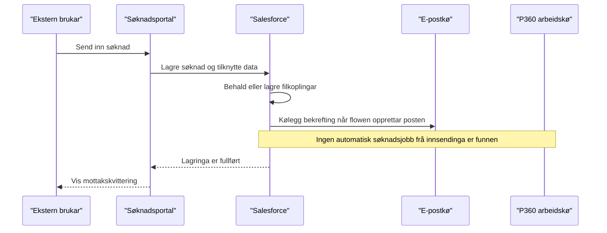

# Core Business Workflows

Aa-registeret handsamar søknader, vedtak og avtalar for tilgang til
arbeidsforholdsopplysningar. Denne avgrensa kartlegginga gjeld dei noverande
P360-relaterte flytane i Salesforce, ikkje ein ferdig integrasjon.

Detaljert kjeldegrunnlag, teststatus og gap står i
[P360-kartlegginga](../../../../../docs/integrations/p360/kartlegging-av-dagens-flytar.md).

## Domain Entities

| Entity | Service / Bounded Context | Description | Key Relationships |
| --- | --- | --- | --- |
| Søknad | Ekstern søknad | Verksemda si førespurnad om tilgang. | Knytt til tilgangsforespurnad, kontaktar og filer. |
| Tilgangsforespurnad | Aa-registeret | Samlar saksgrunnlaget for søknaden. | Kan refererast frå søknad og arkivjobbar. |
| Vedtak | Saksbehandling | Avgjerd som kan frigjevast for arkivering. | Knytt via søknad til tilgangsforespurnad. |
| Avtale | Avtaleforvaltning | Avtale om tilgang. | Kan vere kjelde for ein intern arkivjobb. |
| Arkivjobb | P360-integrasjon | Teknisk status for ei arkivhending. | Refererer til aktuell kjelde og tilgangsforespurnad. |
| Fil | Salesforce Files | Dokumentinnhald og filversjonar. | Kan lenkjast til søknad og tilgangsforespurnad. |

## Service-to-Domain Mapping

| Service | Domain Context | Owned Entities | External Dependencies |
| --- | --- | --- | --- |
| Søknadscontroller | Ekstern innsending | Søknad, kontaktar og filkoplingar | Salesforce Files og tilknytt automasjon. |
| Vedtaksguard | Vedtaksfrigiving | Vedtakssignal og intern vedtaksjobb | Feature flag, custom permission og triggerregistrering. |
| P360-jobbservice og worker | Arkivbehandling | Arkivjobb og teknisk status | Adaptergrense; reell P360-transport er ikkje implementert. |
| E-postkø | Varsling | Kølagd bekrefting | Separat e-postkø og Salesforce-utsending. |

## Primary Workflows

### Søknad og vedlegg

Brukaren lagrar utkast eller sender søknaden. Controlleren lagrar søknad og
tilgangsforespurnad, og koplar eventuelle nye filer. Utkast skal ikkje
arkiverast. Ved innsending kan ein separat flow opprette kontakt og køleggje
bekrefting. Den noverande innsendinga startar ikkje automatisk ein samla
P360-flyt for sak, søknadsdokument og eksisterande vedlegg.

Ein særskild ContentVersion-handler kan opprette ein intern vedleggsjobb ved
direkte publisering på søknaden med aktiv gate. Den faktiske portalopplastinga
brukar ei anna filkopling. Handleren sjekkar ikkje utkaststatus.

### Vedtaksfrigiving

Med aktiv gate krev frigiving særskild brukarrett. Ved oppdatering frå ikkje
frigjeve til frigjeve kan ein intern vedtaksjobb opprettast dersom vedtaket
har kopling til ei tilgangsforespurnad. Etter frigiving avgrensar guarden
ordinære endringar. Arbeidskopien dokumenterer ikkje faktisk P360-arkivering.

### Intern jobbbehandling

Jobbservice opprettar eller gjenbrukar jobbar med unik intern nøkkel.
Scheduler vel nye og tidsmodne feila jobbar; worker kontrollerer gate på
nytt og kallar vald adapter. Mock returnerer suksess utan callout. Vanleg
adapter stoppar med kontrollert exception før reell transport.

### Andre flytar

Jobbservice for avtaledokument og søknadsdokument finst, men automatiske
forretningsutløysarar er ikkje funne. Mapperar, kodeverk og DTO-ar finst,
men er ikkje kopla til workerens minimale adapterrequest.

## Cross-Service Data Flows

Søknaden og vedlegget blir lagra i Salesforce. E-postkøen er ein separat
sideeffekt frå innsendinga. P360-arbeidskøa er ei eiga intern grense; verken
portalinnsending eller mock-suksess opprettar i dagens kode ei faktisk sak
med dokument og vedlegg i P360. Ingen live SIF-integrasjon eller fallback til
reell transport er verifisert.

## Business Workflow Sequence

Dette viser dagens portalveg, ikkje ønskt framtidig arkivering.

<!-- mermaid-checked: every participant uses `participant Id as "Label"`, no \n in aliases/messages/notes, every alt/opt/loop closed by end, no `:` inside any alias -->

## Business Rules & Decision Logic

- Utkast skal ikkje arkiverast; dagens direkte filhandler kontrollerer ikkje
  denne regelen.
- Innsending set normalt søknadsstatus til `New`; rein mottakskvittering er
  ikkje bevis på arkivering.
- P360-gaten er av som metadata-standard og stansar dei kopla inngangane,
  claim og worker når ho ikkje er aktiv.
- Vedtaksfrigiving krev separat permission når gate er på.
- Intern unik nøkkel hindrar dupliserte jobbpostar for same nøkkel; ekstern
  idempotens og delvis-feil-recovery er ikkje avklart.
- Retrybare, handterte feil får avgrensa retry; andre handterte feil går til
  manuell oppfølging. Automatisk recovery for utgått lease er ikkje funnen.
- Mock er ikkje bevis på faktisk P360-sak, dokument, vedlegg eller varsling.
