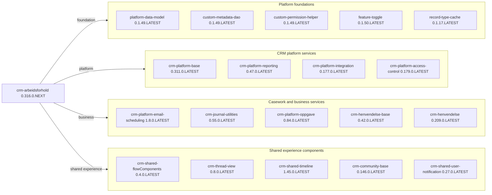

# Dependency Map

The Salesforce DX project `crm-arbeidsforhold` declares 19 direct Salesforce
package dependencies and eight direct npm development dependencies. The map
separates Salesforce package dependencies from the Node.js test and maintenance
tooling; npm packages are not Salesforce runtime packages.

## Dependencies

<!-- mermaid-checked: no \n, no em-dash/en-dash, no {} in labels, subgraphs are id["label"], arrows are -->|"label"|, all subgraphs closed by end, ids unique -->

The graph represents the 19 direct `force-app` dependencies declared in
[`sfdx-project.json`](../../../../../sfdx-project.json). Category placement is
for navigation, not a claim about runtime calls or ownership. The manifest
does not encode a BOM or parent package that centrally manages these versions.
For package relationships and dated resolved-version evidence, see the
[package overview](../../../../../docs/architecture/pakkeavhengigheiter.md).

### Dependency Summary

| Category                             |  Count | Key packages                                                                                                                | Notes                                                         |
| ------------------------------------ | -----: | --------------------------------------------------------------------------------------------------------------------------- | ------------------------------------------------------------- |
| Platform foundations                 |      5 | `platform-data-model`, `custom-metadata-dao`, `custom-permission-helper`, `feature-toggle`, `record-type-cache`             | Shared Salesforce metadata and helper packages                |
| CRM platform services                |      4 | `crm-platform-base`, `crm-platform-reporting`, `crm-platform-integration`, `crm-platform-access-control`                    | Platform capabilities consumed by product packages            |
| Casework and business services       |      5 | `crm-henvendelse-base`, `crm-henvendelse`, `crm-platform-email-scheduling`, `crm-platform-oppgave`, `crm-journal-utilities` | Domain and asynchronous service packages                      |
| Shared experience components         |      5 | `crm-community-base`, `crm-thread-view`, `crm-shared-flowComponents`, `crm-shared-timeline`, `crm-shared-user-notification` | Community, Flow, thread, timeline and notification components |
| **Total direct Salesforce packages** | **19** |                                                                                                                             | Declared under `force-app` in the project manifest            |

### Version & Compatibility Risks

All 19 direct Salesforce dependency selectors in the current manifest use a
`LATEST` suffix, so the manifest alone does not pin a reproducible resolved
package build. The dated package overview records `crm-platform-integration`
as `0.176.0.LATEST`, while the current manifest says `0.177.0.LATEST`; this is
a manifest-versus-snapshot difference, not evidence of the installed org
version. No end-of-life or CVE assessment was performed here. The exact
installed package versions remain unverified.

### Notable Observations

- The package overview has concrete product or metadata references for 8 of
  the 19 direct dependencies. The other 11 remain unresolved, not proven
  unused; see the [call-site matrix](../../../../../docs/architecture/aaregisteret-pakkekallsite-matrise.md)
  and [the follow-up source search](../../../../../docs/architecture/aaregisteret-pakkeavstemming-2026-11-14.md).
- The current manifest and the dated resolved-version snapshot differ for
  `crm-platform-integration`; preserve the old snapshot as historical evidence.
- The npm dependencies are development-only. The lockfile contains 900
  packages, all marked `dev`; this is a tooling tree, not the Salesforce
  package graph.

## Test Dependencies

All direct entries below are declared in `devDependencies` and resolved by
`package-lock.json`. The table lists direct dependencies, not all transitive
lockfile entries.

| Framework or tool           | Locked version | Notes                       |
| --------------------------- | -------------- | --------------------------- |
| `@salesforce/sfdx-lwc-jest` | `8.0.0`        | LWC Jest test runner        |
| `@sa11y/jest`               | `8.2.1`        | Jest accessibility matchers |
| `jest-canvas-mock`          | `2.5.8`        | Canvas mock used by Jest    |
| `prettier`                  | `3.9.10`       | Formatting checks           |
| `@prettier/plugin-xml`      | `3.4.2`        | XML formatting support      |
| `prettier-plugin-apex`      | `2.3.0`        | Apex formatting support     |
| `husky`                     | `9.1.7`        | Git hook management         |
| `lint-staged`               | `17.6.0`       | Staged-file validation      |

Total direct test and development dependencies: 8. The npm lockfile currently
records 900 transitive and direct packages, all marked development-only. Apex,
Flow and Salesforce runtime tests still require the Salesforce platform; Jest
does not replace those test boundaries.
