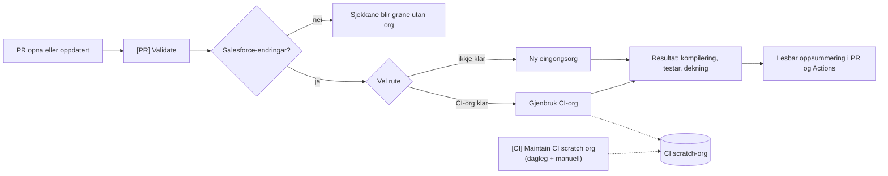
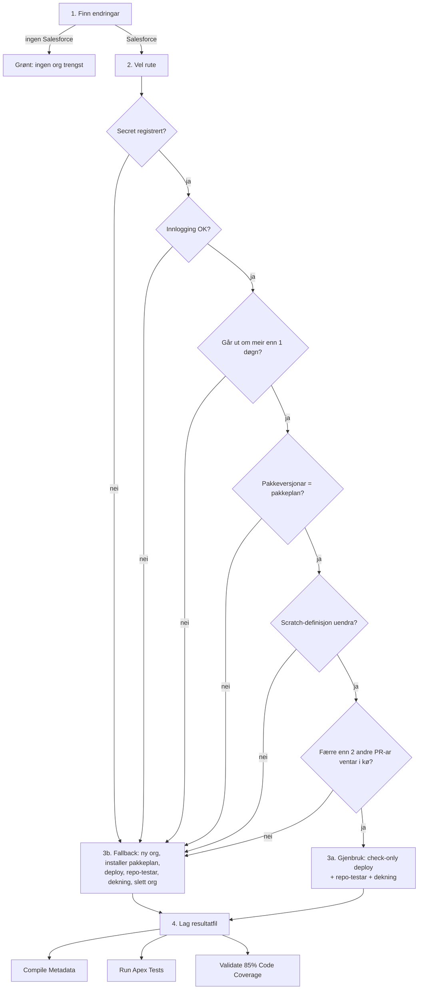
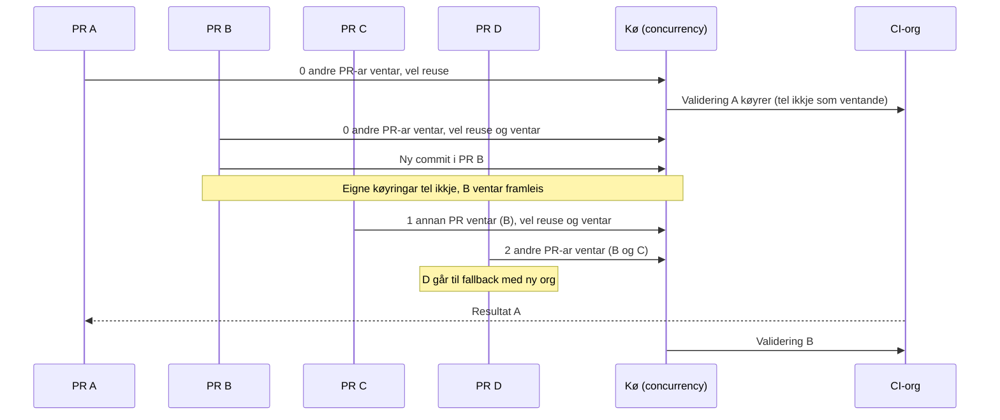
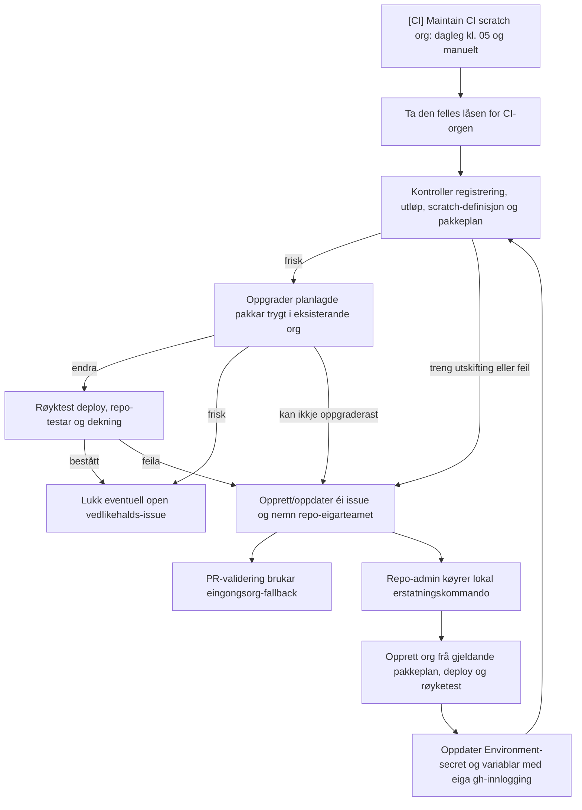

# PR-validering på gjenbrukbar scratch-org

## Problem

`[PR] Validate` lagar ein ny scratch-org for kvar PR som endrar Salesforce-kjelde,
installerer alle 19 pakkeavhengigheiter og køyrer valideringa. Det tek om lag
30 minutt per køyring, sjølv når berre éi Apex-klasse er endra.

Den parallelle piloten viste at:

- gjenbruk av ein ferdig oppsett org fungerer og vel rett rute
  (`reuse validation: CI scratch org matches the package plan.`);
- fallback til ny org fungerer (`fresh validation: Scratch configuration changed.`);
- gjenbruksruta brukte om lag 22,5 minutt mot 31 minutt for vanleg validering,
  og då inkluderte ho alle repo-testane;
- `RunSpecifiedTests` krev minst 75 % dekning **per klasse og trigger**.
  `AAREG_AdminMonitorController` feila på 72 % og vart retta i #1263;
- piloten laga mange unødvendige køyringar fordi han starta på
  `workflow_run: in_progress`, og han kravde manuell miljøgodkjenning per PR.

Piloten blir avslutta. Vi byggjer den endelege workflowen direkte.

## Ønskt resultat

Ein utviklar opnar ein PR og får **éin** Salesforce-validering som:

1. brukar den gjenbrukbare CI-orgen når han er klar, og elles lagar ny org automatisk;
2. aldri krev manuell godkjenning per PR;
3. viser i GitHub kva rute som vart valt og kvifor, kor lang tid kvart steg tok,
   og kva som eventuelt feila, utan at nokon må lese rå CLI-loggar;
4. beheld dei tre påkravde sjekknamna, slik at branch protection ikkje må endrast.

Ein repo-admin må opprette og registrere ein ny CI-org når vedlikehaldet varslar
at det trengst. Vedlikehaldsworkflowen oppgraderer pakkar når det er trygt, og
varslar eigarteamet når manuell utskifting er nødvendig. PR-valideringa fell
alltid tilbake til eingongsorg medan gjenbruksorgen manglar eller er ufrisk.

## Oversikt



## Flyt i `[PR] Validate`



Rutevalet skjer **før** nokon Salesforce-feil kan oppstå i sjølve valideringa.
Kompilerings-, test- og dekningsfeil gir aldri automatisk fallback, fordi dei
er feil i PR-en og ikkje i orgen.

## Køyring og kø



Valideringa er check-only og endrar ikkje kjelda i orgen. Køen er ein felles
lås for CI-orgen. Han hindrar at to deployar konkurrerer i same org, og at
vedlikehaldet oppgraderer pakkar eller slettar orgen medan ein PR validerer.
Fallback-ruta brukar ikkje låsen.

Når ei gjenbruksvalidering har fått låsen, kontrollerer ho tilstanden til orgen
på nytt: registrering, utløp, pakkeversjonar og fingeravtrykk. Har noko endra
seg medan ho venta, går ho til fallback før deployen startar.

Når to eller fleire **andre** PR-ar har ei køyring som **ventar** på CI-orgen,
vel nye køyringar fallback. Elles ville ventetida i køen ete opp tidsvinsten.
Køyringa som er i gang mot orgen, tel ikkje. Kvar PR tel éin gong, sjølv om han
har fleire ventande commitar, og køyringar frå same PR tel ikkje.

## Vedlikehald av CI-orgen



Vedlikehaldsworkflowen opprettar, byter eller slettar aldri scratch-orgar. Ho
brukar Dev Hub-en for å slå opp den same daglege pakkeplanen som PR-valideringa,
men bruker han ikkje til orgoppretting eller sletting. Ein lokal kommando
opprettar og røyketestar ein ny org, og oppdaterer registreringa gjennom
operatøren sin eigen GitHub CLI-token. Kommandoen kan berre køyrast av ein
aktiv medlem av `@navikt/crm-arbeidsforhold-admin` med admin-permission på
repoet. GitHub kontrollerer tilgangen på nytt når miljøverdiane blir endra.

Registreringa består av secreten `CI_SCRATCH_ORG_AUTH_URL` og variablane
`CI_SCRATCH_ORG_ID`, `CI_SCRATCH_ORG_EXPIRATION` og
`CI_SCRATCH_ORG_CONFIG_SHA256`. Variablane blir skrivne før secreten. Ved
delvis feil rullar kommandoen variablane tilbake der det er mogleg, slettar
den nye uregistrerte orgen og viser tydeleg om oppryddinga feila. PR-valideringa
brukar fallback dersom verdiane ikkje peikar på same org.

Vedlikehaldet held éi issue open medan orgen manglar, er utdatert eller ikkje
kan oppgraderast/røyketestast. Issue-en nemner repo-eigarteamet og lenkjer til
driftsguiden. Han blir lukka når vedlikehaldskontrollen er grøn. Dersom
vedlikehaldsworkflowen feilar, stoppar han ikkje PR-valideringa; fallback held
fram.

## Krav

### Ruting og fallback

- **REQ-100:** `[PR] Validate` startar éi Salesforce-validering per PR-oppdatering. Draft-PR-ar og PR-ar utan Salesforce-endringar køyrer ikkje mot org.
- **REQ-101:** Gjenbruk blir valt berre når secret finst, innlogging lukkast, orgen går ut om meir enn eitt døgn, alle 19 pakkeversjonar er nøyaktig lik pakkeplanen og fingeravtrykket til scratch-definisjonen er uendra.
- **REQ-102:** Elles blir det laga ein eingongsorg som blir sletta etter køyringa, også ved feil.
- **REQ-103:** Kompilerings-, test- og dekningsfeil gir aldri fallback.
- **REQ-104:** Gjenbruksruta brukar check-only deploy og endrar ikkje kjelda i CI-orgen.
- **REQ-106:** Gjenbruksvalideringa og muterande vedlikehald (pakkeoppgradering, sletting og byte av org) brukar den same eksklusive låsen. Etter at låsen er teken, blir tilstanden i REQ-101 kontrollert på nytt før deploy. Avvik gir fallback.
- **REQ-107:** Når secreten og dei tre variablane ikkje peikar på same org, vel ruta fallback med grunnen «registreringa er ikkje komplett». Valideringa blir ikkje avbroten.
- **REQ-105:** Når to eller fleire andre PR-ar har ei køyring som ventar på CI-orgen, vel ei ny køyring fallback. Køyringa som er i gang, tel ikkje. Kvar annan PR tel éin gong, og køyringar frå same PR tel ikkje mot grensa. Grunnen og talet på ventande PR-ar blir vist i oppsummeringa.

### Testpolicy

- **REQ-110:** Begge rutene køyrer dei same repo-testklassane, funne med `ci-scratch-plan.cjs tests`.
- **REQ-111:** Samla repo-dekning må vere minst 85 %.
- **REQ-112:** Fordi gjenbruksruta brukar `RunSpecifiedTests`, krev Salesforce minst 75 % per deploya klasse og trigger. Brot blir vist som ein eigen tabell med klasse, dekning og manglande prosentpoeng.
- **REQ-113:** Klassar og triggarar som er lagde til eller endra i PR-en og manglar dekningsdata, blir rekna som 0 % i grunnlaget for 85 %-kravet i staden for å bli utelatne. Testklassar (`@IsTest`), interface og filer i `.forceignore` blir hoppa over. Filene blir lista i oppsummeringa som «⚠️ ingen dekningsdata». Dei gir ikkje eigen stoppfeil. Åtferda blir stadfesta når workflowen blir teken i bruk; det trengst ikkje eiga verifisering i org på førehand.

### Godkjenning og tryggleik

- **REQ-120:** Ingen manuell miljøgodkjenning per PR. Miljøet `ci-scratch-org` blir behalde for secrets, utan required reviewers.
- **REQ-121:** Fork-PR-ar får ikkje tilgang til secrets og køyrer ikkje Salesforce-validering.
- **REQ-122:** Skript som tek avgjerder blir henta frå base-commiten, ikkje frå PR-en.
- **REQ-123:** Ingen secrets, auth-URL-ar, brukarnamn, org-ID-ar eller testdata med persondata blir skrivne til oppsummering, annotasjonar eller artefakt.

### Lesbar output

- **REQ-130:** Kvar køyring skriv ei oppsummering øvst med rute, grunngjeving, org-utløp, tid per steg og samla resultat.
- **REQ-131:** `Compile Metadata` viser kompileringsfeil som tabell: komponent, type, linje og melding.
- **REQ-132:** `Run Apex Tests` viser tal på testar, beståtte, feila og tid, og ein tabell over feila testar med klasse, metode og første linje av feilmeldinga.
- **REQ-133:** `Validate 85% Code Coverage` viser samla dekning mot krav og dei ti klassane med lågast dekning, og eventuelle klassar under 75 %.
- **REQ-134:** Feil blir òg sende som GitHub-annotasjonar (`::error file=…,line=…::`), slik at dei synest i PR-diffen.
- **REQ-135:** Status blir vist med både ikon og tekst (`✅ Bestått`, `❌ Feila`, `⏭️ Hoppa over`), slik at han ikkje er avhengig av farge.
- **REQ-136:** Rå CLI-JSON blir ikkje skriven til loggen. Han blir lagra som artefakt med 7 dagars levetid, utan identitetsfelt.

### Vedlikehald

- **REQ-140:** `[CI] Maintain CI scratch org` køyrer dagleg og manuelt frå `main`, og deler eksklusiv concurrency-lås med PR-gjenbruksvalideringa.
- **REQ-141:** Vedlikehaldet kontrollerer komplett registrering, autentisering, org-identitet, utløp, scratch-konfigurasjonsfingeravtrykk og installerte pakkar. Manglande/ugyldig registrering, utløp innan sju døgn, endra scratch-konfigurasjon eller uverifiserbar org krev eigaroppfølging.
- **REQ-142:** Vedlikehaldsworkflowen opprettar, registrerer, byter eller slettar ikkje scratch-orgar. Vedlikehaldsfeil stoppar ikkje PR-valideringa.
- **REQ-143:** Vedlikehaldet slår opp same pakkeplan som dagleg CI. Planlagde pakkeversjonar blir oppgraderte i eksisterande org når det er trygt. Uventa pakkar, mislukka oppgradering eller mislukka røyketest krev manuell utskifting.
- **REQ-144:** Vedlikehaldet viser kontrollresultat, årsak til eventuell utskifting og pakkeendringar i Actions-oppsummeringa.
- **REQ-145:** Når orgen krev eigaroppfølging eller vedlikehaldet ikkje kan verifisere orgtilstanden, opprettar eller oppdaterer vedlikehaldet éi open issue med årsak, lenke til driftsguiden og mention av `@navikt/crm-arbeidsforhold-admin`. Issue-en blir lukka når kontrollane er grøne og orgen samsvarar med pakkeplanen.
- **REQ-146:** Lokal erstatningskommando krev aktivt medlemskap i `@navikt/crm-arbeidsforhold-admin`, repo-admin-permission, eksplisitt Dev Hub-alias og interaktiv stadfesting før Salesforce blir kontakta. Han opprettar 30-dagars org, installerer gjeldande pakkeplan, deployer `force-app`, køyrer repo-testar og handhevar 85 % dekning før registrering.
- **REQ-147:** Etter grøn røyketest oppdaterer kommandoen `CI_SCRATCH_ORG_ID`, `CI_SCRATCH_ORG_EXPIRATION`, `CI_SCRATCH_ORG_CONFIG_SHA256` og `CI_SCRATCH_ORG_AUTH_URL` i `ci-scratch-org` med operatøren sin `gh`-innlogging. Auth-URL blir send via stdin og aldri vist eller lagra i repo/artifact. Variablane blir skrivne før secreten; ved feil blir tidlegare variabelverdiar gjenoppretta der det er mogleg. Dersom Environment-oppdateringa startar men feilar, blir den nye orgen verande for inspeksjon fordi GitHub kan ha akseptert ei secret-endring sjølv om CLI-en rapporterer feil. Feil før registreringssteget slettar kandidaten.
- **REQ-148:** GitHub App for Environment-secret-skriving blir ikkje teken i bruk no. Ho kan vurderast som valfri automatisering seinare.
- **REQ-149:** Eksisterande org blir ikkje sletta før ny org er verifisert og registrert. PR-valideringa fell tilbake til eingongsorg når registreringa er ufullstendig.

### Opprydding

- **REQ-150:** `ci-reusable-pr-pilot.yml`, pilotdelane av `ci-pr-pilot.cjs` og pilotartefakta blir fjerna.
- **REQ-151:** Avhengigheita til `navikt/crm-workflows-base/.github/workflows/validate.yml` i `salesforce-validation.yml` blir fjerna.
- **REQ-152:** `docs/operations/workflows.md` og `docs/operations/reusable-scratch-org-validation.md` blir oppdaterte. Pilotsteg 8–10 blir arkiverte.

## Eksempel på oppsummering

```text
## Salesforce-validering for PR #1234

| Steg                    | Status       | Tid    |
|-------------------------|--------------|--------|
| Rute                    | ♻️ Gjenbruk  | 0:12   |
| Kompilering             | ✅ Bestått   | 6:40   |
| Apex-testar (480)       | ❌ 2 feila   | 14:05  |
| Dekning                 | ⏭️ Ikkje vurdert | –  |

Rute: gjenbruk – CI-org samsvarar med pakkeplanen (19/19), går ut 2026-12-07.

### Feila testar
| Klasse                     | Metode                         | Feil                          |
|----------------------------|--------------------------------|-------------------------------|
| AAREG_ApplicationControllerTest | submitsApplicationWithAttachments | System.AssertException: Expected 2, actual 1 |
```

## Testseam

- Ruting, testutval, dekningsvurdering og oppsummeringsformat: Node-testar i `scripts/tests/` med fiktive CLI-resultat. Køyrast med `npm run test:node`.
- Workflow-kontraktar (sjekknamn, rekkjefølgje, permissions, ingen `secrets: inherit` til tredjepart): eksisterande `ci-workflows.test.cjs`.
- Faktisk org-åtferd: éin forkastbar test-PR per rute etter merge. Dei er ikkje ein del av lokal validering.

## Avgjerder

| Avgjerd | Val | Grunn |
|---|---|---|
| Pilot | Blir avslutta | Rutene er demonstrerte. Vidare pilot gir støy og ventetid. |
| Sjekknamn | Uendra | Branch protection treng ikkje endrast. |
| Testnivå | Repo-testar (`RunSpecifiedTests`) | Pakketestar blir ikkje køyrde på nytt. 75 %-kravet per klasse er akseptert. |
| Godkjenning | Ingen per PR | Dagens påkravde validering har allereie Dev Hub-secret utan godkjenning. Gjenbruks-secreten gir tilgang berre til ein scratch-org. |
| Vedlikehald av CI-org | Varsel og lokal erstatning av repo-admin | Orgoppretting og Environment-skriving blir utført med eigen Salesforce- og GitHub-innlogging av eigarteamet, ikkje av Actions-tokenet. |
| Kø-grense | Fallback ved 2 eller fleire andre PR-ar i kø | Lang kø et opp tidsvinsten. Commitar i same PR tel ikkje. |
| Dekning for endra filer utan data | Tel som 0 %, ingen eigen stoppfeil | Tettar holet for utesta nye klassar utan falske positive for interface og liknande. |

## Tryggleik og data

- Dev Hub-secreten `CRM_PROD_SFDX_URL` gir tilgang til ein produksjonstilknytt Dev Hub. Vedlikehaldet nyttar han for pakkeplan-oppslag; det opprettar eller slettar ikkje orgar. Lokal eigarhandling opprettar ny scratch-org frå eksplisitt Dev Hub-alias. Agentar autentiserer ikkje mot Dev Hub.
- CI-orgen inneheld berre syntetiske testdata.
- Endringa rører CI og auth og krev menneskeleg review og security-review før merge.

## Utanfor scope

- Snapshots og scratch-org-pool.
- Endring av LWC-, dokumentasjons- og pakkeworkflowar.
- Parallell bruk av fleire CI-orgar.

## Avklarte spørsmål

1. GitHub App for automatisk oppdatering av secreten blir ikkje teken i bruk no. Det er eit valfritt steg seinare (REQ-148).
2. Køyringa går til fallback når to eller fleire andre PR-ar ventar i kø for CI-orgen. Køyringa som er i gang, og fleire køyringar i same PR tel ikkje (REQ-105).
3. Eigarteamet opprettar og registrerer ny org lokalt med eige `sf`/`gh`-oppsett; CI opprettar ikkje kandidatar eller skriv Environment-secrets (REQ-142, REQ-146, REQ-147).
