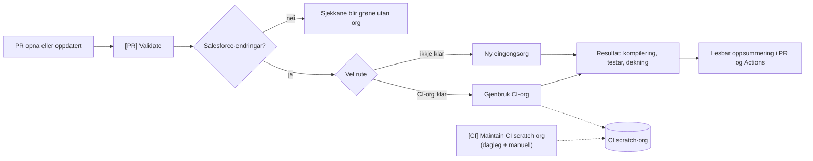
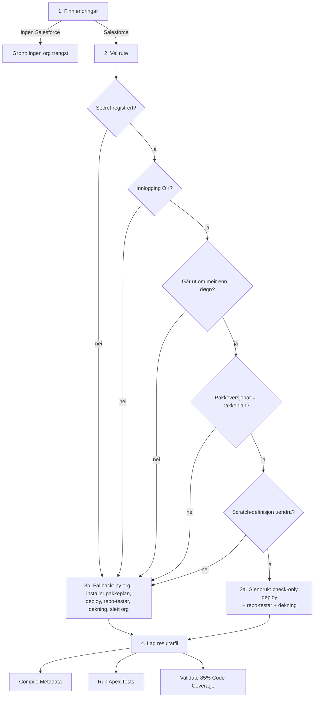
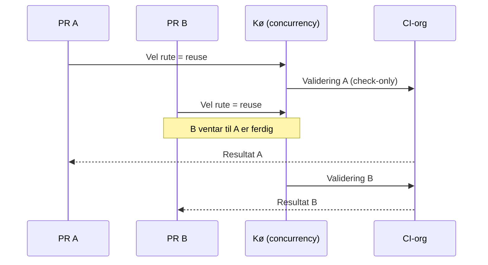
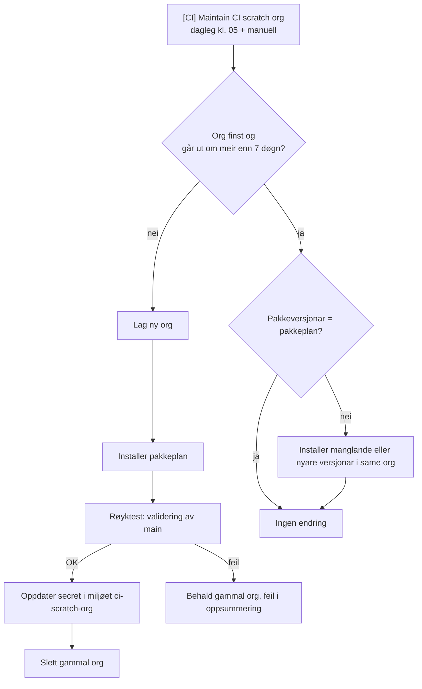

# PR-validering på gjenbrukbar scratch-org

## Problem

`[PR] Validate` lagar ein ny scratch-org for kvar PR som endrar Salesforce-kjelde,
installerer alle 19 pakkeavhengigheiter og køyrer valideringa. Det tek om lag
30 minutt per køyring, sjølv når berre éi Apex-klasse er endra.

Den parallelle piloten viste at:

- gjenbruk av ein ferdig oppsett org fungerer og vel rett rute
  (`reuse validation: CI scratch org matches the package plan.`);
- fallback til ny org fungerer (`fresh validation: Scratch configuration changed.`);
- gjenbruksruta brukte om lag 22,5 minutt mot 31 minutt for vanleg validering,
  og då inkluderte ho alle repo-testane;
- `RunSpecifiedTests` krev minst 75 % dekning **per klasse og trigger**.
  `AAREG_AdminMonitorController` feila på 72 % og vart retta i #1263;
- piloten laga mange unødvendige køyringar fordi han starta på
  `workflow_run: in_progress`, og han kravde manuell miljøgodkjenning per PR.

Piloten blir avslutta. Vi byggjer den endelege workflowen direkte.

## Ønskt resultat

Ein utviklar opnar ein PR og får **éin** Salesforce-validering som:

1. brukar den gjenbrukbare CI-orgen når han er klar, og elles lagar ny org automatisk;
2. aldri krev manuell godkjenning per PR;
3. viser i GitHub kva rute som vart valt og kvifor, kor lang tid kvart steg tok,
   og kva som eventuelt feila, utan at nokon må lese rå CLI-loggar;
4. beheld dei tre påkravde sjekknamna, slik at branch protection ikkje må endrast.

Ingen må manuelt opprette eller oppdatere CI-orgen. Ein planlagd workflow held
han frisk og på rett pakkeversjon.

## Oversikt



## Flyt i `[PR] Validate`



Rutevalet skjer **før** nokon Salesforce-feil kan oppstå i sjølve valideringa.
Kompilerings-, test- og dekningsfeil gir aldri automatisk fallback, fordi dei
er feil i PR-en og ikkje i orgen.

## Køyring og kø



Valideringa er check-only og endrar ikkje kjelda i orgen. Køen hindrar at to
deployar konkurrerer i same org. Fallback-ruta brukar ikkje køen.

## Vedlikehald av CI-orgen



Ein feil i vedlikehaldet stoppar ikkje PR-ar. Dei går til fallback til orgen er
frisk igjen.

## Krav

### Ruting og fallback

- **REQ-100:** `[PR] Validate` startar éi Salesforce-validering per PR-oppdatering. Draft-PR-ar og PR-ar utan Salesforce-endringar køyrer ikkje mot org.
- **REQ-101:** Gjenbruk blir valt berre når secret finst, innlogging lukkast, orgen går ut om meir enn eitt døgn, alle 19 pakkeversjonar er nøyaktig lik pakkeplanen og fingeravtrykket til scratch-definisjonen er uendra.
- **REQ-102:** Elles blir det laga ein eingongsorg som blir sletta etter køyringa, også ved feil.
- **REQ-103:** Kompilerings-, test- og dekningsfeil gir aldri fallback.
- **REQ-104:** Gjenbruksruta brukar check-only deploy og endrar ikkje kjelda i CI-orgen.

### Testpolicy

- **REQ-110:** Begge rutene køyrer dei same repo-testklassane, funne med `ci-scratch-plan.cjs tests`.
- **REQ-111:** Samla repo-dekning må vere minst 85 %.
- **REQ-112:** Fordi gjenbruksruta brukar `RunSpecifiedTests`, krev Salesforce minst 75 % per deploya klasse og trigger. Brot blir vist som ein eigen tabell med klasse, dekning og manglande prosentpoeng.

### Godkjenning og tryggleik

- **REQ-120:** Ingen manuell miljøgodkjenning per PR. Miljøet `ci-scratch-org` blir behalde for secrets, utan required reviewers.
- **REQ-121:** Fork-PR-ar får ikkje tilgang til secrets og køyrer ikkje Salesforce-validering.
- **REQ-122:** Skript som tek avgjerder blir henta frå base-commiten, ikkje frå PR-en.
- **REQ-123:** Ingen secrets, auth-URL-ar, brukarnamn, org-ID-ar eller testdata med persondata blir skrivne til oppsummering, annotasjonar eller artefakt.

### Lesbar output

- **REQ-130:** Kvar køyring skriv ei oppsummering øvst med rute, grunngjeving, org-utløp, tid per steg og samla resultat.
- **REQ-131:** `Compile Metadata` viser kompileringsfeil som tabell: komponent, type, linje og melding.
- **REQ-132:** `Run Apex Tests` viser tal på testar, beståtte, feila og tid, og ein tabell over feila testar med klasse, metode og første linje av feilmeldinga.
- **REQ-133:** `Validate 85% Code Coverage` viser samla dekning mot krav og dei ti klassane med lågast dekning, og eventuelle klassar under 75 %.
- **REQ-134:** Feil blir òg sende som GitHub-annotasjonar (`::error file=…,line=…::`), slik at dei synest i PR-diffen.
- **REQ-135:** Status blir vist med både ikon og tekst (`✅ Bestått`, `❌ Feila`, `⏭️ Hoppa over`), slik at han ikkje er avhengig av farge.
- **REQ-136:** Rå CLI-JSON blir ikkje skriven til loggen. Han blir lagra som artefakt med 7 dagars levetid, utan identitetsfelt.

### Vedlikehald

- **REQ-140:** `[CI] Maintain CI scratch org` køyrer dagleg og manuelt.
- **REQ-141:** Orgen blir fornya når han går ut om sju døgn eller mindre, eller manglar.
- **REQ-142:** Ny org blir teken i bruk berre etter at røyktesten mot `main` er grøn.
- **REQ-143:** Avvik i pakkeversjonar blir retta i same org når det er mogleg. Elles blir orgen fornya.
- **REQ-144:** Vedlikehaldet viser same type oppsummering: tilstand før og etter, pakkar endra og utløpsdato.

### Opprydding

- **REQ-150:** `ci-reusable-pr-pilot.yml`, pilotdelane av `ci-pr-pilot.cjs` og pilotartefakta blir fjerna.
- **REQ-151:** Avhengigheita til `navikt/crm-workflows-base/.github/workflows/validate.yml` i `salesforce-validation.yml` blir fjerna.
- **REQ-152:** `docs/operations/workflows.md` og `docs/operations/reusable-scratch-org-validation.md` blir oppdaterte. Pilotsteg 8–10 blir arkiverte.

## Eksempel på oppsummering

```text
## Salesforce-validering for PR #1234

| Steg                    | Status       | Tid    |
|-------------------------|--------------|--------|
| Rute                    | ♻️ Gjenbruk  | 0:12   |
| Kompilering             | ✅ Bestått   | 6:40   |
| Apex-testar (480)       | ❌ 2 feila   | 14:05  |
| Dekning                 | ⏭️ Ikkje vurdert | –  |

Rute: gjenbruk – CI-org samsvarar med pakkeplanen (19/19), går ut 2026-12-07.

### Feila testar
| Klasse                     | Metode                         | Feil                          |
|----------------------------|--------------------------------|-------------------------------|
| AAREG_ApplicationControllerTest | submitsApplicationWithAttachments | System.AssertException: Expected 2, actual 1 |
```

## Testseam

- Ruting, testutval, dekningsvurdering og oppsummeringsformat: Node-testar i `scripts/tests/` med fiktive CLI-resultat. Køyrast med `npm run test:node`.
- Workflow-kontraktar (sjekknamn, rekkjefølgje, permissions, ingen `secrets: inherit` til tredjepart): eksisterande `ci-workflows.test.cjs`.
- Faktisk org-åtferd: éin forkastbar test-PR per rute etter merge. Dei er ikkje ein del av lokal validering.

## Avgjerder

| Avgjerd | Val | Grunn |
|---|---|---|
| Pilot | Blir avslutta | Rutene er demonstrerte. Vidare pilot gir støy og ventetid. |
| Sjekknamn | Uendra | Branch protection treng ikkje endrast. |
| Testnivå | Repo-testar (`RunSpecifiedTests`) | Pakketestar blir ikkje køyrde på nytt. 75 %-kravet per klasse er akseptert. |
| Godkjenning | Ingen per PR | Dagens påkravde validering har allereie Dev Hub-secret utan godkjenning. Gjenbruks-secreten gir tilgang berre til ein scratch-org. |
| Fornying av secret | GitHub App med `secrets: write` på miljøet | Krevst for full automatisering. Til appen finst, fornyar ein person med éin manuell køyring. |

## Tryggleik og data

- Dev Hub-secreten `CRM_PROD_SFDX_URL` gir tilgang til ein produksjonstilknytt Dev Hub. Han blir brukt berre til å lage og slette scratch-orgar, slik som i dag. Agentar køyrer ikkje desse stega.
- CI-orgen inneheld berre syntetiske testdata.
- Endringa rører CI og auth og krev menneskeleg review og security-review før merge.

## Utanfor scope

- Snapshots og scratch-org-pool.
- Endring av LWC-, dokumentasjons- og pakkeworkflowar.
- Parallell bruk av fleire CI-orgar.

## Opne spørsmål

1. Skal ein GitHub App opprettast for automatisk oppdatering av secreten (REQ-141), eller held det med varsel og manuell køyring?
2. Skal køyringa gå til fallback når køen for CI-orgen er lengre enn ein grense, til dømes to ventande køyringar?
