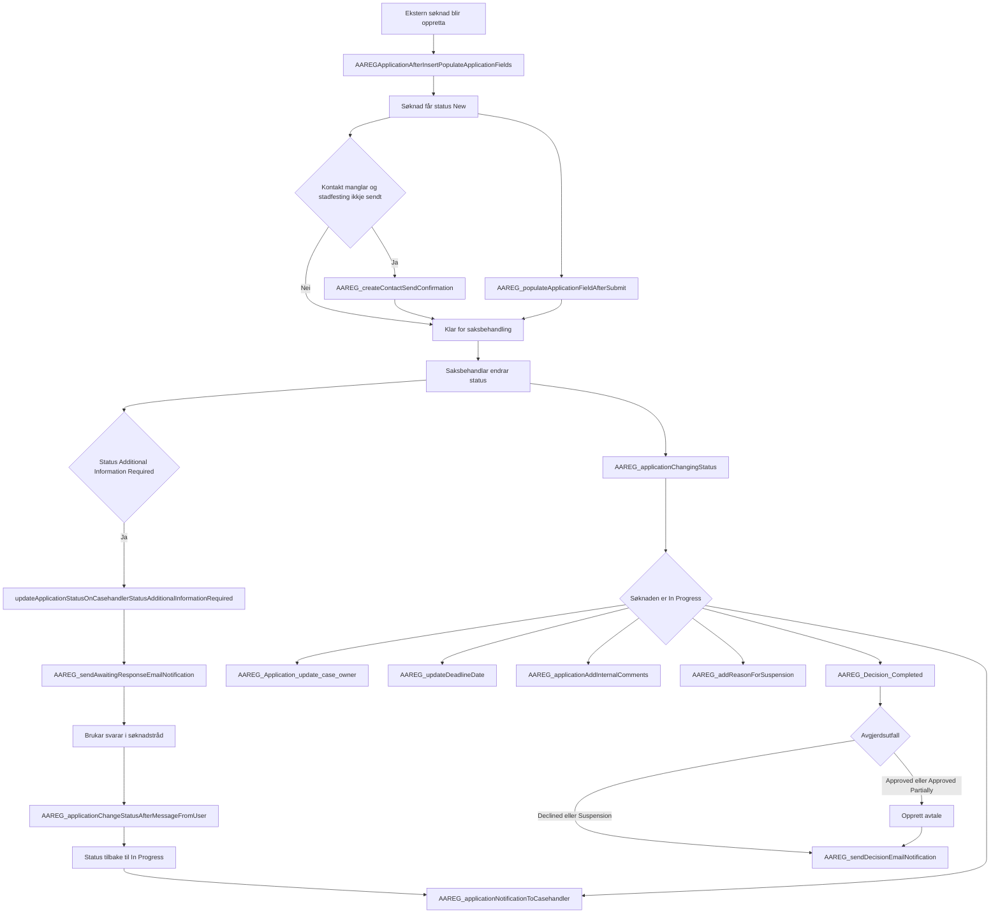
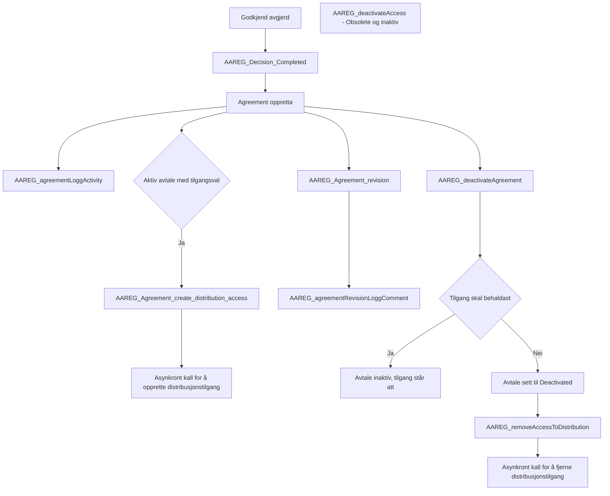
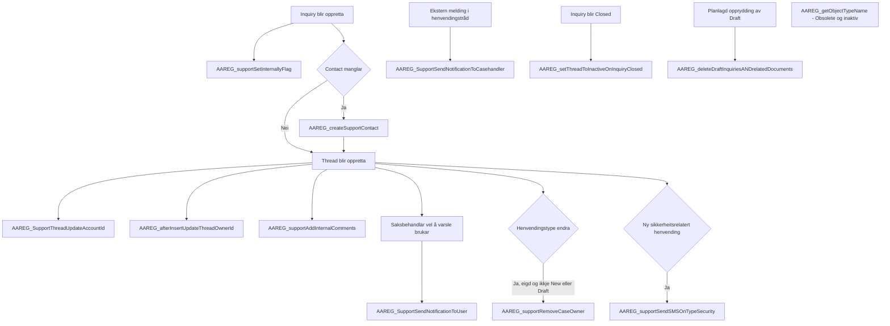
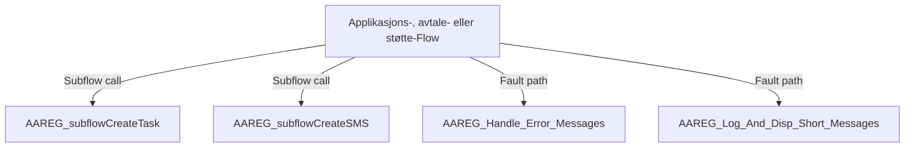
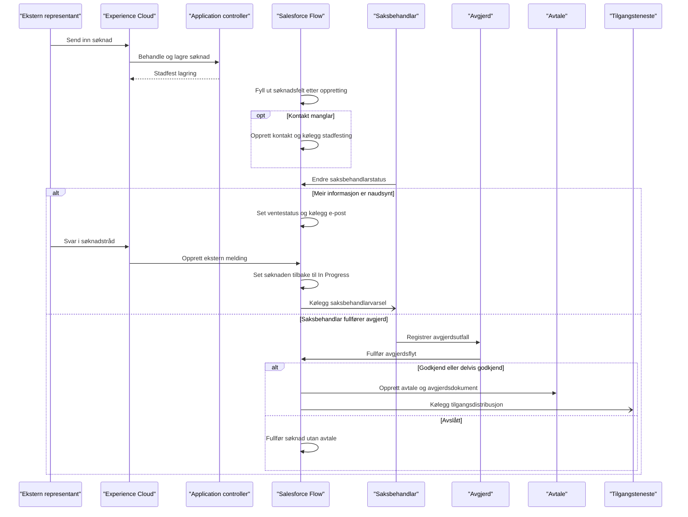

# Grupperte Flow-diagram for Arbeidsforhold / Aa-registeret

Diagramma samlar dei 37 Flow-definisjonane i fire forretningsområde. Dei utfyller [Flow-katalogen](./aareg-flow-katalog.md), som dokumenterer kvar Flow med inngang, sideeffektar og feilbaner.

## Les guide

- Boksar med Flow API-namn viser konkrete Flow-definisjonar.
- Piler viser forretningsmessig samanheng eller record-hending; dei betyr ikkje nødvendigvis at éin Flow kallar den neste.
- Berre piler merkte `Subflow call` viser direkte gjenbruk av subflow.
- `Obsolete`-flytar er viste for å synleggjere historisk kjeldeinnhald, ikkje som aktive baner.
- Kjelda stadfestar struktur og startvilkår; diagramma stadfestar ikkje at kvar handling køyrer feilfritt i org.

## 1. Søknad, saksbehandling og avgjerd

## 2. Avtale og distribusjonstilgang

## 3. Henvending, tråd og støtte

## 4. Delte subflows og feilhandsaming

## Ende-til-ende-sekvens: søknad til avgjerd

Sekvensen viser hovudbana frå innsending til avgjerd. P360-arkivering er ikkje del av denne Flow-bana; sjå den separate [P360-kartlegginga](../integrations/p360/kartlegging-av-dagens-flytar.md).

<!-- mermaid-checked: every participant uses `participant Id as "Label"`, no \n in aliases/messages/notes, every alt/opt/loop closed by end, no `:` inside any alias -->

## Avgrensingar

- Flow-diagramma viser samla forretningsområde, ikkje Salesforce sin fullstendige interne elementgraf for kvar Flow.
- Skjermflytane sine konkrete Lightning Action-/sidebindingar må verifiserast separat.
- Varsling som blir kølagd er ikkje det same som levert e-post eller SMS.
- Fullført Flow/Apex-handling er ikkje bevis på at distribusjonstilgang vart oppretta eller fjerna eksternt.
- Den godkjende org-inventeringa fann 35 aktive og to inaktive Flow-definisjonar. Ingen Flow vart køyrd funksjonelt i denne diagramgjennomgangen.
