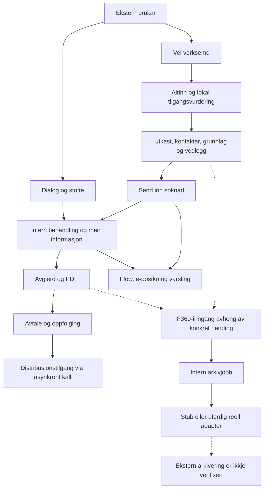

# Arbeidsforhold / Aa-registeret: start her

**Status:** samlande inngang til ei dokumentasjonspakke under arbeid.
**Samanstilt:** 2026-11-14. Dette er ikkje endeleg sign-off eller fersk
org-verifikasjon.

Løysinga lèt verksemder søkje om tilgang til Aa-registeret og følgje søknader,
avtalar og dialog. Interne saksbehandlarar behandlar søknader, fattar avgjerder
og følgjer opp avtalar. Salesforce lagrar arbeidsgrunnlaget; Altinn,
distribusjonstenesta, varsling og P360 har eigne kontrakts- og driftsgrenser.

## Leserekkjefølgje

| Behov                                     | Startpunkt                                                                                                                                    | Kva dokumentet ikkje beviser                                   |
| ----------------------------------------- | --------------------------------------------------------------------------------------------------------------------------------------------- | -------------------------------------------------------------- |
| Produkt, språk og eigarskap               | [CONTEXT](../../CONTEXT.md), [heile løysinga](hele-loysinga.md)                                                                               | Godkjend fasit for kvart forretningsscenario                   |
| Brukarhandling til implementasjon og data | [Kjeldekart og teststrategi](arbeidsforhold-kjeldekart-og-teststrategi.md)                                                                    | Fullført test eller komplett tilgangsverifikasjon              |
| Kjeldestruktur og produktområde           | [Kjeldeinventar](aaregisteret-kjeldeinventar.md)                                                                                              | Runtime-bruk ut frå talet på filer                             |
| Dei 19 direkte dependencies               | [Pakkekallsite-matrise](aaregisteret-pakkekallsite-matrise.md), [pakkeoversikt](pakkeavhengigheiter.md)                                       | At lokal pakkekjelde er identisk med installert versjon        |
| Alle 37 lokale Flow-definisjonar          | [Flow-katalog](aareg-flow-katalog.md), [Flow-diagram](aareg-flow-diagrammer.md)                                                               | Faktisk køyring, UI-binding eller identisk metadata-body i org |
| Datert org-inventar                       | [Snapshot 2026-11-14](aaregisteret-scratch-org-snapshot-2026-11-14.md), [Flow-avstemming](aareg-flow-org-source-reconciliation-2026-11-14.md) | At tilstanden framleis gjeld når neste test startar            |
| P360 først                                | [Inngangar, sideeffektar og verifikasjonsplan](../integrations/p360/inngangar-og-verifikasjonsplan.md)                                        | Live arkivering eller avklart produktkontrakt                  |
| P360 sine fem grunnscenario               | [Scenario og testdekning](../integrations/p360/scenario-testdekning.md)                                                                       | At testkjelde eller historiske tal er ei ny bestått køyring    |
| P360 sine faktiske testobservasjonar      | [Kronologisk testlogg](../integrations/p360/test-log.md)                                                                                      | At eldre mellomstatus overstyrer seinare observasjonar         |
| Arkitekturval og styring                  | [ADR-oversikt](../adr/README.md), [dokumentasjonsarbeidsflyt](../arbeidsflyt-og-dokumentasjon.md)                                             | At ein føreslått ADR er vedteken                               |
| Attståande arbeid                         | [Spec](../../.github/specs/helhetleg-gjennomgang-aaregisteret.md), [gjennomføringsplan](helhetleg-gjennomgang-plan.md)                        | At uendra sjekklister uttrykkjer all seinare framdrift         |

Denne inngangen erstattar ikkje Confluence, historiske Jira-eksportar,
eksisterande integrasjonsguider eller operative runbooks. Eksisterande tekst
er ikkje flytta, sletta eller skriven om i denne samanstillinga.

For Altinn sine tilgangslag, S04-matrise og konkrete UI-bindingar, les
[ressursavgjerd til produktrespons og brukarflate](../integrations/altinn/tilgangskjede-og-scenario.md).
Analysen skil kjeldeforankra navigasjon frå effektiv autorisasjon og har
fersk lokal Jest-evidens utan Salesforce-/Altinn-kall.

## Samanhengande produktreise

Diagrammet summerer kjeldekartet, ikkje ei verifisert org-køyring. P360 er
teikna som ein separat, ufullført integrasjonsveg: innsending eller ei fil i
Salesforce er ikkje bevis på oppretta arkivsak.

### Sentrale data og ansvar

| Område                       | Data / ansvar                                                                              | Detaljkjelde                                                                                     |
| ---------------------------- | ------------------------------------------------------------------------------------------ | ------------------------------------------------------------------------------------------------ |
| Verksemd og tilgangsgrunnlag | `Account`, `Access_Request__c`; ikkje det same som effektiv brukarautorisasjon             | [Datagraf og aktørmatrise](arbeidsforhold-kjeldekart-og-teststrategi.md)                         |
| Søknad                       | `Application__c`, grunnlagskodar, relaterte kontaktar og Salesforce Files                  | [Søknadscontroller](../../force-app/externalApplication/classes/AAREG_ApplicationController.cls) |
| Avgjerd og avtale            | `Application_Decision__c`, avgjerdsdetaljar og `Agreement__c`                              | [Flow-katalog](aareg-flow-katalog.md)                                                            |
| Dialog                       | `Inquiry__c`, `Thread__c`, `Message__c`, eigarskap og filkoplingar                         | [Dialogkjeda](arbeidsforhold-kjeldekart-og-teststrategi.md)                                      |
| Arkivreferansar              | Saksreferanse på tilgangsførespurnad; dokument-/filreferansar på søknad, avgjerd og avtale | [P360-datamodell](p360-data-model-og-arkiveringsjob.md)                                          |
| Jobbstatus                   | `P360_Archive_Job__c` uttrykkjer lokal behandling, ikkje åleine ekstern leveranse          | [P360-verifikasjonsplan](../integrations/p360/inngangar-og-verifikasjonsplan.md)                 |

Team Arbeidsforhold eig produktet/repoet. GitHub-teamet
`@navikt/crm-arbeidsforhold` er bidragsytarar/reviewarar. Dependency-kjelder er
lesegrunnlag, ikkje fritt redigerbare produktfiler. Team Platforce har dei
særskilde produksjonsoppgåvene som er definerte i [AGENTS](../../AGENTS.md).

## Slik skal evidens lesast

- **Kjeldeanalyse:** påstand om det undersøkt kode/metadata seier. Ikkje PASS.
- **Køyrd test:** krev dato, eksakt kommando, resultat og testomfang.
- **Org-observasjon:** gjeld oppgitt mål, tidspunkt, query eller UI-handling;
  namn/versjon/teljing er ikkje åtferdsbevis.
- **Historisk eller brukarrapportert:** bevar proveniens og avgrensing;
  ikkje oppgrader til uavhengig verifisert.
- **Ope spørsmål:** krev eigaravgjerd før det blir akseptansefasit.
- **NOT RUN / BLOCKED:** høvesvis ikkje utført eller hindra av ein konkret
  manglande føresetnad. Ingen av delane betyr PASS eller produktfeil.

Per dokumentert avstemming 2026-11-14 er **37/37 Flow-namn** matcha,
med 35 aktive versjonar og to utan aktiv versjon. Dette er ikkje 37 beståtte
Flow-testar. Pakkematrisa har **8/19 direkte produkt-/metadatareferansar**
kartlagde; dei andre 11 er uavklarte, ikkje ubrukte. Det nye
[P360-kartet](../integrations/p360/inngangar-og-verifikasjonsplan.md)
legg til ei indirekte avhengnad til `custom-permission-helper`, ikkje eit
niande direkte produktkall.

## Prioritert vidare arbeid og ansvar

| Prioritet                 | Neste leveranse / avgjerd                                                                                                 | Sporing                                                                                                                                                                                                          |
| ------------------------- | ------------------------------------------------------------------------------------------------------------------------- | ---------------------------------------------------------------------------------------------------------------------------------------------------------------------------------------------------------------- |
| Før ny P360-test          | Bruk avklart innsending og komplett nytt sett; avklar filversjonsutval, innsendingsidentitet og godkjend testisolering    | [P360-roadmap](https://github.com/navikt/crm-arbeidsforhold/issues/1095), [mapping](https://github.com/navikt/crm-arbeidsforhold/issues/1016), [filer](https://github.com/navikt/crm-arbeidsforhold/issues/1018) |
| Før replay/recovery       | Avklar release medan flagget er av, samtidige claim og utgått lease                                                       | [Retry/recovery](https://github.com/navikt/crm-arbeidsforhold/issues/1015)                                                                                                                                       |
| Før full scenariodekning  | Avklar ALT-02: rå ressursavgjerd mot produktets aggregerte tilgang; utvid kvar brukar-/systemreise med steg og assertions | [Scenario](https://github.com/navikt/crm-arbeidsforhold/issues/1180), [testdata/testplan](https://github.com/navikt/crm-arbeidsforhold/issues/1181)                                                              |
| Før dependency-konklusjon | Fullfør dei 11 uavklarte pakkane, dynamiske metadatareferansar og versjonslineage                                         | [Kjelde/dependencies](https://github.com/navikt/crm-arbeidsforhold/issues/1185)                                                                                                                                  |
| Før runtime-konklusjon    | Samanlikn Flow-body, UI-binding og effektiv rolle-/record-/filtilgang; ikkje bruk assignment-teljing som tilgangstest     | [Org-verifikasjon](https://github.com/navikt/crm-arbeidsforhold/issues/1182)                                                                                                                                     |
| Før opprydding            | Klassifiser overlapp og historikk, avklar eigar, ta originalkopi og kontroller lenker/rollback før godkjend endring       | [Funn/opprydding](https://github.com/navikt/crm-arbeidsforhold/issues/1184)                                                                                                                                      |
| Før ferdigmelding         | Samla kravdekning, lokal dokumentvalidering og menneskeleg sign-off                                                       | [Dokumentasjonspakke](https://github.com/navikt/crm-arbeidsforhold/issues/1183), [hovudsak](https://github.com/navikt/crm-arbeidsforhold/issues/1179)                                                            |

Ingen av desse sakene er lukka som følgje av denne inngangssida. Samla
testdatastrategi og stegvis dekning for alle scenario står framleis att;
P360-dokumenta er første prioriterte del, ikkje erstatning for resten.

### Produktavklaring etter første dokumentutkast

Brukaren stadfesta 2026-11-14 arkivering **ved innsending**, med søknaden og
alle tilhøyrande vedlegg, også frå utkast. Ved ny innsending etter krav om
meir informasjon skal eit **komplett nytt dokumentsett** arkiverast.
Konkret filversjonsutval, innsendingsidentitet og teknisk recovery står att.
[P360-planen](../integrations/p360/inngangar-og-verifikasjonsplan.md)
har oppdaterte P02-A/B-kriterium og nytt P02-D-scenario. Ingen implementasjon
eller runtime-resultat følgjer av produktavklaringa.

## Lokal dokumentvalidering 2026-11-14

| Kontroll                                                                                                                                                                                     | Resultat                                                                                                                                    | Avgrensing                                                                                 |
| -------------------------------------------------------------------------------------------------------------------------------------------------------------------------------------------- | ------------------------------------------------------------------------------------------------------------------------------------------- | ------------------------------------------------------------------------------------------ |
| `npx --no-install prettier --check docs/architecture/aaregisteret-handbok.md docs/integrations/p360/inngangar-og-verifikasjonsplan.md docs/integrations/altinn/tilgangskjede-og-scenario.md` | PASS                                                                                                                                        | Berre dei tre nye dokumenta                                                                |
| `git diff --check`                                                                                                                                                                           | PASS                                                                                                                                        | Kontrollerer spora diffar, ikkje dei nye untracked-filene                                  |
| Lokal Node-kontroll av Markdown-lenkjer                                                                                                                                                      | PASS: 73 lokale lenkjer, inkludert mål for overskrifts- og linjeanker; nye filer utan trailing whitespace                                   | Ingen nettverkskontroll av GitHub-lenkjer; ikkje semantisk kontroll av kvart linjeanker    |
| Diagramstruktur                                                                                                                                                                              | Tre Mermaid-blokker; sekvensdeltakarar og blokkbalanse kontrollerte                                                                         | Ikkje køyrd gjennom Mermaid-renderer; renderer manglar lokalt                              |
| VS Code Markdown-preview                                                                                                                                                                     | Opna for P360-planen                                                                                                                        | Opna preview er ikkje bevis på visuelt korrekt diagram                                     |
| Org-målinspeksjon                                                                                                                                                                            | Godkjend `sf org display --target-org crm-arbeidsforhold --json` fullførte via VS Code-hosttask; utløp `2026-11-19`, `connectedStatus=null` | Detaljert evidens i P360-planen                                                            |
| P360-triggerinnstillingar                                                                                                                                                                    | Separat godkjend metadataquery: tre aktive registreringar for before insert, before update og after update på avgjerd                       | Dei valde felta samsvarar med lokal kjelde; ikkje full body eller køyrd trigger-/arkivtest |
| Lokal Home-komponenttest                                                                                                                                                                     | `rtk proxy npm run test:unit -- -- --runInBand force-app/externalAccess/lwc/aareg_home/__tests__/aareg_home.test.js`: PASS, 14/14           | Mocka Apex; ingen Salesforce-/Altinn-verifikasjon                                          |
| Apex og eksterne integrasjonar                                                                                                                                                               | NOT RUN                                                                                                                                     | Ingen testinnsending eller live-kall                                                       |
