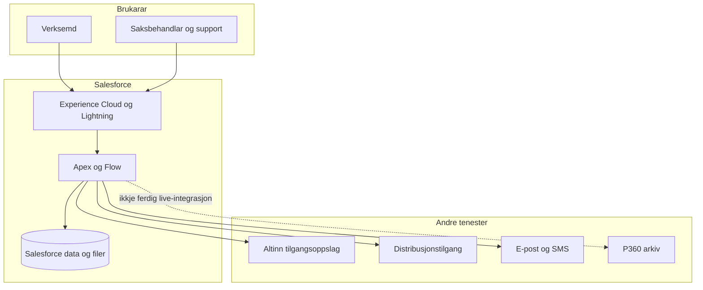
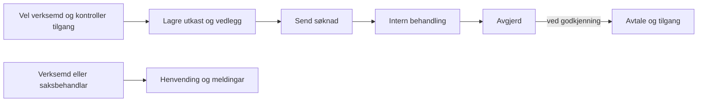
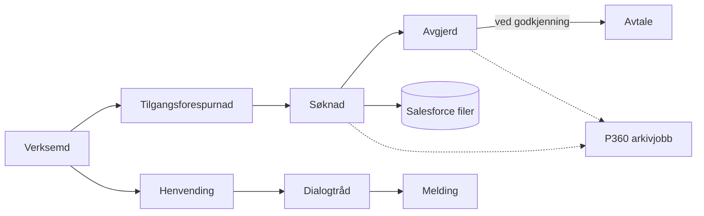

# Arbeidsforhold og Aa-registeret: start her

Salesforce-løysinga hjelper verksemder med å søkje om og følgje opp tilgang til
arbeidsforholdsdata frå Aa-registeret. Interne medarbeidarar behandlar
søknader og avtalar og svarar på henvendingar. Løysinga består av eigne
Salesforce-komponentar og fleire separat eigde avhengnadspakkar.

## Det store biletet

Pilene viser avhengnader, ikkje at eit kall er aktivt, trygt å teste eller har
lykkast i eit bestemt miljø. [Arkitekturoversikta](hele-loysinga.md) forklarer
fleire lag og flytar. [P360](../integrations/p360/README.md) er under arbeid;
kode på `P360Test` er ikkje automatisk levert til `main`.

## Frå søknad til oppfølging

Dette er ein forenkla brukarveg, ikkje ei garanti for at alle steg blir
gjennomførte eller skjer i same transaksjon. Avslag, krav om meir informasjon,
feil og ny innsending er eigne scenario i [testplanen](../testing/aaregisteret-scenario-testplan.md).

## Viktige data

Diagrammet er konseptuelt: piler erstattar ikkje Salesforce sine faktiske
relasjonsfelt eller tilgangsreglar. Sjå [domeneoversikta](../domain/README.md),
[datamodell og flytar](hele-loysinga.md) og
[testdatastrategien](../testing/aaregisteret-testdata-strategi.md).

## Vel leserute

| Eg vil                                      | Start her                                                                                                                                |
| ------------------------------------------- | ---------------------------------------------------------------------------------------------------------------------------------------- |
| Forstå forretningsflyt og arkitektur        | [Heile løysinga](hele-loysinga.md) og [domene](../domain/README.md)                                                                      |
| Finne ein Flow og sjå sideeffektar          | [Flow-katalog](aareg-flow-katalog.md) og [grupperte Flow-diagram](aareg-flow-diagrammer.md)                                              |
| Forstå P360 og kva som ikkje er ferdig      | [P360-inngang](../integrations/p360/README.md)                                                                                           |
| Forstå Altinn og tilgang                    | [Altinn-inngang](../integrations/altinn/README.md) og [tilgangskjeda](../integrations/altinn/tilgangskjede-og-scenario.md)               |
| Kartleggje pakkegrenser                     | [Pakkeavhengigheiter](pakkeavhengigheiter.md) og [kallstader](aaregisteret-pakkekallsite-matrise.md)                                     |
| Teste ein konkret brukarveg                 | [Scenario-testplan](../testing/aaregisteret-scenario-testplan.md) og [syntetiske testdata](../testing/aaregisteret-testdata-strategi.md) |
| Forstå Admin-appen                          | [Admin-app: plan og status](../surfaces/aareg-admin-app.md)                                                                              |
| Finne tidlegare testresultat eller analysar | [Dokumentasjonsarkivet](../archive/README.md)                                                                                            |

## Slik les du evidens

- **Kjeldeanalyse** viser kva som står i den undersøkte greina, ikkje kva som er
  installert eller aktivt i eit org.
- **Lokale testar og mockar** viser berre den avgrensa åtferda testen utøver.
- **Org-observasjonar** gjeld den dokumenterte køyringa, versjonen og datoen.
- **Forslag og opne spørsmål** er ikkje implementerte krav eller godkjende
  produksjonsløysingar.

Før testing: bruk syntetiske data og undersøk sideeffektar for Altinn,
distribusjon, P360, e-post og SMS. Bekreft den eksisterande
`crm-arbeidsforhold` scratch-orgen før handling. Verken lokal kode eller ei
grøn mock-køyring beviser ekstern leveranse.
