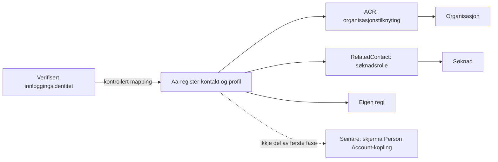

# Kontaktmodell for Aa-registeret

**Status: Forslag til menneskeleg vurdering, ikkje vedteken arkitektur.**

Analysen byggjer på repositoryet og offentleg Salesforce-/Platforce-dokumentasjon undersøkt 23. november 2026. Ingen org er lesen, og ingen kode, metadata, autentisering eller data er endra.
SIT2-løyvet i samtalen er ikkje brukt. Faktisk org-konfigurasjon og datakvalitet er derfor ikkje verifiserte.

## Kort anbefaling

Retninga er god: **ein person skal ikkje bli ein ny kontakt fordi e-post eller organisasjon endrar seg.**
Men «éin kontakt» må tyde éin autoritativ **Aa-register-kontakt per sikkert identifisert person**,
ikkje automatisk éin kontakt på tvers av heile Nav sin Salesforce-plattform.

Tilrådd mål:

1. Ein varig `Contact` i Aa-register-domenet, med ei profilside for eigne kontaktopplysningar.
2. `AccountContactRelation` (ACR) for tilknyting til organisasjonar.
3. Vidareutvikla `RelatedContact__c` som koplingsobjekt mellom kontakt og søknad, med eksplisitt rolle.
4. Same kontakt kan opptre i eigen regi utan aktiv organisasjonsrelasjon.
5. Kontakten har éi privat adresse for eigen regi og éi separat adresse per organisasjonstilknyting.
   Konteksten vel adressa, utan fallback til ei anna adresse. Ein organisasjon ser berre si eiga adresse.
6. Innsende opplysningar blir bevarte som historikk; endring av éi adresse påverkar ikkje dei andre.
7. Seinare Person Account-kopling skjer i ein skjerma identitetsgrense, ikkje som automatisk samanslåing.

**ACR er ein relasjon, ikkje eit tilgangsløyve.** Ei registrert kontaktpersonrolle gir ikkje
Altinn-rett, innlogging, søknadsinnsyn eller rett til å redigere ein annan person sin profil.

## Leserekkjefølgje

| Dokument                                                              | Innhald                                                                             |
| --------------------------------------------------------------------- | ----------------------------------------------------------------------------------- |
| [Analyse og målmodell](analyse-og-malmodell.md)                       | Dagens åtferd, identitet, ACR, roller, eigen regi, skjerming, alternativ og kjelder |
| [Brukarflater og flyt](brukarflater-og-flyt.md)                       | Wireframes, profilendring, kontaktval, innsending og tilgang                        |
| [Migrering og verifikasjon](migrering-og-verifikasjon.md)             | Avklaringar, faseskifte, berørte kontraktar, migreringsvern og akseptansetest       |
| [Brukarstøtte og e-post](brukarstoette-og-e-post-analyse.md)          | Samanlikning med brukarstøtte-branchen, e-postprinsipp og lagringsalternativ        |
| [Wireframes for brukarstøtte](wireframes-brukarstoette-og-kontakt.md) | Vurdering av dei ni skissene og forslag til neste iterasjon                         |

Diagramma er Mermaid, og wireframes er tekstbaserte skisser. Dei er ikkje implementerte skjermbilete.
Salesforce-skisser for Experience Cloud og Lightning, med datamodell og flytskjema, ligg i
[salesforce-skisser.html](salesforce-skisser.html). Ein fullstendig brief som kan limast inn i Claude, inkludert
vurderinga av organisasjonsveljaren på profilen, ligg i [claude-brief.md](claude-brief.md).
Ei samla vurdering av alt materialet, krav til søkbar organisasjonsveljar og funn frå scratch-org
og SIT2 ligg i [samla-vurdering.md](samla-vurdering.md).

## Det som faktisk er funne

- Innsendingsflyten finn `Contact` med **`AccountId` + `Email`**. Ingen treff fører til oppretting.
  Ny e-post eller ny organisasjon kan derfor gi ny kontakt for same person.
- Namn på ny kontakt blir henta frå søknaden sin `CreatedBy`, ikkje frå ei eksplisitt, verifisert
  kontaktidentitet.
- Dei andre kontaktane blir lagra som `RelatedContact__c` med namn, telefon, e-post og fire varselflagg.
  Den lokale objektdefinisjonen har ikkje oppslag til `Contact` eller eksplisitt rollefelt.
- Ved avtaleoppretting blir avtaleoppslaget sett på dei same relaterte kontaktradene som søknaden brukar.
- Innloggings-/Altinn-grensa les allereie identitet gjennom `User.Contact.Account`.
  Det er derfor farleg å berre erstatte `User.ContactId` med den nye domenekontakten.

Detaljerte kodekjelder og presiseringar ligg i [analysen](analyse-og-malmodell.md#1-dagens-løysing).
Dette stadfestar mekanismen i kjeldekoden, ikkje talet på duplikat eller faktisk køyring i SIT2.

## Viktigaste tradeoff

Ein delt profil fjernar duplikat og gir betre sjølvbetening, men aukar konsekvensen av feil identitetskopling
og feil deling. Separate adresser per kontekst avgrensar verknaden av ei e-postendring. Løysinga må derfor skilje mellom
**profil**, **kontekst**, **tilgang** og **innsendingshistorikk**.

Salesforce krev dessutan primærkonto for ein vanleg kontakt som skal ha indirekte ACR-relasjonar.
Ein kontakt utan `AccountId` kan ikkje berre få slike relasjonar seinare. Forslaget om ein kontrollert,
teknisk Aa-register-primærkonto må godkjennast og prøvast med reell delingsmodell før målmodellen blir vedteken.
Ingen slik konto er oppretta eller identifisert i denne analysen.

## Avgrensing

Dette er raud-sone-design: identitet, tilgang, personopplysningar, e-post og migrering krev menneskeleg
gjennomgang. Forslaget endrar ikkje dei eksisterande, føreslåtte
[ADR-0002](../../adr/0002-accountcontactrelation-for-personkontoer.md) og
[ADR-0003](../../adr/0003-e-post-for-personkonto-via-aareg-og-krr.md), som er Confluence-speilkopiar.
Avklar forholdet til desse med Team Platforce før ei ny beslutning blir vedteken.
