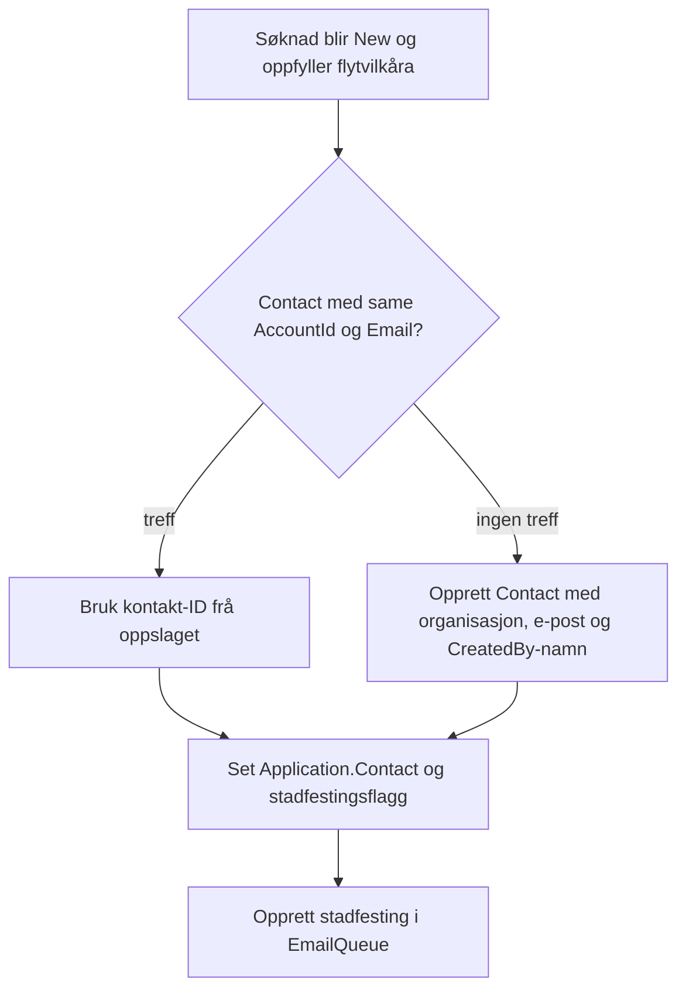
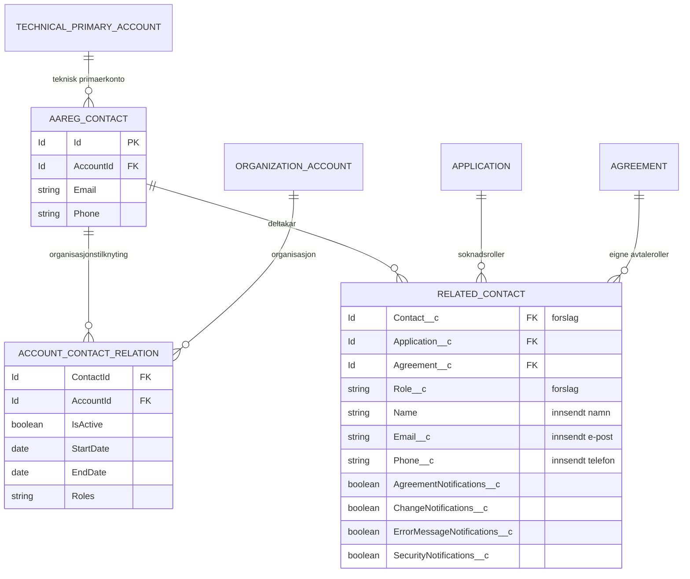

# Analyse og målmodell

**Status: Forslag.** Sjå [oversikta](README.md) for avgrensing og leserekkjefølgje.
Alle nye feltnamn nedanfor er kandidatar, ikkje eksisterande metadata eller lovnader om dependency-API-ar.

## 1. Dagens løysing

### 1.1 Innsendar er ein organisasjons- og e-postbasert kontakt

[AAREG_createContactSendConfirmation](../../../force-app/main/default/flows/AAREG_createContactSendConfirmation.flow-meta.xml)
har følgjande kjeldekodeåtferd:

| Steg       | Observert i metadata                                                                                                                                                  |
| ---------- | --------------------------------------------------------------------------------------------------------------------------------------------------------------------- |
| Start      | After-save ved Update, når `Casehandler_Status__c = New`, kontakt manglar og stadfestingsflagget er false; posten må endre seg til å oppfylle vilkåra. Linje 614–645. |
| Oppslag    | `Contact.AccountId = Application.Account__c` **og** `Contact.Email = Application.Email__c`. Linje 507–535.                                                            |
| Oppretting | Set organisasjonen som `AccountId`, søknadse-post som `Email`, namn frå `CreatedBy` og `Source__c = AA-register søknad`. Linje 326–368.                               |
| Kopling    | Set `Application__c.Contact__c` til kontakten og stadfestingsflagget til true. Linje 582–613.                                                                         |
| Varsel     | Opprettar `EmailQueue__c` med kontakt-ID som `TargetObjectId__c`. Linje 371–418.                                                                                      |

Dette er **gjenbruk av eit kontaktpunkt i ein organisasjon**, ikkje sikker identifisering av ein person.
To personar med same organisasjon og felles e-post kan bli kopla til same kontakt. Ein person med ny
e-post eller annan organisasjon kan få fleire kontaktar. Namn frå `CreatedBy` er heller ikkje alltid
identiteten til den som søknaden oppgir som kontakt, til dømes ved representasjon eller migrering.

At kjede og statusrekkjefølgje er tilsikta, er også synleg i
[AAREG_ApplicationController](../../../force-app/externalApplication/classes/AAREG_ApplicationController.cls),
linje 219–257: barn blir lagra før den separate statusoppdateringa.
[AAREG_ApplicationControllerTest](../../../force-app/externalApplication/classes/AAREG_ApplicationControllerTest.cls),
linje 456–531, testar både organisasjonskopling og gjenbruk ved same organisasjon/e-post.
Testane er lesne, ikkje køyrde i denne analysen.

### 1.2 Andre kontaktar er ikkje standard Contact

[RelatedContact__c](../../../force-app/main/default/objects/RelatedContact__c/) inneheld:

- `Name`, `Email__c` og `Phone__c`;
- valfrie lookup til `Application__c` og `Agreement__c`, begge med `SetNull` ved sletting;
- `AgreementNotifications__c`, `ChangeNotifications__c`, `ErrorMessageNotifications__c`
  og `SecurityNotifications__c`;
- intern og ekstern delingsmodell `Private`, men ikkje aktivert felthistorikk.

Den lokale feltdefinisjonen har **ikkje `Contact__c` eller `Role__c`**. Dette er ei kontakt-/varselrad,
ikkje enno ein normalisert kontakt–søknad-relasjon.

[aareg_applicationContact](../../../force-app/externalApplication/lwc/aareg_applicationContact/aareg_applicationContact.js),
linje 19–31, tek imot fritekst og varselflagg.
[upsertRelatedContacts](../../../force-app/externalApplication/classes/AAREG_ApplicationController.cls),
linje 307–312, set søknadsoppslaget og upsertar radene.
[AAREG_ApplicationInternalController](../../../force-app/internalApplication/classes/AAREG_ApplicationInternalController.cls),
linje 223–259, les dei same fritekstfelta.

**Varselflagg er ikkje det same som forretningsrolle.** «Motta tryggleiksvarsel» fortel ikkje i seg sjølv
om personen er tryggleikskontakt, innsendar eller har signeringsfullmakt.

### 1.3 Søknad og avtale deler kontaktrader

[AAREG_Decision_Completed](../../../force-app/main/default/flows/AAREG_Decision_Completed.flow-meta.xml),
linje 595–618, set `Agreement__c` på radene som har den aktuelle `Application__c`.
Dermed kan ei rad vere knytt til begge.

[AAREG_MyAgreementsController](../../../force-app/externalAgreement/classes/AAREG_MyAgreementsController.cls),
linje 333–380, opprettar nye fritekstrader ved tillegg til avtale. Ved fjerning, linje 396–432,
blir avtalerelasjonen tømd dersom søknadsrelasjonen finst; elles blir rada sletta.

Konsekvens: ei ny målmodell må ta høgd for avtalar, ikkje berre søknadsskjemaet.
Direkte endring av ei delt rad kan elles endre både avtalevisning og søknadsgrunnlag.

### 1.4 Innlogging har ei anna kontaktgrense

[AAREG_CommunityUtils](../../../force-app/externalAccess/classes/AAREG_CommunityUtils.cls),
linje 23–45, avgrensar brukarmålet til den innlogga brukaren og hentar identitet frå
`User.Contact.Account.INT_PersonIdent__c` for Altinn-kallet.

**Dette viser ein eksisterande identitetsavhengigheit, ikkje at alle desse kontoane er Person Accounts.**
Kontotype, registreringshandlar, lisens og faktisk personkopling må verifiserast separat.

Aa-register-kontakten bør først vere ei separat domenekopling frå den eksisterande innloggingsgrensa.
Ikkje repoint `User.ContactId`, endre primærkontoen til innloggingskontakten eller kopier personident
til ein offentleg tilgjengeleg profil for å gjere kontaktoppslaget enklare.

## 2. Kva «éin kontakt» skal bety

Skill mellom fire omgrep:

| Omgrep                  | Identitet/livsløp                                              | Skal ikkje brukast som                            |
| ----------------------- | -------------------------------------------------------------- | ------------------------------------------------- |
| Person                  | Sikkert verifisert identitet, gjennom godkjend plattformgrense | E-postadresse eller organisasjonsnummer           |
| Aa-register-kontakt     | Varig `Contact` med avgrensa domeneansvar                      | Universell Nav-personmaster                       |
| Organisasjonstilknyting | ACR for kontakt og organisasjon                                | Dokumentasjon på Altinn-fullmakt                  |
| Søknadsdeltaking        | Kontakt, søknad, rolle og varselval                            | Eigarskap til kontaktprofil eller innloggingsrett |

E-post er eit endringsbart kontaktpunkt, ikkje ein unik personidentifikator. Det same gjeld telefon og namn.
Eit stabilt internt, domeneavgrensa kontakt-/identitetsoppslag må etablerast gjennom den eksisterande
godkjende identitetsgrensa. Detaljert mekanisme må avklarast med Platforce:

- ikkje fødselsnummer i klientpayload, logg, unik nøkkel eller offentleg testdata;
- ikkje innsendt `ContactId` som bevis på identitet eller redigeringsrett;
- pseudonymiserte nøklar er framleis personopplysningar, ikkje automatisk anonyme;
- handtering av ny innloggingsbrukar, kontogjenoppretting og identitetskorrigering må vere eksplisitt.

For kontaktar utan verifisert identitet må løysinga tillate **uavklart kontakt**, utan automatisk
samanslåing med ein verifisert person. Verifisering av e-post viser kontroll over adressa, ikkje nødvendigvis
personidentitet eller fullmakt. Målet om éin kontakt kan derfor ikkje garanterast for alle tredjepartar
berre ut frå eit skjema med namn og e-post.

Ei felles postkasse er eit organisasjonskontaktpunkt, ikkje ein person. Ho må ikkje få ei personprofilside
eller bli slått saman med innsendar fordi adressa er lik. Første fase kan bevare ei tydeleg merkt
uavklart/organisasjonsbasert varselrad; ein eigen kontaktpunktmodell er berre nødvendig dersom slik
funksjonalitet faktisk skal vidareførast.

## 3. Tilrådd datamodell

### 3.1 Person, ACR og deltaking

Diagrammet viser berre organisasjons-ACR-ane; den automatisk oppretta direkte ACR-en for primærkontoen
er utelaten for lesbarheit. Deltaking har i den nye modellen **søknad eller avtale**, ikkje begge på same rad.
Eksisterande dobbeltkopla rader må handterast særskilt under migrering.

### 3.2 Salesforce ACR: godt val, med reelle avgrensingar

Offisiell Salesforce-dokumentasjon stadfestar:

- Vanleg `Contact` må ha ein primærkonto for å få indirekte relasjonar; private contacts utan konto kan ikkje det.
- `Contact.AccountId` uttrykkjer framleis primærkontoen. Andre organisasjonar ligg i ACR.
- Plattformen opprettar/oppdaterer direkte ACR ved kontaktlagring og primærkontobytte.
- ACR har `IsActive`, `Roles`, `StartDate`, `EndDate` og plattformstyrt `IsDirect`.
- `AccountId` og `ContactId` kan ikkje endrast på ei eksisterande ACR-rad.
- Person Account-relasjonar er støtta, men Person Account kan ikkje vere primærkonto for ein vanleg kontakt.
- Experience Cloud krev særskilt vurdering av sharing sets og lisens; ACR erstattar ikkje dette.

**Tilrådd, men vilkårssett:** bruk ein kontrollert teknisk Aa-register-konto som primærkonto for
domenekontaktane. Han representerer ikkje arbeidsgivar, fullmakt eller at personen har ei verksemd.
Organisasjonane personen representerer blir indirekte ACR-relasjonar.

Dette fungerer konseptuelt også når personen ikkje representerer nokon organisasjon, men gir risiko:
ein felles primærkonto kan skape data-/delingsskjevheit og uønskt tilgang dersom kontaktinnsyn blir arva frå konto.
Felles primærkonto må ikkje delast breitt med portalbrukarar, og standard kontobaserte sharing sets må
ikkje gjere alle kontaktane eller sakene tilgjengelege for kvarandre.
Prøv eigarskap, Contact-OWD, rollehierarki, volum og faktisk ekstern lisens før godkjenning.
Ved manglande isolasjon er dette alternativet **ikkje godkjent for implementasjon**.

Behald/rebruk kontakt–organisasjon-paret ved tilbakekomst. Ikkje legg opp til uavgrensa nye ACR-rader
for kvar rolle eller tilknytingsperiode. Start-/sluttdato på éi rad er ikkje full episodisk historikk.
Behov for fleire periodar eller rollehistorikk må dekkjast av godkjend audit/historikk, ikkje av `Roles` åleine.

Ei avslutta organisasjonstilknyting skal ikkje slette personen eller historiske søknadsroller.
`IsActive` og datoar må vedlikehaldast konsistent; ikkje gå ut frå at datoar automatisk endrar aktivstatus.

ACR er eit delt standardobjekt. Globale `Roles`-verdiar eller felter må ikkje endrast slik at andre
Nav-applikasjonar sine relasjonar blir overskrivne. Aa-register-bruk av relasjonen må ha ei tydeleg
domeneavgrensing. Dersom same par allereie blir forvalta av ein annan app, må ansvar for
aktivstatus, datoar og roller avklarast før Aa-register skriv til rada.

### 3.3 Gjenbruk RelatedContact framfor eit parallelt koplingsobjekt

Tilrådde tillegg etter godkjenning:

- oppslag til `Contact`;
- éi eksplisitt rolle per rad, med godkjent rolletaksonomi;
- aktivstatus/historikk etter dokumentert behov;
- ein servergenerert unik deltakingnøkkel for kontekst + kontakt + rolle.

Til dømes kan same kontakt ha rollene innsendar og fagleg kontakt i same søknad: to deltakingrader,
men éin `Contact`. Kandidatroller som innsendar, fagleg kontakt og tryggleikskontakt må avklarast
mot faktisk forretningsbehov; dei er ikkje eksisterande picklist-verdiar.

Datainvariantar for den nye skrivevegen:

1. Kontaktendring opprettar ikkje ein ny person.
2. Ei verifisert persondeltaking har eitt `Contact__c`.
3. Kvar rad har nøyaktig éin kontekst: søknad eller avtale.
4. Kvar aktiv kombinasjon kontekst + kontakt + rolle finst høgst éin gong, også ved samtidige innsendingar.
5. Innsendarrolla har dokumenterte kardinalitetsreglar; tilrådd éin aktuell innsendar per søknad.
6. Varselval er separate frå rolle og tilgang.
7. Å fjerne ei rolle endrar ikkje personen sin profil eller andre roller.
8. Overgang til avtale opprettar eigne avtaledeltakingar; ho muterer ikkje søknadshistorikken.

Behald eksisterande metadata-/API-namn og fritekstfelt under overgangen.
`Application__c.Contact__c` kan framleis vere kompatibilitetsoppslaget til innsendar,
men skal avleiast server-side frå den autoritative deltakinga. Ein klient skal ikkje kunne setje
oppslaget uavhengig av roller og identitet.

**Kvifor behalde koplingsobjektet?** Det samlar faktisk kontekstavhengige roller, varselval og historikk.
Fjerna vi det, måtte same ansvar spreiast på kontakt, søknad, avtale og fleire controllerar.
Eit nytt parallelt objekt ville derimot skape to kjelder for dei same rollene utan klar gevinst.

### 3.4 Profil, e-post og historikk

| Opplysning                                               | Tilrådd eigar                             |
| -------------------------------------------------------- | ----------------------------------------- |
| Privat e-post og telefon for eigen regi                  | Kontaktprofilen                           |
| Organisasjonstilknyting                                  | ACR, med avtalt domeneansvar              |
| E-post for éi organisasjonstilknyting                    | Tilknytinga (ACR eller eige kontaktpunkt) |
| Rolle og varselval i søknad/avtale                       | Deltakinga                                |
| Namn/e-post/telefon oppgitt ved innsending               | Uforanderleg innsendingsgrunnlag          |
| Faktisk mottakar ved kølegging/utsending                 | Godkjend melding-/køhistorikk             |
| Innloggingsidentitet og framtidig Person Account-kopling | Skjerma plattformgrense                   |

Kontakten har to slags adresser frå første fase:

1. **Éi privat adresse** på profilen, brukt berre når personen opptrer i eigen regi.
2. **Éi separat adresse per organisasjonstilknyting**, uavhengig av kor mange roller personen har der.

Konteksten vel adressa. Det finst ingen automatisk fallback til privatadressa eller til adressa hos
ein annan organisasjon. Manglar adressa for konteksten, må personen oppgi ho før innsending.
Endring av éi adresse påverkar ikkje dei andre eller tidlegare innsendingar, og opprettar ikkje ny kontakt.

Ein organisasjon skal ikkje sjå privatadressa eller adressa personen har hos ein annan organisasjon.
Jobbadressa kan knytast til ACR-relasjonen, men lagring og tilgang må avklarast mot delingsreglar og
andre appar som brukar ACR. Sjå [lagringsalternativa](brukarstoette-og-e-post-analyse.md).
Ingen synkronisering til `User.Email`, KRR eller Person Account inngår i første fase.

**Historikk:** profilendring skal ikkje omskrive kva som vart sendt inn eller arkivert.
Eksisterande fritekstfelt kan bevarast som overgangssnapshot, men er ikkje åleine uforanderleg historikk.
Kvar innsending/ny innsending må ha eit versjonert, tilgangsstyrt grunnlag som faktisk blir bevart,
til dømes godkjend dokumentversjon/arkiv. Lagring, attfinning, innhald og retention må prøvast før valet.
Salesforce Field History åleine er ikkje eit komplett innsendingsdokument.

[AAREG_populateApplicationFieldAfterSubmit](../../../force-app/main/default/flows/AAREG_populateApplicationFieldAfterSubmit.flow-meta.xml),
linje 631–635, les kontaktfritekst for generert søknadstekst.
Det må derfor vere bevisst om ei lesing viser aktuelle kontaktopplysningar eller den innsende versjonen.

Ny innsending etter krav om meir informasjon set begge statusane til `In Progress` i
[AAREG_ApplicationController](../../../force-app/externalApplication/classes/AAREG_ApplicationController.cls),
linje 273–280. Eit nytt historikkgrunnlag kan derfor ikkje vere avhengig av ein flyt som berre startar
ved `New`. Første innsending og ny innsending må vere eksplisitte hendingar i snapshot-kontrakten.

### 3.5 Eigen regi no, Person Account-kopling seinare

Same Aa-register-kontakt kan brukast utan aktiv organisasjons-ACR. Den tekniske primærkontoen er ikkje
ein funksjonell organisasjonstilknyting. I eigen regi skal tilgang byggje på verifisert person og
eigarskap til eiga sak, ikkje på `LastUsedOrganization__c` eller tilfeldige ACR-ar.

Dette betyr **ikkje** at dagens organisasjonsbaserte tilgangssøknad blir ein privatpersons-søknad.
Privatpersonsjourney og eventuelle andre saksobjekt krev ei eiga funksjonell avklaring.

Seinare kan den same verifiserte identiteten knytast til ein eksisterande Person Account og den
tilhøyrande `PersonContactId` gjennom ein skjerma mapping. ACR kan uttrykkje ein konto–kontakt-relasjon,
men eit slikt forhold er ikkje i seg sjølv bevis på at to kontaktpostar er same person.
Ikkje slå saman domenekontakten og personkontakten automatisk.

Eit vanleg lookup, ei formel eller ei relatert liste kan røpe identitet eller sensitive felt.
Ei framtidig mapping må avgrensast både ved lesing, søk, rapportering og serialisering.
Bruk eksisterande plattformmekanisme dersom han dekkjer kontrakten; ikkje opprett eit generelt
identitetsregister eller eit nytt koplingsobjekt på førehand.

## 4. Skjerming må med frå første fase

Ein «Aa-register-kontakt» er ikkje mindre personleg berre fordi han er skild frå Person Account.
Namn, e-post, organisasjonsrelasjon, historiske roller og sakstilknyting er personopplysningar.
Skjerming av eigne tilsette og personar med adressebeskyttelse må kunne gjelde også desse dataa.
Adressebeskyttelse er ikkje berre eit feltfilter for adresse.

Platforce si offentlege rettleiing omtalar særtilgang for eigne tilsette og kode 6/7 via
identitetsrutine, AD-grupper og Salesforce-grupper. Det gir eit plattformprinsipp, ikkje dokumentasjon
på at dei aktuelle objekta i denne løysinga allereie er skjerma.
Ikkje legg til lokale «kode 6/7»-kopiar eller ein ny AD-integrasjon i denne kontaktendringa.

| Grense                             | Påkravd åtferd i målmodellen                                                                                                                |
| ---------------------------------- | ------------------------------------------------------------------------------------------------------------------------------------------- |
| Eige profilinnsyn                  | Serveren finn eiga domenekopling. Ingen bruk av klient-ID som tilgangsbevis.                                                                |
| Organisasjonsinnsyn                | Vis berre deltaking og kontaktdata som er nødvendige i godkjend organisasjonskontekst. Ikkje andre arbeidsgivarar eller privatpersonssaker. |
| Redigering                         | Personen eig eigen profil. Representanten administrerer roller, ikkje andre personar sine globale kontaktdata.                              |
| Internt innsyn                     | Aa-register-tilgang **og** nødvendig særtilgang. Breie permission sets eller kontodeling må ikkje opne skjerma data.                        |
| Plattformkopling                   | Identitets-/Person Account-kopling er ikkje tilgjengeleg i vanlege portalresponsar.                                                         |
| Indirekte flater                   | Same vurdering for ACR, søk, lookup-labels, rapportar, eksport, aktivitet, filer, PDF, arkiv og e-post.                                     |
| Ukjent tilgangs-/skjermingsavgjerd | Stopp operasjonen tydeleg; ikkje vis data eller send melding med permissiv fallback.                                                        |

Tilgang må kunne trekkjast tilbake. Ei gammal rolle eller ein inaktiv ACR gir ikkje varig rett.
Bakgrunnsjobb og e-postsender må handtere endra fullmakt og skjerming etter kølegging.
Kven som kan få varsel om ei skjerma sak, og kva kanalen kan innehalde, krev særskild godkjenning.

**Avgrensa til Aa-registeret:** dette krev faktisk OWD/deling, CRUD/FLS, permission sets/grupper,
serverkontraktar og eigarskap. Ei app, ein tab, eit record type, `Source__c` eller namnet «AAREG»
er ikkje ei sikkerheitsgrense. Privilegerte plattformadministratorar har dessutan særskild tilgang;
produktisolasjon må formulerast realistisk.

## 5. Alternativ og Well-Architected-vurdering

| Alternativ                                              | Fordel                                                                   | Hovudkostnad                                                                          | Vurdering                                                     |
| ------------------------------------------------------- | ------------------------------------------------------------------------ | ------------------------------------------------------------------------------------- | ------------------------------------------------------------- |
| Domenekontakt + ACR + vidareutvikla RelatedContact      | Lite nytt skjema, standard relasjonar, gradvis overgang og sjølvbetening | Primærkonto/deling, sikker identitetsmapping og snapshots må løysast                  | Tilrådd, med sikkerheits- og plattformgate                    |
| Bruk Person Account sin Contact direkte frå første fase | Mindre dobbel personrepresentasjon og tett plattformgjenbruk             | Koplar organisasjonsjourney til skjerma persondata, innlogging og andre pakkar straks | Ikkje tilrådd før plattform- og skjermingskontrakt er avklart |

Dersom standard `Contact` ikkje kan isolerast forsvarleg med tilrådd primærkontomodell,
må ein dedikert Aa-register-profil vurderast som eit nytt designalternativ.
Det har eigne kostnader og gir ikkje standard ACR direkte; derfor er det ein stopp-/revurderingsveg,
ikkje eit ekstra lag i første implementasjon.

- **Trusted:** stabil identitet, avgrensa deling, inga automatisk e-postbasert samanslåing og eksplisitt skjerming.
  Evidens: dagens e-postbaserte oppslag, eksisterande identitetsgrense og Platforce-tilgangsmodell.
- **Easy:** éi profilside og gjenbruk av dagens relasjonsobjekt. Kostnaden er å forklare verknaden
  av profilendring og skiljet mellom rolle, varsel og fullmakt.
- **Adaptable:** kontakt kan ha fleire organisasjonar og opptre i eigen regi.
  Skjerma personkopling kan vurderast seinare utan å endre kontaktidentiteten i søknadane.

## 6. Eksterne kjelder og kunnskapsgrenser

Undersøkt 23. november 2026; ingen repository-kode eller persondata er sendt til eksterne søk.

1. [Salesforce Object Reference: AccountContactRelation](https://developer.salesforce.com/docs/platform/object-reference/references/standard-objects/object-accountcontactrelation.html)
   — felt, uendra endepunkt-ID-ar og automatisk direkte relasjon. Full sidetekst lesen.
2. [Salesforce Help: Contacts to Multiple Accounts](https://help.salesforce.com/s/articleView?id=shared_contacts_overview.htm&language=en_US&type=5)
   — primærkonto, direkte/indirekte forhold og Person Account-avgrensingar.
3. [Salesforce Help: Considerations for Relating a Contact to Multiple Accounts](https://help.salesforce.com/s/articleView?id=sales.shared_contacts_considerations.htm&language=en_US&type=5)
   — private contacts, Experience Cloud og merge-konfliktar.
4. [Platforce: Access Control](https://navikt.github.io/platforce-doc/security/access-control/)
   — permission sets/grupper, postdeling og særtilgang. Full sidetekst lesen.
5. [Platforce: Experience Cloud](https://navikt.github.io/platforce-doc/reference/experience-cloud/)
   — ID-porten og plattformansvar for ekstern tilgang. Full sidetekst lesen.

Salesforce Help returnerte berre «Loading» ved direkte uthenting. Påstandane frå desse to Help-sidene
byggjer derfor på indekserte utdrag frå offisielle sider, ikkje full gjennomlesing.
Aktuell release, lisens og installert metadata må stadfestast før gjennomføring.

Forslaget harmonerer med retninga i
[ADR-0002](../../adr/0002-accountcontactrelation-for-personkontoer.md), men den føreslåtte ADR-en
er ikkje bevis på ACR-aktivering eller korrekt deling i ein org.
[ADR-0003](../../adr/0003-e-post-for-personkonto-via-aareg-og-krr.md) omfattar ein breiare
personkonto-/KRR-e-postmodell. Denne analysen foreslår ikkje å innføre den modellen for jobbe-post.
