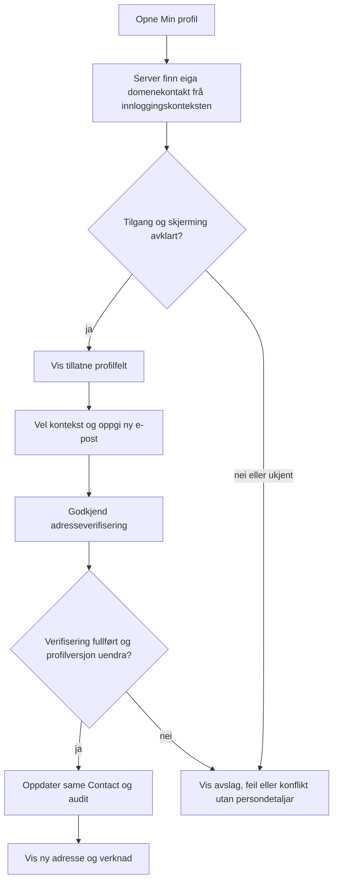
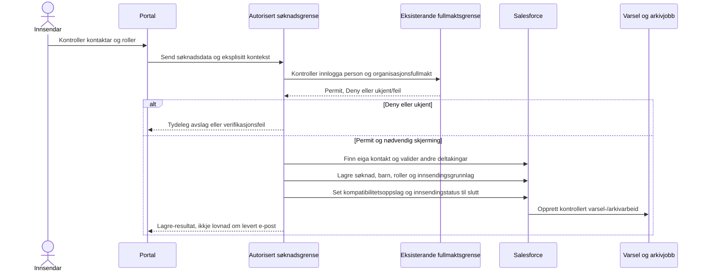

# Brukarflater og flyt

**Status: Designskisser, ikkje implementert UI.** Sjå [målmodellen](analyse-og-malmodell.md).
Alle eksempel er upersonlege plasshaldarar; wireframes viser ikkje faktiske person- eller orgdata.

## 1. Min profil

Profilsida gjeld Aa-registeret, ikkje ein global Nav-profil og ikkje innloggingsinnstillingar.
Organisasjonsrollene er ei eiga oversikt. Personen kan ikkje tildele seg fullmakt ved å redigere profilen.

```text
+------------------------------------------------------------------+
| Aa-registeret                         Min profil      Logg ut     |
+------------------------------------------------------------------+
| Du opptrer som: [ Meg sjølv v ]                                   |
|                                                                  |
| MIN KONTAKTPROFIL                                                 |
| Namn: [verifisert visningsnamn]                                    |
| Namn kjem frå innlogginga. Korrigering følgjer godkjend rutine.     |
|                                                                  |
| PRIVAT (EIGEN REGI)                                               |
| E-post:  [privat adresse]                     [Endre]             |
| Telefon: [gjeldande telefon]                  [Endre]             |
| Blir berre brukt når du opptrer som deg sjølv.                    |
|                                                                  |
| ORGANISASJONSTILKNYTINGAR                                          |
| [Organisasjon A]  Aktiv  E-post: [adresse hos A]  [Endre] [Roller] |
| [Organisasjon B]  Aktiv  E-post: [manglar]        [Legg til]       |
| Kvar organisasjon ser berre si eiga adresse.                      |
| Endring av éi adresse endrar ikkje dei andre eller innsendt historikk. |
| Registrert tilknyting gir ikkje automatisk søknadsfullmakt.         |
+------------------------------------------------------------------+
```

Tilrådd e-postendring:

- endre berre adressa for den valde konteksten (privat eller éin organisasjon);
- vis gammal og ny adresse samt kva endringa påverkar;
- bruk godkjend verifiseringsmekanisme før ny adresse blir gjeldande;
- ikkje endre `User.Email`, innlogging eller Person Account som sideeffekt;
- vis konflikt dersom profilen er endra i ei anna økt;
- ikkje opne andre personar sin profil frå organisasjonsoversikta.



Verifisering og lagring er separate UI-transaksjonar. Ikkje hald ein Salesforce-databasetransaksjon
open medan brukaren følgjer ei lenkje. Tidsavgrensa verifisering og endringsaudit må følgje
godkjend plattformmønster og lagringspolicy.

## 2. Vel kontekst

```text
+------------------------------------------------------------------+
| Kven opptrer du som?                                              |
|                                                                  |
| ( ) Meg sjølv                                                     |
|     Mine eigne kontaktopplysningar og godkjende privatpersonflytar |
|                                                                  |
| ( ) På vegner av ein organisasjon                                 |
|     [Vel organisasjon v]                                          |
|     Vi kontrollerer fullmakta di før du får tilgang til søknaden.  |
|                                                                  |
| [Fortset]                                                        |
+------------------------------------------------------------------+
```

Kontekst skal vere synleg på alle relevante sider og i stadfestinga før innsending.
Byte av organisasjon må nullstille kontekstavhengige val og hente ny tilgangsavgjerd.
Ein gammal `LastUsedOrganization__c` er ein brukarpreferanse, ikkje autorisasjon.

Eigen regi er eit mål for kontaktmodellen. Skissa lovar ikkje at dagens organisasjonssøknad
kan sendast inn utan organisasjon.

## 3. Kontaktar i søknaden

```text
+------------------------------------------------------------------+
| Søknad for [Organisasjon A]                 Steg: Kontaktar        |
+------------------------------------------------------------------+
| INNSENDAR                                                        |
| [Eigen verifisert profil]                                         |
| E-post hos Organisasjon A: [adresse hos A]   [Endre i Min profil]  |
| Manglar adressa, må du oppgi ho her. Ingen privat adresse brukast. |
|                                                                  |
| ANDRE KONTAKTROLLER                                               |
| Person                   Rolle              Varselval             |
| [Tilgjengeleg kontakt]   Fagleg kontakt      [Vel varsel]          |
| [Tilgjengeleg kontakt]   Tryggleikskontakt    [Vel varsel]          |
|                                                                  |
| [Vel kontakt i denne organisasjonen]                              |
| [Registrer uavklart kontakt / inviter etter godkjend rutine]       |
|                                                                  |
| Ei rolle gir ikkje innlogging eller rett til å sjå søknaden.       |
| Du kan ikkje endre andre personar sin globale profil her.          |
|                                                                  |
| [Tilbake]              [Lagre utkast]               [Neste]       |
+------------------------------------------------------------------+
```

Kontaktval skal avgrensast til autorisert organisasjonskontekst, nødvendige felt og nødvendig særtilgang.
Ikkje globalt person-/e-postsøk eller automatisk vising av alle kontaktane på den tekniske primærkontoen.
Skjerma eller utilgjengelege personar må ikkje røpast gjennom søkeresultat, treffstal eller feilmeldingar.

**Same person, fleire roller:** UI kan vise ein samla personrad med fleire roller, medan serveren lagrar
éi deltaking per rolle. Varsel skal dedupliserast per faktisk mottakar og hending.
Tilordning av ei rolle må ikkje sende duplikatvarsel fordi same person har to roller.

**Ny tredjepart:** representanten kan oppgi ein kontakt, men kan ikkje stadfeste personidentiteten
berre ved namn/e-post. Invitasjon må ha kontrollert livsløp og formål. Inntil identitet er avklart,
skal rada vere uavklart og ikkje koplast automatisk til ein kjend profil.
Ei innlogging/verifisering skal heller ikkje automatisk gi organisasjonsfullmakt.

## 4. Saksbehandlarvisning

```text
+------------------------------------------------------------------+
| Søknad [referanse]                         [Organisasjon A]       |
+------------------------------------------------------------------+
| KONTAKTAR                                                        |
| Rolle                 Kontakt                 Aktuelt kontaktpunkt|
| Innsendar             [kontaktlenkje]          [tillaten adresse]  |
| Fagleg kontakt        [kontaktlenkje]          [tillaten adresse]  |
|                                                                  |
| [Sjå opplysningar ved innsending]                                 |
| [Sjå aktuell kontaktinformasjon]                                  |
|                                                                  |
| Organisasjonstilknyting: Aktiv / Avslutta                          |
| Fullmakt: Kontrollerast separat                                   |
| Varsel: [Hendingar denne deltakinga er vald for]                   |
+------------------------------------------------------------------+
```

Tilgangssjekken gjeld også når kontaktlenkja blir opna direkte.
Manglande særtilgang skal gi eit nøytralt avslag, ikkje vising av Person Account-namn, beskyttelsesnivå
eller andre organisasjonar. Vanleg saksbehandlarvisning skal ikkje vise framtidig identitetsmapping.

## 5. Innsending og varsling



Dette er målåtferd, ikkje ein ny klasse-/servicehierarki. Gjenbruk controllerar og eksisterande
fullmaktsgrense; samle kontakt- og deltakingreglar berre der dei faktisk må delast mellom søknad,
avtale og profil. Ikkje innfør ein generell fabrikk eller transportadapter for kontaktmodellen.

### Serverkontrakt før implementasjon

| Del         | Kontrakt                                                                                                                                                   |
| ----------- | ---------------------------------------------------------------------------------------------------------------------------------------------------------- |
| Input       | Søknad/utkast, kontekst, valde kontaktar, roller, varselval og eventuell versjon for konfliktkontroll. Innlogga person blir bestemt av serveren.           |
| Tilgang     | Verifisert innlogging, riktig organisasjonsfullmakt eller godkjend eigen-regi-eigarskap, deling, CRUD/FLS og nødvendig skjerming.                          |
| Validering  | Kontakt tilhøyrer tillaten kontekst; gyldig rolle; ingen urettmessig profilendring; unike deltakingar; avklart mottakar.                                   |
| Resultat    | Varig søknads-ID og eksplisitt status. «Kølagt» er ikkje «sendt» eller «arkivert».                                                                         |
| Feil        | Skil mellom avslag, uavklart identitet, manglande kontaktpunkt, versjonskonflikt og teknisk feil. Ingen persondetaljar i klientfeil/logg.                  |
| Sideeffekt  | Kontakt/deltaking etter godkjent regel, innsendingsgrunnlag, status, varsling og arkivjobb. Ingen endring av autentisering eller andre appars kontaktdata. |
| Transaksjon | Fullmaktscallout før DML. Bulkifisert oppslag/skriving. Barn og historikk før status. Kontakt-/rollefeil rullar tilbake innsending, ikkje delvis suksess.  |

Profilendring skal vere eiga handling, ikkje ein skjult sideeffekt av søknadsinnsending.
Bakgrunnsarbeid startar etter ein vellukka commit. Idempotens og samtidigheitsvern må omfatte
både ny kontaktidentitet, deltaking og varselhending.

### Aktuell e-post er ikkje det same som innsendt e-post

Tilrådd policy:

1. Innsendingsgrunnlaget bevarer kontaktopplysningane som vart oppgitt ved den aktuelle innsendinga.
2. Nye varsel finn aktuell, godkjend adresse i relevant kontekst og lagrar vald mottakar ved kølegging.
3. Før utsending blir tilgang, skjerming, aktiv deltaking og mottakargrunnlag kontrollert på nytt.
4. Dersom adresse eller rettar er endra etter kølegging, stans/marker varselet og gjer kontrollert ny
   mottakaravgjerd. Ikkje send automatisk til ei gammal adresse eller hent ny adresse utan sporbarheit.
5. Retry av arkivering brukar det same innsende grunnlaget, ikkje ein ny profilversjon.

Den eksisterande
[stadfestingsflyten](../../../../force-app/main/default/flows/AAREG_createContactSendConfirmation.flow-meta.xml),
linje 400–403, legg berre kontakt-ID inn som target.
Dermed må det installerte e-postsystemet undersøkjast for adressebinding, tidspunkt og støtte for
konkrete mottakarar. Denne analysen har ikkje stadfesta den kontrakten.
Ikkje opprett «frosne» duplikatkontaktar for å kome rundt ei slik avgrensing.

## 6. Tilgjengelegheit og mobil

- Synleg kontekst, klare overskrifter og permanente feltetikettar; ikkje berre plasshaldarar.
- Feiloppsummering med fokus og lenkje til feltet; feil må ikkje formidlast berre med farge.
- Rolle og varselval er to separate kontrollar med forklaring.
- Profilendring viser verknad før stadfesting, også for skjermlesar.
- Kontaktlista blir stablet til kort på liten skjerm; alle handlingar er tilgjengelege med tastatur.
- Uavklart kontaktstatus skal forklarast utan å røpe skjermingsopplysningar.
- Bruk eksisterande LWC-/Experience Cloud-mønster og lokaliserte tekstar.
  Wireframes er ikkje ei beslutning om å innføre React, Aksel-pakkar eller eit nytt designsystem.
