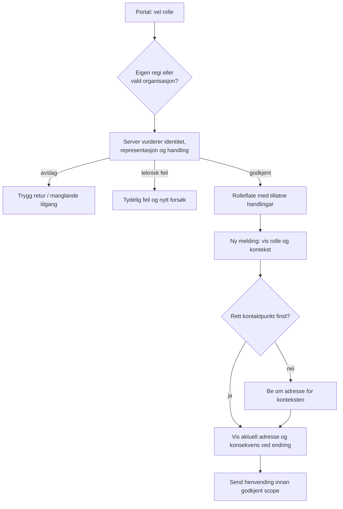

# Brukarstøtte-wireframes og kontaktmodellen

**Status:** Supplerande vurdering, ikkje godkjend design eller implementasjon.

## Grunnlag

Eg har sett på dei ni skissene og merknadene i
[Wireframes – Brukerstøtteutvidelse Aa-registeret](https://claude.ai/artifact/6x3twFEy3xDK4tAXzUFnky#page-dcb81aee8d83).
Artefakten omtalar sjølv skissene som lo-fi og ikkje vedtekne. Dei er baserte på
brukarstøtteutvidinga, ikkje bevis for at tenesta eller tilgangskontrollane er implementerte.

Dette dokumentet supplerer [brukarstøtte- og e-postanalysen](brukarstoette-og-e-post-analyse.md)
og [kontaktprototypen](prototype-v1.html). Ingen av dei eksisterande tekstane eller prototypane
er endra.

## 1. Kva wireframene tilfører

| Skisse                           | Viser                                                                                         | Verknad for kontaktmodellen                                                                                                         |
| -------------------------------- | --------------------------------------------------------------------------------------------- | ----------------------------------------------------------------------------------------------------------------------------------- |
| 1–2: Portal og manglande tilgang | Val av arbeidsgivar, samarbeidspartner/fullmektig eller privatperson; eigen retur ved avslag. | Ein profil/kontakt kan brukast på tvers av roller, men eit rolleval gir ikkje tilgang.                                              |
| 3: Vel verksemd                  | Arbeidsgivar vel verksemd før funksjonar blir viste.                                          | Organisasjonsvalet må følgje handlinga heilt fram til val av rett kontaktpunkt.                                                     |
| 4: Full arbeidsgivartilgang      | Søknad, søknadsoversikt, avtalar, brukarstøtte og meldingar.                                  | Kontakt, søknadsroller og kontaktpunkt må kunne brukast på tvers av flatene utan å slå saman tilgangane.                            |
| 5: Berre brukarstøtte            | Brukarstøtte, meldingar og «Mine avtaler» er viste.                                           | Avtaletilgang og rett til å endre avtalekontaktar for denne tilgangstypen er uttrykkjeleg eit ope spørsmål, ikkje ei vedteken rett. |
| 6: Teknisk feil                  | Altinn-feil med «Prøv igjen».                                                                 | Ikkje fall tilbake til annan kontekst, anna adresse eller gamal tilgangsavgjerd.                                                    |
| 7: Samarbeidspartner/fullmektig  | Éi vald verksemd og inngang til støtte og eigne meldingar.                                    | Fullmaktskjelde og meldingsscope er uavklarte. Relasjonen til kunden betyr ikkje nødvendigvis at personen er tilsett der.           |
| 8: Privatperson/arbeidstakar     | Brukaren treng ikkje velje verksemd, og ser støtte og eigne meldingar.                        | Privat kontaktpunkt og eige meldingsscope må ikkje avhenge av sist valde organisasjon.                                              |
| 9: Ny melding                    | Synleg «Du sender som» med rolle og verksemd, samt obligatorisk kontakt-e-post.               | Legg til synleg kontekst for adressa; avklar kva som blir lagra på profilen, henvendinga og i utsendingshistorikken.                |

Skisse 9 merkar «Du sender som»-linja og lagring av innsendarrolle/kontekst som eit nytt forslag,
ikkje ei vedteken løysing. Det same gjeld fleire av dei tekniske merknadene rundt portal og
rolleutviding. Dei bør vurderast mot den endelege tilgangs- og personvernmodellen.

## 2. Den viktigaste mangelen: kva e-postfeltet betyr

Skisse 9 ber om ei kontaktadresse, men viser ikkje om adressa er:

- privatadressa for eigen regi,
- adressa som er knytt til akkurat denne person–organisasjon-relasjonen,
- ei eingongsadresse for denne henvendinga, eller
- ei endring av ei lagra profiladresse.

Dette er eit hol i skissa, ikkje bevis på at den eksisterande løysinga gjer noko bestemt.
Tilrådinga er å gjere skiljet synleg **før** innsending:

1. Vis rolle og godkjend kontekst: «Du sender som … for …», eller «Du sender i eigen regi».
2. Vis berre den aktuelle adressa i denne konteksten. Ei A-adresse skal ikkje visast som B-adresse.
3. Forklar at adresseendring berre påverkar det aktuelle kontaktpunktet og ikkje tidlegare innsendingar.
4. Dersom adresse manglar: be om adresse for den valde konteksten. Ingen automatisk fallback
   til privatadresse, ei anna verksemd eller standardfelt.
5. Skil mellom eit eventuelt eingongsval og endring av lagra kontaktpunkt. Om eingongsadresse
   skal tillatast, kven som kan endre lagra adresse, og om verifisering er nødvendig, er opne spørsmål.
   Ein endra verdi i eit skjema skal ikkje stille endre den lagra profilen.
6. Dersom ein brukar medvite ønskjer same adresse i fleire kontekstar, krev eit eksplisitt val og
   ei forståeleg opplysning om kven som kan sjå henne. Aldri kopier adressa automatisk.

Dette er forslag til målåtferd, ikkje påstand om at artefakten eller den lokale prototypen allereie
implementerer val for eingongsadresse eller bekrefting.

## 3. Fullmektig: «for» er ikkje det same som «tilsett hos»

Ein rådgivar kan arbeide for organisasjon P og representere kundane A og B. Den valde konteksten
kan vere kunden, medan e-postadressa kan vere hos P. Difor bør grensesnittet omtale dette som
«e-post når du representerer A», ikkje krevje at adressa høyrer til A sitt domene eller at
personen er tilsett hos A.

Målmodellen kan knyte eit kontaktpunkt til person + representert organisasjon, men dette
fastset ikkje kven som har myndigheit til å opprette/vedlikehalde relasjonen. Det må avklarast:

- Kven kan registrere og endre adressa for ein fullmektig?
- Kan den same adressa nyttast for fleire kundar etter eit aktivt val?
- Kva skjer ved tilbakekalla fullmakt, nytt kundeforhold eller ny arbeidsgivar?
- Kven i kunden si verksemd skal eventuelt sjå kontaktpunktet?

ACR kan vere ei relasjonsskildring, men ikkje åleine bevis for at fullmektigen har rett til
innsyn, innsending, oppdatering eller meldingar.

## 4. Samordna brukarreise

Serveren må også kontrollere direkte lenker, individuelle trådar, svar og vedlegg.
Diagrammet er målåtferd, ikkje eit bevis på at wireframene inneheld slik kontroll.

## 5. Kva som bør leggjast til i neste wireframe-iterasjon

Utan å endre dei noverande skissene foreslår eg desse konkrete tillegga:

1. **Profil og kontaktpunkt:** privat adresse og éi adresse per representert organisasjon, med
   kontekst og eigarskap synleg. Gjer ikkje heile profilen synleg for andre representantar.
2. **Ny melding i tre variantar:** eigen regi, verksemd A og verksemd B. Vis kva adresse som
   blir brukt, og kva som skjer om ho manglar.
3. **Fullmektig for kunde:** vis representert verksemd og kontaktadresse utan å antyde tilsetjing.
4. **Adresseendring:** vis skilnaden på endring av kontaktpunkt, eventuell eingongsadresse og
   historisk innsendt mottakar.
5. **Mine meldingar og vedlegg:** illustrer personleg scope og organisasjonsscope utan å fastslå
   uavklart deling mellom representantar eller roller.
6. **Kontekstbyte under utkast:** vis korleis brukaren blir varsla dersom ei anna fane endrar
   kontekst, og bevar utkastet utan å sende i feil kontekst.
7. **Feiltilstandar:** ingen tilgang, teknisk feil, tilbakekalla representasjon og manglande adresse
   er ulike situasjonar med ulike neste steg.

Før desse flatene blir bygde må produkteigar, teknisk eigar og personvern-/tilgangsansvarlege
ta stilling til dei opne spørsmåla. Skjerming og verifikasjon gjeld også søk, rapportar, filer,
trådar, varsel og arkiv — ikkje berre profilvisinga.
