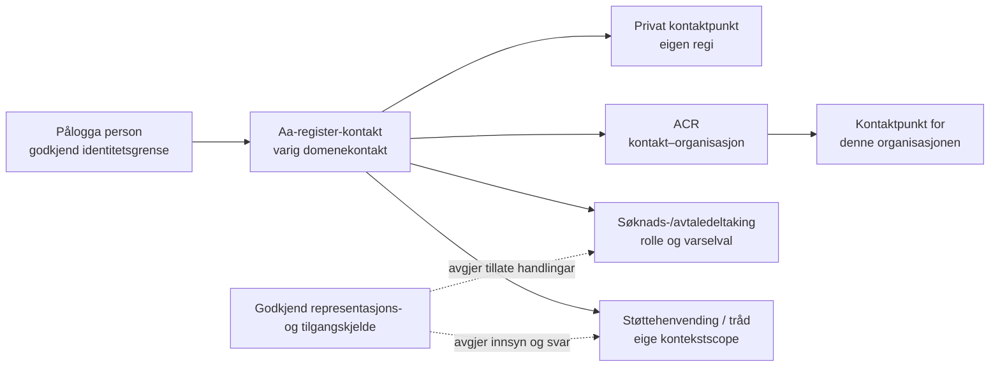
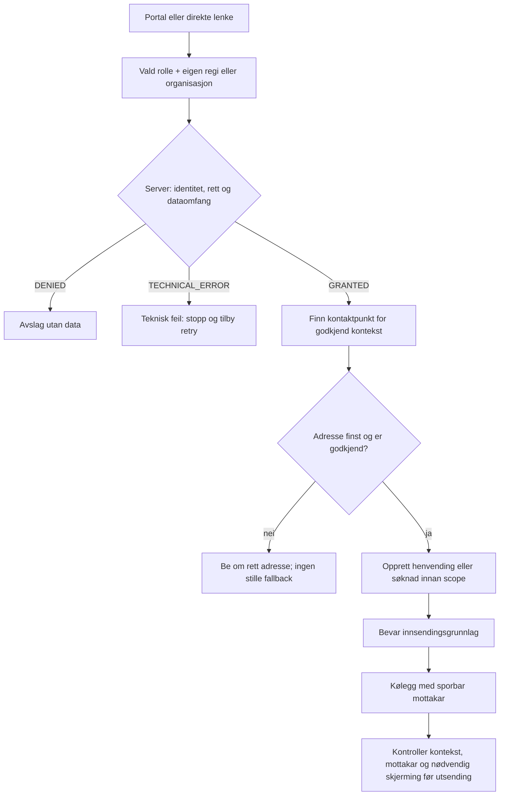

# Kontaktmodell, e-post og utvida brukarstøtte

**Status:** Vidare analyse og forslag til vurdering, ikkje ein godkjend spesifikasjon eller implementasjon.
Analysedato: 23. november 2026.

## Kjelde og avgrensing

Utgangspunktet er brukarstøttematerialet på branchen
[`brukerstøtteløsning_utvidelse_20261110`](https://github.com/navikt/crm-arbeidsforhold/tree/89625d04dab0b1ddc97ff73584f2f88d753a1e84/docs/brukerstotte_utvidelse)
ved commit `89625d04dab0b1ddc97ff73584f2f88d753a1e84`, samanlikna med
[kontaktanalysen](analyse-og-malmodell.md), [prototypen](prototype.html) og relevant kode i dette arbeidsområdet.
Branchkjeldene er lenkja til denne faste versjonen, ikkje til ein branch som kan endre seg.

Dokumenta på branchen er arbeidsmateriale. Nokre punkt er markerte `Confirmed` i eit beslutningsregister,
men detaljerte implementeringsgates står framleis opne. **Ein fil- eller dokumenttittel med «godkjent»
er ikkje i seg sjølv ei godkjenning:** statusfelt, utfylte beslutningar og signaturar må lesast.
Ingen av dei andre dokumenta er endra i denne analysen.

Ingen org er lesen, ingen endringar er deploya, og ingen Apex-/Flow-test er køyrd.
Kjeldekoden i arbeidsområdet og den undersøkte branchen er ikkje heilt identisk:
`AAREG_ApplicationController.cls` har endringar mellom versjonane. Funna om dagens kode nedanfor
gjeld arbeidsområdet her, ikkje automatisk køyrande kode i ein org eller alle branchversjonar.

## 1. Det som endrar vurderinga

Brukarstøtteutvidinga og kontaktarbeidet bør ikkje bli to uavhengige person- og kontekstmodellar.
Den felles modellen må kunne støtte både:

1. **Organisasjon:** ein person representerer verksemd A eller B, med ulik e-post per relasjon.
2. **Eigen regi:** same person brukar privat kontaktpunkt og personbasert støtte/meldingar utan å velje organisasjon.
3. **Søknad/avtale:** ein kontakt kan ha fleire roller, utan at rolle, varselval og fullmakt blir det same.
4. **Brukarstøtte/dialog:** meldingar, vedlegg og svar har sitt eige kontekst- og tilgangsscope.

**Korrigering av vårt tidlegare forslag:** Éi standardadresse først er for snevert for behovet som er
beskrive. Tilrådd mål frå første fase er ei privat adresse for eigen regi og ei separat adresse per
organisasjonstilknyting. Dette erstattar ikkje dei eldre dokumenta automatisk; dei inneheld framleis
den tidlegare anbefalinga og må samordnast ved ein seinare godkjend dokumentrevisjon.

### Prinsipp for e-post (frå innspel i samtalen)

1. **Éin kontakt** per person, med ei privat adresse for eigen regi.
2. **Éi separat adresse per organisasjonstilknyting**, uavhengig av kor mange roller personen har der.
3. **Konteksten vel adressa.** Ingen automatisk fallback til privatadressa eller ei anna organisasjonsadresse.
4. **Endringar er isolerte.** Endring av éi adresse påverkar ikkje dei andre adressene eller tidlegare
   innsendt historikk.
5. **Jobbadressa kan knytast til ACR-relasjonen**, men lagring og tilgang må avklarast mot
   delingsreglar og andre appar som brukar ACR.
6. **Innsyn er avgrensa.** Ein organisasjon skal ikkje sjå privatadressa eller adressa personen har
   hos ein annan organisasjon.

### Situasjonseksempel

| Same person og kontakt  | Aktiv kontekst       | Kontaktpunkt             | Kva skal ikkje skje                                      |
| ----------------------- | -------------------- | ------------------------ | -------------------------------------------------------- |
| Privatperson            | Eigen regi           | Privat e-post            | Ikkje bruk A eller B si jobbadresse automatisk           |
| Representant            | Verksemd A           | E-post for person–A      | Ikkje bruk privat eller B si adresse som stille fallback |
| Representant            | Verksemd B           | E-post for person–B      | Ikkje endre A eller opprette ny kontakt                  |
| Innsendar og fagkontakt | To søknadsroller i A | Same godkjende A-adresse | Ikkje opprett ein ekstra personkontakt per rolle         |

Roller som treng eigne adresser _innanfor same organisasjon_ er ikkje spesifiserte her; dersom det
viser seg nødvendig, krev det ei eiga avklaring. Eit felles mottak/funksjonsadresse er dessutan eit
organisasjonskontaktpunkt, ikkje automatisk ein identifisert person.

## 2. Kva brukarstøttematerialet faktisk seier

| Tema              | Dokumentert retning                                                                                                                                                                                                        | Status og konsekvens                                                                                                                                                                                                                                                                                                                                                                                                                             |
| ----------------- | -------------------------------------------------------------------------------------------------------------------------------------------------------------------------------------------------------------------------- | ------------------------------------------------------------------------------------------------------------------------------------------------------------------------------------------------------------------------------------------------------------------------------------------------------------------------------------------------------------------------------------------------------------------------------------------------ |
| Inngang og roller | Éin portal med arbeidsgivar, samarbeidspartner/fullmektig og privatperson/arbeidstakar; direkte lenker går gjennom same kontroll.                                                                                          | [Oversikta](https://github.com/navikt/crm-arbeidsforhold/blob/89625d04dab0b1ddc97ff73584f2f88d753a1e84/docs/brukerstotte_utvidelse/overview.md#L19-L37) er retning for vidare arbeid; detaljert [portal- og feilkontrakt](https://github.com/navikt/crm-arbeidsforhold/blob/89625d04dab0b1ddc97ff73584f2f88d753a1e84/docs/brukerstotte_utvidelse/Direkte%20lenke-%2C%20portal-%20og%20feilkontrakt%20er%20godkjent.md#L1-L5) står til avklaring. |
| Organisasjonsval  | Fleire organisasjonstilknytingar er moglege, men éin aktiv organisasjonskontekst per flyt der det er kravd. Privatperson treng ikkje organisasjon.                                                                         | [Beslutningsregisteret](https://github.com/navikt/crm-arbeidsforhold/blob/89625d04dab0b1ddc97ff73584f2f88d753a1e84/docs/brukerstotte_utvidelse/open-questions.md#L11-L19) markerer dette som bekrefta retning, ikkje som bevis på implementasjon.                                                                                                                                                                                                |
| Funksjonar        | Synlege handlingar kjem frå ei serveravgjerd for rolle, kontekst og capability; ikkje frå valet i UI.                                                                                                                      | [Capability-matrisa](https://github.com/navikt/crm-arbeidsforhold/blob/89625d04dab0b1ddc97ff73584f2f88d753a1e84/docs/brukerstotte_utvidelse/Endelig%20rolle-%20og%20capability-matrise%20er%20godkjent.md#L1-L19) er ikkje ferdig godkjend, trass tittelen.                                                                                                                                                                                      |
| Meldingsscope     | Eksisterande organisasjonsbasert oppleving skal bevarast; nye person-/rollekontekstar krev eigne filter.                                                                                                                   | [Meldingseigarskap og filter](https://github.com/navikt/crm-arbeidsforhold/blob/89625d04dab0b1ddc97ff73584f2f88d753a1e84/docs/brukerstotte_utvidelse/Meldings-eierskap%20og%20filtermodell%20er%20avklart.md#L1-L17) er ikkje endeleg vedteke.                                                                                                                                                                                                   |
| Representasjon    | Identitet, representasjon, capability og Salesforce-recordtilgang er fire ulike avgjerder.                                                                                                                                 | [Datakjeldene](https://github.com/navikt/crm-arbeidsforhold/blob/89625d04dab0b1ddc97ff73584f2f88d753a1e84/docs/brukerstotte_utvidelse/Datakilder%20for%20partner-%20og%20privatpersonroller%20er%20avklart.md#L1-L29) for partner og privatperson står til avklaring.                                                                                                                                                                            |
| ACR og e-post     | [ACR-/e-postutkastet](https://github.com/navikt/crm-arbeidsforhold/blob/89625d04dab0b1ddc97ff73584f2f88d753a1e84/docs/brukerstotte_utvidelse/acr-email-handling.md) vurderer standard e-postfelt eller eit separat objekt. | Verken éi `Contact.Email` eller skissa til eige objekt definerer åleine rett adresse per organisasjon.                                                                                                                                                                                                                                                                                                                                           |

[Readiness-sjekklista](https://github.com/navikt/crm-arbeidsforhold/blob/89625d04dab0b1ddc97ff73584f2f88d753a1e84/docs/brukerstotte_utvidelse/implementation-readiness-checklist.md)
listar desse avklaringane som gates, ikkje som godkjenning til å starte kode.

### To konkrete motsetnader som må ryddast

- **ACR som fullmakt:** ACR-/e-postutkastet omtalar ACR som «master» for representasjon. Seinare
  [konsekvensanalyse](https://github.com/navikt/crm-arbeidsforhold/blob/89625d04dab0b1ddc97ff73584f2f88d753a1e84/docs/brukerstotte_utvidelse/adr-0002-impact-analysis.md)
  og tilgangsmaterialet understrekar at ACR ikkje åleine gir tilgang. Tilråding: ACR kan dokumentere
  ei kontakt–organisasjon-tilknyting, men godkjend autoritativ fullmaktskjelde må avgjere representasjon
  og tilgang. Ein ACR-post er ikkje bevis på fullmakt.
- **Kontekst for partner:** Oversikta og beslutningsregisteret seier organisasjon er påkravd for
  partner/fullmektig i første versjon. Detaljmatrisa seier «organisasjon eller person», men er ikkje
  utfylt/godkjend. Legg den første versjonen til grunn som dokumentert retning, og avklar personbasert
  representasjon særskilt før ho blir eit krav.

I tillegg seier registeret at separat kontekstmodell er `Confirmed`, medan same dokument etterspør
endeleg eigargodkjenning. Skil mellom ei akseptert arbeidsretning og ei fullført godkjenning.

### Andre dokument på branchen som påverkar kontaktmodellen

| Dokument                                                                                                                                                                                 | Relevant innhald                                                                                                                                                                                                           | Konsekvens for kontaktmodellen                                                                                                                                               |
| ---------------------------------------------------------------------------------------------------------------------------------------------------------------------------------------- | -------------------------------------------------------------------------------------------------------------------------------------------------------------------------------------------------------------------------- | ---------------------------------------------------------------------------------------------------------------------------------------------------------------------------- |
| [Dagens brukarstøtte og søknad](https://github.com/navikt/crm-arbeidsforhold/blob/89625d04dab0b1ddc97ff73584f2f88d753a1e84/docs/brukerstotte_utvidelse/dagens-brukerstotte-og-soknad.md) | Rett til brukarstøtte gir i dag også «Mine avtaler» og skrivetilgang til avtalekontaktar. Dette er markert som ope. Foreslår rolleregister i Custom Metadata og at `LastUsedOrganization__c` ikkje lenger skal gi tilgang. | Kven som kan endre andre personar si organisasjonsadresse, heng direkte saman med dette opne spørsmålet. Adresseoppslaget må bruke same serverkontekst som tilgangsavgjerda. |
| [Tilgangsfunn](https://github.com/navikt/crm-arbeidsforhold/blob/89625d04dab0b1ddc97ff73584f2f88d753a1e84/docs/brukerstotte_utvidelse/sikkerheitsfunn-tilgangskontroll.md)               | Statiske funn på høgt nivå: identitet frå klient og lagra kontekst brukt som tilgang. Detaljar blir handterte internt, fordi repoet er offentleg.                                                                          | Kontakt og adresse må hentast frå innlogga brukar på serveren, ikkje frå klientoppgitt brukar- eller kontakt-ID. Ikkje skriv detaljar om sårbarheiter i dette materialet.    |
| [Implementeringsplan](https://github.com/navikt/crm-arbeidsforhold/blob/89625d04dab0b1ddc97ff73584f2f88d753a1e84/docs/brukerstotte_utvidelse/implementation-plan.md)                     | Avklaringsspor A2 dekkjer kontekst, datakjelder og ACR/e-post. Fase 1 er tryggleiksforsterking før nye flater.                                                                                                             | Kontaktmodellen bør leverast som innspel til A2, ikkje som eit parallelt spor. Migrering av kontaktar bør ikkje starte før fase 1 er på plass.                               |
| [Risiko og testing](https://github.com/navikt/crm-arbeidsforhold/blob/89625d04dab0b1ddc97ff73584f2f88d753a1e84/docs/brukerstotte_utvidelse/risks-and-testing.md)                         | Regresjon for verksemdsrepresentantar og feil i meldingsmodellen er hovudrisikoar.                                                                                                                                         | Testscenarioa i kapittel 9 bør leggjast til branchens testplan.                                                                                                              |
| [Agentinstruks](https://github.com/navikt/crm-arbeidsforhold/blob/89625d04dab0b1ddc97ff73584f2f88d753a1e84/docs/brukerstotte_utvidelse/agent-instruks.md)                                | ACR- og e-postavgjerder i ADR-0002/0003 er forslag inntil dei er godkjende. Ingen namn, identifikatorar eller miljø-URL-ar i dokumentasjonen.                                                                              | Analysen følgjer same avgrensing.                                                                                                                                            |

## 3. Kontaktflyten finst også i brukarstøtta

Den tidlegare analysen viste søknadsflyten. Den lokale
[støtteflyten](../../../force-app/main/default/flows/AAREG_createSupportContact.flow-meta.xml)
har eit tilsvarande oppslag:

- `checkContact`, linje 393–420: finn `Contact` etter `AccountId` **og** `Inquiry.Email__c`.
- Ved oppretting set flyten `AccountId`, `Email` og kjelde for støtte, linje 320–391.
- Flyten set `Inquiry__c.ContactId__c`, linje 503–520.

Dermed er problemet ikkje avgrensa til søknad: ein ny adresse eller annan organisasjon kan også
gi ein annan kontakt i støtteflyten. Lik organisasjon og e-post kan samtidig peike på ein delt adresse,
ikkje nødvendigvis den same personen. Dette er observert i kjeldekode, ikkje tal på faktiske duplikat.

[AAREG_contactSupportController](../../../force-app/dialog/classes/AAREG_contactSupportController.cls),
linje 68–83 og 543–561, koplar støtteutkast til sist brukte organisasjonsnummer og tek imot e-post
som metadata. [AAREG_MyThreadsController](../../../force-app/dialog/classes/AAREG_MyThreadsController.cls),
linje 22–68, les `LastUsedOrganization__c` og finn trådar etter organisasjonskonto.
Desse mekanismane må vurderast for privatperson og ny rollekontekst; organisasjonsfilter åleine kan
ikkje definere personleg innsyn.

## 4. Felles målmodell

Dette er ein **konseptuell modell**, ikkje påstand om at desse Salesforce-felta eller koplingane
finst. Kontaktpunkt kan lagrast på fleire måtar; tilgangssjekk, godkjend identitetsmapping og
tilknyting til rette org må vere implementerte før data kan visast eller brukast.

### Kven eig kva?

| Ansvar                        | Tilrådd eigar                                          | Avgrensing                                           |
| ----------------------------- | ------------------------------------------------------ | ---------------------------------------------------- |
| Innlogging og personidentitet | Eksisterande godkjend plattformgrense                  | Ikkje e-post eller ein klientvald kontakt-ID         |
| Aa-register-kontakt           | Domenekontakt med stabil ID                            | Ikkje automatisk master for heile Nav                |
| Tilknyting til organisasjon   | ACR, dersom eigarskap og deling er avklart             | Ikkje sjølvstendig fullmakt                          |
| Privat kontaktpunkt           | Personleg profil/kontaktpunkt                          | Tilgang frå andre organisasjonar skal nektast        |
| Jobbadresse                   | Kontaktpunkt for konkret person og organisasjon        | Ikkje kopierast mellom organisasjonar                |
| Søknads-/avtalerolle          | `RelatedContact__c` vidareutvikla med kontakt og rolle | Ikkje innloggings-/representasjonsrett               |
| Meldingsrett                  | Godkjend serveravgjerd for tråd, handling og scope     | Må omfatte vedlegg og svar, ikkje berre listevisning |
| Innsendingsgrunnlag           | Versjonert, tilgangsstyrt historikk/arkiv              | Skal ikkje omskrivast ved seinare profilendring      |

### Viktig avklaring om «éin kontakt»

Vårt tidlegare forslag om separat Aa-register-kontakt og seinare skjerma Person Account-kopling
er framleis **eit forslag**, ikkje ei avgjord plattformløysing.
[AAREG_CommunityUtils](../../../force-app/externalAccess/classes/AAREG_CommunityUtils.cls)
les allereie identitet via `User.Contact.Account.INT_PersonIdent__c`.
Person Account/contact-typen og eigarskap i faktisk org er ikkje verifisert her.

Samanlikn to alternativ med Team Platforce før utvikling:

1. **Separat domenekontakt + skjerma identitetsmapping:** lettare å avgrense Aa-register-data, men
   krev korrekt binding, livsløp og synkronisering mellom to representasjonar.
2. **Gjenbruk eksisterande personkontos kontakt:** mindre dobbel representasjon, men meir direkte
   avhengig av plattformens person- og skjermingsmodell og andre pakkar.

Ingen av alternativa er trygge berre fordi dei er standard Salesforce. Valet må testast for eigne
tilsette, adressebeskyttelse, deling, Experience Cloud, minsterettar og andre Nav-pakkar.
Ikkje endre `User.ContactId` eller primærkonto som ein snarveg.
Ein vanleg kontakt med indirekte ACR-relasjonar krev primærkonto; vårt forslag om teknisk
domenekonto må dokumentere isolasjon og volum, elles må designet vurderast på nytt.

## 5. Kvar skal adressene lagrast?

Kravet er **éin aktuell adresse per person og organisasjon, pluss eit privat kontaktpunkt**.
Adressene skal kunne ha ulikt eigarskap og ulik synlegheit.

| Alternativ                                                      | Det som talar for                                                                                        | Det som må bevisast / kostnad                                                                                                                                                           |
| --------------------------------------------------------------- | -------------------------------------------------------------------------------------------------------- | --------------------------------------------------------------------------------------------------------------------------------------------------------------------------------------- |
| Privat kontaktpunkt + Aa-register-felt på ACR                   | Enkel modell: eitt felt for ein person–organisasjon-relasjon. Relasjonen finst allereie.                 | ACR er delt standardobjekt. FLS, recorddeling, andre appar, eigarskap, Person Account og pakkegrenser må kontrollerast. Eit felt på ACR gir ikkje automatisk korrekt kontekstisolasjon. |
| Lite Aa-register-eigd kontaktpunktobjekt med person og kontekst | Kan gi meir eksplisitt eigarskap, separate tilgangsreglar og ein definert plass for verifisering/kjelde. | Ny metadata, deling og unikheit. Må ha **organisasjonsreferanse eller eksplisitt eigen-regi-scope**, ikkje berre `ContactId` + `IsPrimary`.                                             |

**Tilråding:** Prøv først den enklaste modellen med e-post på den aktuelle ACR-relasjonen,
og eit separat privat kontaktpunkt. Ved svak delingsisolasjon eller delt eigarskap som ikkje kan
løysast, vel eit avgrensa domeneeigd kontaktpunktobjekt. Ikkje vedta teknisk lagring før prøva.

`Contact.Email`/`PersonEmail` åleine kan ikkje halde tre ulike samtidige adresser for same person.
Det betyr ikkje at standardfeltet aldri kan brukast; det må berre ha ein avklart semantikk,
deling og integrasjonskontrakt, og ikkje vere ein universell fallback.
Forslaget om `AAREG_PersonEmail__c` på brukarstøttebranchen manglar i si skisse ein eksplisitt
organisasjonskontekst. Det må avklarast før alternativet kan oppfylle behovet.

### Oppdatering og livsløp

- Personen skal kunne vedlikehalde eigne kontaktpunkt gjennom godkjend prosess.
  Om ein representant eller brukarstøtta kan endre _ei organisasjonsadresse for andre_, er ei open
  produkt-/tilgangsavgjerd; det gir ikkje rett til å endre privatadressa.
- Etabler **ein** autoritativ aktuell adresse per person–kontekst for denne første modellen.
  Handter samtidige oppdateringar og e-postverifisering med tydeleg feil/konflikt.
- Utløpt eller avslutta tilknyting skal ikkje slette personen eller historiske kontaktopplysningar.
  Nyleg verifisert adresse gir ikkje automatisk fullmakt.
- KRR, AAREG og manuell oppdatering må ha eigne avklarte kjelder, oppdateringsprioritet og rettsleg
  grunnlag. Ei KRR-oppdatering skal ikkje automatisk overskrive ei jobbadresse.
- Formål, lagringstid og nødvendig historikk må avklarast. E-post og relasjonar er personopplysningar.

## 6. Meldingar, søknader og varsling

### Rett kontekst før rett adresse

Diagrammet er tilrådd målåtferd, ikkje påstand om at eksisterande e-postpakke støttar dette.
Om rettar eller adresse er endra etter kølegging, skal sending stoppe eller få ei kontrollert ny
mottakaravgjerd. Behov og lovleg grunnlag for ny kontroll blir avgjort med eigar av meldingsløysinga.
Stadfestinga «kølagt» er ikkje det same som «sendt».

For eigen regi skal ikkje ein tidlegare `LastUsedOrganization__c` bestemme e-post eller meldingsscope.
For A og B kan same person sjå ulike trådar etter rettane i akkurat den valde konteksten.
At personen eig profilen, betyr ikkje at alle personens organisasjonstrådar er tilgjengelege i eigen regi.

### Meldingsscope er ei eiga beslutning

Brukarstøttematerialet har rett i å ikkje vedta dette for tidleg. Minste trygge utgangspunkt er at
kvar henvending/tråd har ein eksplisitt, servergodkjend person-/organisasjonskontekst og at
lesing, svar og vedlegg sjekkar denne. Om andre godkjende representantar i same organisasjon skal sjå
tråden, og om trådar skal visast på tvers av roller, må produkt- og personvernansvarlege avgjere.
Dette skal ikkje utleiast frå felles e-post eller ACR åleine.

Innsendar, fagkontakt og varselmottakarar er ulike funksjonar. Fleire søknadsroller for same
person skal ikkje automatisk gi fleire identiske varsel. Samstundes må ein eksplisitt regel avgjere
om ein ny hending eller ny innsending skal sende eit nytt varsel.

### Historikk og fleire faner

- `Inquiry.Email__c`, `Application.Email__c` og eksisterande `RelatedContact__c`-felta kan ikkje
  berre overskrivast med dagens profiladresse. Avklar kva som er utkast, faktisk innsendt snapshot og
  gjeldande mottakar.
- Ny innsending kan få eit nytt innsendingsgrunnlag; tidlegare grunnlag må framleis kunne hentast.
  Arkivretry brukar riktig innsendingsversjon.
- Éin aktiv kontekst per flyt betyr ikkje at personen berre kan ha éi organisasjonstilknyting.
  For samtidige faner må ein definere om konteksten er per fane/flyt eller global. Dersom delt
  `LastUsedOrganization__c` blir endra av ei anna fane, må handlinga avvisast eller revaliderast
  mot eksplisitt kontekst — ikkje stille bruke ei anna adresse.

## 7. Innverknad på den eksisterande prototypen

Prototypen viser fleire kontekstadresser og historikk, men ikkje heile den planlagde brukarstøtta.
Han har ingen ekte tilgangskontroll, identitetsbinding, e-postverifisering, meldingsfilter eller
Salesforce-tilkopling.

Ved ei seinare godkjend utviding bør brukarflatene vise:

1. Den føreslåtte inngangen med arbeidsgivar, samarbeidspartner/fullmektig og privatperson.
2. Kontekst- og fullmaktssjekk med ulike utfall for avslag og teknisk feil.
3. Brukarstøtte i eigen regi og på vegner av A/B, med rett kontekstadresse.
4. Meldingsliste og tråd/vedlegg der faktisk innsyn er spesifisert per kontekst.
5. Manglande adresse og ingen stille fallback, samt kva ei adresseendring påverkar.
6. Innsendt kontaktgrunnlag versus aktuelle kontaktpunkt, inkludert ny innsending.

Dette er forslag til neste designiterasjon, ikkje funksjonar som alt finst i prototypen.

## 8. Prioriterte avklaringar før implementasjon

| Avklaring                                                | Kvifor ho er nødvendig                                                                            |
| -------------------------------------------------------- | ------------------------------------------------------------------------------------------------- |
| Domenekontakt eller eksisterande Person Account-kontakt? | Avgjer identitetsbinding, primærkonto, skjerming og korleis «éin kontakt» faktisk kan oppfyllast. |
| Kven eig ACR og kvar ligg kontekstadressa?               | Hindrar at ei pakke overskriv eller eksponerer andre applikasjonar sine data.                     |
| Kva kjelde er autoritativ for partner/fullmektig?        | Relasjon, representasjon og tilgang er ulike avgjerder; ACR er ikkje nok i seg sjølv.             |
| Kven kan oppdatere kvar adresse?                         | Privat, organisasjon, brukarstøtte og verifisering har ulike tillitsgrenser.                      |
| Kven kan lese og svare i kvar tråd, også vedlegg?        | Same person og fleire roller må ikkje gi utilsikta innsyn mellom privat og verksemd.              |
| Kva er adressas binding ved kølegging og utsending?      | Hindrar varsling til feil eller utdatert mottakar.                                                |
| Korleis bevarast innsendingar og arkiv?                  | Kontaktprofilendring og ny innsending må ikkje omskrive historiske grunnlag.                      |
| Korleis verkar skjerming i alle flater?                  | Kontakt, ACR, søk, rapportar, filer og meldingar kan avsløre skjerma personopplysningar.          |
| Kva er status for dei motstridande beslutningane?        | Filnamn med «godkjent» må ikkje overstyre opne statusfelt og manglande godkjenning.               |

## 9. Fokuserte scenario for neste spesifikasjon

- Same verifiserte person med privatadresse, A-adresse og B-adresse har éin domenekontakt;
  oppdatering av A endrar ikkje dei andre.
- Same person i to roller ved A får ikkje ein ny kontakt, og ikkje dobbelt varsel for same hending.
- Eigen-regi-støtte brukar privat kontekst og privat kontaktpunkt utan `LastUsedOrganization__c`.
- I A-kontekst gir manglande A-adresse eit tydeleg stopp, ikkje fallback til privat eller B.
- ACR finst, men autoritativ fullmakt er nekta eller tilbakekalla: inga utvida datatilgang.
- Tilgangskjelda feilar teknisk: ingen data/sending; eigen feil med retry, ikkje falsk «ingen treff».
- Direkte lenke, manipulert kontakt-/tråd-/vedleggs-ID og byte av organisasjon blir vurderte server-side.
- To faner i ulik kontekst får ikkje stille bytt mottakar eller organisasjon under innsending.
- Etter ny innsending kan både gammalt og nytt grunnlag hentast, og arkivretry brukar rett versjon.
- Ein brukar med minsterettar og utan særtilgang kan ikkje finne skjerma informasjon via søk,
  ACR, rapport, vedlegg, melding, e-post eller feilsvar.

Desse scenaria er ikkje køyrde i denne analysen. Før implementasjon krevst menneskeleg review av
identitet, tilgang og personvern, og org-avhengige testar må køyrast i godkjend/verifisert org.
