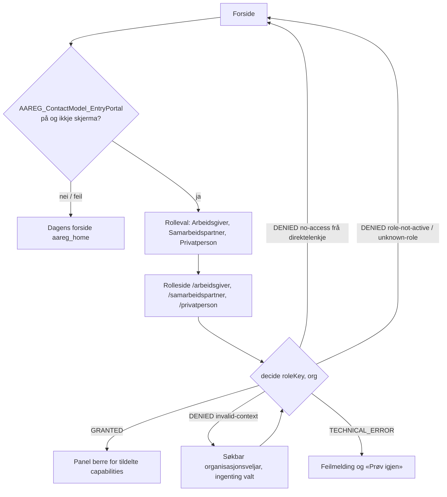
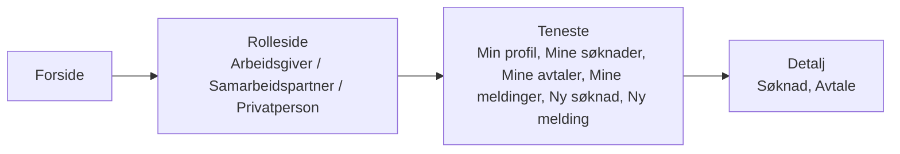

# Inngangsportal og rollesider

Forsida i Aa-registeret startar med eit rolleval. Kvar rolle har si eiga side. Tenestene på sida blir viste først
når serveren har kontrollert rolla og organisasjonen. Løysinga følgjer målbiletet i
[`docs/brukerstotte_utvidelse`](https://github.com/navikt/crm-arbeidsforhold/tree/brukerst%C3%B8ttel%C3%B8sning_utvidelse_20261110/docs/brukerstotte_utvidelse)
og spesifikasjonen for kontaktmodellen. Ho ligg bak fail-closed brytarar.

## Flyt

## Komponentar

| Del                                                                 | Ansvar                                                                                                                                                                                                                                                      |
| ------------------------------------------------------------------- | ----------------------------------------------------------------------------------------------------------------------------------------------------------------------------------------------------------------------------------------------------------- |
| `AAREG_PortalRole__mdt`                                             | Rolleregister: konteksttype, side, brytar, rekkjefølgje og aktiv.                                                                                                                                                                                           |
| `AAREG_RoleCapability__mdt`                                         | Kva capability ei rolle får, og kva Altinn-ressurs som gir henne.                                                                                                                                                                                           |
| `AAREG_RoleAccessService`                                           | Éin avgjerdsstad. `decide` kastar aldri. `require` kastar `AccessDeniedException`.                                                                                                                                                                          |
| `AAREG_EntryPortalController`                                       | `getPortal`, `decide` og `getOrganizations(roleKey)` for portalen og rollesidene.                                                                                                                                                                           |
| `aaregEntryPortal` (LWC)                                            | Ligg på heimesida. Viser rolleval når brytaren er på, elles dagens forside.                                                                                                                                                                                 |
| `aaregRolePage` (LWC)                                               | Rolleside med `roleKey` som designattributt. «Rolle: … / Bytt rolle» øvst, søkbar veljar som alltid er synleg, og tilgangen blir sjekka straks ei virksomheit er vald. Tenestene blir viste i to kolonnar: søknad og avtaler, og brukarstøtte og meldingar. |
| Sidene `Arbeidsgiver__c`, `Samarbeidspartner__c`, `Privatperson__c` | Experience Cloud-sider i `Aa_registret1`.                                                                                                                                                                                                                   |
| `aaregPortalNav` (LWC)                                              | Brødsmulesti og kontekstlinje øvst på portalsidene. Smal skjerm får «Tilbake til …» i staden for stien. Blir berre vist når portalbrytaren er på.                                                                                                           |
| `aaregPortalContext` (JS)                                           | Hugsar rolle, organisasjonsnummer og namnet frå veljaren for økta (`sessionStorage`), og byggjer stien. Ingen personopplysningar.                                                                                                                           |
| Aksel-byggjesteinar (LWC)                                           | `aaregLinkPanel`, `aaregAlert`, `aaregTextField`, `aaregLoader` og `aaregIcon`. Felles utsjånad for alle portalsidene.                                                                                                                                      |

## Navigasjon og utsjånad

Alle portalsidene har same oppsett: brødsmulesti øvst, deretter `h1`, og innhald med maks breidd 60rem.

- **Sti:** `Forside › Rolle › Side › Detalj`. Rolleleddet tek med `?org=` for organisasjonsroller, slik at
  brukaren kjem tilbake til same virksomheit. Tilgangen blir likevel kontrollert på nytt.
- **Kontekst:** Rolla og organisasjonsnummeret blir lagra i `sessionStorage` (`aareg.portal.context`) når
  rollesida har gitt tilgang. Forsida og «Bytt rolle» tømmer konteksten. Ugyldige verdiar blir forkasta.
  Utan rolle går stien rett frå «Forside». Stien viser aldri namn på verksemder eller personar.
- **Vald virksomheit på alle sider:** Under stien på alle undersider står ei kontekstlinje, til dømes
  «Arbeidsgiver for Bedrift AS · Org.nr. 910 000 001 · Bytt virksomhet». Privatperson får «Du bruker tjenesten
  på egne vegne · Bytt rolle». Rollesida har eigen veljar og viser ikkje linja.
    - Organisasjonsnummeret kjem frå serveren (`getPortal().organization`, frå `User.LastUsedOrganization__c`).
      Det er same verdi som dei eldre sidene brukar til å hente søknader, avtaler og meldingar. Linja viser
      difor alltid den virksomheita sida faktisk arbeider for, også om økta i nettlesaren er utdatert.
    - Namnet er det brukaren såg i veljaren (frå Altinn) når nummeret stemmer, elles kontonamnet i Salesforce.
- **Sidetittel i staden for blått banner:** Når portalbrytaren er på, blir `aareg_mainBanner` ein Aksel-overskrift (`h1`)
  rett under stien og kontekstlinja, i same breidd som dei nye sidene. Experience-visningane for melding, søknad og ny
  søknad plasserer komponenten etter `aaregPortalNav`. Når brytaren er av, eller kallet feilar, kjem det blå banneret
  tilbake øvst slik som før. Teksten i tittelen er uendra.
    - «Bytt virksomhet» opnar rollesida med valet, slik at brukaren kan velje ei anna.
- **Valet blir hugsa:** Rollesida brukar virksomheita frå økta når lenkja ikkje har `?org=`. Ei virksomheit
  hugsa for ei anna rolle blir ikkje brukt. «Min profil» startar med same kontekst: virksomheita, eller
  «Meg selv» for privatperson. Tilgangen blir kontrollert i Altinn på nytt begge stader.
- **Veljaren:** Feltet fyller breidda på kortet (maks 48rem) og har søkjeikon. Den valde virksomheita står i
  ein grøn boks («Valgt», namn og org.nr.) over feltet til brukaren vel ei anna.
- **Smal skjerm (under 480px):** Berre lenkja «Tilbake til {forelder}» blir vist.
- **Tilgjengelegheit:** `<nav aria-label="Brødsmulesti">`, ordna liste og `aria-current="page"` på siste ledd.
  Panela er ekte lenkjer, så Ctrl-/Cmd-klikk opnar i ny fane.
- **Aksel:** Nettstaden lastar Aksel v2-CSS globalt gjennom `crm-community-base`. Komponentane brukar difor
  `navds-*`-klassar og `--a-*`-tokens, ikkje React-pakken. Overgang til Aksel v8 (`--ax-*`) krev endring i
  `crm-community-base`, som Team Platforce eig. Det er ei eiga oppfølging.
- **Éin sti:** Når portalbrytaren er på, skjuler dei gamle stiane seg. `aareg_breadcrumbs` på meldingssida og
  omslaget `aaregLegacyBreadcrumbs` rundt `c-breadcrumbs` i sju eldre komponentar (søknad, avtale, avtalekontaktar,
  mine søknader, mine avtaler, mine meldinger og kontaktskjemaet) spør `getPortal()`. Den gamle stien blir viste
  berre når brytaren er av eller kallet feilar, så tilbakerulling gir dagens navigasjon.

## Avgjerdskontrakt

`decide(roleKey, organizationNumber)` returnerer `outcome`, `reason`, `roleKey`, `contextType`,
`organizationNumber` og `capabilities`. Svaret inneheld ikkje personopplysningar.

| Utfall            | Grunn             | Når                                                                              |
| ----------------- | ----------------- | -------------------------------------------------------------------------------- |
| `GRANTED`         |                   | Minst éin capability er tildelt, eller personrolla er gyldig.                    |
| `DENIED`          | `unknown-role`    | Rolla finst ikkje.                                                               |
| `DENIED`          | `role-not-active` | Rolla er inaktiv, portal- eller rollebrytaren er av, eller personen er skjerma.  |
| `DENIED`          | `invalid-context` | Manglande eller ugyldig organisasjonsnummer, eller organisasjon for personrolle. |
| `DENIED`          | `no-access`       | Altinn gir ingen av ressursane rolla krev.                                       |
| `TECHNICAL_ERROR` |                   | Altinn eller serveren svarer ikkje. Ingen tilgang blir gitt.                     |

Klienten viser berre det serveren har gitt. Organisasjonsnummer frå URL-en (`?org=`) blir godteke berre med ni
siffer. Meldingar til forsida går som `c__message` med ei fast liste over kodar. Ukjende kodar blir ignorerte.

## Direktelenkjer

Forsida godtek `?type=employer|agent|private-person&org=<9 siffer>`. Lenkja går til rollesida dersom rolla er
tilgjengeleg. Elles blir brukaren verande på rollevalet. Rollesida kontrollerer alltid tilgangen på nytt.

## Brytarar

| Brytar                            | Verknad                                  |
| --------------------------------- | ---------------------------------------- |
| `AAREG_ContactModel_EntryPortal`  | Rolleval på forsida i staden for dagens. |
| `AAREG_ContactModel_RoleEmployer` | Rolla «Arbeidsgiver».                    |
| `AAREG_ContactModel_RolePartner`  | Rolla «Samarbeidspartner».               |
| `AAREG_ContactModel_RolePrivate`  | Rolla «Privatperson».                    |

Alle er av i repoet og krev `AAREG_ContactModelPilot` i pilotfasen. Dei følgjer brukarbrytarane i
[utrullinga](utrulling.md): på i fasane pilot, brei og skifte. Når portalbrytaren er av, ser alle dagens forside.
Skjerma personar ser alltid dagens forside (ADR-0008).

## Deploy av Experience-sidene

`.forceignore` utelèt `**/experiences`. Derfor blir `home.json` og rolle-rutene/-visingane ikkje med i ein vanleg
`sf project deploy start`. Repo-bundelen er dessutan ute av synk med orgen og blir avvist i heilskap. Gjer slik i
scratch:

1. Hent `ExperienceBundle:Aa_registret1` frå orgen inn i eit mellombels SFDX-prosjekt.
2. Kopier inn `routes/` og `views/` for `arbeidsgiver`, `samarbeidspartner` og `privatperson`, og byt
   `c:aareg_home` til `c:aaregEntryPortal` i `views/home.json`.
3. Deploy frå det mellombelse prosjektet og køyr `sf community publish --name "Aa-registret"`.

Brødsmulestien er lagd inn som første komponent i innhaldsseksjonen i `views/` for rollesidene, `minProfil`,
`mineSøknader`, `mineAvtaler`, `mineMeldinger`, `nyMelding`, `nySøknadAaRegistret`, `applicationDetailFlex`,
`agreementDetailFlex` og `threadDetailFlex`. `.prettierignore` utelèt `**/experiences/**/*.json`.
Dei fleste filene er i Salesforce sitt eige JSON-format, og ei omformatering ville gitt diff i alle filene.

Utan dette viser nettstaden dagens forside, og rollesidene gir 404 sjølv om brytarane er på.

## Tilbakerulling

Slå av `AAREG_ContactModel_EntryPortal`. Forsida viser dagens `aareg_home` ved neste sidelasting. Rollesidene svarer
då med `role-not-active` og sender brukaren til forsida. Ingen data må rullast tilbake.

## Overgang og avvik

- **`LastUsedOrganization__c`:** Ved `GRANTED` for ei organisasjonsrolle blir organisasjonen lagra på brukaren,
  fordi dagens undersider (søknad, avtaler, brukarstøtte) les feltet. Når `AGREEMENTS` er tildelt, blir avtalane
  delte med brukaren som på dagens forside. Feltet blir overflødig når undersidene tek imot kontekst sjølve.
- **Samarbeidspartnar** brukar same Altinn-ressursar som arbeidsgivar (`sok-tilgang` og `brukerstotte`). Dette er
  ei antaking til kjelda er avklart. Brytaren er av.
- **Privatperson** får ingen tenester enno, berre «Min profil». Wireframen viser brukarstøtte og meldingar,
  men `AAREG_contactSupportController` stemplar meldinga med `LastUsedOrganization__c`. Ei personleg melding ville
  då blitt knytt til ei virksomheit. Capabilities blir lagde til i `AAREG_RoleCapability__mdt` når meldingsskjemaet
  tek imot personkontekst.
- **Utforming:** [wireframen frå brukarstøtte-branchen](arkiv/brukerstotte-wireframes-branch.html) viser retninga,
  ikkje fasit. Neste steg derifrå er «Du sender som … for …» med «Endre» i meldingsskjemaet.
- **`require`** er ikkje kopla inn i kontrollarane for søknad og brukarstøtte. Det er neste steg og raud sone.
- Rollevalet blir ikkje hugsa mellom økter. Brukaren vel rolle kvar gong.
