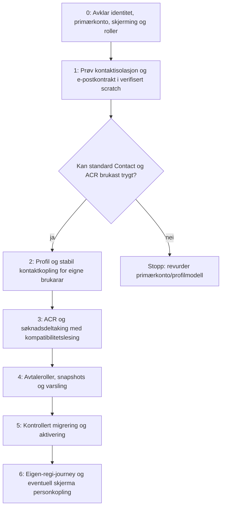

# Migrering og verifikasjon

**Status: Føreslått gjennomføringsrekkjefølgje, ikkje godkjend operativ runbook.**
Sjå [analysen](analyse-og-malmodell.md) og [brukarflytane](brukarflater-og-flyt.md).

## 1. Beslutningar før implementasjon

| Beslutning                 | Tilrådd utgangspunkt                                                                                   | Må avklarast/godkjennast av                         |
| -------------------------- | ------------------------------------------------------------------------------------------------------ | --------------------------------------------------- |
| Kontaktens domene          | Éin autoritativ Aa-register-kontakt per verifisert person, ikkje global Nav-master                     | Team Arbeidsforhold og Team Platforce               |
| Primærkonto og deling      | Kontrollert teknisk domenekonto, berre dersom isolasjon og volum blir beviste                          | Team Platforce og sikkerheitsansvarlege             |
| Identitetsmapping          | Eksisterande innloggingsgrense; ikkje e-postmatching eller repoint av User.ContactId                   | Team Platforce                                      |
| Tredjepartar og postkasser | Uavklart kontakt er lov; ingen automatisk personmerge; postkasse er ikkje person                       | Produkteigar og personvern-/sikkerheitsansvarlege   |
| Rollemodell                | Éi rolle per deltaking; varselflagg er separate; definer obligatoriske roller og kardinalitet          | Produkteigar og saksbehandling                      |
| Profilredigering           | Personen redigerer eigne kontaktpunkt; representanten administrerer kontekstroller                     | Produkteigar og sikkerheitsansvarlege               |
| E-post per organisasjon    | Privat adresse på profilen og éi adresse per tilknyting frå start; vel lagring (ACR eller eige objekt) | Produkteigar og Team Platforce                      |
| E-postverifisering og kø   | Godkjend verifisering og sporbar adressebinding; revalider ved utsending                               | Team Platforce og eigar av e-postpakken             |
| Skjerming frå fase 1       | Bruk etablert særtilgang også for kontakt, relasjon og avleidd informasjon                             | Personvern-/sikkerheitsansvarlege og Team Platforce |
| Innsendingshistorikk       | Uforanderleg grunnlag per innsending/ny innsending, med godkjend retention                             | Produkteigar, arkiv og personvern                   |
| Eigen regi                 | Kontakt kan finnast utan aktiv organisasjon; eige funksjonelt scope for privatpersonflyt               | Produkteigar                                        |
| Person Account             | Ikkje automatisk kopling/samanslåing i første fase                                                     | Team Platforce og personvern-/sikkerheitsansvarlege |

Oppdater ei eventuell beslutning i rett kjelde. Dei eksisterande Confluence-speila ADR-ane skal
ikkje endrast lokalt som om dei var godkjende. Denne leveransen er ikkje ei tildeling av org-,
pakke-, CI-/auth- eller produksjonsløyve.

## 2. Små faseskifte, ikkje ei total omskriving

Fasane er logiske milepålar, ikkje isolerte utrullingar som kan setjast i produksjon utan avhengigheitene.
Profilendring må til dømes ikkje aktiverast mot eksisterande meldingar før adressebinding og historikk
er trygg. Dagens innsendingsflyt må ikkje konkurrere med den nye kontaktopprettinga.

### Fase 0–1: bevis dei farlege føresetnadene først

Prøv standardobjekt og faktiske lisens-/delingsinnstillingar før nye metadata blir designa ferdig:

- «Contacts to Multiple Accounts» er tilgjengeleg/aktivert i målkonfigurasjonen.
- Teknisk primærkonto opnar ikkje alle kontaktane for ein portalbrukar.
- ACR-vising opnar ikkje andre organisasjonar eller personkoplingar.
- Skjerming verkar for direkte lesing, søk, rapport, fil og bakgrunnsjobb.
- Eksisterande innlogging og Altinn-oppslag fungerer uendra.
- E-postpakken støttar nødvendig adressebinding/revalidering, eller har ei godkjend endringsløysing.
- Unik kontakt-/deltakingoppretting fungerer ved samtidige kall.

**Stoppkriterium:** dersom dette ikkje kan bevisast, skal ein ikkje «fikse» problemet ved å gi
brei lesetilgang, bruke `without sharing` overalt eller la ein felles konto eige tilgangen til alle saker.

### Fase 2–4: additive endringar og kontrollerte kontraktar

1. Etabler sikker mapping til domenekontakt utan å endre innloggingskontakten.
2. Legg til profilkontrakt og fokusert sjølvbetening.
3. Utvid `RelatedContact__c` med kontakt og rolle; bevar eksisterande fritekst for lesekompatibilitet.
4. Behald gammal controller-signatur ved behov, men oversett og valider server-side;
   ikkje la gamle og nye skrivevegar konkurrere som to autoritative kjelder.
5. La `Application__c.Contact__c` vere ei kontrollert projisering av innsendarrolla.
6. Erstatt e-post-/organisasjonsmatching først når kontaktidentitet, roller og varsel er klare.
7. Opprett eigne avtaledeltakingar framfor å endre søknadsdeltakinga.
8. Sørg for innsendingsversjon og kontrollert varsel før funksjonen blir aktivert.

Bruk etablerte konfigurasjons-/feature-toggle-mønster dersom styrt aktivering er nødvendig.
Dette er ikkje forslag om nye dynamiske klassefabrikkar eller eit generelt personrammeverk.

## 3. Berørte filer og kontraktar

Ingen av desse er endra i denne leveransen. Tabellen viser kva implementasjon må kartleggje.

| Område                      | Kjelde/kontrakt                                                                                                                                                                                                                                                                  | Konsekvens                                                                                                |
| --------------------------- | -------------------------------------------------------------------------------------------------------------------------------------------------------------------------------------------------------------------------------------------------------------------------------- | --------------------------------------------------------------------------------------------------------- |
| Kontaktoppretting           | [AAREG_createContactSendConfirmation](../../../force-app/main/default/flows/AAREG_createContactSendConfirmation.flow-meta.xml)                                                                                                                                                   | Bytt personidentifikasjon, ikkje berre filteret. Unngå dobbel oppretting og dobbel kølegging.             |
| Søknadsskriving             | [AAREG_ApplicationController](../../../force-app/externalApplication/classes/AAREG_ApplicationController.cls)                                                                                                                                                                    | Deltaking, autorisasjon, unikheit, statusrekkjefølgje og kompatibilitetsoppslag.                          |
| Eksisterande kontrakttestar | [AAREG_ApplicationControllerTest](../../../force-app/externalApplication/classes/AAREG_ApplicationControllerTest.cls)                                                                                                                                                            | Dagens primærkonto-/e-postgjenbruk er eksplisitte forventningar som må migrerast, ikkje berre slettast.   |
| Ekstern søknad              | [aareg_application](../../../force-app/externalApplication/lwc/aareg_application/) og [aareg_applicationContact](../../../force-app/externalApplication/lwc/aareg_applicationContact/)                                                                                           | Profilprefill, rolleval, uavklart kontakt og skilje frå profilredigering.                                 |
| Intern søknad               | [AAREG_ApplicationInternalController](../../../force-app/internalApplication/classes/AAREG_ApplicationInternalController.cls)                                                                                                                                                    | Vis aktuell kontakt og innsendt grunnlag eksplisitt.                                                      |
| Relasjonsmetadata           | [RelatedContact__c](../../../force-app/main/default/objects/RelatedContact__c/) og [Application.Contact__c](../../../force-app/main/default/objects/Application__c/fields/Contact__c.field-meta.xml)                                                                             | Additive felt, datainvariantar, deling og overgangsreglar.                                                |
| Søknadstekst                | [AAREG_populateApplicationFieldAfterSubmit](../../../force-app/main/default/flows/AAREG_populateApplicationFieldAfterSubmit.flow-meta.xml)                                                                                                                                       | Bevar korrekt kontaktgrunnlag per innsending.                                                             |
| Avtaleoppretting            | [AAREG_Decision_Completed](../../../force-app/main/default/flows/AAREG_Decision_Completed.flow-meta.xml)                                                                                                                                                                         | Opprett eiga avtaledeltaking i staden for dobbeltkopla søknadsrad.                                        |
| Avtalekontaktar             | [AAREG_MyAgreementsController](../../../force-app/externalAgreement/classes/AAREG_MyAgreementsController.cls) og [aareg_agreementContacts](../../../force-app/externalAgreement/lwc/aareg_agreementContacts/)                                                                    | Endre/fjern rolle utan å slette person eller endre søknadshistorikk.                                      |
| Varsling                    | [AAREG_sendAwaitingResponseEmailNotification](../../../force-app/main/default/flows/AAREG_sendAwaitingResponseEmailNotification.flow-meta.xml) og [AAREG_sendDecisionEmailNotification](../../../force-app/main/default/flows/AAREG_sendDecisionEmailNotification.flow-meta.xml) | Mottakarpolicy, aktiv deltaking, skjerming og deduplisering.                                              |
| Innlogging/fullmakt         | [AAREG_CommunityUtils](../../../force-app/externalAccess/classes/AAREG_CommunityUtils.cls)                                                                                                                                                                                       | Bevar eksisterande identitetsgrense og faktisk fullmaktskontroll.                                         |
| Arkivering                  | [P360-integrasjonen](../../../force-app/integration/p360/)                                                                                                                                                                                                                       | Verifiser innsende kontaktgrunnlag i dokument og ved retry; ikkje endre integrasjonskontrakt på antaking. |
| Tilgang og rapportering     | [Permission sets](../../../force-app/main/default/permissionsets/) og [report types](../../../force-app/main/default/reportTypes/)                                                                                                                                               | Nye felt krev eksplisitt tilgang; fleire roller kan endre radtal og rapportteljing.                       |

Kontakt-/supportflytar og nedstraums konsumentar må referansekartleggjast før migrering.
Tabellen er ikkje ein fullstendig «where used»-analyse eller dokumentasjon på org-dependency-ar.
Pakkeeigde komponentar er lesbare referansar, ikkje fritt endringsscope.

## 4. Migrering utan farleg automatisk samanslåing

### 4.1 Klassifiser, ikkje berre dedupliser på e-post

| Eksisterande rad                                         | Tilrådd behandling                                                          |
| -------------------------------------------------------- | --------------------------------------------------------------------------- |
| Kontakt med godkjent, verifisert identitetskopling       | Kandidat for mapping til autoritativ domenekontakt                          |
| Same person dokumentert på fleire organisasjonskontaktar | Opprett/rebruk ACR-par og flytt framtidig deltaking kontrollert             |
| Same e-post, ukjent personidentitet                      | Ikkje automatisk merge                                                      |
| Felles postkasse eller funksjonskontakt                  | Bevar som kontaktpunkt/uavklart rad, ikkje personprofil                     |
| Fritekst RelatedContact utan identitet                   | Bevar innsendt historikk; avklar/registrer kontakt i framtidig skriveveg    |
| RelatedContact med både søknad og avtale                 | Etabler separate deltakingar utan å miste kva kvar kontekst tidlegare viste |
| Skjerma eller ukjent skjermingsstatus                    | Godkjend særhandtering; ikkje brei eksport eller automatisk kopling         |

Migreringsmapping og detaljrapportar inneheld personopplysningar og høyrer ikkje heime i offentleg repo,
GitHub-kommentarar eller dokumenta her. Bruk godkjend ikkje-offentleg lagring og sporbar tilgang.

### 4.2 Bevar og kontroller

- Ta godkjend kopi av originaldata og relasjonar før endring, i godkjend lagring.
- Kjør tørrkøyring med aggregert resultat og eksplisitt liste over uavklarte kategoriar.
- Bevar gamle ID-ar i kontrollert mapping; flytt ikkje innloggingskoplingar som sideeffekt.
- Migrer i avgrensa, repeterbare batchar; gjenkøyring skal ikkje lage nye kontaktar, ACR-ar eller roller.
- Bevar innsende og arkiverte opplysningar. Ny profil skal ikkje «korrigere» gamle dokument.
- Sjekk konto-, aktivitet-, fil-, e-post-, avtale- og arkivrelasjonar før noko blir slått saman.
- Handter ACR-konfliktar før kontaktmerge; Salesforce dokumenterer konfliktar ved overlappande indirekte relasjonar.
- Ikkje slett/merge gamle kontaktar i første utrulling berre fordi dei er mappa til ein ny kontakt.

Akseptanserekneskap:

- Alle historiske søknader/avtalar har same verifiserte innsendingsgrunnlag som før.
- Alle migrerte personar har éin autoritativ domenekontakt og korrekt organisasjons-/deltakingmapping.
- Alle ikkje-migrerte rader er klassifiserte som uavklarte, ikkje skjulte feil.
- Ingen nye kryssorganisasjonsinnsyn eller skjermingsbrot.
- Ingen uventa varsel sendt av migrerings-DML.

### 4.3 Rollback er meir enn å slå av eit flagg

Etter at same kontakt er brukt på tvers av organisasjonar, kan gammal `AccountId + Email`-matching ikkje
utan vidare gjeninnførast. Ho vil kunne skape nye duplikat eller feil mottakar.
Rollback må derfor skilje:

1. stoppe nye skriveoperasjonar/varsling kontrollert;
2. halde lesing av både gamle og nye data tilgjengeleg med korrekt tilgang;
3. bruke den godkjende mappinga til målretta tilbakeføring, dersom historikk og sideeffektar tillèt det;
4. ikkje reversere nye profil-/identitetsdata eller arkiverte dokument blindt.

Metadata som skal slettast eller få nytt API-namn krev eigen operativ runbook med alle API-namn,
ansvar, godkjenningar, skript, rollback og verifikasjon.
SIT2-verifikasjon krev fersk mål-/handlingsgodkjenning for kvar org-kommando.
Team Platforce utfører produksjonsverifikasjon og sletting; agentar skal ikkje aksessere produksjon.

## 5. Akseptansetest gjennom offentleg åtferd

Dette er foreslåtte testar, **ikkje køyrde eller grøne testar**.
Test gjennom same serverkontrakt som portal/saksbehandlar brukar, ikkje gjennom private tilstandsfelt.
Bruk syntetiske personar og adresser i godkjend testmiljø.

| Scenario                                              | Målbart resultat                                                                                           |
| ----------------------------------------------------- | ---------------------------------------------------------------------------------------------------------- |
| Same verifiserte person sender med ny e-post          | Same domenekontakt-ID; kontaktantall uendra; ny adresse først gjeldande etter verifisering                 |
| Same person representerer to organisasjonar           | Éin domenekontakt, eitt relevant ACR-par per organisasjon; korrekte søknadsroller                          |
| To personar brukar same e-post                        | Ingen automatisk merge eller krysskopling                                                                  |
| Same person får to roller i same søknad               | To deltakingar, éin kontakt, høgst eitt varsel per mottakar/hending                                        |
| Dobbeltklikk eller samtidige kall                     | Éin autoritativ kontakt og ingen duplikat for kontekst + kontakt + rolle                                   |
| Eigen regi utan aktiv organisasjon                    | Eigen profil kan brukast; ingen organisasjonstilgang blir avleidd                                          |
| Organisasjonsbyte                                     | Ny fullmaktsavgjerd og ingen kontaktar/utkastdata frå førre kontekst i responsen                           |
| Klient sender ein annan ContactId                     | Avslag utan lesing/endring av den andre profilen                                                           |
| Representant endrar ein tredjepart sin globale e-post | Avslag; tillaten rolleendring påverkar ikkje profilen                                                      |
| Person endrar adressa hos organisasjon A              | Adressa hos B og privatadressa er uendra                                                                   |
| Adresse manglar for organisasjon B ved innsending     | Innsending krev adresse; ingen fallback til privat adresse eller adressa hos A                             |
| Organisasjon A ser på kontakten                       | Privatadressa og adressa hos B er ikkje synlege                                                            |
| Tilknyting/fullmakt blir trekt tilbake                | Nye handlingar blir avviste; personen og historikken blir bevarte                                          |
| Tilgang-/skjermingsavgjerd feilar                     | Ingen data eller melding blir frigitt; synleg feil, ikkje permissiv fallback                               |
| Manglande særtilgang for skjerma person               | Ingen persondetaljar i UI, søk, rapport, eksport, fil, kø eller feilrespons                                |
| Profil blir endra etter innsending                    | Historisk søknads-/arkivgrunnlag uendra; nye meldingar følgjer vedteken adressepolicy                      |
| Profil/rettar blir endra etter kølegging              | Varsel stansar eller får kontrollert ny mottakaravgjerd; inga umerkt utsending til gammal adresse          |
| Ny innsending / arkivretry                            | Rett versjon av innsendingsgrunnlaget; retry endrar ikkje historiske kontaktdata                           |
| Overgang til avtale                                   | Eigne avtaleroller; endring/fjerning av avtalerolle endrar ikkje søknadsversjonen                          |
| Gamal dobbeltkopla eller uavklart rad                 | Lesbar historikk og eksplisitt migreringsstatus; ingen tvungen e-postmerge                                 |
| Nytt profilendringskall feilar i DML                  | Profil uendra og tydeleg feil; ingen falsk «lagra»-melding                                                 |
| Innlogging og Altinn etter migrering                  | Eksisterande identitetskopling fungerer utan endring av User.ContactId                                     |
| Stor organisasjon/batch                               | Bulkifisert SOQL/DML, dokumenterte grenser og prøvd primærkontovolum                                       |
| Minste tilgang                                        | Positive eigne handlingar og negative kryssperson-/kryssorganisasjonshandlingar prøvde med minimumstilgang |

### Lokal og org-avhengig verifikasjon

- **Lokal Jest:** profilprefill, rolle-/varselval, konfliktsvar, organisasjonsbyte, feilvising og tastatur/fokus.
  Fokusert køyring følgjer repositorymønsteret
  `npm run test:unit -- -- --runInBand <test-path>`.
- **Org-avhengig Apex/Flow:** Contact/ACR-reglar, samtidige skriveoperasjonar, faktisk deling/CRUD/FLS,
  minimumstilgang, særtilgang, statusrekkjefølgje, avtaleovergang og varsling.
- **Integrasjon:** adressebinding i installert e-postpakke, mottakarkontroll og dokumentinnhald ved arkivering/retry.
- **Migrering:** tørrkøyring, aggregert rekneskap, målretta attkøyring og kontrollert rollback.

For kvar vertikale implementasjonsskive: skriv ein åtferdstest, observer raudt når miljøet støttar det,
implementer minste endring, observer grønt og refaktorer først deretter.
Apex krev autentisert, verifisert scratch-org gjennom den støtta host-terminalen.
Lokale Jest-resultat beviser ikkje Apex, ACR, skjerming eller e-postlevering.

## 6. Verifikasjon i denne leveransen

- Repository-kode, relevante Flow-/objektmetadata, næraste testar og eksisterande ADR-ar er lesne.
- Offisielle kjelder er undersøkte med avgrensingane dokumenterte i [analysen](analyse-og-malmodell.md#6-eksterne-kjelder-og-kunnskapsgrenser).
- Ingen orglesing, deploy, datamigrering, e-postsending, Apex-test eller Jest-test er utført.
- Leveransen omfattar berre nye dokument. Han er ikkje godkjenning eller bevis for operativ gjennomføring.
