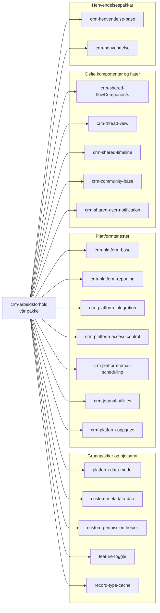
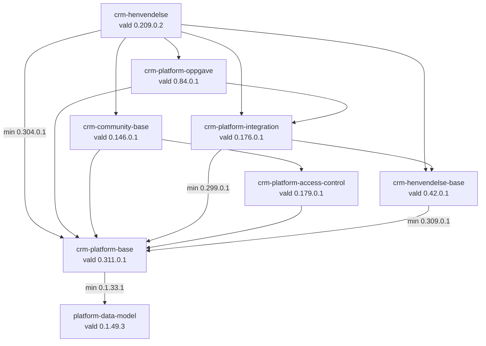
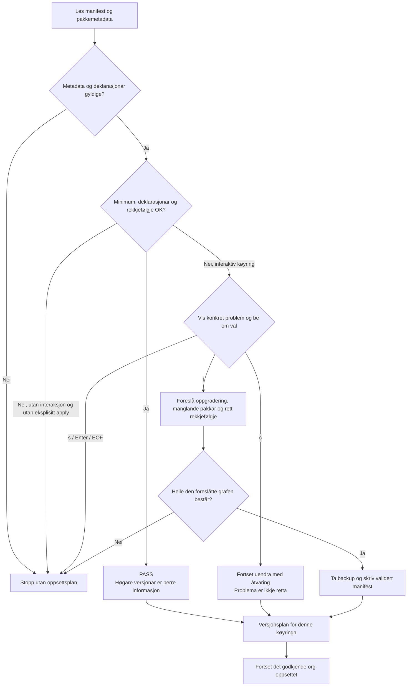

# Pakkeavhengigheiter i crm-arbeidsforhold

`crm-arbeidsforhold` byggjer på 19 deklarerte Salesforce-pakkar. Dette dokumentet
forklarer kva pakkar som er med, korleis avhengigheitene heng saman, og kva
versjonskrava betyr. Kommandoar og operasjonelle scenario ligg i
[skriptguiden](../../bin/README.md) og [kommandoreferansen](../../bin/COMMANDS.md).

## Innhald

- [Kjelder og dato](#kjelder-og-dato)
- [Kva er ei pakkeavhengigheit?](#kva-er-ei-pakkeavhengigheit)
- [Alle dei direkte avhengigheitene](#alle-dei-direkte-avhengigheitene)
- [Kva dei ulike pakkane bidreg med](#kva-dei-ulike-pakkane-bidreg-med)
- [Samband mellom pakkane](#samband-mellom-pakkane)
- [Versjonar og minimumskrav](#versjonar-og-minimumskrav)
- [Preflight og autofiks](#preflight-og-autofiks)
- [Endringar, eigarskap og verifikasjon](#endringar-eigarskap-og-verifikasjon)

## Kjelder og dato

Dette er eit repo-eigd forklaringsdokument, ikkje ein generert installasjonsrapport
eller eit nytt arkitekturvedtak.

| Kjelde                                                       | Kva ho fortel                                                         |
| ------------------------------------------------------------ | --------------------------------------------------------------------- |
| [sfdx-project.json](../../sfdx-project.json)                 | Deklarerte avhengigheiter, versjonsseriar, pakkealias og kjeldemapper |
| Avhengigheitsrapport frå `2026-10-24T20:35:55.965Z`          | Konkret oppløyste versjonar og observerte minimumskrav i den køyringa |
| README i kvar referansemappe                                 | Dokumentasjon og avgrensingar for den lokale pakkekjelda              |
| [package-dependencies.js](../../bin/package-dependencies.js) | Implementasjonen av minimumskontroll, rapport og autofiks             |

Versjonstabellen og sambandsdiagrammet nedanfor er eit **datert øyeblikksbilete**
frå desse kjeldene. `LATEST` kan seinare bli løyst til eit anna bygg. Bruk manifestet
og ein fersk, godkjend metadata-sjekk for ei ny køyring; ikkje kopier denne tabellen
til manifestet som ei oppgraderingsliste.

Rapporten viste:

- 19 direkte deklarerte avhengigheiter;
- 0 manglande pakkedeklarasjonar;
- 0 valde versjonar under minimumskravet;
- 0 rapporterte installasjonsrekkjefølgjefeil;
- 57 krav der vald versjon var høgare, fordelte på 15 pakkar;
- samla resultat **PASSED** etter checkerens minimumspolicy.

Dette dokumenterer ikkje kva som er installert i ein bestemt org, og er ikkje
bevis på at ei Salesforce-installasjon eller ein runtime-test har lukkast.

## Kva er ei pakkeavhengigheit?

Ei direkte avhengigheit står i `dependencies` for `crm-arbeidsforhold` i manifestet.
Ei transitiv avhengigheit kjem gjennom ein av desse pakkane. Same pakke kan vere
både direkte og transitiv: vi deklarerer til dømes `crm-platform-base` sjølve,
medan fleire av dei andre pakkane òg krev han.

Dette er viktig å skilje:

| Omgrep                 | Meining                                                                |
| ---------------------- | ---------------------------------------------------------------------- |
| Vår pakke              | `crm-arbeidsforhold`, med produktkjelde under `force-app/`             |
| Deklarert avhengigheit | Pakke og versjonsserie som manifestet ber om                           |
| Minimumskrav           | Versjonen ein annan pakke oppgir at han treng                          |
| Vald versjon           | Den konkrete versjonen preflight har løyst for denne køyringa          |
| Installert versjon     | Tilstanden i målorg-en; må kontrollerast separat                       |
| Lokal referansemappe   | Kjelde for kontekst/utvikling, ikkje autoritativ avhengigheitsmetadata |

`packageAliases` koplar namn til pakkeidentitetar. Ei oppføring i
`packageDirectories`, eller ei lokal mappe, er ikkje åleine ei deklarert
avhengigheit. `src-temp` er ikkje ei tjuande pakkeavhengigheit sjølv om mappa er
merkt som standardmappe i manifestet. Alias for pakke og ID for ein bestemt
subscriber-versjon er heller ikkje det same.

## Alle dei direkte avhengigheitene

Diagrammet viser alle 19 deklarasjonane. Gruppene er ei **lesegruppering** for
oversikt, ikkje dokumentasjon på teameigarskap, formelle lag eller runtime-kall.
Ei pil tyder «har deklarert avhengigheit til».

Diagramkjelde: [pakkeoversikt.mmd](pakkeoversikt.mmd).

### Versjonsoversikt

Lenkjene i første kolonne går til kvar pakke si lokale README. Desse mappene
er pakkeeigde referansar og skal ikkje endrast som del av vanleg produktarbeid.

| Pakke                                                                          | Deklarert serie i manifestet | Vald i rapporten 2026-10-24 |
| ------------------------------------------------------------------------------ | ---------------------------- | --------------------------- |
| [platform-data-model](../../platform-data-model/README.md)                     | `0.1.49.LATEST`              | `0.1.49.3`                  |
| [custom-metadata-dao](../../custom-metadata-dao/README.md)                     | `0.1.49.LATEST`              | `0.1.49.3`                  |
| [custom-permission-helper](../../custom-permission-helper/README.md)           | `0.1.49.LATEST`              | `0.1.49.3`                  |
| [feature-toggle](../../feature-toggle/README.md)                               | `0.1.50.LATEST`              | `0.1.50.3`                  |
| [record-type-cache](../../record-type-cache/README.md)                         | `0.1.17.LATEST`              | `0.1.17.3`                  |
| [crm-platform-base](../../crm-platform-base/README.md)                         | `0.311.0.LATEST`             | `0.311.0.1`                 |
| [crm-platform-reporting](../../crm-platform-reporting/README.md)               | `0.47.0.LATEST`              | `0.47.0.2`                  |
| [crm-shared-flowComponents](../../crm-shared-flowComponents/README.md)         | `0.4.0.LATEST`               | `0.4.0.3`                   |
| [crm-henvendelse-base](../../crm-henvendelse-base/README.md)                   | `0.42.0.LATEST`              | `0.42.0.1`                  |
| [crm-platform-integration](../../crm-platform-integration/README.md)           | `0.176.0.LATEST`             | `0.176.0.1`                 |
| [crm-platform-access-control](../../crm-platform-access-control/README.md)     | `0.179.0.LATEST`             | `0.179.0.1`                 |
| [crm-thread-view](../../crm-thread-view/README.md)                             | `0.8.0.LATEST`               | `0.8.0.1`                   |
| [crm-shared-timeline](../../crm-shared-timeline/README.md)                     | `1.45.0.LATEST`              | `1.45.0.3`                  |
| [crm-community-base](../../crm-community-base/README.md)                       | `0.146.0.LATEST`             | `0.146.0.1`                 |
| [crm-platform-email-scheduling](../../crm-platform-email-scheduling/README.md) | `1.8.0.LATEST`               | `1.8.0.2`                   |
| [crm-journal-utilities](../../crm-journal-utilities/README.md)                 | `0.55.0.LATEST`              | `0.55.0.1`                  |
| [crm-shared-user-notification](../../crm-shared-user-notification/README.md)   | `0.27.0.LATEST`              | `0.27.0.2`                  |
| [crm-platform-oppgave](../../crm-platform-oppgave/README.md)                   | `0.84.0.LATEST`              | `0.84.0.1`                  |
| [crm-henvendelse](../../crm-henvendelse/README.md)                             | `0.209.0.LATEST`             | `0.209.0.2`                 |

## Kva dei ulike pakkane bidreg med

Dette er korte orienteringsforklaringar støtta av metadata som finst i dei lokale
referansemappene. Døma er **ikkje** ein full API-kontrakt, eit bevis på faktisk
bruk frå vår kode eller ei stadfesting av at referansekjelda har same versjon som
den oppløyste pakken. Sjekk den aktuelle pakka si dokumentasjon og implementasjon
før ein integrerer mot konkrete API-ar. Fleire av dei lokale README-ane er generelle.

| Pakke                           | Orienterande rolle                                      | Døme på observert metadata                                                 |
| ------------------------------- | ------------------------------------------------------- | -------------------------------------------------------------------------- |
| `platform-data-model`           | Delt datamodell og konfigurasjonsmetadata               | `Feature_Flag__mdt`, `Nav_Team__mdt`                                       |
| `custom-metadata-dao`           | Hjelpar for tilgang til Custom Metadata                 | `CustomMetadataDAO`                                                        |
| `custom-permission-helper`      | Støtte for custom permissions                           | `CustomPermissionHelper`, `CustomPermissionHelperStub`                     |
| `feature-toggle`                | Funksjonsbrytarar og inngangar for Apex, Flow og Aura   | `IFeatureToggle`, `FeatureToggleInvokable`, `FeatureToggleAura`            |
| `record-type-cache`             | Record type-oppslag og cache                            | `RecordTypeCache`, `RecordTypeSelector`                                    |
| `crm-platform-base`             | Felles CRM-hjelparar, dataoperasjonar og logging        | `CRM_DatabaseOperations`, `fflib_SObjectUnitOfWork`, `loggerUtility`       |
| `crm-platform-reporting`        | Rapporteringsdata og bruksmåling                        | `ReportingData__c`, `AmplitudeHelper`                                      |
| `crm-shared-flowComponents`     | Gjenbrukbare Flow-komponentar                           | `fcFlowRecordNavigator`, `fcFlowNextScreenNavigator`                       |
| `crm-henvendelse-base`          | Fellesmetadata og referansar for henvendelser og trådar | `CRM_ThreadRelationHandler`, `CRM_ConvNoteReferenceHandler`                |
| `crm-platform-integration`      | Integrasjonsstøtte og integrasjonsmetadata              | `PDL_Identitetsgrunnlagsstatus`, `KafkaMessageHandlerBinding__mdt`         |
| `crm-platform-access-control`   | Brukar-, eigarskaps- og delingsstøtte                   | `UsersSelector`, `DefaultRecordOwner__c`, `crmPersonSharingRerunner`       |
| `crm-thread-view`               | Delte komponentar for tråd- og meldingsvising           | `crmThreadViewFormattedDate`, `crmThreadViewMessageContainer`              |
| `crm-shared-timeline`           | Tidslinjer og konfigurasjon for vising                  | `Timeline_Validator`, `TimelineParent__mdt`, `timeline`                    |
| `crm-community-base`            | Community-/Experience Cloud- og Id-porten-støtte        | `IdPortenAuthUtil`, `IdPortenTokenRefreshController`                       |
| `crm-platform-email-scheduling` | Kø- og jobbstøtte for e-post                            | `EmailQueue__c`, `EmailQueueJob`                                           |
| `crm-journal-utilities`         | Journal- og saksrelaterte hjelparar og datamodellar     | `Journal_Entry__c`, `CRM_Sak`, `CRM_AvsenderMottaker`                      |
| `crm-shared-user-notification`  | Delte brukarvarsel og vising av varselstatus            | `UN_TmsEventApiInnboks`, `un_UsernotificationStatus`                       |
| `crm-platform-oppgave`          | Oppgåver, fristar og oppgåvekomponentar                 | `NavTask__c`, `CRM_DueDateUtility`, `crmOppgaveSyncher`                    |
| `crm-henvendelse`               | Henvendelser, arkivering og meldingskomponentar         | `CRM_Henvendelse`, `ArchiveBatch`, `crmMessagingCommunityMessageContainer` |

## Samband mellom pakkane

Alle pilene nedanfor finst i rapporten frå 2026-10-24, men dette er eit **utdrag**.
Det viser sentrale samband utan å teikne alle dei gjentekne grunnpakkekrava.
Pilen `A --> B` tyder «A krev B», ikkje at A blir installert først eller kallar B
ved runtime. Installasjon går avhengigheit-først: B må vere tilgjengeleg før A.

Nodeversjonane er dei valde versjonane i rapporten. Etikettane på nokre piler
viser minimumet den aktuelle avsendarpakken kravde. Dermed kan fleire ulike
minimumskrav samlast mot same valde pakke.

Diagramkjelde: [pakkeavhengigheiter-kjerne.mmd](pakkeavhengigheiter-kjerne.mmd).

### Kva bør vi vere særleg merksame på?

- `crm-platform-base` er eit felles knutepunkt i dette utdraget. Ei endring der
  bør vurderast mot fleire krevjande pakkar, ikkje berre vår direkte deklarasjon.
- `crm-henvendelse` samlar mange avhengigheiter. Rapporten oppgir 15 direkte krav
  frå denne pakken, mellom anna oppgåve, community, integrasjon og grunnpakker.
- Dei same grunnpakkane kan bli kravde av mange pakkar. Dei 57 høgare-versjonsradene
  er kravrelasjonar, ikkje 57 forskjellige pakkar eller 57 feil.
- Ein pakke utan registrerte direkte krav i denne rapporten er ikkje nødvendigvis
  utan runtime-avhengigheiter, konfigurasjonsbehov eller krav til org-funksjonar.

Den fullstendige, versjonsspesifikke grafen og alle innkomande krav høyrer heime
i den genererte rapporten. Dette dokumentet erstattar ikkje den grafen.

## Versjonar og minimumskrav

Salesforce-pakkeversjonane blir her samanlikna som fire tal:
`major.minor.patch.build`. Eit eksakt bygg og ei symbolsk serie som
`0.1.49.LATEST` er ulike ting. Preflight løyser serien til ein konkret versjon
og held den kontrollerte ID-en i ein mellombels plan for same oppsettskøyring.

| Påkravd minimum | Vald versjon    | Resultat og handling                                          |
| --------------- | --------------- | ------------------------------------------------------------- |
| `0.1.49.3`      | `0.1.49.3`      | PASS; ingen retting                                           |
| `0.1.33.1`      | `0.1.49.3`      | PASS: HIGHER VERSION; informasjon, ikkje spørsmål             |
| `0.1.49.3`      | `0.1.33.1`      | FAIL: VERSION TOO LOW; kan oppgraderast ved godkjend autofiks |
| `1.0.0.2`       | `1.0.0.10`      | PASS; bygg 10 er høgare enn bygg 2                            |
| `1.0.0.1`       | Ikkje deklarert | FAIL: MISSING; kan leggast til ved godkjend autofiks          |

### Eitt konkret døme frå rapporten

`crm-platform-base 0.311.0.1` oppgav minimum `platform-data-model 0.1.33.1`.
Vi hadde valt `platform-data-model 0.1.49.3`. Kravet var dermed oppfylt etter
minimumspolicyen. Vi skal ikkje nedgradere til `0.1.33.1` for å få identiske tal.

Checkerens godkjenning er likevel ikkje ein generell garanti om bakoverkompatibilitet.
API-endringar, pakke-lineage, installasjonsrettar, metadataavhengigheiter og
funksjonell oppførsel må vurderast og testast i den relevante Salesforce-org-en.

## Preflight og autofiks

Dette prosessdiagrammet gjeld normal installasjon/oppdatering som brukaren alt
har godkjent. Her viser pilene **prosessrekkjefølgje**, ikkje pakkeavhengigheiter.
Autofiks i standalone-modus avsluttar etter manifestretting utan å starte org-oppsett.

Diagramkjelde: [pakkeversjon-preflight.mmd](pakkeversjon-preflight.mmd).

Autofiks vel versjonar som er identifiserte i avhengigheitsmetadata. Ved ulike
minimum oppgraderer han til det høgaste nødvendige kravet og kontrollerer nye
avhengigheiter rekursivt. Han bevarer allereie høgare versjonar. Manifestet blir
ikkje delvis skrive dersom valideringa feilar.

`c` er ei eksplisitt aksept av risiko, ikkje ei retting eller ein ny PASS.
Metadatafeil og ugyldige grafar kan ikkje omgåast gjennom dette valet.
Sjå [preflight-scenario](../../bin/README.md#scenario-examples) for den faktiske
terminaldialogen, backup, ikkje-interaktive køyringar og feilsøking.

## Endringar, eigarskap og verifikasjon

1. Endre deklarasjonane i vårt manifest, ikkje kjelda i andre pakker utan godkjenning.
2. Les både direkte og transitive minimumskrav når ei pakke skal oppgraderast.
3. Køyr ein godkjend read-only preflight og vurder autofiks/diff før installasjon.
4. Test den faktiske installasjonen og relevant åtferd i den godkjende scratch-org-en.
5. Oppdater dette øyeblikksbiletet berre når versjonar og sambandsdata er kontrollerte.
   Oppdater både Mermaid-blokkane og dei tilsvarande `.mmd`-filene.

Pakkeeigde referansemapper er ikkje ein stad for lokale hotfixar. Feil i ei slik
pakke må handterast gjennom pakka si eigarskaps- og releaseflyt. Versjons- og
pakkeendringar skal gjennom menneskeleg review; autentisering er ikkje løyve
til å endre ein delt org eller produksjon.

For lokale dokumentasjonskontrollar kan ein samanlikne versjonstabellen med
manifestet, kontrollere at dei viste sambanda finst i rapporten, og sjekke at
innebygde Mermaid-diagram samsvarar med kjeldefilene. Desse kontrollane krev
ikkje Salesforce-tilgang og er ikkje org-validering.

### Vidare lesing

- [Scratch-org, rapportar og autofiks](../../bin/README.md)
- [Alle skriptflagg og kommandoeksempel](../../bin/COMMANDS.md)
- [Plattformar og kva testane faktisk verifiserer](../../bin/COMPATIBILITY.md)
- [Prosjektkontekst og pakkegrenser](../../CONTEXT.md)
- [Arkitektur og design](README.md)
