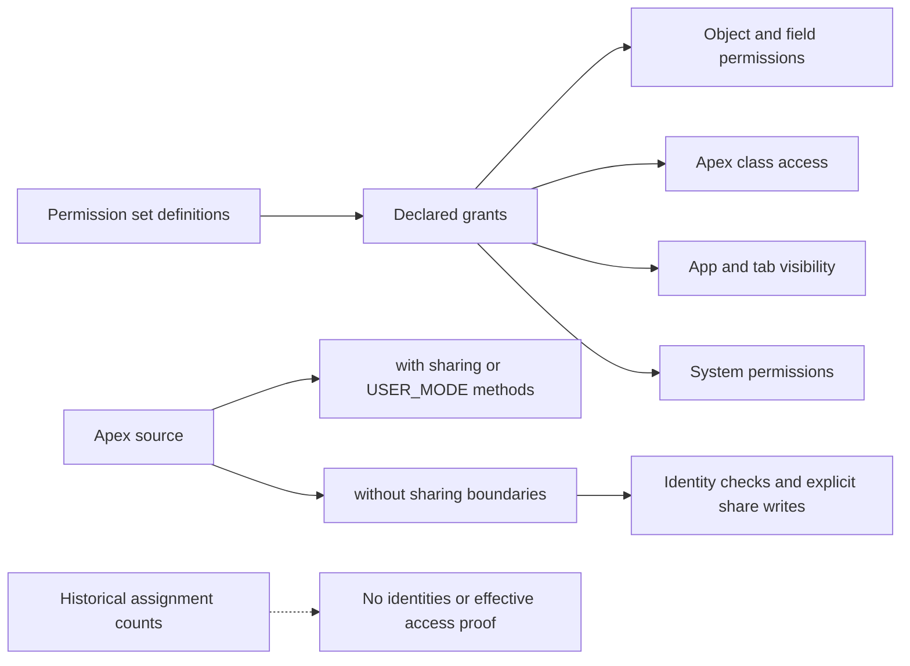

# Aa-registeret: tilgangskart frå lokal kjelde

> **Arkivert kjeldegjennomgang:** Metadata og tildelingar kan ha endra seg etter kontrollen.

**Kontrollert:** 2026-11-14 frå permission-set-, object- og Apex-metadata i
arbeidskopien. Dette er ikkje ein full org-/brukarautorisasjonsrapport.
Permission-set-definisjonar viser moglege grants; assignment, profil,
permission-set-grupper, delingar og faktisk brukarrett må vurderast separat.

Sjå òg [kjeldekartet og teststrategien](../../architecture/arbeidsforhold-kjeldekart-og-teststrategi.md)
for kjeda frå brukarflate til serverkode og den daterte,
avgrensa assignment-teljinga, samt
[scratch-org-snapshotet](aaregisteret-scratch-org-snapshot-2026-11-14.md)
for andre avgrensa org-observasjonar.

## 1. Kva kjeldene kan og ikkje kan vise

- Hovudpakken har åtte lokale permission-set-definisjonar under
  `force-app/main/default/permissionsets/`. Ingen lokale profiler,
  permission-set-grupper, sharing rules eller sharing sets vart funne under
  `force-app/main/default/`.
- Den dokumenterte lesande runtime-sjekken 2026-11-13 rapporterer éi
  assignment for `AAREG_CommunityPermission` og éi for
  `AAREG_Arbeidsforhold_Saksbehandling`. Ingen assignee-identitetar vart
  henta. Teljinga stadfestar ikkje effektiv tilgang eller noverande status.
- Lokal `with sharing` handhevar record-level sharing i den klassen; det
  beviser ikkje i seg sjølv CRUD/FLS. `WITH USER_MODE`, `AccessLevel.USER_MODE`
  og schema-kontroll må vurderast per metode.
- `without sharing` er eit eksplisitt privilegert boundary i fleire eksterne
  klasser. Koden, identitetsbinding, input, CRUD/FLS, record-scope og
  sideeffektar må vurderast saman. Dette kartet er ikkje ein sårbarheitsdom.

Diagrammet viser lokale deklarasjonar, ikkje kva ein bestemt brukar faktisk
kan gjere. Det finst ingen assignment-pil frå ein identifisert brukar i
kjeldene.

## 2. Permission-set-definisjonar

I object-kolonna betyr `C/R/E/D` create/read/edit/delete, `A` `viewAllRecords`
og `M` `modifyAllRecords`. System-permissions og field permissions kjem i
tillegg. Tala er teljing av metadataelement, ikkje tal på brukarar eller
effektive rettar.

| Permission set                                                                                                                                                             | Lokal funksjon/flate                                                                                          | Object grants i kjelda                                                                                                                                                                                                                                                                           | Andre erklærte grants                                                                                                                                                                                            | Assignment-evidens                                                    |
| -------------------------------------------------------------------------------------------------------------------------------------------------------------------------- | ------------------------------------------------------------------------------------------------------------- | ------------------------------------------------------------------------------------------------------------------------------------------------------------------------------------------------------------------------------------------------------------------------------------------------ | ---------------------------------------------------------------------------------------------------------------------------------------------------------------------------------------------------------------- | --------------------------------------------------------------------- |
| [`AAREG_CommunityPermission`](../../../force-app/main/default/permissionsets/AAREG_CommunityPermission.permissionset-meta.xml)                                             | Ekstern/community API-tilgang; 26 Apex-klassar og 131 field-permission-oppføringar                            | `Access_Request__c C/R/E`; `Agreement__c C/R/E`; `ApplicationBasisCode__c C/R/E/D`; `Application_Decision_Details__c R`; `Application_Decision__c R`; `Application__c C/R/E`; `Inquiry__c C/R/E`; `Message__c C/R/E`; `RelatedContact__c C/R/E/D`; `Thread__c C/R/E`; `UserExternalCredential R` | Ingen app-visibilitet, system-permission eller Flow access-rad i fila                                                                                                                                            | Éi assignment i datert snapshot; identitet og effektiv tilgang ukjend |
| [`AAREG_Arbeidsforhold_Saksbehandling`](../../../force-app/main/default/permissionsets/AAREG_Arbeidsforhold_Saksbehandling.permissionset-meta.xml)                         | Intern søknads-/avgjerdsbehandling; `AAREG_application`; 21 Apex-klassar, 186 field permissions               | `Access_Request__c C/R/E/D`; `Account R/E`; `Agreement__c C/R/E`; `ApplicationBasisCode__c C/R`; `Application_Decision_Details__c C/R/E/D`; `Application_Decision__c C/R/E/D`; `Application__c C/R/E/D`; `Contact C/R/E/D`; `NavUnit__c R/A`; `RelatedContact__c C/R/E/D`                        | `ActivitiesAccess`, `EditEvent`, `EditTask`, `TransferAnyEntity`; relevante tabs synlege                                                                                                                         | Éi assignment i datert snapshot; identitet og effektiv tilgang ukjend |
| [`AAREG_Arbeidsforhold_Support`](../../../force-app/main/default/permissionsets/AAREG_Arbeidsforhold_Support.permissionset-meta.xml)                                       | Support-app `AAREG_support`, Inquiry-fane; to Apex-klassar, 84 field permissions                              | `Access_Request__c R`; `Account R/E`; `Contact C/R/E/D`; `EmailQueue__c C/R/E`; `Inquiry__c C/R/E`; `NavUnit__c R/A`; `RelatedContact__c R`                                                                                                                                                      | `ActivitiesAccess`, `EditEvent`, `EditTask`, `RunFlow`, `TransferAnyEntity`                                                                                                                                      | Ikkje etablert i det refererte assignment-oppslaget                   |
| [`AAREG_Arbeidsforhold_Support_Read_Only`](../../../force-app/main/default/permissionsets/AAREG_Arbeidsforhold_Support_Read_Only.permissionset-meta.xml)                   | Support-lesing; seks read-only objektgrants, fire Apex-klassar, 119 field permissions; `AAREG_support` synleg | `Access_Request__c R`; `Agreement__c R`; `ApplicationBasisCode__c R`; `Application_Decision__c R`; `Application__c R`; `RelatedContact__c R`                                                                                                                                                     | `ActivitiesAccess`, `CreateCustomizeDashboards`, `CreateCustomizeReports`, `EditEvent`, `EditTask`, `RunFlow`, `RunReports`, `TransferAnyEntity`, `ViewPublicDashboards`; Agreement/Application tabs `Available` | Ikkje etablert i det refererte assignment-oppslaget                   |
| [`AAREG_Dialog`](../../../force-app/main/default/permissionsets/AAREG_Dialog.permissionset-meta.xml)                                                                       | Dialog-controllerar og Thread-fane; ni Apex-klassar, 36 field permissions                                     | `Message_Content__c R`; `Message__c C/R/E`; `Thread__c C/R/E`                                                                                                                                                                                                                                    | Ingen system-permissions eller explicit app-visibility-rad i fila                                                                                                                                                | Ikkje etablert i det refererte assignment-oppslaget                   |
| [`AAREG_NADA`](../../../force-app/main/default/permissionsets/AAREG_NADA.permissionset-meta.xml)                                                                           | Read-only NADA-integrasjon; 11 field permissions                                                              | `Agreement__c R/A`; `Contact R`                                                                                                                                                                                                                                                                  | Ingen Apex-klassar, app-visibilitet eller system-permissions deklarerte i fila                                                                                                                                   | Ikkje etablert i det refererte assignment-oppslaget                   |
| [`AAREG_Arbeidsforhold_rapporter_og_kontrollpanel`](../../../force-app/main/default/permissionsets/AAREG_Arbeidsforhold_rapporter_og_kontrollpanel.permissionset-meta.xml) | Rapport-/dashboard-rettar                                                                                     | Ingen object- eller field-permissions deklarerte i fila                                                                                                                                                                                                                                          | `CreateCustomizeDashboards`, `CreateCustomizeReports`, `RunReports`, `ViewPublicDashboards`                                                                                                                      | Ikkje etablert i det refererte assignment-oppslaget                   |
| [`AAREG_Arbeidsforhold_run_flow`](../../../force-app/main/default/permissionsets/AAREG_Arbeidsforhold_run_flow.permissionset-meta.xml)                                     | Flow-køyringsrett                                                                                             | Ingen object-, field- eller Apex-class grants deklarerte i fila                                                                                                                                                                                                                                  | `RunFlow`                                                                                                                                                                                                        | Ikkje etablert i det refererte assignment-oppslaget                   |

`AAREG_Arbeidsforhold_Support_Read_Only` har read-only grants på dei seks
listede objektane, men permission setet inneheld også system-permissions for
redigering av Task/Event, Flow-køyring og rapport-/dashboard-handlingar.
Namnet åleine må ikkje lesast som at alle effektar er read-only.

Dei åtte setta manglar eksplisitte `flowAccesses`-rader i lokal metadata.
`RunFlow` system permission i tre setta er ikkje bevis på at ein bestemt Flow
er synleg, aktiv eller kan kallast frå ei bestemt side.

## 3. Record-sharing-modell frå object metadata

Følgjande `sharingModel`-verdiar står i lokale CustomObject-filer. Dei er
ikkje fersk stadfesting av org-tilstanden og viser ikkje delingsreglar eller
brukarspesifikke shares.

| Objekt                            | Lokal sharing model  |
| --------------------------------- | -------------------- |
| `Access_Request__c`               | `ReadWrite`          |
| `Application__c`                  | `Private`            |
| `ApplicationBasisCode__c`         | `Private`            |
| `Agreement__c`                    | `Private`            |
| `RelatedContact__c`               | `Private`            |
| `Inquiry__c`                      | `Private`            |
| `Application_Decision__c`         | `ControlledByParent` |
| `Application_Decision_Details__c` | `ControlledByParent` |

Kjelder: dei respektive object-meta XML-filene under
[`force-app/main/default/objects`](../../../force-app/main/default/objects/).
Lokale profiler, sharing rules og sharing sets vart ikkje funne, så dette er
ikkje full OWD-/sharing-konfigurasjon for org-en.

## 4. Apex-grenser og kontrollmønster

| Boundary                             | Kjeldeobservasjon                                                                                                                                                                                    | Verifikasjonsgrense                                                                                                                                                               |
| ------------------------------------ | ---------------------------------------------------------------------------------------------------------------------------------------------------------------------------------------------------- | --------------------------------------------------------------------------------------------------------------------------------------------------------------------------------- |
| `AAREG_HomeController`               | `without sharing`; kontroller at `userId` er innlogga brukar; kallar Altinn, oppdaterer sist brukte verksemd og kan opprette Agreement-/RelatedContact-shares                                        | System-mode identitetsoppslag og delings-DML krev kontroll av record-scope, input, CRUD/FLS og faktisk share-resultat. Synlege produktflagg er ikkje effektiv record-tilgang.     |
| `AAREG_CommunityUtils.getUserRights` | `without sharing`; avviser blank/annan `userId` før identitetsoppslag og Altinn-kall                                                                                                                 | Sjekken bind brukaren til sesjonen, men beviser ikkje at alle datafelt/tilgangar elles blir handheva.                                                                             |
| `AAREG_ApplicationController`        | `without sharing`; `processApplication` har schema-basert create/update/felt-sanitizing; `saveAsDraft` følgjer ikkje same sanitize-bane                                                              | CRUD/FLS- og record-authorisering må testast per public method og per status; sjå [søknadsdelen i kjeldekartet](../../architecture/arbeidsforhold-kjeldekart-og-teststrategi.md). |
| Eksterne lesekontrollarar            | `AAREG_MyApplicationsController`, `AAREG_MyAgreementsController` og `AAREG_MyThreadsController` er deklarerte `with sharing`; enkelte les-/PDF-metodar brukar `WITH USER_MODE` eller schema-kontroll | `with sharing` gir ikkje automatisk FLS for alle spørringar eller mutationar; vurder kvar metode.                                                                                 |
| Dialog                               | `AAREG_contactSupportController` er `with sharing` og brukar `AccessLevel.USER_MODE`, `WITH USER_MODE` og `Security.stripInaccessible` på fleire skrive-/lesesteg                                    | Gjeld dei undersøkte kodestadene, ikkje alle Flow-, package- eller runtime-baner.                                                                                                 |
| Intern behandling                    | Application-, Agreement- og Decision-controllerar er i hovudsak `with sharing`; Agreement/Decision/PDF-metodar har eksplisitte schema- eller `USER_MODE`-kontrollar                                  | Permission-set metadata og `runAs`-testar åleine er ikkje bevis på aktiv org-assignment eller full data-isolasjon.                                                                |

`AAREG_HomeController` dokumenterer sjølv kvifor `without sharing` er brukt:
han skal kunne opprette delingar for community-brukarar. Det er ei tilsikta
arkitekturgrense med sideeffekt, ikkje ein rein lesekontroller.

## 5. Testmål og opne bevis

1. Test negativ direkte record-, underrecord- og filtilgang mellom verksemd A
   og B som minimumstilgangsbrukarar. Kople dette til
   [DATA-01/02 i scenario-testplanen](../../testing/aaregisteret-scenario-testplan.md).
2. Test `saveAsDraft` og `processApplication` kvar for seg med CRUD/FLS,
   feilaktig forelder, framand record-ID og filer; test også at avviste
   handlingar ikkje skriv partial records.
3. Test Home-controllerens Altinn-check og delingssideeffekt separat:
   Permit/Deny/error, organisasjonsbyte, eksisterande shares og direkte
   serverkall. UI-skjuling er ikkje autorisasjon.
4. Verifiser faktiske assignments, profiler, grupper, sharing og
   Experience Cloud-brukarkontekst berre i dokumentert, godkjend
   ikkje-produksjonsmål. Det daterte assignment-aggregatet i
   [runtime-sjekken i kjeldekartet](../../architecture/arbeidsforhold-kjeldekart-og-teststrategi.md)
   gir ikkje brukaridentitet eller effektiv rett.

**Ikkje utført:** nye org-oppslag, endringar i permission sets, Apex-testar,
Flow-testar eller endringar i tilgangslogikk. Ingen permission-set assignment
blir anbefalt frå denne kjeldekartlegginga.
