# P360: scratch-kontrakttest og interne val

> **Arkivert arbeidsrapport:** Resultat og nokre kodepåstandar gjeld testperioden. Sjå [gjeldande oversikt](../../integrations/p360/scratch-kontrakttest-og-interne-val.md).

Status 2026-11-15: søknadsinnsending er kopla til ein P360-arkivjobb, og workeren byggjer ein komplett SIF-førespurnad (`CreateCase` ved behov, deretter `CreateDocument` med samandrag og alle vedlegg). Heile vegen er verifisert ende-til-ende i den eksisterande `crm-arbeidsforhold` scratch-orgen mot eit serverfritt testmottak som lagrar førespurnadene i eit scratch-only objekt. Dette er **ikkje** ein miljøverifisert P360-klient: ekte HTTP-transport, autentisering og P360-kodeverk er framleis ikkje stadfesta mot ein P360-server.

Arbeidet følgjer bestillinga om å ta eigne, endringsvenlege val frå tilgjengeleg dokumentasjon og kunne undersøkje data utan ein P360-server. Det erstattar ikkje P360-teamet sitt eigarskap til arkivstruktur, kodeverk, obligatoriske metadata eller tilgangsreglar i [overordna rammeverk](../../integrations/p360/overordnet-rammeverk.md).

Relaterte saker:

- [Idempotens, retry og eksterne identitetar](https://github.com/navikt/crm-arbeidsforhold/issues/1015).
- [Filflyt og storfilstrategi](https://github.com/navikt/crm-arbeidsforhold/issues/1018).

## Kva SIF-dokumentet faktisk seier

Kjelda er den lokalt lesne [SIF PDF-en](../../integrations/p360/source/sif-api.pdf). Sidetala er PDF-sidene, ikkje gjetta miljøkonfigurasjon.

| Kjelde                          | Dokumentert eigenskap                                                                                                                                        | Kva vi ikkje kan slutte frå dette                                                                                      |
| ------------------------------- | ------------------------------------------------------------------------------------------------------------------------------------------------------------ | ---------------------------------------------------------------------------------------------------------------------- |
| Side 66, `CreateCase`           | `ExternalId` har `Id` og `Type`. Identiteten er unik innan ein type.                                                                                         | Dokumentet gir ikkje her ein garanti for trygg gjentaking av `CreateCase` etter tapt respons.                          |
| Side 75, `GetCases`             | Oppslag krev minst eitt søkjekriterium; ekstern identitet kan nyttast.                                                                                       | Eit tomt eller manglande oppslag beviser ikkje automatisk at eit tidlegare kall aldri vart utført.                     |
| Side 94 og 98, `CreateDocument` | Dokument kan knytast til sak; dokumentidentitet har ekstern ID og type. `Category` og `Status` er obligatoriske.                                             | Vi kjenner ikkje Aa-registeret sine faktiske kodeverdiar eller alle kundespesifikke valideringsreglar.                 |
| Side 122, `File`                | `Title` og `Format` er obligatoriske. `Data` er byte-array; `Base64Data` er støtta, men semi-deprecated. `UploadedFileReference` kan nyttast etter upload.   | Base64 er ikkje den føretrekte framtidige SIF-representasjonen berre fordi eksisterande Salesforce-mapper nyttar han.  |
| Side 137, `FileService/Upload`  | RPC nyttar `FileData` som byte-array. Referansen blir returnert i `FileReference`. Fila ligg mellombels i brukaren sin cache; same brukar må nyttast vidare. | Cache-levetid, kundespesifikke grenser og cleanup-garantiar er ikkje fastsette av desse sidene.                        |
| Side 138–139                    | Storfilopplasting nyttar mønsteret `/v2/support/Uploadfile` og krev oppsett i P360.                                                                          | Dette er ikkje godkjenning av eit konkret endepunkt, ein produksjonsgrense eller ein Salesforce-storfilimplementasjon. |

Ingen P360-server, produksjonsorg eller Dev Hub vart kontakta i denne leveransen. Ingen auth-, OAuth-, AuthKey- eller Named Credential-konfigurasjon er endra.

## Interne avgjerder vi kan teste no

### Identitet, gjentaking og ukjent utfall

1. Identiteten består av entitet/operasjon, eksternt system (`ExternalId.Type`) og ein stabil ekstern nøkkel (`ExternalId.Id`). Produktet sender sak som `ACCESS_REQUEST:<Access_Request__c-id>` og dokument som arkivjobbens idempotensnøkkel, til dømes `APPLICATION_DOCUMENT:<Application__c-id>`. Testmottaket godtek `Id` etter mønsteret `^[A-Za-z0-9._:-]{1,160}$` og `Type` etter `^[A-Za-z0-9 ._:-]{1,100}$`; andre format blir avviste. Mottaket er sjølv avgrensa til aktivert scratch-org, så typen treng ikkje vere låst til `Scratch P360`.
2. Ei identisk gjentaking skal gi same simulerte identitet. Same nøkkel med endra førespurnadsbytes blir avvist; han skal ikkje overskrive tidlegare innhald.
3. Ny innsending med eit nytt komplett dokumentsett treng ei ny innsendingsidentitet. Dagens jobbnøkkel `APPLICATION_DOCUMENT:<Application__c-id>` skil **ikkje** mellom første innsending og ny innsending etter krav om meir informasjon. Ny innsending blir derfor ikkje arkivert som eit nytt dokumentsett enno; sjå attståande arbeid.
4. Berre ei feil som uttrykkjeleg betyr **ikkje akseptert**, blir merkt retrybar.
5. Timeout etter mogleg aksept er eit **ukjent utfall**, ikkje automatisk løyve til å opprette på nytt. Testmottaket lagrar resultatet, kastar ein ikkje-retrybar timeout og krev oppslag med ekstern identitet.
6. Oppslaget gir den allereie simulerte identiteten. Det endrar ikkje automatisk ukjent utfall til ferdig avstemt, og opnar ikkje for eit nytt create-kall. Den framtidige orkestreringa skal bruke den funne identiteten vidare.
7. Permanente avvisingar gir `Successful=false`, utan oppdikta arkividentitet.

Dette er vår testbare, konservative policy. At mottaket dedupliserer, er **ikkje** evidens for at ein ekte SIF-server gjer det same. Dagens produkt-worker sine retry-tal og backoff er ikkje endra.

### Filval i denne testskiva

- Bruk eksisterande mapper sitt inline `Base64Data`-format for små, syntetiske filer. Dette vel ikkje eit ekte endepunkt og endrar ikkje den stabile adaptergrensa.
- Maksimum blir styrt av `MaxFileBytes__c`, målt på **dekoda bytes per fil**. Testmottaket har ei absolutt tryggleiksgrense på 32 768 bytes per fil og 100 000 teikn per førespurnad.
- Desse grensene er lokale grenser for eit lite, inspiserbart testmottak, **ikkje** dokumenterte P360-/Salesforce-maksimum. Fleire filer må òg få plass innan den samla førespurnadsgrensa.
- Tom, ugyldig eller for stor fil blir avvist før kvittering blir oppretta. Det skjer ikkje stille avkorting eller automatisk skifte av filtransport.
- `Data`, upload og opplasta filreferansar er ikkje implementerte i denne skiva. Desse blir avviste, ikkje late som leverte.
- Storfilflyt blir ikkje aktivert før byte-array-/upload-kontrakt, heap/payload-budsjett og referanselivsløp har eigne testar. Den eksisterande adaptergrensa kan haldast uendra.

## Arkitektur og avgrensing

```mermaid
flowchart LR
    Submit["AAREG_ApplicationController.processApplication"] -->|"etter vedlegg"| Hook["P360_ArchiveJobService.requestApplicationArchiveOnSubmit"]
    Hook -->|"gate på"| Job["P360_Archive_Job__c ApplicationDocument"]
    Job --> Claim["P360_ArchiveJobClaimService"]
    Claim --> Worker["P360_ArchiveJobWorker"]
    Worker --> Builder["AAREG_ApplicationArchiveRequestBuilder"]
    Builder -->|"samandrag og vedlegg"| Adapter["P360_ArchiveAdapter"]
    Adapter --> Serializer["P360_SifRequestSerializer"]
    Adapter --> Factory["P360_AdapterFactory"]
    Factory -->|"Rpc_Client_Class__c"| Rpc["P360_IRpcClient"]
    Rpc -->|"scratch"| Receiver["P360_ScratchRpcClient"]
    Rpc -->|"standard, TODO"| Http["P360_RpcClient HTTP"]
    Receiver --> Guard["Scratch-domene, sandbox og Enabled"]
    Guard --> Capture["Privat P360ScratchCapture__c"]
```



Vald løysing er ein separat, unpackaged implementasjon av det eksisterande `P360_IRpcClient`-interfacet, valt gjennom produktinnstillinga `Rpc_Client_Class__c`. Alternativet var å utvide success-stubben (`Use_Mock_Transport__c`) til å lagre førespurnader. Det ville krevje eit testobjekt i produktpakkja og framstille testlagring som vellukka produktarkivering. Stubben er derfor halden uendra, og han har framleis førsteprioritet i factoryen.

- Runtime-metadata ligg i [scratch-bundelen](https://github.com/navikt/crm-arbeidsforhold/tree/807fdcf12f3f281beb780173d0db427cf7fa0142/scripts/scratch/p360/), utanfor alle produktpakker.
- Testklassen ligg i [scratch-bundelen](https://github.com/navikt/crm-arbeidsforhold/blob/807fdcf12f3f281beb780173d0db427cf7fa0142/scripts/scratch/p360/tests/P360_ScratchRpcClientTest.cls), ikkje under `force-app/`. Han krev scratch-skjema og skal ikkje kompilerast inn i produktpakkja. CI finn og køyrer alle `@IsTest`-klassar under `force-app/`, så ein ikkje-deploya test der ville få valideringa til å feile.
- [Køyreskriptet](https://github.com/navikt/crm-arbeidsforhold/blob/807fdcf12f3f281beb780173d0db427cf7fa0142/scripts/p360-scratch-contract.cjs) (Node.js, fungerer på macOS, Linux og Windows) set saman ein mellombels Metadata API-bundle med testen. Det endrar ikkje pakkedefinisjon, dependency-versjonar eller CI/auth.
- `send` nyttar `with sharing` og user-mode SOQL/DML for kvitteringar. Berre kontrollen av `Organization.IsSandbox` les i system mode. Den dedikerte permission set-en gir ikkje tilgang til produktarkivering eller credentials.
- Captures har privat deling. Lese-, opprette- og endretilgang er nødvendig for mottaket; sletting er ikkje gitt i permission set-en.
- Ingen `Http`-klient finst i mottaket. Responsheaderen `X-P360-Simulation: scratch-only` skil simulering frå ekte transport. `Recno`, sak-/dokumentnummer og `Accepted` er berre lokale simuleringsverdiar.
- `CreateCase`, `CreateDocument`, `GetCases` og `GetDocuments` er støtta som avgrensa syntetiske scenario, ikkje som ein full SIF-server. Kundespesifikke kodeverk, tilgangar i P360 og sak/dokument-relasjonar blir ikkje validerte som hos P360.
- Kvitteringa blir lagra i same Salesforce-transaksjon som kallaren. Dersom kallaren rullar tilbake eller lèt eit unntak gå uhandtert ut, blir kvitteringa òg rulla tilbake. Testen for ukjent utfall fangar feilen og bevarer transaksjonen. Han simulerer **ikkje** ein ekstern commit som overlever ein lokal rollback.

### Produktvegen som no er implementert

1. `processApplication` kallar `requestApplicationArchiveOnSubmit` etter at søknad og vedlegg er lagra. Kallet opprettar éin `ApplicationDocument`-jobb berre når feature-flagget `P360_Archive_Processing` er på. Feil blir logga med `IntegrationLogContext('P360','ApplicationDocument','EnqueueFailed')` og blokkerer aldri innsendinga.
2. Workeren hentar jobben, byggjer førespurnaden med `AAREG_ApplicationArchiveRequestBuilder` og kallar adapteren. Andre jobbtypar får framleis berre identitet og blir avviste av adapteren.
3. Buildaren lagar ei txt-samandragsfil med organisasjonsfelt, og tek med siste versjon av **alle** filer som er lenkja til søknaden (eldste først). `CreateCase` blir berre bygd når `Access_Request__c.P360_Case_Number__c` er tom.
4. Adapteren kallar `CaseService/CreateCase`, les `CaseNumber`, og kallar `DocumentService/CreateDocument`. HTTP 408, 429 og 5xx gir retry; anna ikkje-2xx, ulesbar respons og `Successful=false` gir kontraktfeil (Manual Review).
5. `P360_SifRequestSerializer` skriv SIF-forma `{"parameter":{...}}` med PascalCase, utelèt null-verdiar, sender `ExternalId` som `{Id, Type}` og datoar som `yyyy-MM-dd`.

**Tilgang (raud sone, må gjennomgåast):** Buildaren les søknaden, saksnummeret på tilgangsførespurnaden og dei lenkja filene gjennom ein avgrensa indre klasse med `without sharing` og `WITH SYSTEM_MODE`. Lesinga er avgrensa til den eine søknaden som den claima jobben peikar på. Alternativet var å gi prosesseringsbrukaren View All på `Application__c`, `Access_Request__c` og filer i `P360_Archive_Job_Processing`, men det ville gitt brei, varig tilgang til persondata. Scratch-testen viste at `WITH SYSTEM_MODE` åleine ikkje er nok i ein `with sharing`-klasse: spørjinga såg null søknader.

## Konfigurasjon

### Produktinnstillingar (pakka)

| Innstilling                                              | Verdi i dag      | Verknad                                                                                                                                                          |
| -------------------------------------------------------- | ---------------- | ---------------------------------------------------------------------------------------------------------------------------------------------------------------- |
| `Feature_Flag.P360_Archive_Processing` (`Is_Enabled__c`) | `false` i kjelde | Hovudbrytar. Av: ingen jobb blir oppretta ved innsending, og workeren legg claima jobbar tilbake.                                                                |
| `P360_Integration_Setting__c.Use_Mock_Transport__c`      | `true` i scratch | Stubadapter som alltid svarer vellukka. Har førsteprioritet; må vere `false` for å nå RPC-klienten. **Ein grøn jobb med stub på er ikkje arkivering.**           |
| `P360_Integration_Setting__c.Rpc_Client_Class__c`        | tom              | Apex-klasse som implementerer `P360_IRpcClient`. Tom gir standard `P360_RpcClient`. Ugyldig klasse gir `P360_ConfigException`. Scratch: `P360_ScratchRpcClient`. |
| `P360_Integration_Setting__c.External_System__c`         | tom              | `ExternalId.Type` på sak og dokument. Tom gir `Salesforce Aa-registeret`.                                                                                        |
| `P360_Code_Table_Value.DocumentCategoryInDefault`        | `Dokument inn`   | `Category` på `CreateDocument`.                                                                                                                                  |
| `P360_Code_Table_Value.ClassCode1ArchiveTypeDefault`     | `Arkivnøkkel`    | `ArchiveCodes[].ArchiveType` på `CreateCase`.                                                                                                                    |
| Øvrige `P360_Code_Table_Value`-rader                     | uendra           | Dokumenttype, status, tilgangskode og andre kodeverdiar blir lesne same stad. Endring krev berre ny CMDT-verdi, ikkje Apex.                                      |

### Interne val som P360-teamet bør stadfeste

| Val               | Vår verdi                                        | Kvar det blir endra                                     |
| ----------------- | ------------------------------------------------ | ------------------------------------------------------- |
| Eksternt system   | `Salesforce Aa-registeret`                       | `External_System__c`                                    |
| Saksidentitet     | `ACCESS_REQUEST:<id>`                            | `AAREG_ApplicationArchiveRequestBuilder`                |
| Dokumentidentitet | `APPLICATION_DOCUMENT:<Application__c-id>`       | `P360_IdempotencyKey`                                   |
| Arkivtype         | `Arkivnøkkel`                                    | CMDT `ClassCode1ArchiveTypeDefault`                     |
| Dokumentkategori  | `Dokument inn`                                   | CMDT `DocumentCategoryInDefault`                        |
| Søknadsinnhald    | Generert txt-samandrag + alle lenkja vedlegg     | `AAREG_ApplicationArchiveRequestBuilder`                |
| Filtransport      | Inline `Base64Data`, maks 4 000 000 base64-teikn | `MAX_INLINE_BASE64_LENGTH` (storfil via upload er TODO) |
| Datoformat        | `yyyy-MM-dd`                                     | `P360_SifRequestSerializer`                             |

### Scratch-mottak (berre scratch)

Org-default-rada i scratch-only hierarchy setting `P360ScratchSetting__c` styrer mottaket:

| Felt              | Gyldige verdiar                                                     | Verknad                                                                  |
| ----------------- | ------------------------------------------------------------------- | ------------------------------------------------------------------------ |
| `Enabled__c`      | `true` eller `false`                                                | Må vere eksplisitt på. Metadata åleine aktiverer ikkje mottaket.         |
| `Scenario__c`     | `Success`, `RetryableFailure`, `PermanentFailure`, `UnknownOutcome` | Vel eit deterministisk mottaks-/feilscenario. Ugyldig verdi blir avvist. |
| `MaxFileBytes__c` | 1–32 768                                                            | Maksimum dekoda bytes per fil. Manglande/ugyldig verdi blir avvist.      |

I Setup: **Custom Settings → P360 Scratch Setting → Manage**. Endre berre org-default-rada i den verifiserte scratch-orgen. Brukar-/profilrader blir ikkje lesne. Sjølve smoke-fixturen opprettar org-default med `Success` og 1 024 bytes dersom rada manglar; eksisterande konfigurasjon blir ikkje overskriven.

Bytte av scenario gjeld nye forsøk. Ei allereie akseptert eller permanent avvist identitet blir ikkje omskriven fordi innstillinga endrar seg. Bruk nye syntetiske eksterne nøklar for eit nytt scenario.

## Steg-for-steg-køyring og forventa resultat

Køyr autentiserte kommandoar i den støtta VS Code-verts-terminalen, med Salesforce CLI 2.158.7. Skriptet les lokal scratch-klassifisering utan tilkoplingskontroll mot andre orgar, krev korrekt scratch-domene og kontrollerer `IsSandbox=true`. Deretter blir det verifiserte brukarnamnet festa som eksplisitt mål, slik at seinare kommandoar ikkje avheng av eit alias som kan endrast.

### 1. Lokal tryggleiks- og formatkontroll

```bash
rtk proxy node --test scripts/tests/p360-scratch-contract.test.cjs
```

Forventa: sju lokale testar består (`verify` og `e2e` mot tre ugyldige mål, pluss ukjend handling). Manglande scratch-mål, feil klassifisering og feil domene stoppar før org-query, deploy og Apex. Ukjend handling stoppar før nokon Salesforce-kommando.

### 2. Deploy, fokuserte testar og vedvarande data

```bash
npm run p360:scratch -- verify
```

Dette gjer dry-run før deploy, køyrer den fokuserte Apex-klassen, gir den noverande CLI-brukaren den dedikerte scratch-permission-set-en og køyrer [syntetisk fixture](https://github.com/navikt/crm-arbeidsforhold/blob/807fdcf12f3f281beb780173d0db427cf7fa0142/scripts/apex/p360ScratchCapture.apex). Permission set-tilordning er ei eiga transaksjon før dataskriving. Ingen andre brukarar blir tildelte tilgang.

Forventa:

1. Dry-run og deploy gir `Succeeded`, utan komponentfeil.
2. Dei åtte fokuserte Apex-testane består.
3. Fixturen opprettar/gjenbruker éi syntetisk sakskvittering og éi dokumentkvittering med to filer: syntetisk søknad og syntetisk vedlegg.
4. Gjenteke dokumentkall gir same simulerte identitet. Gjenteken smoke køyring aukar forsøksteljaren, ikkje talet på desse kvitteringane.
5. `filesVerified=2`, `callouts=0` og `productJobCountUnchanged=true`.
6. Ein **ny Salesforce-query etter fullført Apex-transaksjon** finn begge kvitteringane og dekodar begge filene til nøyaktig forventa syntetisk innhald: `persistentReceipts=2`, `filesVerifiedAfterCommit=2`.

Dersom eksisterande setting ikkje er aktiv med `Success`, feilar fixturen tydeleg. Han skiftar ikkje frå eit medvite feilscenario på eiga hand.

### 3. Undersøk utan å skrive nye data

```bash
npm run p360:scratch -- inspect
```

Forventa: same to vedvarande kvitteringar og verifiserte filer; ingen nye captures eller forsøk. Skriptet skriv ikkje filinnhald, org-ID, brukarnamn eller token til resultatet.

Den scratch-only fanen heiter **P360 Scratch Captures**. For eksplisitt innhaldsinspeksjon kan ein bruke Query Editor med:

```sql
SELECT Name, Operation__c, Outcome__c, Attempts__c, RequestBody__c, ResponseBody__c
FROM P360ScratchCapture__c
ORDER BY CreatedDate DESC
```

Dette er tillate berre for syntetiske data i scratch. Førespurnadskroppen inneheld faktisk testfilinnhald som Base64, ikkje berre ein fil-ID. Ikkje kopier reelle søknader, vedlegg, persondata eller auth-headers inn i mottaket.

### 4. Relevant regresjon

```bash
npm run p360:scratch -- regression
```

Dette køyrer scratch-testklassen saman med eksisterande factory-, filmapper- og dokumentmapper-testar. Forventa: CLI-summary er `Passed`. Det er ikkje ein full Salesforce- eller P360-integrasjonstest.

### 5. Ende-til-ende frå innsending til mottak

```bash
npm run p360:scratch -- e2e
```

Skriptet verifiserer scratch-målet, gir CLI-brukaren `P360_Scratch_Capture_Access` og `P360_Code_Table_Access`, og slår feature-flagget mellombels på med ein mellombels metadata-bundle. Deretter køyrer [E2E-skriptet](https://github.com/navikt/crm-arbeidsforhold/blob/807fdcf12f3f281beb780173d0db427cf7fa0142/scripts/apex/p360ScratchSubmissionE2E.apex) i éin transaksjon:

1. Stoppar dersom scratch-mottaket ikkje er aktivt med `Success`, flagget ikkje er på, eller andre jobbar står som `Pending`/`In Progress`.
2. Tek vare på `Rpc_Client_Class__c`, `External_System__c` og `Use_Mock_Transport__c`, og set dei til `P360_ScratchRpcClient`, `Scratch P360` og `false`.
3. Opprettar ein syntetisk konto og kallar `processApplication` med eit syntetisk txt-vedlegg.
4. Claimar og køyrer workeren, og finn kvitteringane med same nøkkel som mottaket reknar ut.
5. Set dei tre innstillingane tilbake i `finally`. Skriptet set flagget tilbake frå kjelde (`false`) også når køyringa feilar.

Forventa: `claimedJobs=1`, `jobStatus=Succeeded`, to kvitteringar (`CaseService/CreateCase` og `DocumentService/CreateDocument`) med `Accepted`, `CaseNumber` på dokumentet lik namnet på sakskvitteringa, `filesVerified=2` og `callouts=0`.

Kvitteringskontrollen er sjølve beviset. Første forsøk viste at jobben kan bli `Succeeded` gjennom stubben utan nokon kvittering når `Use_Mock_Transport__c=true`.

### 6. Stopp og bevaring

Set `Enabled__c=false` for å stanse nye mottak. Captures blir bevarte for inspeksjon, og produktfactoryen blir ikkje endra. Ingen automatisk cleanup, sletting av metadata eller sletting av andre brukarar sine data er del av skriptet. Fjerning av metadata må få eigen runbook etter org-reglane. Vedvarande testdata følgjer elles scratch-orgen sitt livsløp.

## Registrert evidens

Alle org-handlingane under vart køyrde i den verifiserte eksisterande scratch-orgen gjennom VS Code-oppgåver, utan `cplt`.

| Kontroll                                                   | Faktisk resultat 2026-11-15                                                                                                                                                                                                                                                                                                                                                                                                                                                                                                                                                         |
| ---------------------------------------------------------- | ----------------------------------------------------------------------------------------------------------------------------------------------------------------------------------------------------------------------------------------------------------------------------------------------------------------------------------------------------------------------------------------------------------------------------------------------------------------------------------------------------------------------------------------------------------------------------------- |
| Fokusert red før implementasjon                            | Testen kompilerte og feila med `P360_ContractException: Scratch capture not implemented.` Tidlegare fixture-/tilgangsfeil vart retta før dette vart brukt som red-evidens.                                                                                                                                                                                                                                                                                                                                                                                                          |
| Feilscenario før støtte vart lagt til                      | Scenario-testane feila med `Unsupported scratch scenario.` Dei vart ikkje rapporterte grøne på dette tidspunktet.                                                                                                                                                                                                                                                                                                                                                                                                                                                                   |
| Dry-run og scratch-deploy                                  | Begge `Succeeded`, null komponentfeil.                                                                                                                                                                                                                                                                                                                                                                                                                                                                                                                                              |
| Fokusert testklasse                                        | 8/8 bestått. Inkluderer minimum-access-brukar med og utan dedikert tilgang, eksakt filgrense, immutable førespurnad, feilkonfigurasjon, permanent/transient feil og oppslag etter ukjent utfall.                                                                                                                                                                                                                                                                                                                                                                                    |
| Regresjonskommando                                         | CLI-summary: `Passed`, `passing=15`, `failing=0`, `skipped=0`.                                                                                                                                                                                                                                                                                                                                                                                                                                                                                                                      |
| Vedvarande smoke og seinare query                          | `SCRATCH-000016` og `SCRATCH-000017`; to faktiske testfiler verifiserte etter commit i Salesforce-transaksjonen; null callouts og uendra tal produktjobbar. Dette er ikkje git-commit.                                                                                                                                                                                                                                                                                                                                                                                              |
| Lokale målvern-testar                                      | 4/4 bestått.                                                                                                                                                                                                                                                                                                                                                                                                                                                                                                                                                                        |
| Eksisterande Node-suite                                    | `rtk proxy npm run test:node`: 138/138 bestått, inkludert dei fire nye målvern-testane.                                                                                                                                                                                                                                                                                                                                                                                                                                                                                             |
| Lokal filvalidering                                        | `rtk proxy bash -n scripts/p360-scratch-contract.sh` og `rtk git diff --check` bestod. Sju scratch-metadatafiler vart XML-parsa utan feil. Fokusert Prettier-kontroll bestod.                                                                                                                                                                                                                                                                                                                                                                                                       |
| Produkt-TDD, worker                                        | Ende-til-ende-testen `submittedApplicationIsArchivedThroughConfiguredRpcClient` og seks andre feila først med `System.QueryException: No such column 'P360_Case_Number__c'` og deretter `Application archive source is unavailable.` (prosesseringsbrukaren såg ikkje søknaden). Etter avgrensa system-lesing: 13/13.                                                                                                                                                                                                                                                               |
| Breitt P360-sett + controller                              | 56 klassar, 139/139 bestått (alle P360-testklassar utanom scratch, og `AAREG_ApplicationControllerTest`).                                                                                                                                                                                                                                                                                                                                                                                                                                                                           |
| `verify` etter nytt identitetsvern                         | Dry-run og deploy `Succeeded`, `P360_ScratchRpcClientTest` 8/8, smoke og `inspect` bestod.                                                                                                                                                                                                                                                                                                                                                                                                                                                                                          |
| `e2e` i scratch                                            | Søknad `a0jPw00000rIk4HIAS`: éin jobb `Succeeded`, `SCRATCH-000036` (`CreateCase`) og `SCRATCH-000037` (`CreateDocument`) begge `Accepted`, dokumentet peikar på `SCRATCH-000036`, `filesVerified=2`, `callouts=0`. Etterpå: `Use_Mock_Transport__c=true`, tomme `Rpc_Client_Class__c`/`External_System__c`, flagg `false`.                                                                                                                                                                                                                                                         |
| Falsk grøn avdekt                                          | Første `e2e`-forsøk (søknad `a0jPw00000rIk2fIAC`) gav jobb `Succeeded`, men null kvitteringar fordi stubben var på. Skriptet feila korrekt (`exit 4`). Jobben står att som syntetisk scratch-data.                                                                                                                                                                                                                                                                                                                                                                                  |
| Node-suite etter `e2e`-modus                               | `npm run test:node`: 141/141 bestått.                                                                                                                                                                                                                                                                                                                                                                                                                                                                                                                                               |
| Ekskludering frå produktkjelde                             | `rtk proxy sf project list ignored --source-dir force-app/tests/classes/integration/p360/scratch --json` lista både scratch-testklassen og metadatafila som ignorerte. Historisk: testen er seinare flytta til `scripts/scratch/p360/tests/` fordi CI køyrer alle `@IsTest`-klassar under `force-app/`.                                                                                                                                                                                                                                                                             |
| Saksnummer blir gjenbrukt (`ec3cfdb5`)                     | `retryAfterDocumentFailureReusesCaseCreatedInFailedAttempt` var raud (CreateCase, CreateDocument, CreateCase, CreateDocument) og `createdCaseNumberIsReusedByNextApplicationOnSameAccessRequest` var raud (saksnummer `null`). Etter retting: `P360_ArchiveJobWorkerTest` 16/16 og relaterte P360-/admin-testar 63/63. Deretter var `applicationsOnSameAccessRequestInOneBatchShareOneCase` raud (to CreateCase i same batch); etter retting 17/17 og 71/71.                                                                                                                        |
| API 67 brukarmodus (`ebe408e2`)                            | CI (`[PR] Validate` 43730139559) feila med 15 Apex-feil som var grøne lokalt, fordi scratch-admin hadde ekstra permission set. Reprodusert lokalt ved å fjerne dei (21 feil). `submittedApplicationQueuesArchiveJobWhenArchivingIsEnabled` køyrd som søkjar var raud (0 jobbar): API 67.0 køyrer SOQL/DML i brukarmodus, og søkjaren har ikkje tilgang til `P360_Archive_Job__c`. Etter system mode i `SubmissionJobQueue` og testar som køyrer som brukarar med rette permission set: alle 106 testklassar under `force-app` 507/507 både utan og med dei ekstra permission set-a. |
| Portallisens eig arkivjobb (scratch-probe, ikkje committa) | Mellombels test køyrd som den aktive `Customer Community Plus`-brukaren i scratch: innsending la éin jobb med søkjaren som eigar, og prosesseringsbrukaren claima og arkiverte han til `Succeeded` med `P360_CapturingRpcClient`. Testklassen vart sletta frå scratch-orga etterpå. Ikkje verifisert i SIT2 eller produksjon.                                                                                                                                                                                                                                                       |

Sikkerheitsdimensjonar: **Trusted** gjennom scratch-sperre, syntetiske data, private captures og user-mode tilgang; **Easy** gjennom eitt mottak og éi lita konfigurasjon; **Adaptable** gjennom gjenbruk av eksisterande RPC-interface utan dynamisk klasselasting eller endring av produktfactory. Hovudtradeoff er at eit same-transaksjonsmottak ikkje kan etterlikne alle eksterne commit-/rollback-forhold.

## Attståande arbeid er konkret implementasjon, ikkje passiv venting

Ferdig i denne runden: innsending koplar til jobb, komplett søknads-/vedleggssett, SIF-wiremapping, sak-/dokument-orkestrering og konfigurerbar transport og kodeverdi. Dette står att:

- **Ny innsending** etter krav om meir informasjon treng eigen innsendingsidentitet og eit komplett nytt dokumentsett. I dag gjenbrukar ho `APPLICATION_DOCUMENT:<id>`, og `getOrCreate` lagar ingen ny jobb.
- **Vedleggsutval** blir ikkje lagra med utkastet. `getApplicationAttachments` returnerer alltid `selected=true`, så buildaren tek med alle lenkja filer.
- **Tilbakeskriving av dokumentnummer** til `Application__c` er ikkje gjort. `Application__c` har mange flows; skrivinga treng eigen vurdering. Saksnummeret blir sidan commit `ec3cfdb5` lagra på `Access_Request__c.P360_Case_Number__c`, også når dokumentsteget feilar. Seinare jobbar for same tilgangsførespurnad i same batch bruker same sak.
- **Gjenopptaking etter ukjent utfall** (oppslag med `GetCases`/`GetDocuments` før nytt create) er ikkje kopla inn i adapteren.
- **Community-innsending:** kroken køyrer med innsendaren sin sharing. Om jobben ikkje kan opprettast, blir det logga, men det er ikkje verifisert med ein ekte community-brukar.
- **Prosesseringsbrukaren** for schedulert køyring treng `P360_Archive_Job_Processing` og `P360_Code_Table_Access`.
- Filer utan filending gir `File format is required.` og hamnar i Manual Review.
- **Ekte HTTP-transport** i `P360_RpcClient` (Named Credential, auth, feilkodar) er framleis ikkje implementert.
- Lage byte-array-/upload- og storfiltestar før desse transportane blir aktiverte. Ikkje finn på cache-TTL eller kundespesifikke feilkodar.
- Verifisere miljøspesifikk tilgang, endepunkt, kodeverk og faktisk duplikatåtferd når eit godkjent ikkje-produksjonsmiljø for P360 kan brukast. Dette er ekstern kontraktverifikasjon, ikkje eit hinder for dei føregåande interne skivene.

Dei opphavlege sakene har framleis kriterium om ekstern stadfesting. Ingen slik stadfesting er påstått, og ingen issue er lukka som ferdig ende-til-ende-integrasjon på grunnlag av dette testmottaket.
