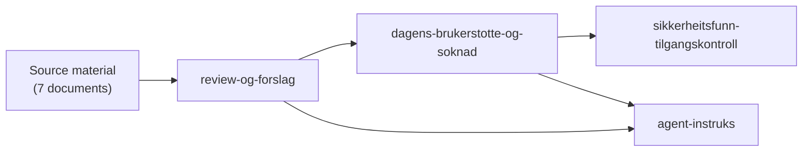
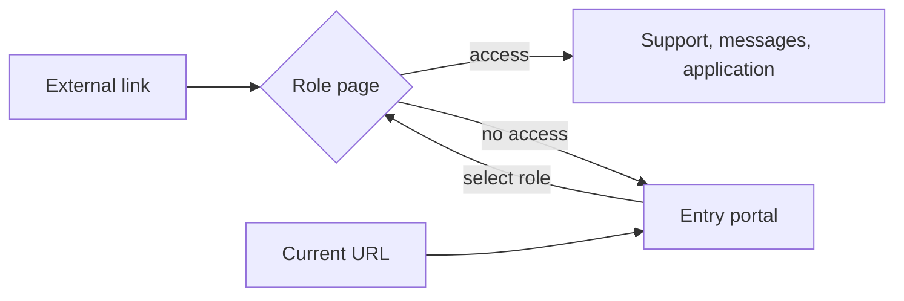

# User Support Extension

This folder gathers analysis and proposals for extending the external
support experience in Experience Cloud. These documents are working material,
not approved architecture decisions or proof that the solution has been implemented.

## Start here

| Document                                                                   | Purpose                                                             |
| -------------------------------------------------------------------------- | ------------------------------------------------------------------- |
| [overview.md](overview.md)                                                 | Background and overall goals                                        |
| [current-implementation.md](current-implementation.md)                     | Description of the current solution                                 |
| [proposed-changes.md](proposed-changes.md)                                 | Proposed changes                                                    |
| [implementation-plan.md](implementation-plan.md)                           | Phase-based plan                                                    |
| [open-questions.md](open-questions.md)                                     | Open questions and decisions to clarify                             |
| [risks-and-testing.md](risks-and-testing.md)                               | Risks and test ideas                                                |
| [acr-email-handling.md](acr-email-handling.md)                             | ACR and email model                                                 |
| [review-og-forslag.md](review-og-forslag.md)                               | Independent review, conflicts, and recommendations                  |
| [agent-instruks.md](agent-instruks.md)                                     | Instructions for the agent extending the material                   |
| [dagens-brukerstotte-og-soknad.md](dagens-brukerstotte-og-soknad.md)       | Current support and application flow, and the extensible role model |
| [sikkerheitsfunn-tilgangskontroll.md](sikkerheitsfunn-tilgangskontroll.md) | High-level access findings under review by the team                 |

### Reading order

The first seven documents are the original source material. The last four were added
from the review performed on 2026-11-13. Start with the review, then move to the role model,
and use the agent instructions when an agent is expected to continue the work.

## Target state in one diagram

**Example:** An employer receives a link to the employer page in an email.
The page checks access against Altinn. If the user has access, they can see
support, messages, and application pages. If the user does not have access, they are
returned to the portal with the message: “You do not have access to this page. Choose another role.”

## Current direction

The user guidance for continued design work is:

- The current Experience Cloud URL becomes the new main page / entry portal.
- The portal shows three choices: employer, partner / authorized representative, and
  private person / employee.
- Each role has its own Experience Cloud page. External links may go directly to the
  role page.
- The role page and server calls must validate real access. Selecting a role or values
  in the URL does not grant access.
- If access is missing, the user is returned to the entry portal with a clear message.
- Reuse existing components and functionality where it makes sense.
- Additional roles such as board manager or future roles should be added quickly, ideally
  through configuration. See [the role model](dagens-brukerstotte-og-soknad.md).
- Consider feature toggles for controlled transition and quick rollback, and remove old
  logic only after the new solution is adopted and validated.

These guidelines do not replace open domain and access decisions in the supporting
documents. See [the review](review-og-forslag.md) before using the implementation plan
as a task list.

## Document and decision status

- Existing files in this folder are preserved unchanged in this review.
- New proposals in `review-og-forslag.md` are not approved until the product owner and
  relevant technical owners have approved them.
- ADR-0002 and ADR-0003 are marked as proposed in the repository; do not present ACR
  or email choices there as final decisions.
- Follow the repository’s [development standards](../utviklingsstandarder.md),
  [architecture guidance](../architecture/README.md), and the root file
  [AGENTS.md](../../AGENTS.md). Feature work crossing module or access boundaries may
  require an issue, specification, or ADR.

## Scope limitation

This documentation set does not include implementation. Org access,
deployment, metadata changes, and changes to package-owned content require separate
approvals under the repository rules.
