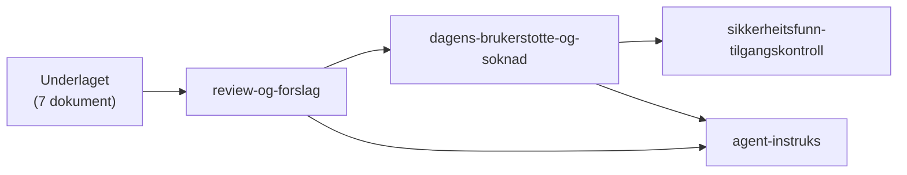
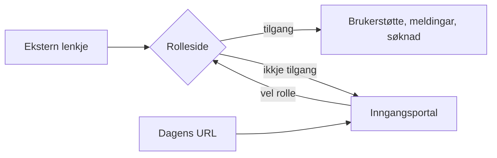

# Brukerstøtteutvidelse

Denne mappa samlar analyse og forslag for utviding av den eksterne
brukerstøtteflata i Experience Cloud. Dokumenta er arbeidsunderlag, ikkje
godkjende arkitekturvedtak eller bevis på at løysinga er implementert.

## Start her

| Dokument                                                                   | Føremål                                                |
| -------------------------------------------------------------------------- | ------------------------------------------------------ |
| [overview.md](overview.md)                                                 | Bakgrunn og overordna mål                              |
| [current-implementation.md](current-implementation.md)                     | Skildring av dagens løysing                            |
| [proposed-changes.md](proposed-changes.md)                                 | Føreslåtte endringar                                   |
| [implementation-plan.md](implementation-plan.md)                           | Faseinndelt plan                                       |
| [open-questions.md](open-questions.md)                                     | Avklaringar og førebelse val                           |
| [risks-and-testing.md](risks-and-testing.md)                               | Risiko og testidéar                                    |
| [acr-email-handling.md](acr-email-handling.md)                             | ACR- og e-postmodell                                   |
| [review-og-forslag.md](review-og-forslag.md)                               | Uavhengig gjennomgang, motstridar og anbefalingar      |
| [agent-instruks.md](agent-instruks.md)                                     | Instruks for agent som vidareutviklar underlaget       |
| [dagens-brukerstotte-og-soknad.md](dagens-brukerstotte-og-soknad.md)       | Dagens brukerstøtte og søknad, og utvidbar rollemodell |
| [sikkerheitsfunn-tilgangskontroll.md](sikkerheitsfunn-tilgangskontroll.md) | Overordna tilgangsfunn som teamet vurderer             |

### Leserekkjefølgje

Dei sju første dokumenta er det opphavlege underlaget. Dei fire siste kom frå
gjennomgangen 2026-11-13. Start med gjennomgangen, gå vidare til rollemodellen,
og bruk agentinstruksen når ein agent skal arbeide vidare.

## Målbilete i éin figur

**Døme:** Ein arbeidsgivar får ei lenkje til arbeidsgivarsida i ein e-post.
Sida kontrollerer tilgangen mot Altinn. Har brukaren tilgang, ser hen
brukerstøtte, meldingar og søknad. Har brukaren ikkje tilgang, kjem hen til
portalen med meldinga «Du har ikkje tilgang til denne sida. Vel ei anna rolle.»

## Førebels retning

Brukarens føringar for vidare designarbeid er:

- Dagens Experience Cloud-URL blir den nye hovudsida/inngangsportalen.
- Portalen viser tre val: arbeidsgivar, samarbeidspartnar/fullmektig og
  privatperson/arbeidstakar.
- Kvar rolle har si eiga Experience Cloud-side. Eksterne lenkjer kan gå direkte
  til rollesida.
- Rollesida og serverkalla skal kontrollere reell tilgang. Val av rolle eller
  verdiar i URL gir ikkje tilgang.
- Ved manglande tilgang skal brukaren tilbake til inngangsportalen med ei
  forståeleg melding.
- Gjenbruk eksisterande komponentar og funksjonalitet så langt det er naturleg.
- Bobestyrar og seinare roller skal kunne leggjast til raskt, helst med
  konfigurasjon. Sjå [rollemodellen](dagens-brukerstotte-og-soknad.md).
- Vurder feature toggle for kontrollert overgang og rask tilbakeføring, og
  fjern gammal logikk først når ny løysing er teken i bruk og verifisert.

Desse føringane erstattar ikkje opne domene- og tilgangsavgjerder i
underlagsdokumenta. Sjå [gjennomgangen](review-og-forslag.md) før
implementasjonsplanen blir brukt som oppgåveliste.

## Dokument- og avgjerdsstatus

- Eksisterande filer i denne mappa er bevarte uendra i denne gjennomgangen.
- Nye forslag i `review-og-forslag.md` er ikkje vedtekne før produkteigar og
  relevante tekniske eigarar har godkjent dei.
- ADR-0002 og ADR-0003 er merkte som foreslåtte i repoet; ikkje presenter
  ACR- eller e-postval der som endeleg vedtekne.
- Følg repoets [utviklingsstandardar](../utviklingsstandarder.md),
  [arkitekturrettleiing](../architecture/README.md) og rotfila
  [AGENTS.md](../../AGENTS.md). Feature-arbeid som kryssar modular eller
  tilgangsgrenser kan krevje Issue, spesifikasjon eller ADR.

## Avgrensing

Dette dokumentasjonsunderlaget inneheld ikkje implementasjon. Org-tilgang,
deploy, metadataendringar og endringar i pakkeeigd innhald krev eigne
godkjenningar etter repoets reglar.
