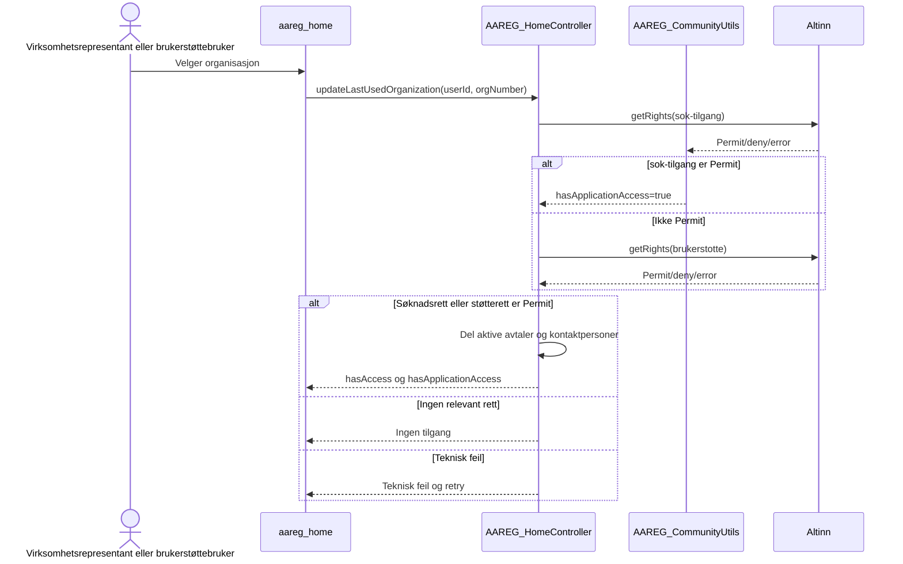
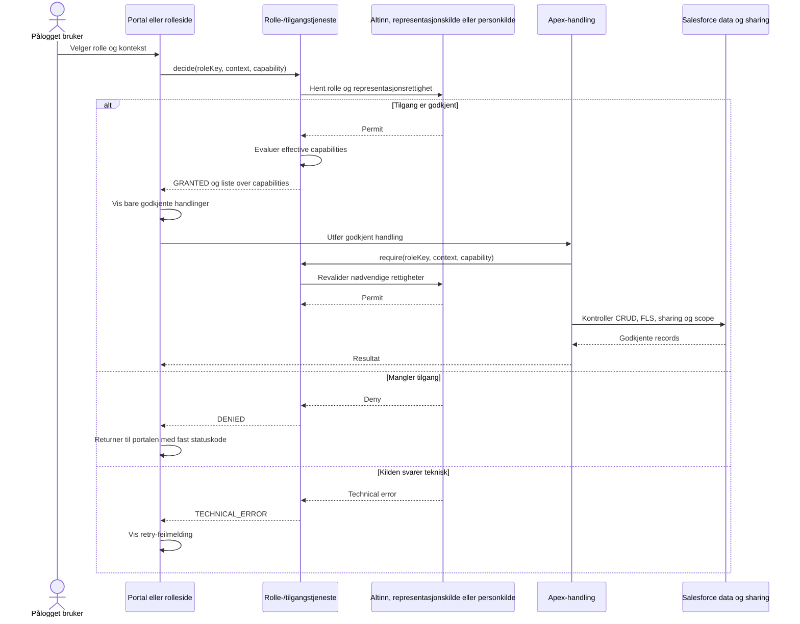

# Server-side tilgangskontroll og minimumsaksesscenario er avklart

**Status:** For avklaring — ikke godkjent før servergrensen, minimum-access scenarioet og sikkerhetstestene er fylt ut

Dette dokumentet skal beskrive den serverbaserte tilgangen og hvordan løsningen verifiseres med Salesforce-brukere som har minimale rettigheter.

## Beslutningsregel

Klient, Experience Cloud-sidevisibility og URL-parametere kan ikke gi tilgang. Hver serverkontroll må gjøre følgende:

1. Hent bruker-ID fra `UserInfo.getUserId()` på serveren.
2. Verifiser rollen som brukes i den valgte konteksten.
3. Verifiser organisasjons- eller personkonteksten mot godkjent kilde.
4. Evaluer forventet capability.
5. Kontroller Salesforce CRUD, FLS og record sharing.
6. Returnér `GRANTED`, `DENIED` eller `TECHNICAL_ERROR`.

## 1. Server-side identitet og autorisasjon

- [ ] Bruker-ID hentes alltid fra `UserInfo.getUserId()` på serveren.
- [ ] Klienten sender aldri `userId` som tilgangsbevis.
- [ ] Klienten sender aldri en capability som servergodkjenning.
- [ ] Valgt rolle brukes som UX-/kontekstvurdering, ikke som autorisasjon alene.
- [ ] Organisasjons- eller personkontekst revalideres ved hvert kall.
- [ ] URL-parametere brukes bare som kontekst, aldri som autorisasjonsbevis.
- [ ] Direkte Apex-kall får samme kontroll som LWC- og portal-kall.

**Beslutning:**

**Ansvarlig for implementasjonen:**

## 2. Capabilities som må beskyttes

| Capability        | Operasjon som beskyttes                     | Servermå kontrollere                                 | Beslutning |
| ----------------- | ------------------------------------------- | ---------------------------------------------------- | ---------- |
| `APPLICATION`     | Opprette eller sende søknad                 | Rolle, context, rettighet, data-/actiongrense        | Uavklart   |
| `MY_APPLICATIONS` | Liste eller åpne egne søknader              | Rolle, context, eier/scope, CRUD/FLS                 | Uavklart   |
| `AGREEMENTS`      | Liste, opprette, endre eller slette avtaler | Rolle, context, rettighet, record sharing            | Uavklart   |
| `SUPPORT`         | Opprette Inquiry                            | Rolle, context, capability, Inquiry-eier             | Uavklart   |
| `MESSAGES`        | Liste, åpne tråd eller sende svar           | Rolle, context, capability, Thread-/Attachment-scope | Uavklart   |

## 3. Apex-metoder som må kontrollere tilgang

Kartlegg alle Apex-metoder som får eller endrer sensitive data:

| Apex-metode | Klasse/feature | Capability | Data som leses eller skrives | Har egen kontroll? | Beslutning |
| ----------- | -------------- | ---------- | ---------------------------- | ------------------ | ---------- |
| Fyll ut     | Fyll ut        | Fyll ut    | Fyll ut                      | Nei                | Uavklart   |
| Fyll ut     | Fyll ut        | Fyll ut    | Fyll ut                      | Nei                | Uavklart   |
| Fyll ut     | Fyll ut        | Fyll ut    | Fyll ut                      | Nei                | Uavklart   |
| Fyll ut     | Fyll ut        | Fyll ut    | Fyll ut                      | Nei                | Uavklart   |

Minimumskravene gjelder:

- [ ] Hver Apex-kontroller gjør sin egen tilgangskontroll.
- [ ] Kontroll gjentas ved direkte kall og ikke bare i Experience Cloud.
- [ ] Kontrolleren validerer serverens forventede rolle og kontekst.
- [ ] Kontrolleren avviser manglende eller manipulerte record-IDer.
- [ ] Kontrolleren avslutter før handling eller datautlevering ved `DENIED`.
- [ ] Kontrolleren skiller `DENIED` fra `TECHNICAL_ERROR`.

**Beslutning:**

## 4. Data- og actiongrenser

For hvert sensitive område skal følgende avklares:

- hvilke objekttyper som kan leses,
- hvilke objekttyper som kan skrives,
- hvilke felter som kan leses,
- hvilke felter som kan skrives,
- hvilke record-IDer som kan brukes,
- hvilke organisasjoner som er godkjente,
- hvilke personer som er godkjente,
- hvilke handlinger som er tillatt for rollen,
- hvilke handlinger som er avvist.

| Objekt/record  | Lesing  | Skriving | Godkjent rolle/kontekst | Field scope | Beslutning |
| -------------- | ------- | -------- | ----------------------- | ----------- | ---------- |
| Inquiry        | Fyll ut | Fyll ut  | Fyll ut                 | Fyll ut     | Uavklart   |
| Thread         | Fyll ut | Fyll ut  | Fyll ut                 | Fyll ut     | Uavklart   |
| Attachment     | Fyll ut | Fyll ut  | Fyll ut                 | Fyll ut     | Uavklart   |
| Søknad         | Fyll ut | Fyll ut  | Fyll ut                 | Fyll ut     | Uavklart   |
| Avtale         | Fyll ut | Fyll ut  | Fyll ut                 | Fyll ut     | Uavklart   |
| Kontakt/e-post | Fyll ut | Fyll ut  | Fyll ut                 | Fyll ut     | Uavklart   |

**Beslutning:**

## 5. CRUD, FLS og record sharing

Avklaringspunkter:

- [ ] `CRUD` er avklart for hver objektklasse.
- [ ] `FLS` er avklart for hvert sensitivt eller skrivet felt.
- [ ] Record sharing er avklart for søknad, avtale, Inquiry, Thread, Attachment og svar.
- [ ] Sharing følger faktisk rolle, organisasjon eller personkontekst.
- [ ] Sharing er ikke brukt som substitutt for eksplisitt capabilitykontroll.
- [ ] Brukeren får ikke utvidet tilgang ved å sende flere eller manipulerte record-IDer.
- [ ] Bulkoperasjoner har samme tilgangskontroll som enkeltoperasjoner.
- [ ] SOSL/SOQL-spørringer har server-/scopegrenser.
- [ ] DML-operasjoner har eksplisitte ownership- og actiongrenser.

**Beslutning:**

## 6. Apex execution mode

Beslutningene for `with sharing`, `without sharing` og system mode må dokumenteres:

- [ ] Klasser bruker `with sharing` som standard der det ikke er et uttrykkelig behov for unntak.
- [ ] `without sharing` eller elevated system mode krever dokumentert begrunnelse.
- [ ] System-mode-metoder har begrenset offentlig API og eksplisitte data-/actiongrenser.
- [ ] System-mode-metoder validerer bruker-ID, rolle, kontekst og capability før tilgang.
- [ ] System-mode-metoder kan ikke ta klientens rolle eller user-ID som autorisasjonsbevis.
- [ ] Bruk av elevated permissions skjuler ikke manglende capability i testene.

| Klasse/metode | Execution mode | Begrunnelse | Egendefinert grense | Beslutning |
| ------------- | -------------- | ----------- | ------------------- | ---------- |
| Fyll ut       | Fyll ut        | Fyll ut     | Fyll ut             | Uavklart   |
| Fyll ut       | Fyll ut        | Fyll ut     | Fyll ut             | Uavklart   |

**Beslutning:**

## 7. Minimumsaksesscenario

Minimum Access-scenarioet skal gjenspeile en reell ekstern bruker og ikke en testbruker med uforholdsmessig bred tilgang.

### Brukeroppsett

- [ ] En ekstern bruker opprettes fra Minimum Access-profilen.
- [ ] Brukeren får bare de nødvendig godkjente permission sets.
- [ ] Brukeren får ingen test-only hardcoded Salesforce-ID-er.
- [ ] Rolle og kontekst representeres gjennom godkjente testdata.
- [ ] Minimum-access bruker brukes i positive og negative tester der oppførselen ikke krever høyere tilgang.

**Minimum Access-profil:** `Minimum Access - Salesforce`

**Ekstern brukerprofil eller license:** Fyll ut

**Nødvendige permission sets:** Fyll ut

**Nødvendige testdata:** Fyll ut

### Scenarioer

| Scenario                                  | Forventet resultat                      | Testmetode                        |
| ----------------------------------------- | --------------------------------------- | --------------------------------- |
| Har godkjent rolle og capability          | `GRANTED`; handling utføres innen scope | `System.runAs(minimumAccessUser)` |
| Har rolle, men mangler capability         | `DENIED`; ingen handling eller data     | `System.runAs(minimumAccessUser)` |
| Har capability, men mangler valid context | `DENIED`; ingen handling eller data     | `System.runAs(minimumAccessUser)` |
| Manipulerer bruker-ID eller record-ID     | `DENIED`; ingen handling eller data     | `System.runAs(minimumAccessUser)` |
| Mangler CRUD eller FLS                    | Ingen uautorisert data-/skrivetilgang   | `System.runAs(minimumAccessUser)` |
| Mangler record sharing                    | Ingen record lastes eller endres        | `System.runAs(minimumAccessUser)` |
| Tilgangskilde svarer teknisk              | `TECHNICAL_ERROR`; ingen handling       | Mock eller integrasjonstest       |

**Beslutning:**

## 8. Direkte Apex-kall

- [ ] Direkte Apex-kall testes uten å gå gjennom en LWC-mellomfunksjon.
- [ ] Direkte Apex-kall uten godkjent capability avvises.
- [ ] Direkte Apex-kall som manipulerer rolle eller kontekst avvises.
- [ ] Direkte Apex-kall som manipulerer bruker-ID avvises.
- [ ] Direkte Apex-kall kan ikke bruke experience-sidevisibility som autorisasjon.
- [ ] Hver controller og servicegrense har sine egne positive og negative tester.

**Beslutning:**

## 9. Feilutfall

| Situasjon                           | Serverutfall                             | Forventet handling                                  |
| ----------------------------------- | ---------------------------------------- | --------------------------------------------------- |
| Mangler capability                  | `DENIED`                                 | Ikke lese eller endre data                          |
| Mangler gyldig rolle eller kontekst | `DENIED`                                 | Ikke lese eller endre data                          |
| Manipulerte eller ukjente IDer      | `DENIED`                                 | Avvis før spørring eller DML                        |
| Mangler CRUD/FLS                    | `DENIED` eller explicit ugyldig handling | Ikke eksponere felt eller utføre DML                |
| Mangler record sharing              | `DENIED`                                 | Ikke laste eller endre record                       |
| Kildeintegrasjon svarer teknisk     | `TECHNICAL_ERROR`                        | Ingen tilgangsgodkjennelse; retry eller feilmelding |
| Tomt resultat                       | Ikke teknisk feil                        | Vis relevant tom tilstand                           |

**Beslutning:**

## 10. Logging og personvern

- [ ] Logging inkluderer ikke fødselsnummer eller andre personopplysninger.
- [ ] Logging inkluderer ikke tilgangstokens eller hemmeligheter.
- [ ] Logging inkluderer ikke e-postadresser eller sensitivt meldingsinnhold der dette ikke er nødvendig.
- [ ] Sikkerhetsfeil kan logges uten personopplysninger.
- [ ] Audit-/sporingsbehov er avklart for ACR, Inquiry, Thread og Attachment.
- [ ] Human security/personvernreview er avklart for rødsoneområdene.

**Beslutning:**

## 11. Testkrav

- [ ] Apex-tester dekker positive, negative og technical-error-scenarioer.
- [ ] Apex-tester bruker `System.runAs(minimumAccessUser)` der oppførselen ikke krever høyere tilgang.
- [ ] Apex-tester bruker fullt kvalifisert framework: `System.Assert.*` og `System.Test.*`.
- [ ] Tester dekker alle roller og representative multi-role scenarios.
- [ ] Tester dekker CRUD, FLS og record sharing.
- [ ] Direkte Apex-kall er testet separat fra LWC.
- [ ] Eksisterende virksomhetsrepresentantflyt er regresjonstestet.
- [ ] Eksisterende brukerstøtteflyt er regresjonstestet.
- [ ] Testene kjøres i godkjent ikke-produksjonsorg før en godkjent uttalelse om at Apex-testene er grønne.

## 12. Godkjenning

| Område                                  | Godkjent av | Dato | Referanse |
| --------------------------------------- | ----------- | ---- | --------- |
| Server-side tilgangsmodell              |             |      |           |
| Apex execution mode                     |             |      |           |
| CRUD/FLS og record sharing              |             |      |           |
| Minimum Access-profil og testscenarioer |             |      |           |
| Direkte Apex-kall                       |             |      |           |
| Security/personvern                     |             |      |           |

## Endelig beslutning

- [ ] Klientinput kan ikke gi tilgang.
- [ ] Bruker-ID hentes på serveren fra `UserInfo.getUserId()`.
- [ ] Hver Apex-kontroller har egen tilgangskontroll.
- [ ] CRUD/FLS og record sharing er avklart for alle sensitive records.
- [ ] System-mode-metoder har eksplisitte action- og datagrens­er.
- [ ] Minimum Access-scenariet er definert og testbart.
- [ ] Direkte Apex-kall er testet.
- [ ] Logging oppfyller personvernskravene.
- [ ] Positive, negative og technical-error-tester er planlagt.
- [ ] Ingen kode startes før gate er oppfylt.

**Referanse til godkjenning/issue/PR:**

**Godkjent dato:**

## Dagens eksisterende access-scenarioer

Denne delen beskriver dokumentert atferd i koden i dag. Den er ikke godkjent som målmodell for utvidelsen, og den bør brukes som baseline for regresjonstest og avgrensning av endringer.

### Virksomhetsrepresentant

Virksomhetsrepresentanten er dagens hovedmodell for den eksterne Aa-registeret-flaten. Brukeren:

- logger på Experience Cloud,
- får en organisasjonsliste fra Altinn gjennom `AAREG_HomeController.getOrganizationsWithRoles()`,

- velger en organisasjon i `aareg_home`,
- får valgt organisasjonsnummer lagret i `User.LastUsedOrganization__c`, og
- får tilgang vurdert mot to eksisterende Altinn-ressurser for valgt organisasjon:
    - `nav_arbeidsforhold_aa-registeret-sok-tilgang`
    - `nav_arbeidsforhold_aa-registeret-brukerstotte`

`AAREG_HomeController.checkAndShareIfAuthorized()` sjekker søknadsrettigheten først. Dersom den ikke gir permit, sjekker den brukerstøtterettigheten. Ved godkjent tilgang deler kontrolleren aktive avtaler for den valgte organisasjonen og kontaktpersoner på disse avtalene med brukeren.

Dagens meldingsmodell er organisasjonsbasert. Søknader, avtaler og tråder filtreres i ulike metoder på `LastUsedOrganization__c` og den tilknyttede arbeidsgiverkontoen.

| Dagens Altinn-resultat      | APPLICATION   | MY_APPLICATIONS | AGREEMENTS       | SUPPORT       | MESSAGES      | Dagens detalj                                        |
| --------------------------- | ------------- | --------------- | ---------------- | ------------- | ------------- | ---------------------------------------------------- |
| `sok-tilgang` = permit      | Ja            | Ja              | Ja               | Ja            | Ja            | Gir dagens full flyt i portalens panelmodell         |
| Kun `brukerstotte` = permit | Nei           | Nei             | Ja i dagens flyt | Ja            | Ja            | Gir dagens avtale-, støtte- og meldingsflyt          |
| Ingen relevant permit       | Nei           | Nei             | Nei              | Nei           | Nei           | Ingen tilgangspanel                                  |
| Teknisk feil fra Altinn     | Ikke godkjent | Ikke godkjent   | Ikke godkjent    | Ikke godkjent | Ikke godkjent | Vises som teknisk feil og ikke som manglende tilgang |

Dagens brukerstøtterettighet gir i dag både `AGREEMENTS`, `SUPPORT` og `MESSAGES`, samt redigeringsdeling av avtaler og relaterte kontaktpersoner. Dette skal beholdes som eksplisitt regresjonsbaseline, men omfanget må godkjennes separat før målmodellen endres.

### Eksisterende brukerstøttebruker

«Eksisterende brukerstøttebruker» betyr i dagens løsning en bruker som får tilgang via Altinn-ressursen `nav_arbeidsforhold_aa-registeret-brukerstotte` og den eksisterende organisasjonsbaserte portalen.

Brukerstøttebrukeren følger samme organisasjonsvalg som virksomhetsrepresentanten:

- organisasjonsnummer lagres i `User.LastUsedOrganization__c`,
- brukeren får tilgang til valgt organisasjon etter `brukerstotte`-rettighet,
- avtaler for organisasjonen og tilknyttede kontaktpersoner deles med brukeren,
- flaten viser Mine avtaler, Support og Mine meldinger,
- søknad og Mine søknader er i dagens modell skjult.

Dette er ikke en ny brukerstøtteservice-rolle med personkontekst. Eksisterende brukerstøttebrukere er organisasjonsbaserte Altinn-brukere i dagens modell.

### Dagens kontekst- og tilgangsgrenser

Dagens flate har flere kjente begrensninger som må behandles som baseline, ikke som godkjent målmodell:

1. Tilgangskontrollen skjer primært på startsiden `aareg_home`.
2. `LastUsedOrganization__c` brukes som kontekst av flere undersider og kontrollere.
3. Flere undersider validerer ikke på nytt Altinn-rettigheten for hver handling.
4. Direkte lenker går ikke nødvendigvis gjennom samme kontroll som portalen.
5. Noen kontrollere bruker `without sharing` og må ha eksplisitte data- og actiongrenser.
6. Noen kontrollere deler data bredere enn en ren capability-basert modell.
7. Søknadssiden kontrollerer rettighet i LWC i dag, mens metoder på serversiden må ikke stole på at denne kontrollen alltid er utført.

### Dagens kontrollflyt

### Dagens controller- og datagrense

| Dagens Apex-metode                                                                   | Dagens rolle/kontekst                        | Capability eller effekt                 | Dagens støtte i kode                                    | Kjent begrensning                                                 |
| ------------------------------------------------------------------------------------ | -------------------------------------------- | --------------------------------------- | ------------------------------------------------------- | ----------------------------------------------------------------- |
| `AAREG_HomeController.getOrganizationsWithRoles()`                                   | Pålogget bruker + personidentitet            | Lister organisasjoner                   | `UserInfo.getUserId()`-sjekk                            | Altinn-resultatet må skille teknisk feil fra tom liste            |
| `AAREG_HomeController.checkAndShareIfAuthorized()`                                   | Pålogget bruker + valgt organisasjon         | Søknads- eller støtterett; avtaledeling | `without sharing`, to Altinn-kall                       | Må revalideres ved hver handling i målmodellen                    |
| `AAREG_HomeController.updateLastUsedOrganization()`                                  | Pålogget bruker                              | Lagre organisasjonskontekst             | `without sharing`                                       | Klientverdi må ikke bli autorisasjonsbevis                        |
| `AAREG_MyApplicationsController.getUsersApplications()`                              | `LastUsedOrganization__c`                    | `MY_APPLICATIONS`                       | `with sharing` og SOQL-scope                            | Mangler eksplisitt Altinnkontroll på metoden i dagens modell      |
| `AAREG_ApplicationController.saveAsDraft/processApplication/deleteDraftRecord`       | `LastUsedOrganization__c` eller record input | `APPLICATION`                           | `without sharing` på deler av klassen                   | Skriving må ha eksplisitt capabilitykontroll i målmodellen        |
| `AAREG_MyAgreementsController.*`                                                     | `LastUsedOrganization__c` eller record-ID    | `AGREEMENTS`                            | `with sharing` på lest kode og Apex-sharing for writing | Må bekrefte at brukerstøtterett gir avtalekontroll og oppdatering |
| `AAREG_contactSupportController.initDraftRecord/createFinalInquiry/createNewInquiry` | `LastUsedOrganization__c` eller bruker       | `SUPPORT`                               | `with sharing`, bruker mode på deler av DML             | Metoden må ha eksplisitt støtterett på hver kallvei               |
| `AAREG_MyThreadsController.getUsersThreads()`                                        | `LastUsedOrganization__c` + Account          | `MESSAGES`                              | `with sharing` og Account-filter                        | Må bekrefte serverrettighet ved liste og åpningshandling          |

### Dagens positive og negative access-scenarier

| Scenario                                                     | Virksomhetsrepresentant                 | Eksisterende brukerstøttebruker         | Forventet utfall i dagens modell                                                       |
| ------------------------------------------------------------ | --------------------------------------- | --------------------------------------- | -------------------------------------------------------------------------------------- |
| Har `sok-tilgang` for valgt organisasjon                     | Ja                                      | Ikke relevant                           | Søknad, Mine søknader, avtaler, support og meldinger                                   |
| Har bare `brukerstotte`                                      | Ikke relevant i dagens fullflyt         | Ja                                      | Mine avtaler, support og meldinger; ikke søknad eller Mine søknader                    |
| Mangler begge rettighetene                                   | Ja                                      | Ja                                      | Ingen paneler eller datahandlinger                                                     |
| Har rettighet, men velger ny organisasjon                    | Ja                                      | Ja                                      | Serverkall må bruke ny valgt organisasjon; `LastUsedOrganization__c` oppdateres        |
| Har rettighet for organisasjon A, manipulerer organisasjon B | Må avvises i målmodellen                | Må avvises i målmodellen                | I dagens modell er dette et kjent risikoområde som må dekke direkte lenke og record-ID |
| Altinn returnerer teknisk feil                               | Ja                                      | Ja                                      | Teknisk feil med retry, ikke «ingen tilgang»                                           |
| Ingen organisasjon er valgt                                  | Ja                                      | Ja                                      | Tomt kontekstutfall, ikke nødvendigvis teknisk feil                                    |
| Direkte lenke til ny søknad eller Mine avtaler               | Må kontrolleres på server i målmodellen | Må kontrolleres på server i målmodellen | I dag kan stored context og bare UI-kontroll ikke være tilstrekkelig                   |

### Regresjonskrav for dagens brukere

Utvidelsen må bevare følgende brukervalg under overgang, med mindre en eksplisitt godkjent endring erstatter dem:

- [ ] Virksomhetsrepresentanten beholder dagens organisasjonsvalg og organisasjonsliste.
- [ ] `sok-tilgang` beholder dagens full tilgang.
- [ ] `brukerstotte` beholder Mine avtaler, support og meldinger.
- [ ] Avtale- og kontaktsharing oppdateres eller erstattes uten uautorisert bred tilgang.
- [ ] Eksisterende meldinger for valgt organisasjon er fortsatt tilgjengelige for godkjente eksisterende brukere.
- [ ] Eksisterende brukerstøttebruker får ikke person-/rollemodell som ekspanderer scope utilsiktet.
- [ ] Direkte lenker til eksisterende undersider må testes mot samme access-regler som portalen.
- [ ] Nye roller må ikke endre dagens Altinn-rettighetsmapping eller avtalehandlinger uten godkjent endring.

## Foreslått fremtidig kontrollflyt

**Status:** Forslag til målmodell — ikke godkjent før de avhengige beslutningsdokumentene er fylt ut og godkjent.

Fremtidens modell bør skille rolle, kontekst, rettighet, capability og Salesforce-record-scope. Rollen styrer brukeropplevelsen, men gir ikke tilgang alene.

### 1. Rolle er UX og kontekst

Rollen bestemmer:

- hvilken rolle-side brukeren ser,
- om contexttypen er organisasjon, person eller en fremtidig kontekst,
- hvilke contextvalg som vises,
- hvilke capabilities som kan gjøres synlige.

Rollen gir ikke automatisk tilgang til søknader, avtaler, support, meldinger eller vedlegg.

### 2. Identitet, representasjon og autorisasjon må skilles

Tjenesten bør håndtere separate beslutninger:

1. **Identitet:** hvem er den påloggede brukeren?
2. **Representasjon:** hvem har brukeren rett til å representere?
3. **Rettighet:** hvilke capabilities får brukeren i valgt rolle og kontekst?
4. **Record-scope:** hvilke Salesforce-records og felt får brukeren lese eller endre?

ACR, Altinn og personkilder bør ikke blandes som om de er samme type beslutning. Kilden som styrer en beslutning må være eksplisitt definert.

### 3. Serverbeslutningen bør være eksplisitt

Hvert relevant serverkall bør evaluere minst:

- pålogget bruker-ID,
- valgt rolle,
- valgt eller levert kontekst,
- forventet capability,
- relevant data-/recordscope.

Beslutningen bør ha ett av disse resultatene:

- `GRANTED`: handlingen kan utføres innen det servergodkjente scopet.
- `DENIED`: brukeren mangler rolle, kontekst eller capability.
- `TECHNICAL_ERROR`: tilgangskilden eller serververdi kan ikke evalueres.

Tomt dataresultat skal ikke automatisk bli `TECHNICAL_ERROR`.

### 4. UI er bare en visningsmodell

Portalen skal bare vise handlinger som serveren har godkjent:

- Ingen granted capability: handling skjules.
- `DENIED`: safe retur til portalen med fast, godkjent statuskode.
- `TECHNICAL_ERROR`: egen feilmelding og retry.
- Tomt resultat: relevant tom tilstand.

Experience Cloud audience, sidevisibility og skjult navigasjon må ikke være eneste tilgangsvern.

### 5. Hver Apex-handling validerer på nytt

Samme serverkontroll må brukes:

- ved åpning av en portal- eller rolleside,
- ved åpning av en direkte lenke,
- ved read-operasjoner,
- ved skriveoperasjoner,
- ved oppretting av Inquiry,
- ved oppretting eller svar i tråder,
- ved opplasting eller nedlasting av vedlegg.

Hver handling bør følge denne rekkefølgen:

1. Hent bruker-ID fra `UserInfo.getUserId()`.
2. Verifiser rolle og kontekst på serveren.
3. Evaluer forventet capability.
4. Kontroller record-eierskap eller serverfiltrering.
5. Kontroller CRUD og FLS.
6. Kontroller record sharing.
7. Utfør bare handlingen innenfor de godkjente grensene.

Klienten må ikke kunne sende `userId`, rolle, capability eller record-scope som autorisasjonsbevis.

## Bevaring av dagens brukere i målmodellen

### Virksomhetsrepresentant

Virksomhetsrepresentanten bør fortsatt være organisasjonsbasert:

- Altinn henter tilgjengelige organisasjoner.
- Serveren validerer valgt organisasjonsnummer ved hvert kall.
- `sok-tilgang` gir søknad, Mine søknader, avtaler, support og meldinger.
- `brukerstotte` gir i dagens modell Mine avtaler, support og meldinger.
- Eksisterende organisasjonsbaserte meldinger bevares.
- `LastUsedOrganization__c` brukes bare som lagret kontekst, aldri som bevis på tilgang.

Den endelige mappingen for `brukerstotte` må godkjennes før servermodellen implementeres.

### Eksisterende brukerstøttebruker

Eksisterende brukerstøttebruker bør beholdes som organisasjonsbasert under overgang:

- samme organisasjonskontekst,
- samme organisasjonsfilter,
- samme meldingsmodell,
- serverbasert kontroll av `brukerstotte`,
- ingen utvidelse til person- eller partnermodell uten godkjent beslutning.

## Viktigste endringer fra dagens løsning

| I dag                                                 | Foreslått målmodell                                     |
| ----------------------------------------------------- | ------------------------------------------------------- |
| Tilgang kontrolleres primært på startsiden            | Hver rolle-side og hvert Apex-kall kontrollerer         |
| `LastUsedOrganization__c` brukes som tilgangskontekst | Kontekst revalideres mot godkjent kilde                 |
| Rolle, kontekst og rettighet blandes                  | Rolle, kontekst, capability og record-scope er separate |
| UI skjuler handlinger                                 | UI viser bare servergodkjente handlinger                |
| Kontrollere har ulik modell                           | Felles rolle-/tilgangstjeneste                          |
| Meldinger er primært organisasjonsbaserte             | Modell per rolle med serverbasert filter                |
| Noen metoder kjører uten sharing                      | Eksplisitte CRUD-, FLS-, sharing- og system-modegrenser |

## Avklaringer som må være godkjent før implementasjon

- [ ] Endelig rolle-/capability-matrise.
- [ ] Autoritativ kilde for partner-/fullmektigrepresentasjon.
- [ ] Autoritativ personkilde for privatperson.
- [ ] Eierskap og filtermodell for Inquiry, Thread og vedlegg.
- [ ] Om `brukerstotte` gir Mine avtaler og skrivetilgang.
- [ ] Oppførsel ved flere samtidige roller.
- [ ] Direkte lenke, redirect og feilkontrakt.
- [ ] CRUD, FLS og record sharing for alle sensitive recordtyper.
- [ ] Minimum Access-scenarier.
- [ ] Eksisterende brukere og flater som regresjonskrav.

Dagens access-scenarioer ovenfor skal brukes som baseline for implementasjonen. Ny funksjonalitet skal ikke utvide dagens scope eller tillate datatilgang som ikke er uttrykkelig godkjent i rolle-/capability-matrisen.
