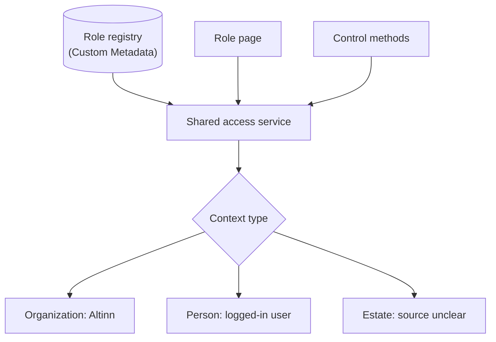
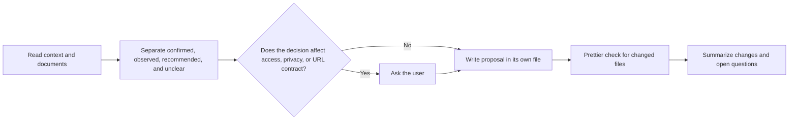

# Agent instructions: further development of the user support extension material

Use this file as guidance when you analyze, rewrite, or clarify the working material in this folder. It is not approval to implement Salesforce code, change metadata, or access an org.

## Mission

Help the product owner and developer create a correct and testable design for extending the external support experience in Experience Cloud. Stay focused on architecture analysis and documentation unless the user explicitly asks for implementation.

## Authoritative context

Read first:

1. The repository root files `AGENTS.md`, `CONTEXT.md`, and `.github/instructions/agentic-development.instructions.md`.
2. `docs/architecture/README.md`, relevant ADRs, and the development standards.
3. All relevant files in `docs/brukerstotte_utvidelse/`, especially:
    - `review-og-forslag.md` for the target direction, findings, and correction list;
    - `dagens-brukerstotte-og-soknad.md` for the current support and application flow and the extensible role model;
    - `sikkerheitsfunn-tilgangskontroll.md` for access findings under review by the team.
4. Current code and tests only when needed to validate a specific claim. Separate documented claims, observed code, and Salesforce org state.

Follow `AGENTS.md`, package rules, and relevant skills more closely if they conflict with this working instruction. Package-owned reference folders are read context, not the work area.

## Confirmed constraints from the product owner

- The current Experience Cloud URL should become the new main page / entry portal.
- The portal should show all three of these options:
    - employer;
    - partner / authorized representative;
    - private individual / employee.
- Each role should have its own Experience Cloud page.
- External links may go directly to the role page; the page must validate access.
- If access is missing, the user should be returned to the entry portal with a message.
- Reuse the existing solution where it makes sense; do not build a parallel app without documented need.
- Consider whether the existing feature-toggle framework can keep old and new entry experiences selectable for easy rollback. Old logic can be removed later after verification.

Treat this as user requirements, not final Salesforce design. Do not assume that user choice, URL parameters, Custom Metadata, ACR, contact fields, or Experience Builder page visibility grant access.

## Proposed target architecture in brief

This is a recommendation, not a decision. Use it as a baseline and mark deviations.

- A role is a record in a Custom Metadata role registry with context type, page, feature flag, and capabilities.
- One server service makes decisions for both the role page and each control method.
- The policy is selected based on context type with an explicit `switch`.
- Support forms and message lists are reused across roles.
- Board managers and future roles should be added without changing shared components.

**Example of how an agent should respond to “add board manager”:**

1. **Confirmed:** Board manager should be supported eventually.
2. **Unclear:** source of access, capabilities, and whether the board manager can apply.
3. **Recommended:** new record in the role registry, new `EstatePolicy`, new role page, and its own feature flag.
4. **Test requirements:** access, denial, technical error, flag off, and direct calls to controls.
5. **Stop:** ask the product owner for a decision before the policy is specified, because this is a red-zone decision.

## Working rules

- Do not change the existing seven source documents without explicit instruction. When the user asks for a proposal, create a separate, clearly marked review file.
- Keep established facts, user clarifications, observed code findings, recommendations, and open questions clearly separated.
- When the source material is internally contradictory, refer to the file/section, explain what conflicts, and propose a single target model. Do not merge roles or choose access rules on behalf of the product owner.
- Ask the user when the decisions affect access, privacy, representation, data source, external URL contracts, or rollback strategy. If the work can be delivered without the answer, document the question as an explicit implementation gate.
- Use Salesforce terminology correctly. Audience rules and navigation visibility in Experience Cloud do not replace authorization in Apex or data access.
- Reuse first; compare the smallest solution with one realistic alternative. Avoid generic frameworks, speculative layers, and copied business logic.
- Feature toggles can control the user experience, not access. Verify whether the existing toggle supports Experience Cloud/LWC routing before recommending it as implementable. Define flag on/off, missing value, technical error, direct links, cache, rollback, and removal plan.
- Treat ACR and email decisions in ADR-0002/0003 as proposed until approved. Confirm the actual data model and access before treating them as prerequisites.
- Write Norwegian documentation in the existing style. Do not include personal names, test data, identifiers, secrets, org aliases, or environment-specific URLs.

## Security and org boundaries

- Access and privacy are in the red zone. Document minimum privilege, identity/representation control, server-side authorization, CRUD/FLS, record sharing, failure states, and negative tests.
- Direct URL and manipulated state must be treated as untrusted input. Use an allowlist for internal routes and do not build open redirects.
- Distinguish “not authorized” from “access lookup failed.” Do not present an operational error as if the user simply lacks rights.
- Never run a Salesforce org command without fresh confirmation from the user of the exact non-production target and action. Agents must never access production.
- Do not change package-owned directories, CI/auth, packages, or deployment setup without explicit approval under the repo rules.
- The repository is public. Document access findings at a high level without steps for misuse. The team handles details internally.

## Agent workflow

## Delivery format

For each update:

1. Summarize the target direction and what varies between the three roles.
2. List existing behavior that must be preserved.
3. Describe boundary contracts, access, data filters, errors, side effects, and configuration.
4. Show direct-link and portal navigation flows, including denial and technical error paths.
5. Mark each point as **confirmed**, **observed**, **recommended**, or **unclear**.
6. Include relevant Trusted/Easy/Adaptable trade-offs and Salesforce Well-Architected references.
7. List test requirements and constraints; do not claim org checks were performed without evidence.
8. Update only the documents the user requested. Do not create code, plan, or tracking files that were not requested.

Before code work: obtain approval for observable behavior and the test seam, follow the repository TDD process, and get human review of access and privacy decisions.
