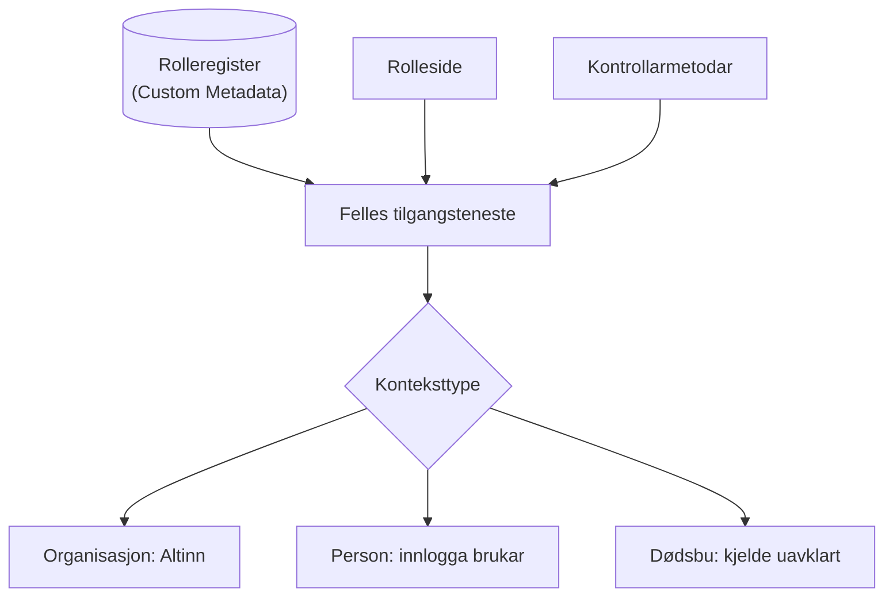
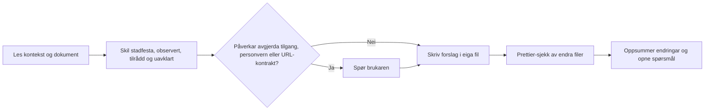

# Agentinstruks: vidareutvikling av underlaget for brukerstøtteutvidelse

Bruk denne fila som styring når du analyserer, skriv om eller konkretiserer
arbeidsunderlaget i denne mappa. Ho er ikkje godkjenning til å implementere
Salesforce-kode, endre metadata eller aksessere eit org.

## Oppdrag

Hjelp produkteigar og utviklar med å utvikle eit korrekt og testbart design for
utviding av den eksterne brukarstøtta i Experience Cloud. Hald deg til
arkitekturanalyse og dokumentasjon med mindre brukaren uttrykkeleg ber om
implementasjon.

## Autoritativ kontekst

Les først:

1. Repo-rota `AGENTS.md`, `CONTEXT.md` og `.github/instructions/agentic-development.instructions.md`.
2. `docs/architecture/README.md`, relevante ADR-ar og utviklingsstandardane.
3. Alle relevante filer i `docs/brukerstotte_utvidelse/`, særleg:
    - `review-og-forslag.md` for målreise, funn og rettingsliste;
    - `dagens-brukerstotte-og-soknad.md` for dagens brukerstøtte og søknad og
      den utvidbare rollemodellen;
    - `sikkerheitsfunn-tilgangskontroll.md` for tilgangsfunn som teamet
      vurderer.
4. Gjeldande kode og testar berre når det er nødvendig for å verifisere ei
   konkret påstand. Skil mellom dokumentert påstand, observert kode og
   Salesforce-org-tilstand.

Følg nærare `AGENTS.md`, pakkereglar og skills dersom dei kjem i konflikt med
denne arbeidsinstruksen. Pakkeeigde referansemappene er lesekontekst, ikkje
arbeidsområde.

## Stadfesta føringar frå produkteigar

- Dagens Experience Cloud-URL skal bli den nye hovudsida/inngangsportalen.
- Portalen skal vise alle desse tre vala:
    - arbeidsgivar;
    - samarbeidspartnar/fullmektig;
    - privatperson/arbeidstakar.
- Kvar rolle skal ha eiga Experience Cloud-side.
- Eksterne lenkjer kan gå direkte til rollesida; sida må kontrollere tilgang.
- Ved manglande tilgang skal brukaren returnerast til inngangsportalen med ei
  melding.
- Gjenbruk eksisterande løysing der det er naturleg; ikkje bygg ein parallell
  app utan dokumentert behov.
- Vurder om eksisterande feature-toggle-rammeverk kan halde gammal og ny
  inngangsoppleving valbar for enkel tilbakeføring. Gammal logikk kan fjernast
  seinare, etter verifisering.

Behandle dette som brukarkrav, ikkje ferdig Salesforce-design. Ikkje anta at
brukarval, URL-parameter, Custom Metadata, ACR, kontaktfelt eller
Experience Builder-sidevising gir tilgang.

## Føreslått målarkitektur i korte trekk

Dette er **tilrådd**, ikkje vedteke. Bruk det som utgangspunkt og marker
avvik.

- Ei rolle er ein post i eit rolleregister i Custom Metadata med konteksttype,
  side, feature-flagg og kapabilitetar.
- Éi serverteneste tek avgjerda for både rollesida og kvar kontrollarmetode.
- Policyen blir vald etter konteksttype med ein eksplisitt `switch`.
- Brukerstøtteskjema og meldingsliste blir gjenbrukte under alle rollene.
- Bobestyrar og seinare roller skal kunne leggjast til utan å endre felles
  komponentar.

**Døme på korleis ein agent skal svare på «legg til bobestyrar»:**

1. **Stadfesta:** Bobestyrar skal inn på sikt.
2. **Uavklart:** kjelde for tilgang, kapabilitetar og om bobestyrar kan søkje.
3. **Tilrådd:** ny post i rolleregisteret, ny `EstatePolicy`, ny rolleside og
   eige feature-flagg.
4. **Testkrav:** tilgang, avslag, teknisk feil, flagg av og direkte kall til
   kontrollarar.
5. **Stopp:** be om avgjerd frå produkteigar før policyen blir spesifisert,
   fordi dette er raud sone.

## Arbeidsreglar

- Endre ikkje dei eksisterande sju underlagsfilene utan uttrykkeleg beskjed.
  Når brukaren ber om eit forslag, opprett ein separat, tydeleg merkt
  gjennomgangsfil.
- Hald vedtekne forhold, brukaravklaringar, observerte kodefunn,
  anbefalingar og opne spørsmål tydeleg skilde.
- Når underlaget er sjølvmotseiande, vis til fil/avsnitt, forklar kva som
  kolliderer og foreslå éi målmodell. Ikkje slå saman roller eller velje
  tilgangsreglar på vegner av produkteigar.
- Spør brukaren når avgjerda påverkar tilgang, personvern, representasjon,
  datakjelde, ekstern URL-kontrakt eller rollback-strategi. Dersom arbeidet kan
  leverast utan svaret, dokumenter spørsmålet som ei eksplisitt
  implementasjonsgate.
- Bruk Salesforce-terminologi korrekt. Audience-reglar og
  navigasjonssynlegheit i Experience Cloud erstattar ikkje autorisasjon ved
  Apex- eller datatilgang.
- Gjenbruk først; samanlikn det minste løysingsalternativet med eitt reelt
  alternativ. Unngå generiske rammeverk, spekulative lag og kopiert
  forretningslogikk.
- Feature toggle kan styre val av oppleving, ikkje tilgang. Verifiser om
  eksisterande toggle støttar Experience Cloud/LWC-ruting før du tilrår henne
  som implementerbar. Definer flagg av/på, manglande verdi, teknisk feil,
  direkte lenkjer, cache, rollback og plan for fjerning.
- Behandle ACR og e-postval i ADR-0002/0003 som foreslåtte til dei er godkjende.
  Stadfest faktisk datamodell og tilgang før dei blir føresetnader.
- Skriv norsk dokumentasjon i eksisterande stil. Ikkje legg inn personnamn,
  testdata, identifikatorar, secrets, org-alias eller miljøspesifikke URL-ar.

## Sikkerheits- og org-grenser

- Tilgang og personvern er raud sone. Dokumenter minste privilegium,
  identitets-/representasjonskontroll, server-side autorisasjon, CRUD/FLS,
  record sharing, feiltilstandar og negative testar.
- Direkte URL og manipulert tilstand må behandlast som ubetrodd input. Bruk
  allowlist for interne ruter og ikkje bygg open redirect.
- Skil «ikkje autorisert» frå «tilgangsoppslag feila». Ikkje presenter
  driftsfeil som om brukaren sikkert manglar rettar.
- Aldri køyr ei Salesforce-org-kommando utan fersk stadfesting frå brukaren av
  eksakt ikkje-produksjonsmål og handling. Agentar skal aldri aksessere
  produksjon.
- Ikkje endre pakkeeigde katalogar, CI/auth, pakkar eller deployoppsett utan
  eksplisitt godkjenning etter repo-reglane.
- Repoet er offentleg. Skriv tilgangsfunn på overordna nivå, utan steg for
  misbruk. Teamet handterer detaljane internt.

## Arbeidsflyt for agenten

## Leveranseformat

Ved kvar oppdatering:

1. Oppsummer målreise og kva som varierer mellom dei tre rollene.
2. List eksisterande åtferd som skal bevarast.
3. Beskriv grensekontrakt, tilgang, datafilter, feil, sideeffektar og
   konfigurering.
4. Vis direkte lenkje- og portalnavigasjonsflyt, inkludert avslag og teknisk
   feil.
5. Merk kvart punkt som **stadfesta**, **observert**, **tilrådd** eller
   **uavklart**.
6. Ta med relevante Trusted/Easy/Adaptable-tradeoffs og Salesforce
   Well-Architected-kjelder.
7. List testkrav og avgrensingar; ikkje påstå at org-kontrollar er utførte utan
   evidens.
8. Oppdater berre dokumenta som brukaren har bede om. Ikkje lag kode-, plan-
   eller trackingfiler som ikkje er etterspurde.

Før kodearbeid: få godkjent observerbar åtferd og testseam, følg repoets
TDD-prosess, og få menneskeleg gjennomgang av tilgangs- og personvernval.
