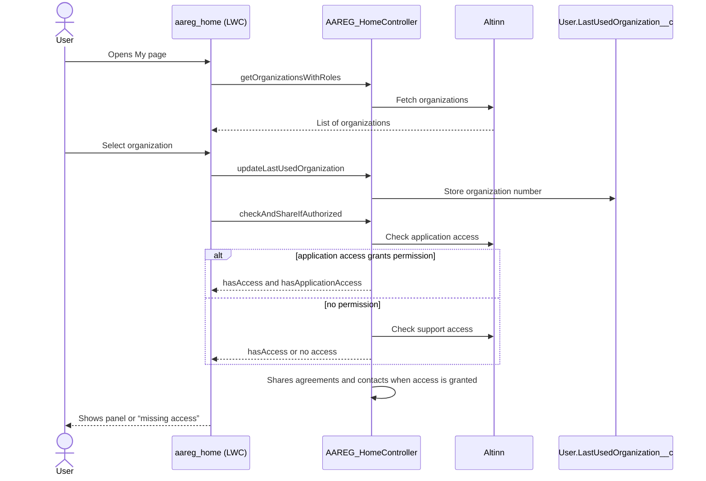
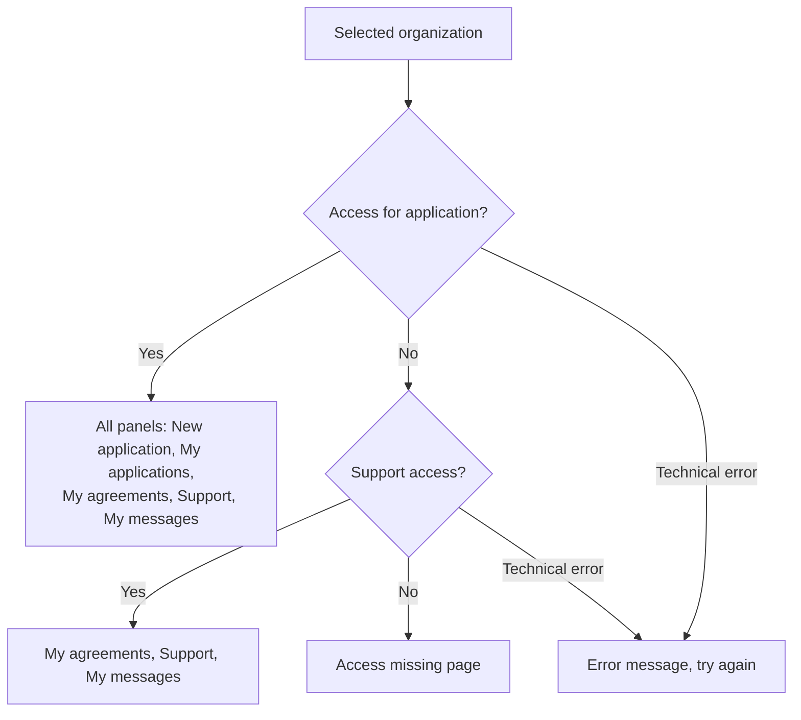
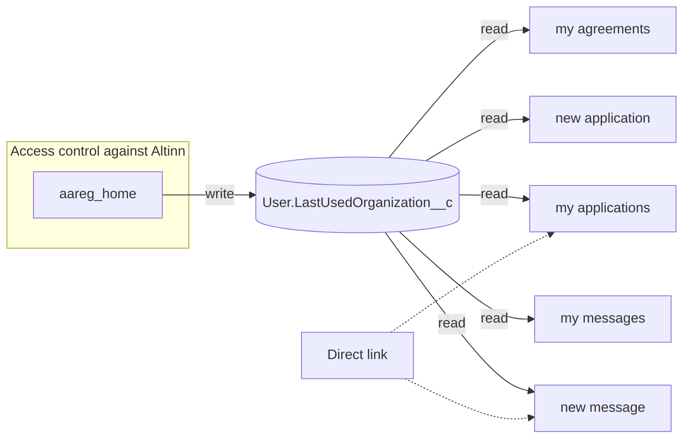
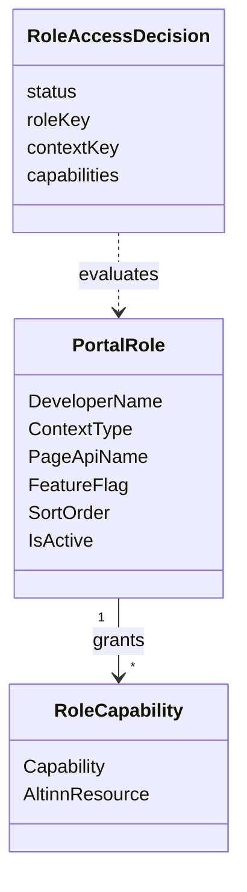
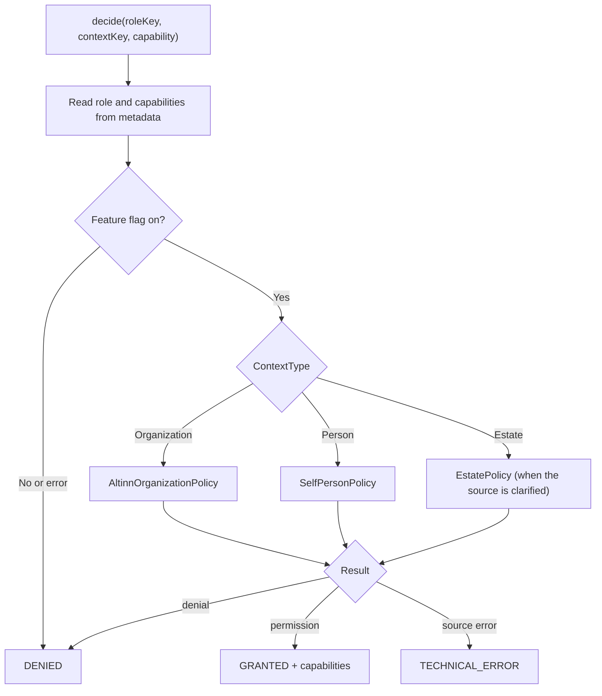
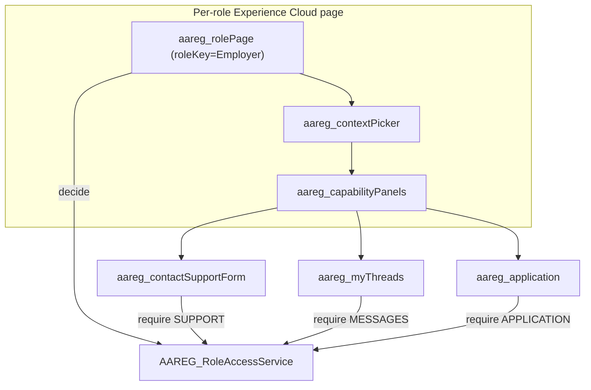
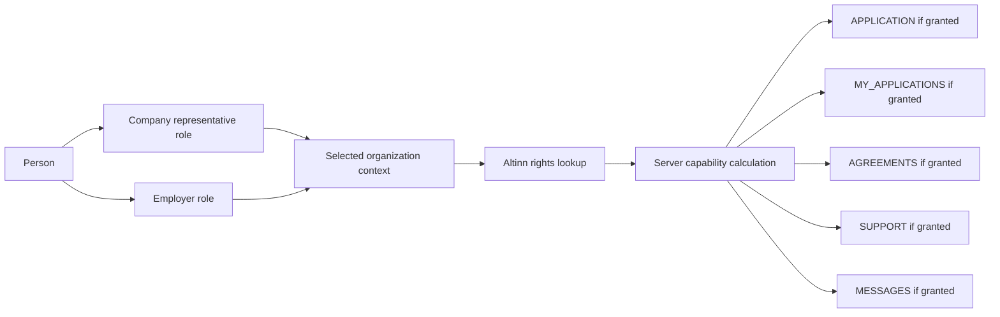
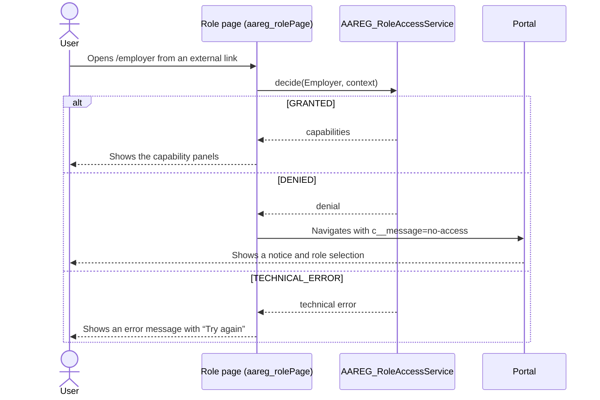
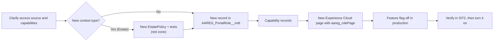
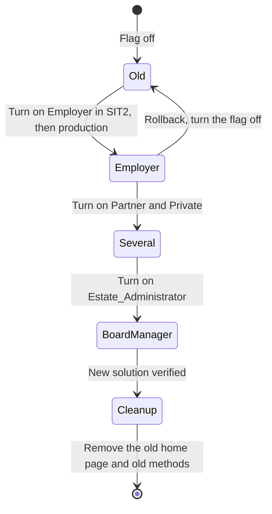

# Support and access application: current solution and role model

This note describes how support and access application work today and how the functions can be extended under the new role pages. Board managers and other roles should be able to be added without rebuilding the solution.

**Status:** Working material based on static reading of the code. Nothing has been verified in the org, and no proposals are approved. The code examples are illustrations, not implementation.

See also [review-og-forslag.md](review-og-forslag.md) for the target direction and [sikkerheitsfunn-tilgangskontroll.md](sikkerheitsfunn-tilgangskontroll.md) for access findings the team is reviewing.

## 1. Current solution

### 1.1 Entry and access decision

The home page [aareg_home](../../force-app/externalAccess/lwc/aareg_home/aareg_home.html) has the title “My page - Support and access application for Aa-registeret”.
The flow is as follows:

1. The user selects an organization from a dropdown. The list comes from Altinn via `AAREG_HomeController.getOrganizationsWithRoles`.
2. The selection is stored in `User.LastUsedOrganization__c`.
3. `AAREG_HomeController.checkAndShareIfAuthorized` asks Altinn for two resources for the selected organization: first the application resource and then the support resource.
4. If access is granted, active agreements for the organization and their contact persons are shared with the user.
5. The home page shows panels depending on the access granted.

The sequence below shows the same process as the list above.



### 1.2 What the user sees

The decision on the home page follows this tree. Technical errors from Altinn are shown as error messages and not as missing access.



| Altinn permission           | New application | My applications | My agreements | Support (new message) | My messages   |
| --------------------------- | --------------- | --------------- | ------------- | --------------------- | ------------- |
| `sok-tilgang`               | Yes             | Yes             | Yes           | Yes                   | Yes           |
| only `brukerstotte`         | No              | No              | Yes           | Yes                   | Yes           |
| none                        | No              | No              | No            | No                    | No            |
| technical error from Altinn | Error message   | Error message   | Error message | Error message         | Error message |

The support permission currently also grants “My agreements” and write access to agreement contacts. This should be clarified to confirm if this is intentional.

The full Altinn resource names are `nav_arbeidsforhold_aa-registeret-sok-tilgang` and `nav_arbeidsforhold_aa-registeret-brukerstotte`.

### 1.3 Screens and controllers

| Page (URL)               | LWC / controller                                              | Current context                                  |
| ------------------------ | ------------------------------------------------------------- | ------------------------------------------------ |
| `ny-melding`             | `aareg_contactSupportForm` / `AAREG_contactSupportController` | `LastUsedOrganization__c` on the request         |
| `mine-meldinger`         | `aareg_myThreads` / `AAREG_MyThreadsController`               | threads for the account of the last organization |
| `ny-soknad-aa-registret` | `aareg_application` / `AAREG_ApplicationController`           | last organization, rights check only in LWC      |
| `mine-soknader`          | `AAREG_MyApplicationsController`                              | last organization                                |
| `mine-avtaler`           | `AAREG_MyAgreementsController`                                | last organization                                |

All routes in `force-app/unpackagable/experiences/Aa_registret1/routes` have `pageAccess: UseParent`. They require login but have no role control.

The figure shows that the access control is only on the home page, while the subpages read the stored organization.



### 1.4 Main findings

1. **Access decisions happen only on the home page.** The subpages and controllers use `LastUsedOrganization__c` as context and do not ask Altinn again. A direct link to a subpage therefore does not go through the same control.
2. **Stored context is treated as proof of access.** The field is set by the client and read by several controllers without being tied to a verified decision.
3. **Application control is only in the UI.** `aareg_application` calls `getUserRights` from the LWC. The request submission on the server side does not validate the permission.
4. **Context and role are mixed together.** Everything is organization-based. There is no model for person, authority, or estate context.
5. **Altinn resources and panel choices are hardcoded** in Apex and HTML. A new role requires changes in multiple files.

Findings 1–3 also have a security side. They are summarized at a high level in [sikkerheitsfunn-tilgangskontroll.md](sikkerheitsfunn-tilgangskontroll.md), and the team reviews and prioritizes them. The new role model should not build on approaches that rely on stored context without server-side control.

## 2. Goals for the role model

- Support and access application should be available under each relevant role. For employers, the behavior should be the same as today.
- A new role, for example board manager, should mainly require configuration, one new Experience Cloud page, and possibly one new access policy, not changes in shared components.
- Each role page and each server call should validate actual access itself.
- When access is denied, the user is returned to the entry portal with a message.

## 3. Proposed design

### 3.1 Concepts

- **Role** is how the user acts, for example employer, partner / authorized representative, private individual, or board manager.
- **Context** is whom the user is acting for: an organization, themselves, or an estate.
- **Capability** is a function the user may get, for example `SUPPORT`, `MESSAGES`, `APPLICATION`, `MY_APPLICATIONS`, or `AGREEMENTS`.
- **Access decision** is the result of a server-side control for role and context. The result is `GRANTED`, `DENIED`, or `TECHNICAL_ERROR`, with a list of capabilities.

The model below shows how the concepts fit together. A role has one context type and multiple capabilities. Each capability can require one or more Altinn resources.



### 3.2 Role registry in Custom Metadata

Each role gets one record, for example in `AAREG_PortalRole__mdt`.

| Field            | Example for employer                    | Purpose                               |
| ---------------- | --------------------------------------- | ------------------------------------- |
| `DeveloperName`  | `Employer`                              | stable role key                       |
| `ContextType__c` | `Organization`                          | `Organization`, `Person`, or `Estate` |
| `PageApiName__c` | `arbeidsgiver__c`                       | navigation from the portal            |
| `FeatureFlag__c` | name of the flag in `Feature_Flag__mdt` | controlled rollout and rollback       |
| `SortOrder__c`   | `10`                                    | order in the portal                   |
| `IsActive__c`    | `true`                                  | whether the role is shown             |
| Label            | Custom Label and Translation Workbench  | Norwegian text without hardcoding     |

The capabilities and Altinn resources per role are stored in a separate record, for example `AAREG_RoleCapability__mdt`, with `Role__c`, `Capability__c`, and `AltinnResource__c`. The current two resources then become data rather than code.

| Role       | Capability                          | Altinn resource granting access |
| ---------- | ----------------------------------- | ------------------------------- |
| `Employer` | `APPLICATION`, `MY_APPLICATIONS`    | `sok-tilgang`                   |
| `Employer` | `SUPPORT`, `MESSAGES`, `AGREEMENTS` | `sok-tilgang` or `brukerstotte` |

It must be decided explicitly that multiple resources for the same capability means that one of them is enough. That is the current behavior.

**Example metadata record** (illustration):

```xml
<?xml version="1.0" encoding="UTF-8" ?>
<CustomMetadata
    xmlns="http://soap.sforce.com/2006/04/metadata"
    xmlns:xsi="http://www.w3.org/2001/XMLSchema-instance"
    xmlns:xsd="http://www.w3.org/2001/XMLSchema"
>
    <label>Employer</label>
    <protected>false</protected>
    <values>
        <field>ContextType__c</field>
        <value xsi:type="xsd:string">Organization</value>
    </values>
    <values>
        <field>PageApiName__c</field>
        <value xsi:type="xsd:string">arbeidsgiver__c</value>
    </values>
    <values>
        <field>SortOrder__c</field>
        <value xsi:type="xsd:double">10</value>
    </values>
    <values>
        <field>IsActive__c</field>
        <value xsi:type="xsd:boolean">true</value>
    </values>
</CustomMetadata>
```

### 3.3 One server-side service for access

The `AAREG_RoleAccessService` service reads the role from metadata, checks the
feature flag, and selects a policy based on the context type. The same service is
called from the role page and from each controller method.



Rules for the service:

- The policy is selected with an explicit `switch` on `ContextType__c`, not with
  dynamic class lookup. A new role with an existing context type only needs
  metadata. A new context type requires one new policy class and one new branch.
- Identity always comes from `UserInfo.getUserId()`. The client never sends
  `userId`.
- Reuse `AAREG_AltinnServiceFactory` and Altinn scenarios so that tests and the
  scratch org can control access per role.
- Short-lived Platform Cache can be considered if Altinn calls become expensive.
  The cache is a performance optimization and does not replace the check.

**Example contract** (illustrative, not implemented):

```apex
public with sharing class AAREG_RoleAccessService {
    public enum Status {
        GRANTED,
        DENIED,
        TECHNICAL_ERROR
    }

    public static RoleAccessDecision decide(String roleKey, String contextKey) {
        // 1. Read AAREG_PortalRole__mdt and capabilities
        // 2. Check feature flag fail-closed
        // 3. switch on ContextType__c -> policy
        // 4. Return decision with capabilities
        return null; // sketch
    }

    public static void require(String roleKey, String contextKey, String capability) {
        RoleAccessDecision decision = decide(roleKey, contextKey);
        if (decision.status != Status.GRANTED || !decision.capabilities.contains(capability)) {
            throw new AuraHandledException('You do not have access to this function.');
        }
    }
}
```

**Example of use in an existing controller** (illustrative):

```apex
@AuraEnabled
public static void createNewInquiry(String roleKey, String contextKey, Inquiry__c inquiry, List<FileData> files) {
    AAREG_RoleAccessService.require(roleKey, contextKey, 'SUPPORT');
    inquiry.SubmittedRole__c = roleKey;
    // existing logic for inquiry, thread, and attachments
}
```

### 3.4 Active context

`LastUsedOrganization__c` should no longer grant access.

- Stored context may still be used to preselect in the UI.
- The server re-checks the context on every call, or stores a verified decision with
  role, context, and timestamp that only the server can write.
- Inquiries and threads store the role and context explicitly, for example
  `SubmittedRole__c` and the context type in addition to
  `CreatedByOrganizationNumber__c`. Case handlers then see which role the user came from.

| Role                      | Context type   | Example `contextKey`         | Source for control      |
| ------------------------- | -------------- | ---------------------------- | ----------------------- |
| Employer                  | `Organization` | organization number          | Altinn                  |
| Partner / authorized rep. | `Organization` | organization number          | Altinn, to be clarified |
| Private person / employee | `Person`       | empty, always logged-in user | login                   |
| Estate administrator      | `Estate`       | reference to the estate      | to be clarified         |

### 3.5 Reusable components

| Component                  | Responsibility                                                                                                                      | Reuse from                          |
| -------------------------- | ----------------------------------------------------------------------------------------------------------------------------------- | ----------------------------------- |
| `aareg_rolePage`           | Takes `roleKey` as a design attribute in Experience Builder, calls `decide`, and shows content or sends the user back to the portal | `aareg_home`, `aareg_missingAccess` |
| `aareg_contextPicker`      | Shows the context options for the role; for organizations this is the current dropdown list                                         | `aareg_home`                        |
| `aareg_capabilityPanels`   | Shows a `c-link-panel` for each capability in the decision                                                                          | panels in `aareg_home`              |
| `aareg_contactSupportForm` | Unchanged form; the server takes role and context from the decision                                                                 | existing                            |
| `aareg_myThreads`          | Unchanged list; the server filters by role and context                                                                              | existing                            |

`roleKey` is set in Experience Builder per page and is not read from the URL.
A manipulated URL therefore cannot change the role.



**Example of design attribute** in `aareg_rolePage.js-meta.xml` (illustrative):

```xml
<targetConfigs>
    <targetConfig targets="lightningCommunity__Default">
        <property
            name="roleKey"
            type="String"
            label="Role"
            datasource="Employer,Partner,Private"
            required="true"
        />
    </targetConfig>
</targetConfigs>
```

### 3.6 Multi-role and employer representative behavior

A person can hold more than one role for the same organization, such as company representative and employer. The specification therefore separates the following concepts:

- `Role` is the selected experience/context.
- `ContextKey` is the selected organization or person.
- `SourceRights` are the rights returned for the logged-in person by Altinn or another approved source.
- `Capabilities` are the actions allowed by the server after evaluating those source rights.

The role does not grant a capability by itself. For example, opening the employer role page does not grant `APPLICATION`, even if the same person is a company representative for another context. The server evaluates the selected organization and selected role context against the approved source.



For organization-based roles, the effective capability matrix should use the following baseline mapping until a final business owner decision replaces it:

| Source result          | APPLICATION          | MY_APPLICATIONS      | AGREEMENTS                                      | SUPPORT              | MESSAGES             |
| ---------------------- | -------------------- | -------------------- | ----------------------------------------------- | -------------------- | -------------------- |
| `sok-tilgang`          | Yes                  | Yes                  | Yes                                             | Yes                  | Yes                  |
| Only `brukerstotte`    | No                   | No                   | Yes, according to current behavior if confirmed | Yes                  | Yes                  |
| No relevant access     | No                   | No                   | No                                              | No                   | No                   |
| Technical source error | No; show error/retry | No; show error/retry | No; show error/retry                            | No; show error/retry | No; show error/retry |

Existing agreement behavior for support-only access must be explicitly confirmed. The capability mapping must not be derived from UI role selection.

### 3.7 Direct link and return to the portal

A direct link goes through the same control as navigation from the portal. On
denial, the user is returned to the portal with a limited status code that only
controls which message is shown.



| URL status code   | Message in the portal (example)                             |
| ----------------- | ----------------------------------------------------------- |
| `no-access`       | “You do not have access to this page. Choose another role.” |
| `role-not-active` | “This service is not available right now.”                  |
| unknown value     | No message                                                  |

The portal shows only messages from a fixed list. The value in the URL never
grants access and does not contain personal data.

### 3.8 Adding board managers

The figure shows the steps for a new role. Shared components and the other roles
are not changed.



1. Clarify the access source, for example a probate certificate, Digital Estate, or another source, and whether the board manager should be able to request access or only receive support.
2. Add `AAREG_PortalRole__mdt.Estate_Administrator` and capability records, for example only `SUPPORT` and `MESSAGES`.
3. Implement `EstatePolicy` with its own tests. This is a red-zone area because of privacy and information about the deceased.
4. Create the Experience Cloud page with `aareg_rolePage` and `roleKey` set.
5. Add a feature flag and turn it on in SIT2 before production.

**Example capabilities for board managers** (assumption, not decided):

| Role                   | Capability            | Source         |
| ---------------------- | --------------------- | -------------- |
| `Estate_Administrator` | `SUPPORT`, `MESSAGES` | `EstatePolicy` |

## 4. Options considered

| Option                                                                   | Advantage                                              | Disadvantage                                                                      |
| ------------------------------------------------------------------------ | ------------------------------------------------------ | --------------------------------------------------------------------------------- |
| Copy `aareg_home` and the controllers per role                           | quick for the first role                               | duplicated access logic; board managers create a new copy; easy to forget control |
| Dynamic policy class from metadata (`Type.forName`)                      | no code change for new context types                   | hidden control flow; harder to test and review; not needed now                    |
| **Metadata for role and explicit policy per context type** (recommended) | new role is mostly configuration; one place for access | requires current controllers to be adapted to use a shared service                |

## 5. Transition

Each role has its own feature flag. The old home page and the new role pages can therefore live side by side.



- The role page is off when the flag is off.
- Start with the employer role, since it matches today’s behavior and can be tested against the table in 1.2.
- New pages should not call old controller methods that rely only on `LastUsedOrganization__c`. The old methods are removed when the new solution is verified.

## 6. Tests that need to be in place

- The table in 1.2 as parameterized Apex tests against `decide`, via an Altinn scenario.
- Every controller method rejects calls without a valid decision, including direct calls without going through the page.
- A direct link to a role page without access returns to the portal with the correct status code.
- Technical errors yield `TECHNICAL_ERROR` rather than `DENIED`.
- A disabled feature flag gives the same result as missing access.
- `System.runAs` with the minimum profile, in line with the repository rules.

**Example test scenario** (illustrative):

| Scenario                          | Role       | Altinn response       | Expected              |
| --------------------------------- | ---------- | --------------------- | --------------------- |
| Full access                       | `Employer` | `sok-tilgang` Permit  | `GRANTED`, all five   |
| Support only                      | `Employer` | `brukerstotte` Permit | `GRANTED`, three      |
| No access                         | `Employer` | both Deny             | `DENIED`              |
| Altinn down                       | `Employer` | technical error       | `TECHNICAL_ERROR`     |
| Flag off                          | `Employer` | Permit                | `DENIED`              |
| Direct call to `createNewInquiry` | `Employer` | Deny                  | exception, no inquiry |

## 7. Open questions

1. Should support-only access still grant “My agreements” and write access to agreement contacts?
2. Which Altinn resources or other sources apply to partners, private individuals, and board managers?
3. Can private individuals and board managers request access, or do they only use support?
4. Should messages be visible across roles for the same person, or only within the role and context from which they were sent?
5. What should a case handler see about the role and context in `Inquiry__c` and the threads?
