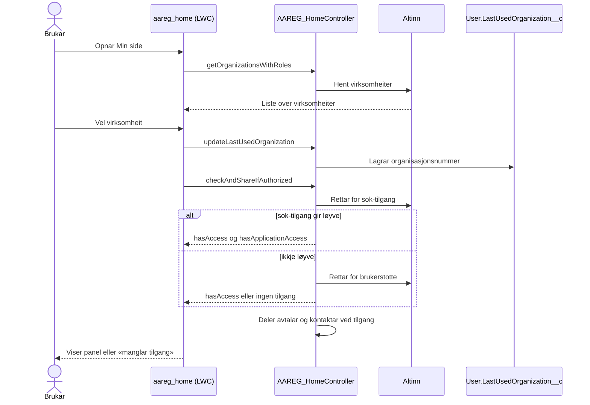
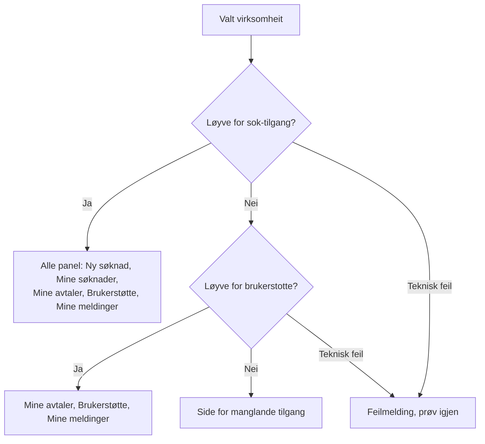
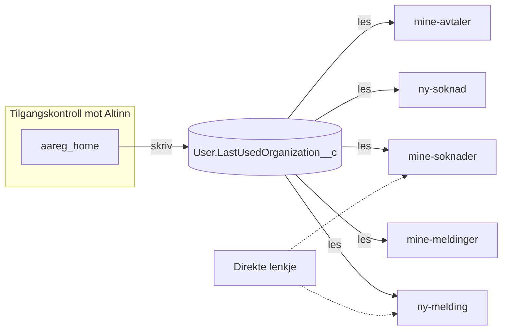
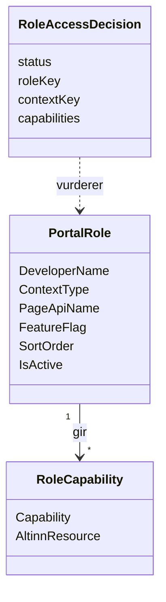
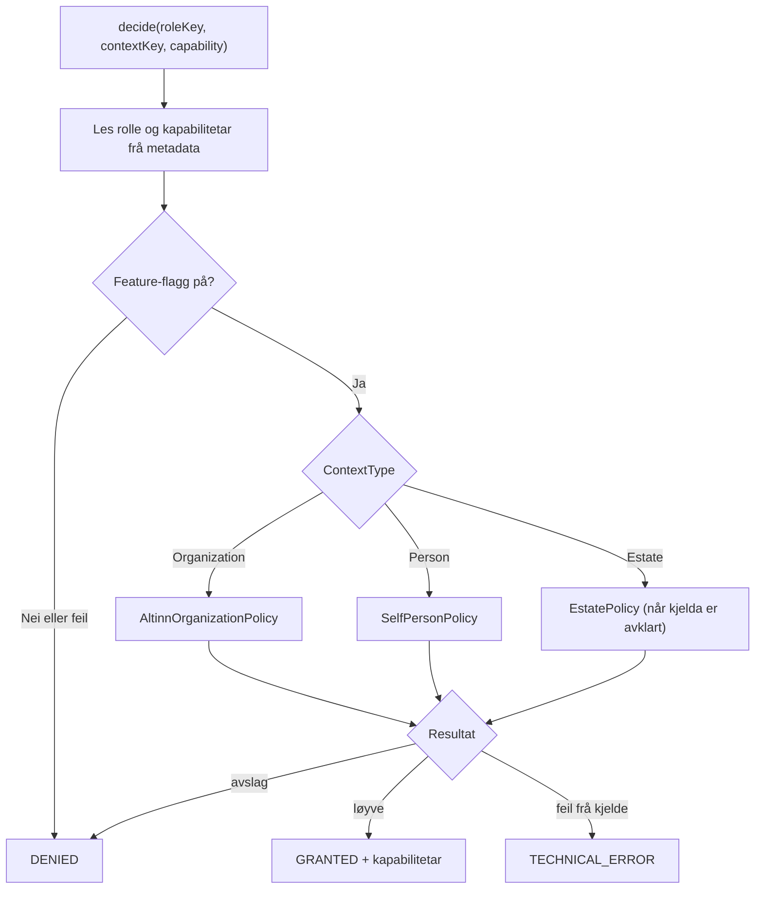
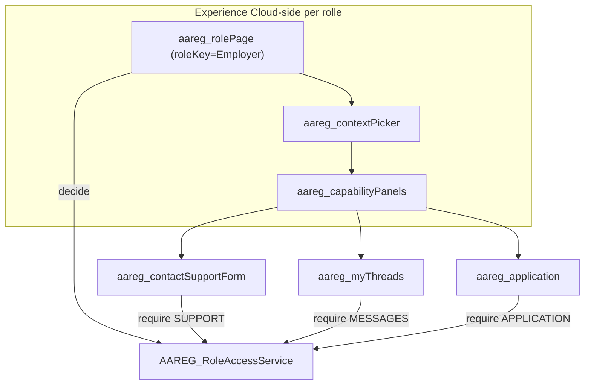
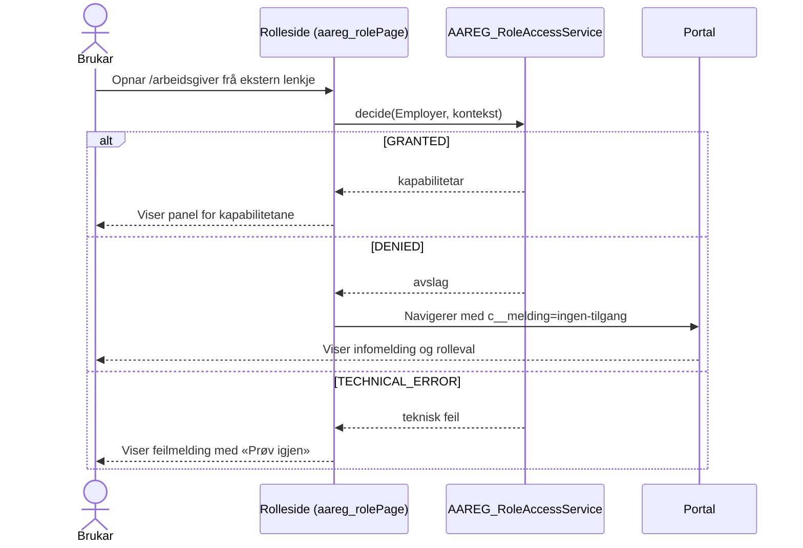
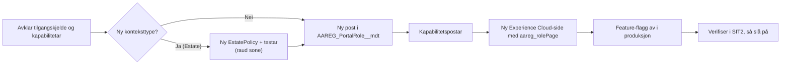
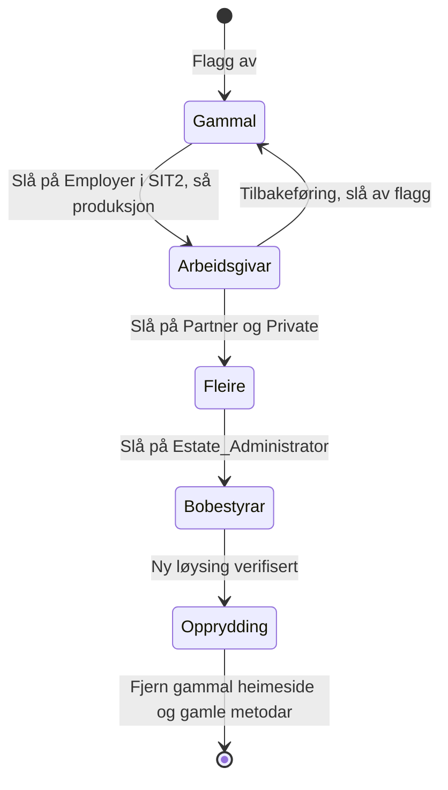

# Brukerstøtte og søknad om tilgang: dagens løysing og rollemodell

Dette notatet skildrar korleis brukerstøtte og søknad om tilgang fungerer i dag,
og korleis funksjonane kan førast vidare under dei nye rollesidene. Bobestyrar og
andre roller skal kunne leggjast til utan å byggje om løysinga.

**Status:** Arbeidsunderlag basert på statisk lesing av koden. Ingenting er
verifisert i org, og ingen forslag er vedtekne. Kodedøma er illustrasjonar, ikkje
implementasjon.

Sjå òg [review-og-forslag.md](review-og-forslag.md) for målreisa og
[sikkerheitsfunn-tilgangskontroll.md](sikkerheitsfunn-tilgangskontroll.md) for
tilgangsfunn som teamet vurderer.

## 1. Dagens løysing

### 1.1 Inngang og tilgangsavgjerd

Heimesida [aareg_home](../../force-app/externalAccess/lwc/aareg_home/aareg_home.html)
har tittelen «Min side - Brukerstøtte og søknad om tilgang til Aa-registeret».
Flyten er slik:

1. Brukaren vel virksomheit i ei nedtrekksliste. Lista kjem frå Altinn via
   `AAREG_HomeController.getOrganizationsWithRoles`.
2. Valet blir lagra i `User.LastUsedOrganization__c`.
3. `AAREG_HomeController.checkAndShareIfAuthorized` spør Altinn om to ressursar
   for valt virksomheit, først søknadsressursen og deretter
   brukerstøtteressursen.
4. Ved tilgang blir aktive avtalar for virksomheita og kontaktpersonane deira
   delte med brukaren.
5. Heimesida viser panel etter kva tilgang brukaren fekk.

Sekvensen under viser det same som lista over.



### 1.2 Kva brukaren ser

Avgjerda på heimesida følgjer dette treet. Teknisk feil frå Altinn blir vist som
feilmelding og ikkje som manglande tilgang.



| Altinn-løyve            | Ny søknad   | Mine søknader | Mine avtaler | Brukerstøtte (ny melding) | Mine meldinger |
| ----------------------- | ----------- | ------------- | ------------ | ------------------------- | -------------- |
| `sok-tilgang`           | Ja          | Ja            | Ja           | Ja                        | Ja             |
| berre `brukerstotte`    | Nei         | Nei           | Ja           | Ja                        | Ja             |
| ingen                   | Nei         | Nei           | Nei          | Nei                       | Nei            |
| teknisk feil frå Altinn | Feilmelding | Feilmelding   | Feilmelding  | Feilmelding               | Feilmelding    |

Brukerstøtte-løyvet gir i dag òg «Mine avtaler» og skrivetilgang til
avtalekontaktar. Det bør avklarast om dette er tilsikta.

Dei fulle Altinn-ressursnamna er `nav_arbeidsforhold_aa-registeret-sok-tilgang`
og `nav_arbeidsforhold_aa-registeret-brukerstotte`.

### 1.3 Undersider og kontrollarar

| Side (URL)               | LWC / kontrollar                                              | Kontekst i dag                            |
| ------------------------ | ------------------------------------------------------------- | ----------------------------------------- |
| `ny-melding`             | `aareg_contactSupportForm` / `AAREG_contactSupportController` | `LastUsedOrganization__c` på henvendinga  |
| `mine-meldinger`         | `aareg_myThreads` / `AAREG_MyThreadsController`               | tråder på kontoen til siste virksomheit   |
| `ny-soknad-aa-registret` | `aareg_application` / `AAREG_ApplicationController`           | siste virksomheit, rettssjekk berre i LWC |
| `mine-soknader`          | `AAREG_MyApplicationsController`                              | siste virksomheit                         |
| `mine-avtaler`           | `AAREG_MyAgreementsController`                                | siste virksomheit                         |

Alle rutene i `force-app/unpackagable/experiences/Aa_registret1/routes` har
`pageAccess: UseParent`. Dei krev innlogging, men har ingen rollekontroll.

Figuren viser at tilgangskontrollen berre ligg i heimesida, medan undersidene
les den lagra virksomheita.



### 1.4 Hovudfunn

1. **Tilgangsavgjerda skjer berre på heimesida.** Undersidene og kontrollarane
   bruker `LastUsedOrganization__c` som kontekst og spør ikkje Altinn på nytt. Ei
   direkte lenkje til ei underside går difor ikkje gjennom same kontroll.
2. **Lagra kontekst blir behandla som tilgangsbevis.** Feltet blir sett frå
   klienten og lese av fleire kontrollarar utan å vere knytt til ei verifisert
   avgjerd.
3. **Søknadskontrollen er berre i UI.** `aareg_application` kallar
   `getUserRights` frå LWC-en. Innsendinga på serversida kontrollerer ikkje
   løyvet.
4. **Kontekst og rolle er samanblanda.** Alt er organisasjonsbasert. Det finst
   ingen modell for person-, fullmakts- eller dødsbukontekst.
5. **Altinn-ressursar og panelval er hardkoda** i Apex og HTML. Ei ny rolle
   krev endringar i fleire filer.

Funn 1–3 har òg ei sikkerheitsside. Dei er samla på overordna nivå i
[sikkerheitsfunn-tilgangskontroll.md](sikkerheitsfunn-tilgangskontroll.md), og
teamet vurderer og prioriterer dei. Den nye rollemodellen bør ikkje byggje vidare
på metodar som stolar på lagra kontekst utan serverkontroll.

## 2. Mål for rollemodellen

- Brukerstøtte og søknad om tilgang skal finnast under kvar rolle der dei er
  relevante. For arbeidsgivar skal oppførselen vere som i dag.
- Ei ny rolle, til dømes bobestyrar, skal i hovudsak krevje konfigurasjon, éi ny
  Experience Cloud-side og eventuelt éin ny tilgangspolicy, ikkje endringar i
  felles komponentar.
- Kvar rolleside og kvart serverkall skal kontrollere reell tilgang sjølv.
- Ved avslag går brukaren tilbake til inngangsportalen med ei melding.

## 3. Foreslått design

### 3.1 Omgrep

- **Rolle** er korleis brukaren opptrer, til dømes arbeidsgivar,
  samarbeidspartnar/fullmektig, privatperson eller bobestyrar.
- **Kontekst** er kven brukaren opptrer for: ei virksomheit, seg sjølv eller
  eit dødsbu.
- **Kapabilitet** er ein funksjon brukaren kan få, til dømes `SUPPORT`,
  `MESSAGES`, `APPLICATION`, `MY_APPLICATIONS` eller `AGREEMENTS`.
- **Tilgangsavgjerd** er resultatet av ein serverkontroll for rolle og kontekst.
  Resultatet er `GRANTED`, `DENIED` eller `TECHNICAL_ERROR`, med ei liste over
  kapabilitetar.

Modellen under viser korleis omgrepa heng saman. Ei rolle har éin konteksttype
og fleire kapabilitetar. Kvar kapabilitet kan krevje éin eller fleire
Altinn-ressursar.



### 3.2 Rolleregister i Custom Metadata

Kvar rolle får éin post, til dømes i `AAREG_PortalRole__mdt`.

| Felt             | Døme for arbeidsgivar                   | Føremål                                 |
| ---------------- | --------------------------------------- | --------------------------------------- |
| `DeveloperName`  | `Employer`                              | stabil rollenøkkel                      |
| `ContextType__c` | `Organization`                          | `Organization`, `Person` eller `Estate` |
| `PageApiName__c` | `arbeidsgiver__c`                       | navigasjon frå portalen                 |
| `FeatureFlag__c` | namnet på flagget i `Feature_Flag__mdt` | kontrollert lansering og tilbakeføring  |
| `SortOrder__c`   | `10`                                    | rekkjefølgje i portalen                 |
| `IsActive__c`    | `true`                                  | om rolla blir vist                      |
| Etikett          | Custom Label og Translation Workbench   | norsk tekst utan hardkoding             |

Kapabilitetane og Altinn-ressursane per rolle ligg i ein eigen post, til dømes
`AAREG_RoleCapability__mdt`, med `Role__c`, `Capability__c` og
`AltinnResource__c`. Dagens to ressursar blir då data og ikkje kode.

| Rolle      | Kapabilitet                         | Altinn-ressurs som gir løyve       |
| ---------- | ----------------------------------- | ---------------------------------- |
| `Employer` | `APPLICATION`, `MY_APPLICATIONS`    | `sok-tilgang`                      |
| `Employer` | `SUPPORT`, `MESSAGES`, `AGREEMENTS` | `sok-tilgang` eller `brukerstotte` |

Det må avgjerast eksplisitt at fleire ressursar for same kapabilitet tyder at
éin av dei er nok. Det er dagens oppførsel.

**Døme på metadatapost** (illustrasjon):

```xml
<?xml version="1.0" encoding="UTF-8" ?>
<CustomMetadata
    xmlns="http://soap.sforce.com/2006/04/metadata"
    xmlns:xsi="http://www.w3.org/2001/XMLSchema-instance"
    xmlns:xsd="http://www.w3.org/2001/XMLSchema"
>
    <label>Employer</label>
    <protected>false</protected>
    <values>
        <field>ContextType__c</field>
        <value xsi:type="xsd:string">Organization</value>
    </values>
    <values>
        <field>PageApiName__c</field>
        <value xsi:type="xsd:string">arbeidsgiver__c</value>
    </values>
    <values>
        <field>SortOrder__c</field>
        <value xsi:type="xsd:double">10</value>
    </values>
    <values>
        <field>IsActive__c</field>
        <value xsi:type="xsd:boolean">true</value>
    </values>
</CustomMetadata>
```

### 3.3 Éi serverteneste for tilgang

Tenesta `AAREG_RoleAccessService` les rolla frå metadata, sjekkar
feature-flagget og vel policy etter konteksttypen. Same teneste blir kalla frå
rollesida og frå kvar kontrollarmetode.



Reglar for tenesta:

- Policyen blir vald med ein eksplisitt `switch` på `ContextType__c`, ikkje med
  dynamisk klasseoppslag. Ei ny rolle med eksisterande konteksttype krev berre
  metadata. Ein ny konteksttype krev éin ny policyklasse og éi ny grein.
- Identiteten kjem alltid frå `UserInfo.getUserId()`. Klienten sender aldri
  `userId`.
- Gjenbruk `AAREG_AltinnServiceFactory` og Altinn-scenarioa, slik at testar og
  scratch-org kan styre løyve per rolle.
- Platform Cache med kort levetid kan vurderast dersom Altinn-kalla blir dyre.
  Cachen er ei ytingsoptimalisering og erstattar ikkje kontrollen.

**Døme på kontrakt** (illustrasjon, ikkje implementert):

```apex
public with sharing class AAREG_RoleAccessService {
    public enum Status {
        GRANTED,
        DENIED,
        TECHNICAL_ERROR
    }

    public static RoleAccessDecision decide(String roleKey, String contextKey) {
        // 1. Les AAREG_PortalRole__mdt og kapabilitetar
        // 2. Sjekk feature-flagg fail-closed
        // 3. switch on ContextType__c -> policy
        // 4. Returner avgjerd med kapabilitetar
        return null; // skisse
    }

    public static void require(String roleKey, String contextKey, String capability) {
        RoleAccessDecision decision = decide(roleKey, contextKey);
        if (decision.status != Status.GRANTED || !decision.capabilities.contains(capability)) {
            throw new AuraHandledException('Du har ikkje tilgang til denne funksjonen.');
        }
    }
}
```

**Døme på bruk i ein eksisterande kontrollar** (illustrasjon):

```apex
@AuraEnabled
public static void createNewInquiry(String roleKey, String contextKey, Inquiry__c inquiry, List<FileData> files) {
    AAREG_RoleAccessService.require(roleKey, contextKey, 'SUPPORT');
    inquiry.SubmittedRole__c = roleKey;
    // eksisterande logikk for henvending, tråd og vedlegg
}
```

### 3.4 Aktiv kontekst

`LastUsedOrganization__c` bør ikkje lenger bere tilgang.

- Lagra kontekst kan framleis brukast for å førehandsvelje i UI.
- Serveren kontrollerer konteksten på nytt i kvart kall, eller lagrar ei
  verifisert avgjerd med rolle, kontekst og tidspunkt som berre serveren kan
  skrive.
- Henvendingar og tråder får rolle og kontekst lagra eksplisitt, til dømes
  `SubmittedRole__c` og konteksttype i tillegg til
  `CreatedByOrganizationNumber__c`. Saksbehandlarar ser då kva rolle brukaren
  kom frå.

| Rolle                        | Konteksttype   | Døme på `contextKey`        | Kjelde for kontroll  |
| ---------------------------- | -------------- | --------------------------- | -------------------- |
| Arbeidsgivar                 | `Organization` | organisasjonsnummer         | Altinn               |
| Samarbeidspartnar/fullmektig | `Organization` | organisasjonsnummer         | Altinn, må avklarast |
| Privatperson/arbeidstakar    | `Person`       | tom, alltid innlogga person | innlogginga          |
| Bobestyrar                   | `Estate`       | referanse til dødsbuet      | må avklarast         |

### 3.5 Gjenbrukbare komponentar

| Komponent                  | Ansvar                                                                                                                      | Gjenbruk frå                        |
| -------------------------- | --------------------------------------------------------------------------------------------------------------------------- | ----------------------------------- |
| `aareg_rolePage`           | Tek `roleKey` som designattributt i Experience Builder, kallar `decide` og viser innhald eller sender brukaren til portalen | `aareg_home`, `aareg_missingAccess` |
| `aareg_contextPicker`      | Viser val for konteksttypen til rolla; for organisasjon er dette dagens nedtrekksliste                                      | `aareg_home`                        |
| `aareg_capabilityPanels`   | Viser `c-link-panel` per kapabilitet i avgjerda                                                                             | panela i `aareg_home`               |
| `aareg_contactSupportForm` | Uendra skjema; serveren tek rolle og kontekst frå avgjerda                                                                  | eksisterande                        |
| `aareg_myThreads`          | Uendra liste; serveren filtrerer på rolle og kontekst                                                                       | eksisterande                        |

`roleKey` blir sett i Experience Builder per side og blir ikkje lese frå URL-en.
Ein manipulert URL kan difor ikkje byte rolle.



**Døme på designattributt** i `aareg_rolePage.js-meta.xml` (illustrasjon):

```xml
<targetConfigs>
    <targetConfig targets="lightningCommunity__Default">
        <property
            name="roleKey"
            type="String"
            label="Rolle"
            datasource="Employer,Partner,Private"
            required="true"
        />
    </targetConfig>
</targetConfigs>
```

### 3.6 Direkte lenkje og retur til portalen

Ei direkte lenkje går gjennom same kontroll som navigasjon frå portalen. Ved
avslag går brukaren tilbake til portalen med ein avgrensa statuskode som berre
styrer kva melding som blir vist.



| Statuskode i URL    | Melding i portalen (døme)                                 |
| ------------------- | --------------------------------------------------------- |
| `ingen-tilgang`     | «Du har ikkje tilgang til denne sida. Vel ei anna rolle.» |
| `rolle-ikkje-aktiv` | «Denne tenesta er ikkje tilgjengeleg no.»                 |
| ukjend verdi        | Ingen melding                                             |

Portalen viser berre meldingar frå ei fast liste. Verdien i URL-en gir aldri
tilgang og inneheld ikkje personopplysningar.

### 3.7 Leggje til bobestyrar

Figuren viser stega for ei ny rolle. Felles komponentar og dei andre rollene blir
ikkje endra.



1. Avklar kjelda for tilgang, til dømes skifteattest, Digitalt dødsbo eller ei
   anna kjelde, og om bobestyrar skal kunne søkje om tilgang eller berre få
   brukerstøtte.
2. Legg til `AAREG_PortalRole__mdt.Estate_Administrator` og kapabilitetspostar,
   til dømes berre `SUPPORT` og `MESSAGES`.
3. Implementer `EstatePolicy` med eigne testar. Dette er raud sone på grunn av
   personvern og opplysningar om avdøde.
4. Opprett Experience Cloud-sida med `aareg_rolePage` og `roleKey` sett.
5. Legg til eit feature-flagg og slå det på i SIT2 før produksjon.

**Døme på kapabilitetar for bobestyrar** (føresetnad, ikkje vedteke):

| Rolle                  | Kapabilitet           | Kjelde         |
| ---------------------- | --------------------- | -------------- |
| `Estate_Administrator` | `SUPPORT`, `MESSAGES` | `EstatePolicy` |

## 4. Alternativ som er vurdert

| Alternativ                                                             | Fordel                                                     | Ulempe                                                                       |
| ---------------------------------------------------------------------- | ---------------------------------------------------------- | ---------------------------------------------------------------------------- |
| Kopiere `aareg_home` og kontrollarane per rolle                        | raskt for første rolle                                     | duplisert tilgangslogikk; bobestyrar gir ein ny kopi; lett å gløyme kontroll |
| Dynamisk policyklasse frå metadata (`Type.forName`)                    | ingen kodeendring for ny konteksttype                      | skjult kontrollflyt; vanskelegare å teste og gjennomgå; ikkje behov no       |
| **Metadata for rolle og eksplisitt policy per konteksttype** (tilrådd) | ny rolle er stort sett konfigurasjon; éin stad for tilgang | krev at dagens kontrollarar blir lagde om til å bruke felles teneste         |

## 5. Overgang

Kvar rolle har sitt eige feature-flagg. Gammal heimeside og nye rollesider kan
difor leve side om side.



- Rollesida er av når flagget er av.
- Start med arbeidsgivar, sidan rolla svarar til dagens oppførsel og kan testast
  mot tabellen i 1.2.
- Nye sider skal ikkje kalle gamle kontrollarmetodar som berre stolar på
  `LastUsedOrganization__c`. Dei gamle metodane blir fjerna når ny løysing er
  verifisert.

## 6. Testar som må finnast

- Tabellen i 1.2 som parametriserte Apex-testar mot `decide`, via
  Altinn-scenario.
- Kvar kontrollarmetode avviser kall utan gyldig avgjerd, også ved direkte kall
  utan å gå via sida.
- Direkte lenkje til rolleside utan tilgang gir retur til portalen med rett
  statuskode.
- Teknisk feil gir `TECHNICAL_ERROR` og ikkje `DENIED`.
- Avslått feature-flagg gir same resultat som manglande tilgang.
- `System.runAs` med minimumsprofil, i tråd med repoets reglar.

**Døme på testscenario** (illustrasjon):

| Scenario                            | Rolle      | Altinn-svar           | Forventa                 |
| ----------------------------------- | ---------- | --------------------- | ------------------------ |
| Full tilgang                        | `Employer` | `sok-tilgang` Permit  | `GRANTED`, alle fem      |
| Berre brukerstøtte                  | `Employer` | `brukerstotte` Permit | `GRANTED`, tre           |
| Ingen løyve                         | `Employer` | begge Deny            | `DENIED`                 |
| Altinn nede                         | `Employer` | teknisk feil          | `TECHNICAL_ERROR`        |
| Flagg av                            | `Employer` | Permit                | `DENIED`                 |
| Direkte kall til `createNewInquiry` | `Employer` | Deny                  | unntak, ingen henvending |

## 7. Opne spørsmål

1. Skal berre brukerstøtte-løyve framleis gi «Mine avtaler» og skrivetilgang
   til avtalekontaktar?
2. Kva Altinn-ressursar eller andre kjelder gjeld for samarbeidspartnar,
   privatperson og bobestyrar?
3. Kan privatperson og bobestyrar søkje om tilgang, eller berre bruke
   brukerstøtte?
4. Skal meldingar vere synlege på tvers av roller for same person, eller berre
   innanfor rolla og konteksten dei vart sende frå?
5. Kva skal saksbehandlar sjå om rolle og kontekst i `Inquiry__c` og trådane?
