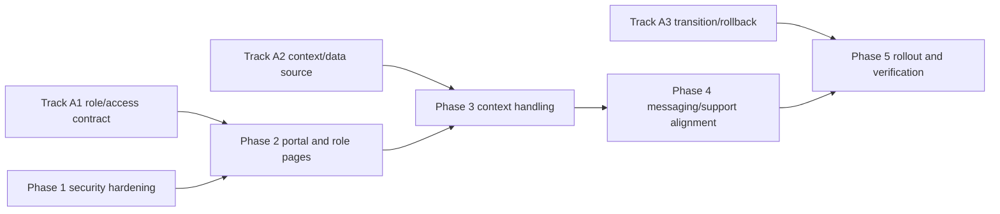
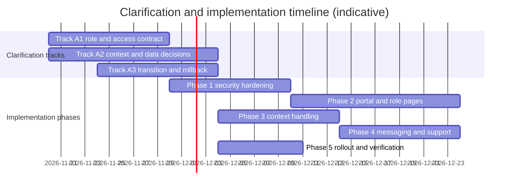

# Implementation plan

## Phase dependency overview

## Indicative timeline

## Part A: Clarification tracks (must be completed before major implementation)

### Track A1: Role and access contract

#### Goal for A1

- freeze exact function and data access per role,
- keep current company representative and support behavior unchanged,
- confirm that role/URL/context do not grant access on their own.

#### Deliverables for A1

- approved role-function matrix,
- approved direct-link behavior contract,
- approved denial and technical-error behavior.

#### Dependencies for A1

- input from product owner and technical owners.

### Track A2: Context and data source decisions

#### Goal for A2

- confirm source of truth for representation relationships,
- clarify ACR/email decisions that are still proposed,
- decide where organization context is mandatory or optional.

#### Deliverables for A2

- approved source mapping per role,
- approved context rules per role,
- approved data ownership notes for email and representation.

#### Dependencies for A2

- ADR owners and domain owner decisions.

### Track A3: Transition and rollback model

#### Goal for A3

- confirm if feature toggle can safely control entry experience,
- define fallback behavior when toggle is off, missing, or has technical error,
- ensure same access rules in old/new entry flows.

#### Deliverables for A3

- approved transition contract,
- rollout and rollback runbook,
- removal criteria for old flow and temporary toggle logic.

#### Dependencies for A3

- validation against existing toggle framework and Experience Cloud behavior.

## Part B: Implementation phases (after clarifications are approved)

## Phase 1: Security hardening of existing flow

### Goals for phase 1

- strengthen server-side identity and access checks in existing exposed methods,
- reduce reliance on client-supplied identity/context,
- preserve current business behavior while closing high-risk control gaps.

### Areas affected in phase 1

- existing Apex controllers in external/support/application flows,
- current entry and context handling logic.

### Tests for phase 1

- negative tests for manipulated parameters,
- runAs tests for minimum-access users,
- regression tests for current company representative/support flow.

## Phase 2: Portal and role-page foundation

### Goals for phase 2

- build portal on current URL,
- create role pages for employer, partner, and private individual,
- ensure direct link and portal navigation call same access decision service.

### Areas affected in phase 2

- Experience Cloud page/routing setup,
- LWC portal and role-shell components,
- shared server-side access decision service.

### Tests for phase 2

- portal navigation tests,
- direct role-page open tests,
- denied/return-to-portal tests,
- technical-error flow tests.

## Phase 3: Context handling per role

### Goals for phase 3

- keep `aareg_home` behavior for company representative flow,
- require organization context for employer/partner,
- allow private individual flow without organization selection,
- keep one active organization context per flow where relevant.

### Areas affected in phase 3

- role page context picker behavior,
- server context validation.

### Tests for phase 3

- positive/negative context tests per role,
- tests for missing/invalid organization context,
- tests for no multi-active organization context.

## Phase 4: Messaging and support alignment

### Goals for phase 4

- keep existing organization-based messaging unchanged for company representatives,
- add person-based filtering for new roles,
- align support flow with role/context decision.

### Areas affected in phase 4

- message and support controllers,
- related LWC components.

### Tests for phase 4

- role-based message scope tests,
- support permission tests per role,
- regression tests for existing message/support behavior.

## Phase 5: Controlled rollout and verification

### Goals for phase 5

- verify toggle on/off/missing/error behavior,
- verify rollback path,
- verify no regressions in old flow during transition.

### Tests for phase 5

- transition matrix tests,
- end-to-end user journey checks for each role,
- final regression pass for current users.

## Approval gate before production-like rollout

- all clarification tracks approved,
- access/privacy red-zone review completed,
- regression and negative tests passed,
- rollback path verified.
