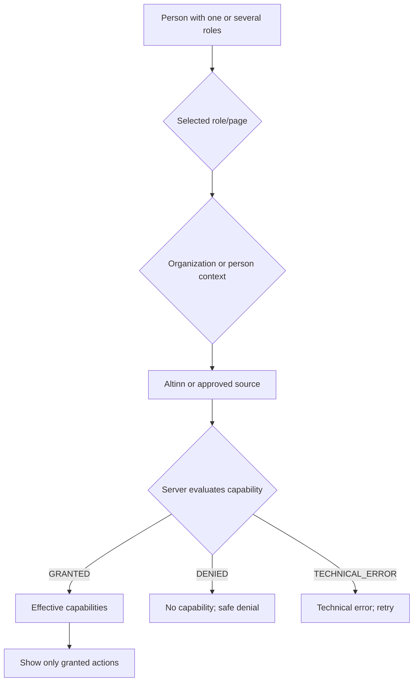

# Decision register and open gates before implementation

This file now acts as a decision register instead of a pure question list.

Status values:

- `Confirmed`: agreed and can be used as implementation input.
- `Needs owner decision`: still unresolved and blocks part of implementation.
- `Proposed`: recommendation exists but must be approved.

## Decision table

| ID  | Topic                              | Decision                                                                                                                                      | Status               | Owner                          | Notes                                                                                   |
| --- | ---------------------------------- | --------------------------------------------------------------------------------------------------------------------------------------------- | -------------------- | ------------------------------ | --------------------------------------------------------------------------------------- |
| D1  | First-release user groups          | First version supports employer, partner, and private individual.                                                                             | Confirmed            | Product owner                  | Existing company representative/support flow remains during transition.                 |
| D2  | Separate context model             | Use explicit model for selected role, organization/person context, Altinn result, and effective capabilities.                                 | Confirmed            | Tech lead + Product owner      | Selected role is UX/context; Altinn determines capabilities.                            |
| D3  | Message model per group            | Existing company representative/support message behavior remains unchanged. New roles use person-based model; organization is context/filter. | Confirmed            | Product owner + Tech lead      | Must be enforced server-side, not only UI.                                              |
| D4  | Multiple active organizations      | No. One active organization context per flow where organization context is required.                                                          | Confirmed            | Product owner                  | `LastUsedOrganization__c` only for company representatives.                             |
| D5  | Users without organization context | Private individual: no organization required. Employer/partner: organization required (via URL or selection).                                 | Confirmed            | Product owner                  | Must be validated on server in role flow.                                               |
| D6  | Metadata vs permission sets        | Need explicit decision on which parts belong in Custom Metadata and/or permission sets.                                                       | Needs owner decision | Tech lead + Security owner     | Impacts implementation boundaries and operations.                                       |
| D7  | Component strategy                 | Limit new components. Use a small new portal/entry layer and reuse current flows where safe.                                                  | Confirmed            | Product owner + Tech lead      | Do not build parallel app without need.                                                 |
| D8  | Allowed/not-allowed matrix         | Matrix is capability-based and derived from server-side access checks, primarily Altinn for organization contexts.                            | Confirmed            | Product owner + Domain owner   | Role selection does not grant access. Final capabilities must be approved before build. |
| D9  | Audit/tracking scope               | Keep first step small and AAREG-specific.                                                                                                     | Proposed             | Product owner + Security owner | Decide minimum needed history before implementation.                                    |
| D10 | Isolation vs shared logic          | Keep first phase AAREG-specific while reusing existing shared components/services where safe.                                                 | Confirmed            | Tech lead                      | Avoid speculative generic framework.                                                    |

## Baseline capability matrix

The selected role determines presentation and context. The server derives the effective capabilities from Altinn or another approved source for the selected organization/person. A capability is available only when the server decision is `GRANTED`.

| Selected role                       | Context required | Data/action source                                          | New application              | My applications              | Agreements                                                  | Support                                      | My messages                                  |
| ----------------------------------- | ---------------- | ----------------------------------------------------------- | ---------------------------- | ---------------------------- | ----------------------------------------------------------- | -------------------------------------------- | -------------------------------------------- |
| Company representative              | Organization     | Altinn for selected organization                            | If `sok-tilgang` is granted  | If `sok-tilgang` is granted  | Existing behavior; support-capability clarification remains | If support or application capability applies | If support or application capability applies |
| Employer                            | Organization     | Altinn for selected organization                            | If `sok-tilgang` is granted  | If `sok-tilgang` is granted  | Only according to effective capability                      | If support/application capability applies    | Only server-approved thread scope            |
| Partner / authorized representative | Organization     | Altinn or approved partner source; source must be confirmed | As approved for partner role | As approved for partner role | As approved for partner role                                | As approved for partner role                 | Only server-approved thread scope            |
| Private individual / employee       | Person           | Approved person/self source; source is not yet confirmed    | No                           | No                           | No                                                          | As approved for person role                  | Personal scope only                          |
| Existing support user               | Existing context | Current support/access behavior                             | Existing behavior            | Existing behavior            | Existing behavior                                           | Existing behavior                            | Existing behavior                            |

The matrix for selected role and capability is UX guidance. It is never authorization. If the same person holds company representative and employer roles simultaneously, the server aggregates capabilities for the selected organization and chosen role context. One role can be shown without granting every capability that another role provides.

## Remaining implementation gates

1. Final owner approval of D2, D6, and D9.
2. Final role-function matrix approved for data access and not only navigation.
3. Direct-link contract finalized for denied and technical-error outcomes.
4. Feature-toggle transition and rollback contract approved.
