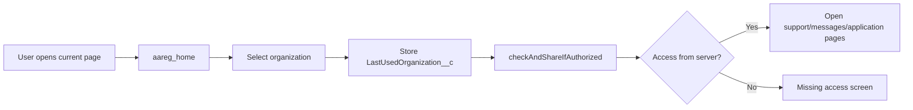
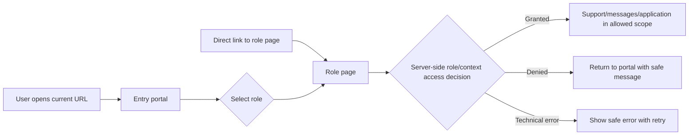
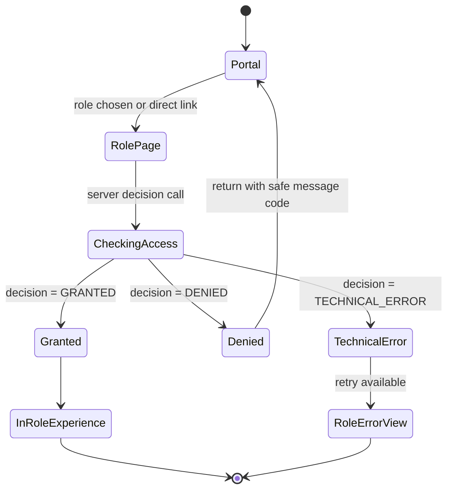
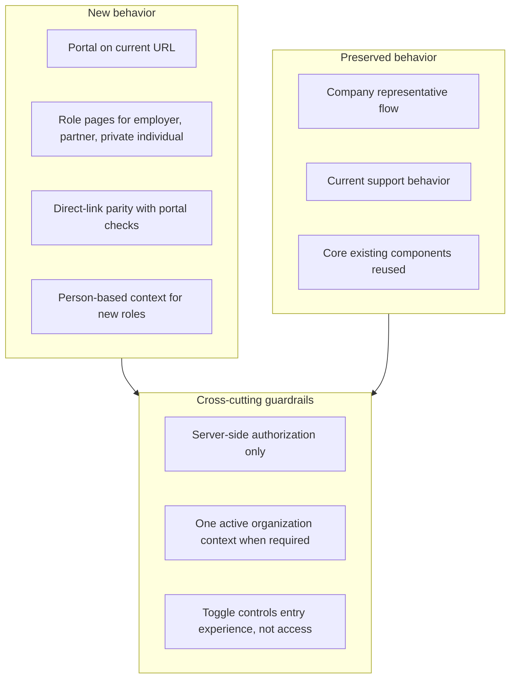
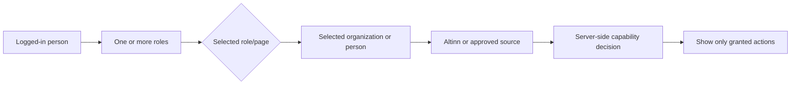

# Overview of the AAREG external user experience extension

## Purpose

This document describes the analysis and specification for extending the current external user experience in crm-arbeidsforhold. The goal is to support new user groups without changing the current behavior for existing company representatives or support users more than necessary.

This document is now aligned with the review direction in [review-og-forslag.md](review-og-forslag.md), and should be treated as the authoritative target direction for the next implementation phase.

## Background

The current solution is built around a company-specific context and the existing access model for company representatives. The home page and navigation in AAREG are largely based on the last selected organization number, and access to application data and messages is currently tied to that selection.

The new solution should expand this to also support:

- employers,
- partners / authorized representatives,
- private individuals / employees.

## Decisions that form the basis

1. The first version supports private individuals, employers, and partners.
2. The current solution for company representatives and the current support flow should work as today without regression.
3. `LastUsedOrganization__c` is used only for company representatives.
4. For employers, partners, and private individuals, person-based context is the primary model, while the organization is used as a work context or filter.
5. Private individuals do not need an organization number or organization selection.
6. Employers and partners must either have an organization number or choose an organization on the homepage before continuing.
7. We will limit the number of new components and build a small new entry page on top of the current `aareg_home` model.

## Authoritative target direction

1. The current Experience Cloud URL becomes the entry portal.
2. The portal shows three explicit choices: employer, partner/authorized representative, and private individual/employee.
3. Each role gets its own Experience Cloud page with stable route behavior.
4. Direct links to role pages must run the same server-side access checks as portal navigation.
5. If access is denied, the user is returned to the portal with a clear message.
6. Existing company representative and support behavior remains available and must not regress during transition.
7. Transition from old to new entry experience may use a feature toggle, but access control must remain server-side regardless of toggle status.

## End-to-end visual summary

### Current flow (today)

### Target flow (proposed)

### Access decision states (proposed)

### What changes vs what stays

## Core principles

1. Preserve the current solution for company representatives.
2. Reuse existing LWC components, Apex classes, and data models where it is natural to do so.
3. Ensure a clear separation between user group, representation context, and actual access.
4. Validate all authorization dependencies on the server side.
5. Avoid introducing new and generic architecture without a concrete need.
6. Use one active organization context per user in the new person-based flows, not multiple simultaneous active organization selections.

## Entry approaches

The solution should support portal-first navigation and direct links:

- Existing `aareg_home` flow remains for company representatives and current support users during transition.
- A new, small entry page handles role selection for employers, partners, and private individuals.
- Direct entry via URL to role pages is supported, but URL values are never treated as access proof.

## How roles and actions are determined

A distinction must be maintained between role, context, and action rights:

- **Role** controls which page and interaction mode is presented.
- **Context** controls whom or which organization the operation concerns.
- **Altinn or another approved source** determines whether the operation is permitted.
- **Server-side capability decision** is the final authority for showing or executing an action.

For organization-based roles, the server must evaluate the selected organization and the relevant Altinn resources. The resource result must be converted into capabilities such as `APPLICATION`, `MY_APPLICATIONS`, `AGREEMENTS`, `SUPPORT`, and `MESSAGES`.

A person may hold several roles, for example company representative and employer, at the same time. The selected role chooses the page/context, while Altinn determines the effective capabilities for that organization. The two roles must not automatically aggregate all capabilities for the person if Altinn does not grant them; capabilities are evaluated from the approved source for the current role/context combination.

## Draft of desired behavior

- Company representative: receives capabilities according to the current organization-specific Altinn access. The current application, agreement, support, and message behavior is preserved where the corresponding capability is granted.
- Support user: receives support and relevant message capabilities according to the existing/current server-side access model.
- Employer: receives capabilities according to Altinn for the selected organization. A selected employer page does not grant any application, agreement, support, or message action by itself.
- Partner / authorized representative: receives capabilities according to the role source, Altinn or another approved source, for the selected organization. The exact partner source remains a decision gate.
- Private individual: receives person-based capabilities from the approved person/self source. No organization is required.

## Documentation structure

This document is the overarching framework. The more detailed analyses are in the other documents in this directory:

- current-implementation.md
- proposed-changes.md
- acr-email-handling.md
- implementation-plan.md
- risks-and-testing.md
- open-questions.md

## Scope limitation

This is an analysis and specification phase. No code should be implemented in this phase. The changes are documented only as plans for later development.

Conflicting alternatives from earlier drafts should be considered replaced by this target direction unless explicitly re-opened by product owner decision.
