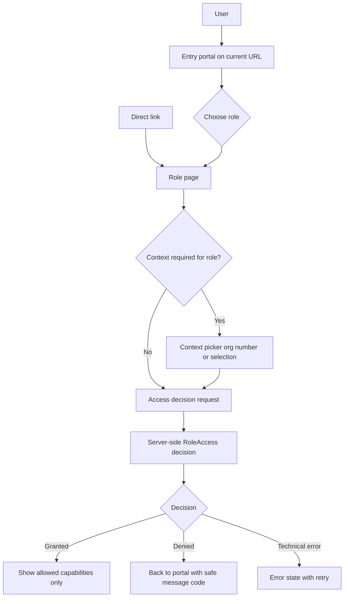
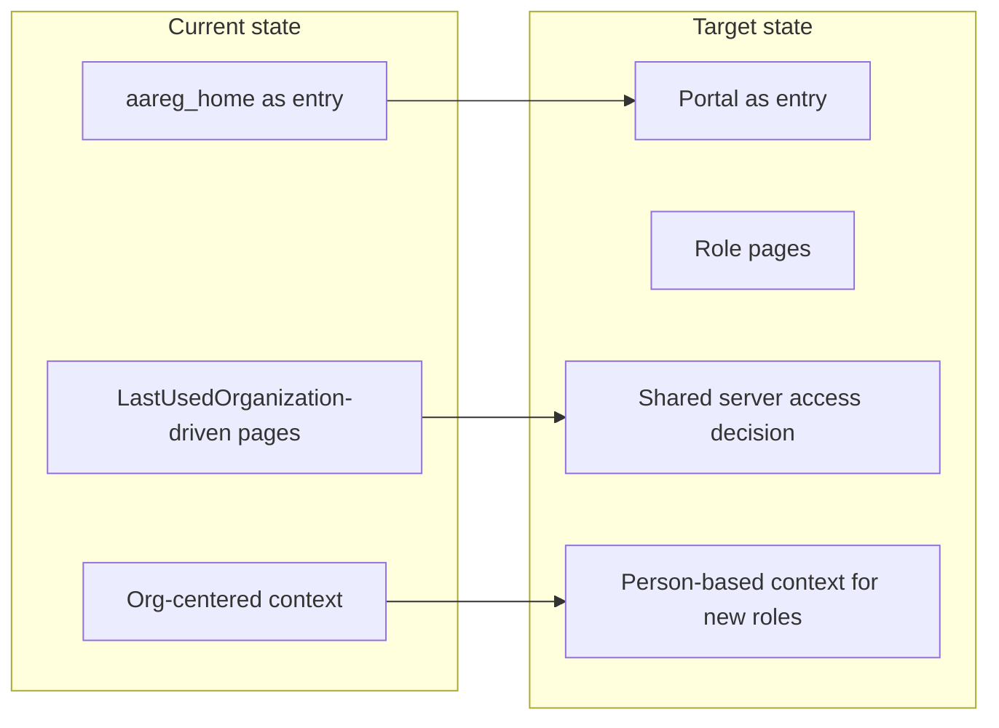
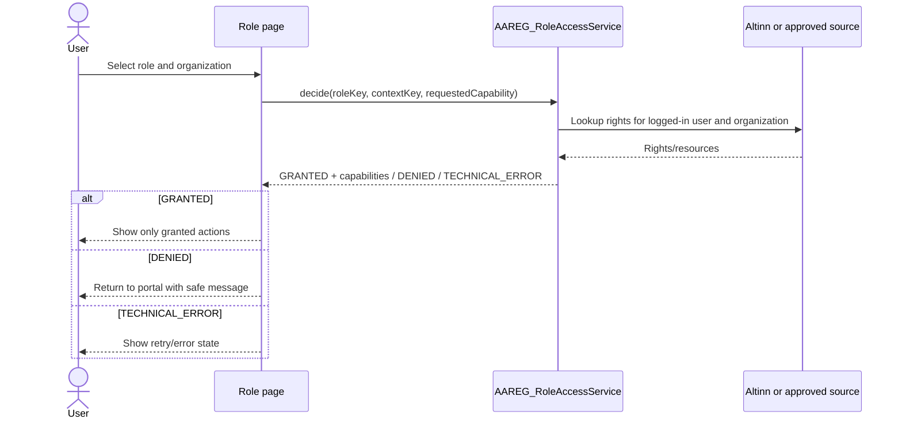
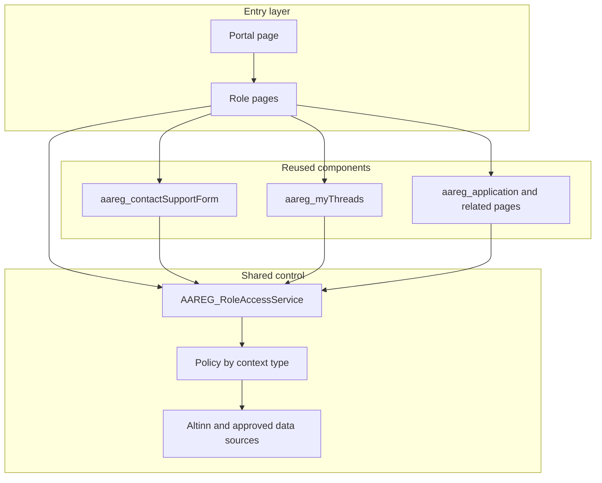
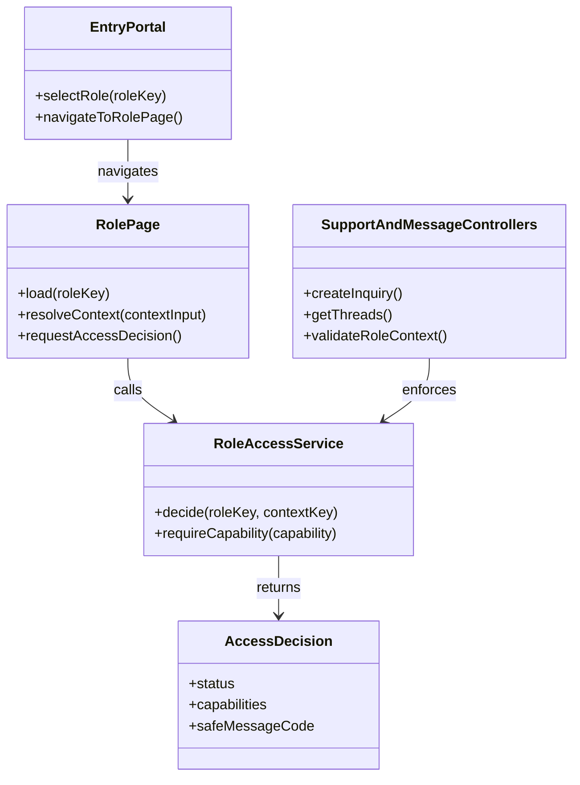

# Proposed changes

## End-to-end target flow

## Current-to-target transition map

## 0. One target model and replaced alternatives

This document now assumes one target model from [review-og-forslag.md](review-og-forslag.md): portal on current URL, one page per role, same server-side access control for portal and direct links, and return to portal on access denial.

The following alternatives are considered replaced in this version:

- treating role choice or URL values as authorization,
- running multiple parallel entry architectures as equally valid,
- relying on UI visibility as the main access mechanism.

## 1. Shared entry page for user-group selection

It is recommended to develop a small new entry page that is responsible for:

- showing the selected user group,
- collecting the organization number when relevant,
- navigating the user to the correct part of the application,
- validating input before further navigation.

The current home page in [force-app/externalAccess/lwc/aareg_home/aareg_home.js](../force-app/externalAccess/lwc/aareg_home/aareg_home.js) should be retained as the existing organization-based flow. The new entry should be a thin layer on top of the current model, not a completely new app from scratch.

For the new entry page, this should be extended with a user-group selection layer that chooses which functional area the user should open. This should not grant access on its own; it should only choose which context should be used next.

The most important points are:

- company representatives enter through the current `aareg_home` flow,
- employers and partners must either have an organization number or choose an organization on the homepage,
- private individuals go directly into a person-based context without organization selection,
- we limit the number of new components and keep the existing flow intact.

## 2. Separate user group, representation context, and access

It is necessary to make this model explicit in the design:

- User group: company representative, employer, partner, private individual, etc.
- Representation context: the organization or person the user is acting on behalf of.
- Actual access: the rights that are actually validated on the server side.

It is not recommended to use a single variable for all of these concepts. Instead, context should be built as a modeling layer in Apex and LWC:

- `userType`
- `selectedOrganizationNumber` or `selectedPersonContext`
- `effectiveAccess` / `canAccessFeature`

This should be handled in the server logic, not only in the UI.

At the same time, it is important that:

- `LastUsedOrganization__c` is used only for company representatives,
- employers and partners use person-based context and one selected organization number in the work flow,
- private individuals do not need an organization number or selection,
- we do not support multiple simultaneous active organization selections in the same flow for the new user groups.

## 3. Direct URL entry

Direct entry via query parameters should be implemented as a separate context layer in the navigation model.

Recommended pattern:

- `?type=employer&org=123456789`
- `?type=private-person`
- `?type=agent&org=123456789`

Implementation notes:

- validate `type` on the client and server,
- validate the organization number format,
- handle missing or invalid parameters with a safe fallback,
- ensure the URL value is not used as the basis for access,
- update the selected context only after server validation.

Contract notes:

- direct links must call the same server-side access decision as portal navigation,
- access denial should return to portal with a restricted message code,
- technical lookup failure should show safe retry/error behavior and not be described as normal access denial.

The current `CurrentPageReference` pattern in `aareg_application.js` is a useful precedent, but it should not be used as the only access model. It should only be used as navigation and context information, not as security control.

## 4. Changes in function visibility and server enforcement

For all roles, the menu and action availability should be calculated from server-granted capabilities, not from role name or URL alone.

Recommended capability mapping:

| Capability        | Typical action or page              |
| ----------------- | ----------------------------------- |
| `APPLICATION`     | New application                     |
| `MY_APPLICATIONS` | My applications                     |
| `AGREEMENTS`      | My agreements                       |
| `SUPPORT`         | Create support inquiry              |
| `MESSAGES`        | Read or write allowed message scope |

For organization-based contexts:

- Altinn is queried for the selected organization.
- The server converts approved Altinn resources into capabilities.
- One or more capabilities are returned with `GRANTED`, `DENIED`, or `TECHNICAL_ERROR`.
- UI visibility is derived from that result, and every Apex method independently calls `requireCapability` before reading or changing data.

For a person holding company representative and employer roles simultaneously:

- the selected role determines which role page/context is used,
- the selected organization is sent to the server as context,
- the server evaluates the approved source and capabilities for that context,
- no capability is granted merely because another role exists,
- the effective capability list can contain support-only or application-plus-support actions according to Altinn.

## 5. Messaging model

This is a critical area.

The current model in `AAREG_MyThreadsController.getUsersThreads()` fetches threads from `User.LastUsedOrganization__c` and `CRM_Account__c`. This works well for company representatives, but not for employers, partners, or private individuals.

Recommended changes:

- For company representatives: keep the organization-based view unchanged.
- For employers and partners: use person-based filtering in addition to the selected organization number as the work context. The organization is used as a filter, not as the only identifier.
- For private individuals: use person-based viewing without an organization number.

This should be implemented in both the LWC display and Apex logic. UI hiding alone is not enough.

## 6. Reuse of existing components

It is recommended to be conservative in reuse:

- `aareg_home` can be expanded into a shared selection page.
- `AAREG_HomeController` can be reused as the basis for organization and access logic.
- `AAREG_ApplicationController` and `AAREG_MyApplicationsController` can remain unchanged for company representatives.
- `AAREG_MyThreadsController` may need to be extended with a person-based method or new filter logic, without changing the current organization model for existing customers.
- `AAREG_contactSupportController` should continue to be usable for the support flow; this is already a reusable support point.

## 7. New setup for access control

It is recommended to introduce a clear server-side access service or small helper that decides:

- user type,
- selected context,
- whether the user can open the function,
- whether fetching messages or other data must be filtered against person or organization.

The same decision service should be used consistently by:

- role pages,
- support/message/application controller methods,
- direct URL page openings.

This should be designed as a small, focused utility adapted to AAREG, not as a generic audit or authorization framework.

## Proposed dependency model

## Proposed responsibility model

## 8. Why not do a larger refactoring

A larger refactoring of all navigation and authorization logic is not necessary in this phase. The current design is already good enough to support context layering, but it lacks clear modeling of multiple user roles and personal contexts. The best solution is therefore to build on the current pattern without doing a large redesign of the core architecture.
