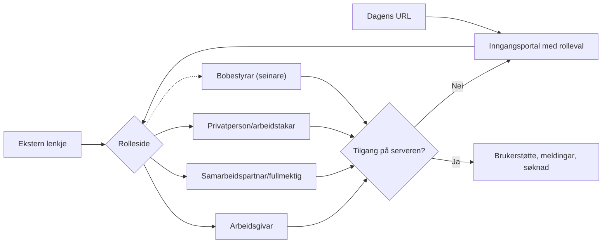
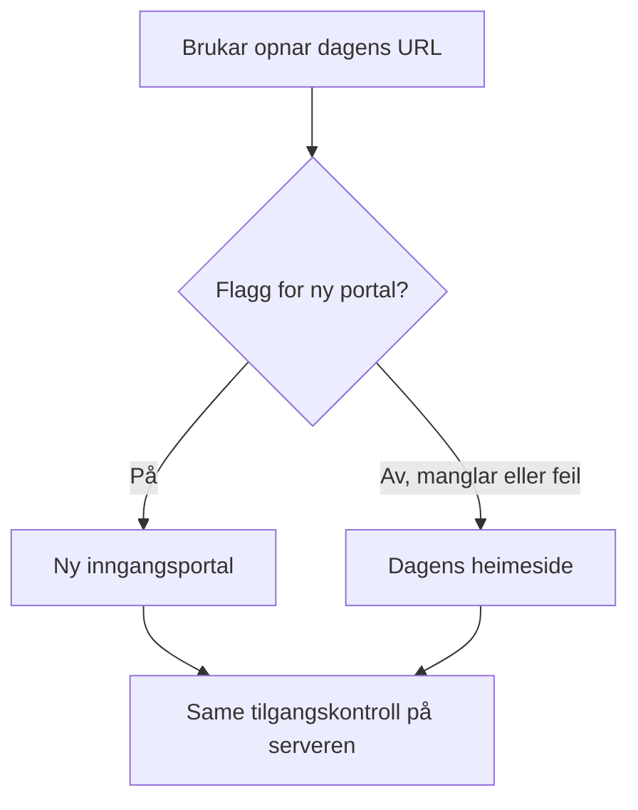
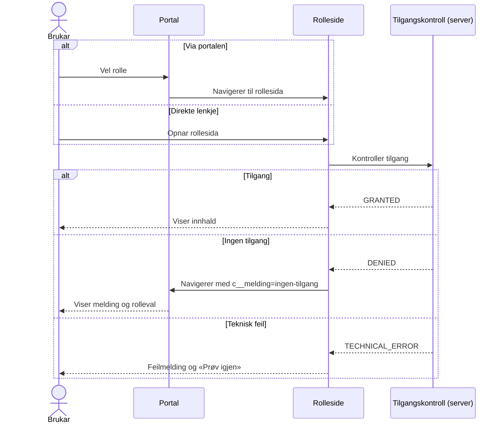

# Gjennomgang og forslag

**Status:** Fagleg gjennomgang av arbeidsunderlag; ikkje eit vedtak  
**Dato:** 2026-11-13  
**Omfang:** Dei sju eksisterande dokumenta i denne mappa og relevante
arkitekturføringar i repoet. Originaldokumenta er ikkje endra.

## Samandrag

Arbeidsunderlaget identifiserer dei sentrale risikoområda: dagens flyt er
organisasjonsorientert, personbasert tilgang må ikkje blandast saman med
organisasjonsval, og autorisasjon må skje på serversida. Det treng likevel ei
tydelegare målreise før implementasjonsplanen blir brukt:

1. Éi inngangsportal på dagens URL viser dei tre brukarvala.
2. Kvar rolle har ei eiga Experience Cloud-side med ein stabil, lenkbar URL.
3. Ei direkte lenkje går gjennom same tilgangskontroll som navigasjon frå
   portalen.
4. Ved avslag går brukaren tilbake til portalen med ei forståeleg melding.
5. Gammal funksjonalitet blir halden tilgjengeleg bak ei kontrollert overgang
   dersom feature-toggle-mønsteret kan brukast trygt.

Det viktigaste skiljet i all vidare utforming er:

> Rolleval og URL veljer ei ønskt brukaroppleving. Dei er aldri bevis på
> identitet, representasjonsrett eller tilgang til data.

### Målbilete

Brukaren kjem anten til portalen eller direkte til ei rolleside via ei ekstern
lenkje. Uansett veg kontrollerer rollesida tilgangen på serveren. Ved avslag går
brukaren tilbake til portalen med ei melding.

### Relaterte dokument frå denne gjennomgangen

| Dokument                                                                   | Innhald                                                                            |
| -------------------------------------------------------------------------- | ---------------------------------------------------------------------------------- |
| [dagens-brukerstotte-og-soknad.md](dagens-brukerstotte-og-soknad.md)       | Korleis brukerstøtte og søknad fungerer i dag, og forslag til utvidbar rollemodell |
| [sikkerheitsfunn-tilgangskontroll.md](sikkerheitsfunn-tilgangskontroll.md) | Overordna tilgangsfunn i dagens løysing som teamet vurderer                        |
| [agent-instruks.md](agent-instruks.md)                                     | Instruks for agenten som vidareutviklar underlaget                                 |

## Funn i underlaget

### 1. Inngangsmodell og brukargrupper er motstridande

`overview.md`, `proposed-changes.md`, `implementation-plan.md` og
`open-questions.md` omtalar fleire inngangar: den eksisterande
`aareg_home`-flyten, ei ny startside og direkte inngang med parameterar.
Dei skildrar òg «virksomhetsrepresentant» og brukerstøtte som eksisterande
grupper ved sida av arbeidsgivar, samarbeidspartnar og privatperson.

Brukarens presisering for målbildet er i staden éi ny inngangsportal på dagens
URL med tre synlege rolleval, kvar med si eiga side. Dette bør vere den
overordna målreisa i neste versjon av spesifikasjonen. Kva som skjer med
eksisterande verksemdsrepresentantar og supportbrukarar må framleis kartleggjast
som bakoverkompatibilitet; ikkje slå dei saman med ei av dei tre nye rollene
utan ei stadfesta mapping.

### 2. Rolle og tilgang er blanda saman i nokre formuleringar

Dokumenta seier at ei ny brukargruppe skal få tilgang til bestemte funksjonar og
at menyen kan byggjast frå `userType`. Dette kan lesast som om rollevalet
avgjer tilgang. Bruk ein eksplisitt modell der:

- **Vald rolle** styrer kva side brukaren ønskjer å opne.
- **Identitet og relasjonar** avgjer kven brukaren er og eventuelt kven brukaren
  representerer.
- **Autorisasjon** avgjer kva side, funksjon og data brukaren faktisk får bruke.
- **Organisasjonskontekst** avgrensar ei godkjend arbeidsøkt; han gir ikkje i
  seg sjølv rettar.

Sidan direkte lenkjer er eit krav, må same autorisasjon køyrast for direkte
sideopning og for navigasjon frå portalen. Navigasjonsskjuling eller
Experience Builder-publikum åleine er ikkje dokumentert som tilstrekkeleg
datatilgangskontroll. Kontroller faktisk side- og datatilgang i Experience
Cloud og handhev tilgang på serversida.

### 3. Feature toggle er eit relevant forslag, men ikkje ei stadfesta Experience Cloud-løysing

Repoet viser at `feature-toggle` er ei pakkeavhengigheit med inngangar for
Apex, Flow og Aura ([pakkeavhengigheiter](../architecture/pakkeavhengigheiter.md)).
Det finst eit fail-closed Apex-mønster for P360 i
[P360_ArchiveProcessingGate.cls](../../force-app/integration/p360/classes/P360_ArchiveProcessingGate.cls).
Desse kjeldene dokumenterer ikkje at pakka kan byte Experience Cloud-side eller
LWC-rute direkte.

**Tilråding:** Halde gammal flyt urørt, og bruk ein tydeleg brytar ved
inngangsgrensa til den nye portalopplevinga dersom eksisterande API kan kallast
frå denne grensa utan å endre den pakkeeigde avhengigheita. Verifiser først:

- kvar Custom Metadata-flagget blir lese, og om det er eigna for denne
  Experience Cloud-flyten;
- korleis LWC-en får eit trygt og testbart svar frå serveren;
- kva flaggverdi, manglande metadata og teknisk feil skal gjere;
- om direkte URL til rollesider følgjer same overgangsregel;
- korleis aktivering/tilbakeføring skjer operativt, og om eventuell cache gjer
  at «på dagen» ikkje er umiddelbart.

Flagget skal velje mellom versjonar av brukaropplevinga, aldri mellom
tilgangsreglar. Autorisasjon må vere aktiv uansett flagg. Ein feil eller
manglande flaggverdi må ikkje opne ny tilgang; den trygge fallbacken bør vere
avklart og testa. P360-mønsteret returnerer `false` ved manglande flagg eller
`FeatureToggleException`, men det er eit mønster å vurdere, ikkje eit ferdig
krav for portalens feilflyt.

Figuren viser korleis flagget kan velje oppleving utan å påverke tilgangen.
Tilgangskontrollen er den same uansett kva grein brukaren hamnar i.

Døme på operativ bruk: Flagget blir slått på i SIT2 og verifisert med
testbrukarar for kvar rolle. Deretter blir det slått på i produksjon. Ved feil
blir flagget slått av, og brukarane får dagens heimeside utan deploy.

### 4. «Tilbake til portalen» treng ein eksplisitt kontrakt

Gjer feilsituasjonen konkret for både direkte lenkje og navigasjon frå portalen:

Flyten er slik:

1. Brukaren vel rolle i portalen, eller opnar rollesida direkte frå ei lenkje.
2. Rollesida kallar tilgangskontrollen på serveren.
3. Ved tilgang blir innhaldet vist.
4. Ved avslag går brukaren tilbake til portalen, som viser ei melding.
5. Ved teknisk feil blir ei feilmelding vist på rollesida med høve til å prøve
   igjen.

Døme på kontrakt for meldinga i portalen:

| Verdi i `c__melding` | Melding (døme)                                            |
| -------------------- | --------------------------------------------------------- |
| `ingen-tilgang`      | «Du har ikkje tilgang til denne sida. Vel ei anna rolle.» |
| `rolle-ikkje-aktiv`  | «Denne tenesta er ikkje tilgjengeleg no.»                 |
| anna eller tom       | Ingen melding                                             |

Portalen må kunne vise ei melding etter retur utan å stole på ein manipulert
URL-parameter som autorisasjon. Bruk ein avgrensa statuskode for vising, ikkje
personopplysningar eller tilgangsbevis i URL-en. Avklar om teknisk feil (til
dømes feil ved oppslag av tilgang) skal gi ei eiga feilmelding og forsøk på
nytt, i staden for å bli feilaktig omtala som «manglande tilgang». Unngå
redirect-loopar og opne retur-URL-ar.

## Føreslått rettingsliste for neste utgåve av underlaget

1. Skriv éi autoritativ målreise i `overview.md`: dagens URL er portal,
   tre valde roller, eiga side per rolle og same kontroll for direkte lenkjer.
2. Flytt «virksomhetsrepresentant» og noverande supportflyt til ein tydeleg
   **eksisterande flyt som skal bevarast**-del, fram til rolle-/tilgangsmapping
   er godkjend.
3. Merk motstridande forslag om ny og gammal startside som foreldra/erstatt
   med éi målmodell; ikkje presenter begge som vedtekne.
4. Gjer tabellen i `open-questions.md` om frå førebels løysingsval til
   avgjerdstabell med eigar/status for kvar uavklart rett: roller, tilgang,
   organisasjonskontekst, funksjonar, meldingsomfang, ACR og e-post.
5. Del `implementation-plan.md` i **avklaringsgater** og **implementasjonsfasar**.
   Ikkje start personbasert meldings- eller e-postmodell før datakjelde,
   eigarskap, lovleg tilgang og rolledefinisjon er stadfesta.
6. Merk ADR-0002 og ADR-0003 som foreslåtte avgjerder. Ikkje gjer ACR-rollar,
   e-postlagring eller ny e-posttabell til føresetnader før ADR-eigarane har
   avgjort det.
7. Legg til test av direkte tilgang, avslag/retur, flagg av/på og regressjon for
   eksisterande brukarar. Test brukaropplevinga og datatilgang kvar for seg.
8. Ta inn skildringa av dagens brukerstøtte og søknad og den utvidbare
   rollemodellen frå
   [dagens-brukerstotte-og-soknad.md](dagens-brukerstotte-og-soknad.md), slik at
   bobestyrar og seinare roller kan leggjast til med konfigurasjon.
9. Vis til [sikkerheitsfunn-tilgangskontroll.md](sikkerheitsfunn-tilgangskontroll.md)
   der planen gjenbruker eksisterande kontrollarar.

Denne lista er eit forslag til rettingar. Ho endrar ikkje dei sju
underlagsfilene.

## Førebels atferdsmatrise

Dette er kva som kan førast vidare frå brukarens avklaringar og repoet. Ho
stadfestar ikkje ennå kva data eller forretningsfunksjonar kvar rolle skal ha.

| Situasjon                         | Førebels forventa atferd                                                                         | Må avklarast/verifiserast                                             |
| --------------------------------- | ------------------------------------------------------------------------------------------------ | --------------------------------------------------------------------- |
| Opne dagens hovud-URL             | Vis inngangsportalen med arbeidsgivar, samarbeidspartnar/fullmektig og privatperson/arbeidstakar | Om eksisterande brukargrupper også skal visast som val                |
| Velje ei rolle                    | Naviger til den rollespesifikke Experience Cloud-sida                                            | Om rollevalet blir hugsa; det må aldri vere autorisasjon              |
| Opne direkte lenkje til rolleside | Køyr same kontroll som ved portalnavigasjon                                                      | Stabil URL, innloggings-/redirect-flyt og sidekonfigurasjon           |
| Brukar manglar tilgang            | Returner til portalen og vis ei informativ melding                                               | Nøyaktig melding og om retur skjer straks                             |
| Tilgangsoppslag feilar teknisk    | Vis ei eiga trygg feilmelding og gi ein forståeleg veg vidare                                    | Feil-/retry-policy; ikkje gjer teknisk feil om til eit tilgangsavslag |
| Ny flyt er slått av               | Bruk avklart gammal/fallback-oppleving utan å opne nye funksjonar                                | At fallback faktisk støttar brukargruppa                              |
| Ny flyt er slått på               | Bruk den nye portalen og rolleflyten                                                             | Gradvis utrulling, rollback og metadata/cache-effekt                  |

## Tilrådd ansvarsskilje

| Ansvar                                        | Plassering/regel                                                                       |
| --------------------------------------------- | -------------------------------------------------------------------------------------- |
| Vis dei tre rollevala og naviger              | Portal-LWC / Experience Cloud-navigasjon                                               |
| Oppslag av rolle og representasjonsrelasjon   | Eksisterande godkjend datakjelde og serverlogikk                                       |
| Autorisasjon av funksjonar og data            | Server-side tilgangskontroll, sharing og nødvendige CRUD/FLS-kontrollar                |
| Val av gammal/ny inngangsoppleving            | Feature-toggle ved inngangsgrensa, dersom pakka støttar mønsteret                      |
| Meldingsretur til portalen                    | Trygg, avgrensa navigasjonstilstand utan sensitiv informasjon                          |
| Kva roller som finst og kva dei gir           | Rolleregister i Custom Metadata, sjå [rollemodellen](dagens-brukerstotte-og-soknad.md) |
| Felles tilgangsavgjerd for side og kontrollar | Éi serverteneste, til dømes `AAREG_RoleAccessService`                                  |

Ikkje utvid den eksisterande
[AAREG_HomeController](../../force-app/externalAccess/classes/AAREG_HomeController.cls)
utan ei særskild vurdering: han er `without sharing` og utfører tilgangs- og
delingsoperasjonar. Dette er ein eksisterande raud-sone-grense, ikkje berre ein
praktisk plass å leggje ny rutinglogikk.

## Tilgang, ACR, e-post og personvern

- Bruk Salesforce sin tilgangsmodell lagvis: org-/lisensrammer, objekt-CRUD,
  felt-FLS og record sharing. Test som den faktiske eksterne brukarprofilen,
  ikkje berre som administrator.
- ACR kan vere eit relevant relasjonsobjekt, men dei lokale ADR-ane om ACR og
  e-post er framleis foreslåtte. Stadfest faktiske ACR-roller, status-/datoregl,
  kontakt-/personkontomodell og datakjelde før implementasjon.
- Unngå å lagre eller logge meir persondata enn use caset krev. Avklar
  e-postkjelder, oppdateringsprioritet, historikk, retention og kven som kan
  lese/endre data før val av nye felt eller objekt.
- Hald serverkontroll på alle direkte Apex-operasjonar; ei avgrensa side eller
  skjult knapp fjernar ikkje behovet for kontroll ved datakallet.

## Gjenbruk og overgang

Målprinsippet er **gjenbruk utan å gjere rollback avhengig av dobbelt
forretningslogikk**:

1. Kartlegg kva eksisterande side, komponentar og serveroperasjonar som faktisk
   kan delast utan å endre dagens tilgangskontrakt.
2. Legg ny rolleval/navigasjon i ei avgrensa portalgrense.
3. La gammal og ny inngangsoppleving vere valbare medan den nye blir verifisert.
4. Hald autorisasjon, datatilgang og domenereglar felles eller eksplisitt
   uendra; ikkje dupliser dei bak kvar si flagggren.
5. Definer målbar exit-kriterium for når flagget og gammal implementasjon kan
   fjernast. Ikkje la overgangsflagget bli permanent arkitektur ved uhell.

**Døme:** Brukerstøtteskjemaet `aareg_contactSupportForm` og meldingslista
`aareg_myThreads` kan brukast uendra under alle rollesidene. Berre
serverkontrollane får rolle og kontekst som parameter. Sjå
[dagens-brukerstotte-og-soknad.md](dagens-brukerstotte-og-soknad.md) for
komponentoversikt og stega for å leggje til bobestyrar.

Det minste designet som kan fungere er portal + rollebasert navigasjon, med
eksisterande sider og use case gjenbrukte der kontrakt og tilgang tillèt det.
Eit alternativ er ein ny parallell app med eigne datasider og tilgangslogikk.
Det alternativet gir større risiko for dobbelt vedlikehald og
regresjonsavvik, og er ikkje tilrådd utan eit konkret krav om funksjonelt skilje.

## Test- og godkjenningsgater

**Før kode**

- Stadfest ordlista og mappinga mellom dei tre synlege rollene, eksisterande
  virksomhetsrepresentantar og supportbrukarar.
- Stadfest funksjons-/datarettar per rolle og kva system som er kjelda for
  kvar relasjon.
- Avklar om arbeidsgivar og samarbeidspartnar må velje organisasjon, og om
  privatperson alltid opererer utan organisasjonskontekst.
- Avklar feature-flaggets fallback, livssyklus, eigar og direkte URL-atferd.
- Behandle tilgang, meldingar og personopplysningar som raud sone med
  menneskeleg gjennomgang.

**Under implementasjon**

- LWC/Jest: rolleval, URL-parsing, ukjend rolle, avslagstilstand og
  tilgjengeleg melding.
- Apex-test: tilgang på serveren ved direkte kall, positive og negative
  autorisasjonstilfelle, person-/organisasjonsfilter og teknisk feil.
- Regresjonstest: eksisterande virksomhetsrepresentant- og supportflyt.
- Toggle-test: på, av, manglande flagg og teknisk feil; same tilgangsreglar i
  begge modus.
- Experience Cloud-verifikasjon i godkjent ikkje-produksjonsorg: direkte URL,
  innlogging/redirect, rett side for rett brukar, avvist brukar, og at
  ugyldig retur ikkje gir open redirect.

Ingen org-validering er utført som del av denne dokumentasjonsgjennomgangen.
Org-tilgang krev ny stadfesting av eksakt mål og handling.

## Salesforce- og repo-referansar

- Repoets [arkitekturoversikt](../architecture/README.md) og
  [utviklingsstandardar](../utviklingsstandarder.md).
- Salesforce Help: [Best Practices and Considerations for Page-Level Access
  in Experience Builder](https://help.salesforce.com/s/articleView?id=platform.networks_page_level_best_practices.htm&language=en_US&type=5).
  Verifiser sideåtferd med faktiske brukarar; skjult navigasjon må ikkje
  forvekslast med datatilgangskontroll.
- Salesforce Architects:
  [Identity and Access Management patterns](https://architect.salesforce.com/docs/architect/well-architected/guide/trust-identity-access-patterns.html)
  og [Well-Architected Framework](https://architect.salesforce.com/docs/architect/well-architected/guide/framework.html).
  Den gjeldande rammeoversikta bruker fem pillarar: Trust, Reliability,
  Operational Excellence, Resource and Cost Optimization, Fairness. Repoet
  brukar òg Trusted/Easy/Adaptable som vurderingsspråk; begge kan brukast utan
  å hevde at dei er same inndeling.

## Samla vurdering med repoets Trusted / Easy / Adaptable

- **Trusted:** Gå vidare berre med serverautorisering, dokumentert
  datatilgang, negativtesting og avklart handtering av personopplysningar.
- **Easy:** Éi inngangsportal og direkte lenkjer gjer brukarvegen tydeleg.
  Hald feilmelding og fallback enkel og konsistent.
- **Adaptable:** Ei avgrensa overgangsgrense kan gjere rask tilbakeføring
  mogleg; verifiser at toggle verkeleg dekkjer Experience Cloud-inngangen og
  definer når gammal kode blir fjerna.

**Hovudtradeoff:** Ein liten router-/inngangsgrense og mellombels feature flag
gir ein tryggare overgang, men legg til mellombels konfigurasjon og
testmatrise. Det er mindre risikabelt enn å endre dagens organisasjons- og
tilgangslogikk samtidig som nye personbaserte roller blir introduserte.
