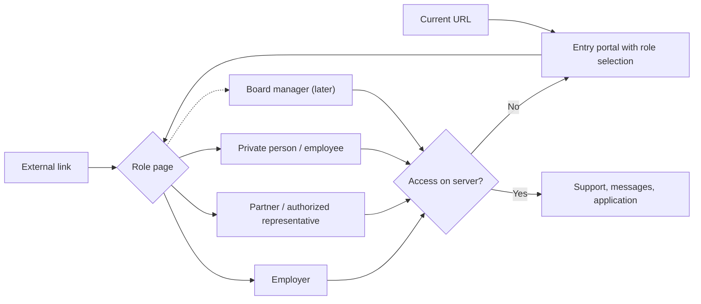
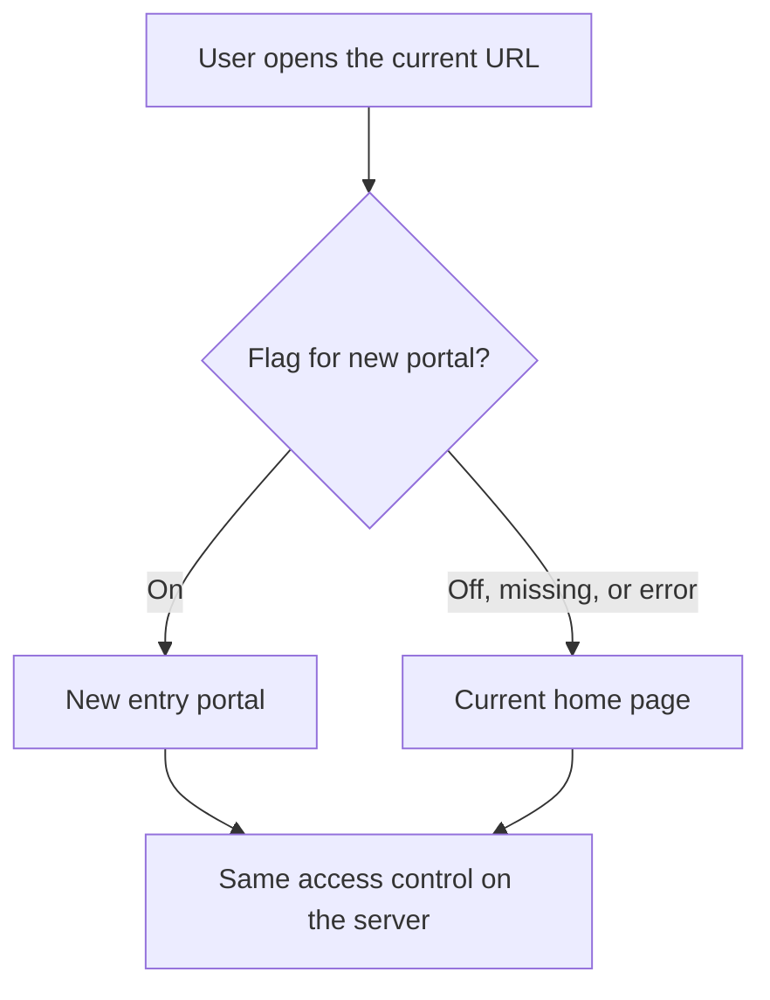
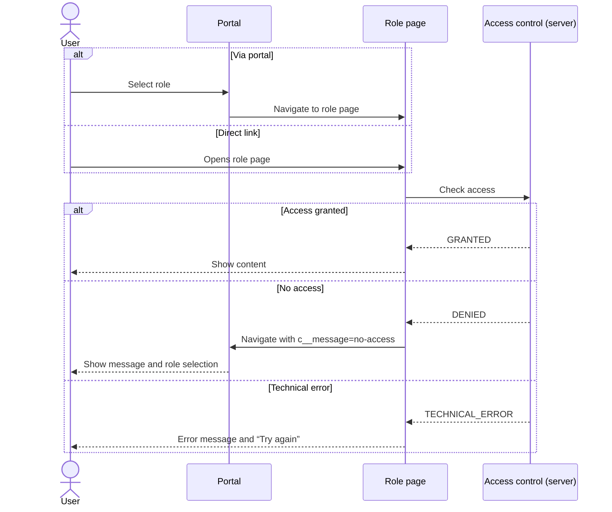

# Review and proposal

**Status:** Professional review of the working material; not a decision  
**Date:** 2026-11-13  
**Scope:** The seven existing documents in this folder and the relevant architecture guidance in the repository. The original documents have not been changed.

## Summary

The working material identifies the key risk areas: the current flow is organization-oriented, person-based access must not be mixed with organization selection, and authorization must happen on the server side. A clearer target direction is still needed before the implementation plan is used:

1. A single entry portal on the current URL shows the three user choices.
2. Each role has its own Experience Cloud page with a stable, linkable URL.
3. A direct link goes through the same access control as navigation from the portal.
4. When access is denied, the user is returned to the portal with a clear message.
5. Old functionality remains available behind a controlled transition if the feature-toggle pattern can be used safely.

The most important distinction in any further design is:

> Role selection and the URL choose the desired user experience. They are never proof of identity, representation rights, or access to data.

### Target picture

The user arrives either at the portal or directly at a role page via an external link. In either case, the role page checks access on the server. If access is denied, the user is returned to the portal with a message.

### Related documents from this review

| Document                                                                   | Content                                                                             |
| -------------------------------------------------------------------------- | ----------------------------------------------------------------------------------- |
| [dagens-brukerstotte-og-soknad.md](dagens-brukerstotte-og-soknad.md)       | How support and application work today, and a proposal for an extensible role model |
| [sikkerheitsfunn-tilgangskontroll.md](sikkerheitsfunn-tilgangskontroll.md) | High-level access findings in the current solution that the team is reviewing       |
| [agent-instruks.md](agent-instruks.md)                                     | Instructions for the agent continuing the work                                      |

## Findings in the material

### 1. Entry model and user groups are inconsistent

`overview.md`, `proposed-changes.md`, `implementation-plan.md`, and `open-questions.md` reference several entry points: the existing `aareg_home` flow, a new landing page, and direct entry with parameters. They also describe “company representative” and support users as existing groups alongside employers, partners, and private individuals.

The user’s specification for the target state is instead a new entry portal on the current URL with three visible role choices, each with its own page. This should be the overarching target direction in the next version of the specification. What happens with existing business representatives and support users still needs to be mapped as backward compatibility; do not merge them with one of the three new roles without a confirmed mapping.

### 2. Role and access are mixed together in some formulations

The documents say that a new user group should get access to certain functions and that the menu can be built from `userType`. This can be read as if the role selection determines access. Use an explicit model where:

- **Selected role** controls which page the user wants to open.
- **Identity and relationships** determine who the user is and, if relevant, whom they represent.
- **Authorization** determines which page, function, and data the user can actually use.
- **Organization context** narrows a valid work session; it does not, by itself, grant rights.

Since direct links are required, the same authorization must run for direct page opening and navigation from the portal. Navigation hiding or Experience Builder audience alone is not documented as sufficient data access control. Validate actual page and data access in Experience Cloud and enforce access on the server side.

### 3. Feature toggle is one relevant suggestion, but not a permanent solution for Experience Cloud-solution

The repository shows that `feature-toggle` is a package dependency with entry points for
Apex, Flow, and Aura ([package dependencies](../architecture/pakkeavhengigheiter.md)).
There is a fail-closed Apex pattern for P360 in
[P360_ArchiveProcessingGate.cls](../../force-app/integration/p360/classes/P360_ArchiveProcessingGate.cls).
These sources do not document that the package can switch Experience Cloud pages or
LWC routes directly.

**Recommendation:** Keep the old flow unchanged and use a clear switch at the
entry boundary of the new portal experience if the existing API can be called from
this boundary without changing the package-owned dependency. Verify first:

- where the Custom Metadata flag is read, and whether it is appropriate for this
  Experience Cloud flow;
- how the LWC gets a safe and testable response from the server;
- what the flag value, missing metadata, and technical errors should do;
- whether direct URLs to role pages follow the same transition rule;
- how activation / rollback happens operationally, and whether any cache means
  that “on the day” is not immediate.

The flag should choose between versions of the user experience, never between
access rules. Authorization must be active regardless of the flag. An error or
missing flag value must not open new access; the safe fallback should be clarified
and tested. The P360 pattern returns `false` when the flag is missing or
`FeatureToggleException` occurs, but it is a pattern to evaluate, not a final
requirement for the portal’s error flow.

The figure shows how the flag can choose the experience without affecting access.
Access control remains the same regardless of which branch the user ends up in.

Example of operational use: the flag is turned on in SIT2 and verified with test
users for each role. It is then turned on in production. If there is a problem,
the flag is turned off, and users get the current home page without a deployment.

### 4. “Back to the portal” needs an explicit contract

Make the error situation concrete for both direct links and navigation from the portal:

The flow is:

1. The user selects a role in the portal or opens the role page directly via a link.
2. The role page calls the access control on the server.
3. If access is granted, the content is shown.
4. If access is denied, the user is returned to the portal, which shows a message.
5. If there is a technical error, an error message is shown on the role page with the option to retry.

Example contract for the message in the portal:

| Value in `c__message`  | Message (example)                                           |
| ---------------------- | ----------------------------------------------------------- |
| `no-access`            | “You do not have access to this page. Choose another role.” |
| `role-not-active`      | “This service is not available right now.”                  |
| anything else or empty | No message                                                  |

The portal must be able to show a message after returning without relying on a manipulated URL parameter as authorization. Use a limited status code for display, not personal information or access evidence in the URL. Clarify whether a technical error (for example, a failure in access lookup) should show a separate message and retry option rather than being incorrectly described as “missing access.” Avoid redirect loops and open return URLs.

## Proposed correction list for the next version of the material

1. Write one authoritative target direction in `overview.md`: the current URL is the portal, three selected roles, one page per role, and the same control for direct links.
2. Move “company representative” and the current support flow into a clear **existing flow to preserve** section until the role/access mapping is approved.
3. Mark contradictory proposals about the new and old entry pages as deprecated/replaced with one target model; do not present both as approved.
4. Convert the table in `open-questions.md` from preliminary solution choices to a decision table with owner/status for each unresolved right: roles, access, organization context, functions, message scope, ACR, and email.
5. Split `implementation-plan.md` into **clarification tracks** and **implementation phases**. Do not start the person-based message or email model before the data source, ownership, legal access, and role definition are confirmed.
6. Mark ADR-0002 and ADR-0003 as proposed decisions. Do not treat ACR roles, email storage, or a new email table as prerequisites before the ADR owners decide.
7. Add tests for direct access, denial/return, flag on/off, and regression for existing users. Test user experience and data access separately.
8. Include the description of the current support and application flow and the extensible role model from [dagens-brukerstotte-og-soknad.md](dagens-brukerstotte-og-soknad.md) so that board managers and later roles can be added through configuration.
9. Refer to [sikkerheitsfunn-tilgangskontroll.md](sikkerheitsfunn-tilgangskontroll.md) where the plan reuses existing controls.

This list is a proposal for fixes. It does not change the seven source files.

## Preliminary behavior matrix

This is what can be taken forward from the user’s clarifications and the repository. It does not yet confirm which data or business functions each role should have.

| Situation                         | Preliminary expected behavior                                                                           | Must be clarified / verified                                          |
| --------------------------------- | ------------------------------------------------------------------------------------------------------- | --------------------------------------------------------------------- |
| Open the current main URL         | Show the entry portal with employer, partner / authorized representative, and private person / employee | Whether existing user groups should also be displayed as choices      |
| Select a role                     | Navigate to the role-specific Experience Cloud page                                                     | Whether the role choice is remembered; it must never be authorization |
| Open a direct link to a role page | Run the same control as portal navigation                                                               | Stable URL, login / redirect flow, and page configuration             |
| User lacks access                 | Return to the portal and show an informative message                                                    | Exact message and whether the return happens immediately              |
| Access lookup fails technically   | Show a dedicated safe error message and provide a clear next step                                       | Error / retry policy; do not treat technical failure as access denial |
| New flow is turned off            | Use the agreed old / fallback experience without enabling new functions                                 | Whether the fallback actually supports the user group                 |
| New flow is turned on             | Use the new portal and role flow                                                                        | Gradual rollout, rollback, and metadata / cache effects               |

## Recommended responsibility split

| Responsibility                                  | Location / rule                                                                          |
| ----------------------------------------------- | ---------------------------------------------------------------------------------------- |
| Show the three role choices and navigate        | Portal LWC / Experience Cloud navigation                                                 |
| Look up role and representation relationship    | Existing approved data source and server logic                                           |
| Authorize functions and data                    | Server-side access control, sharing, and necessary CRUD / FLS checks                     |
| Choose old / new entry experience               | Feature toggle at the entry boundary if the package supports the pattern                 |
| Return messages to the portal                   | Safe, restricted navigation state without sensitive information                          |
| Which roles exist and what they provide         | Role registry in Custom Metadata, see [the role model](dagens-brukerstotte-og-soknad.md) |
| Shared access decision for page and controllers | One server service, for example `AAREG_RoleAccessService`                                |

Do not expand the existing [AAREG_HomeController](../../force-app/externalAccess/classes/AAREG_HomeController.cls) without a specific assessment: it is `without sharing` and performs access and sharing operations. This is an existing red-zone boundary, not just a convenient place to add new routing logic.

## Access, ACR, email, and privacy

- Use Salesforce’s access model layer by layer: org / license boundaries, object CRUD, field FLS, and record sharing. Test as the actual external user profile, not just as an administrator.
- ACR may be a relevant relationship object, but the local ADRs on ACR and email are still proposed. Confirm actual ACR roles, status / date rules, contact / person account model, and data source before implementation.
- Avoid storing or logging more personal data than the use case requires. Clarify email sources, update priority, history, retention, and who can read or change the data before selecting new fields or objects.
- Keep server control on all direct Apex operations; a limited page or hidden button does not remove the need for control at the data call.

## Reuse and transition

The target principle is **reuse without making rollback depend on duplicate business logic**:

1. Map which existing pages, components, and server operations can actually be shared without changing today’s access contract.
2. Place the new role selection and navigation in a limited portal boundary.
3. Keep the old and new entry experiences switchable while the new one is validated.
4. Keep authorization, data access, and domain rules shared or explicitly unchanged; do not duplicate them behind separate flag branches.
5. Define measurable exit criteria for when the flag and old implementation can be removed. Do not let the transition flag become permanent architecture by accident.

**Example:** The support form `aareg_contactSupportForm` and the message list `aareg_myThreads` can be reused unchanged under all role pages. Only the server controls receive the role and context as parameters. See [dagens-brukerstotte-og-soknad.md](dagens-brukerstotte-og-soknad.md) for component overview and the steps for adding a board manager.

The smallest design that can work is portal + role-based navigation, with existing pages and use cases reused where the contract and access allow it. An alternative is a new parallel app with separate data pages and access logic. That alternative has higher risk of duplicate maintenance and regression drift, and is not recommended without a concrete requirement for functional separation.

## Test and approval gates

**Before code**

- Confirm the glossary and mapping between the three visible roles, existing company representatives, and support users.
- Confirm the function/data rights per role and which system is the source for each relationship.
- Clarify whether employers and partners must select an organization, and whether private individuals always operate without an organization context.
- Clarify the feature flag fallback, lifecycle, owner, and direct URL behavior.
- Treat access, messages, and personal data as a red zone with human review.

**During implementation**

- LWC/Jest: role selection, URL parsing, unknown role, denial state, and available message.
- Apex tests: access on the server for direct calls, positive and negative authorization cases, person / organization filtering, and technical errors.
- Regression tests: existing company representative and support flow.
- Toggle tests: on, off, missing flag, and technical error; same access rules in both modes.
- Experience Cloud verification in an approved non-production org: direct URL, login / redirect, correct page for the correct user, rejected user, and ensuring invalid return does not create an open redirect.

No org validation was performed as part of this documentation review. Org access requires fresh confirmation of the exact target and action.

## Salesforce and repo references

- The repo’s [architecture overview](../architecture/README.md) and [development standards](../utviklingsstandarder.md).
- Salesforce Help: [Best Practices and Considerations for Page-Level Access in Experience Builder](https://help.salesforce.com/s/articleView?id=platform.networks_page_level_best_practices.htm&language=en_US&type=5). Verify page behavior with real users; hidden navigation must not be confused with data access control.
- Salesforce Architects: [Identity and Access Management patterns](https://architect.salesforce.com/docs/architect/well-architected/guide/trust-identity-access-patterns.html) and [Well-Architected Framework](https://architect.salesforce.com/docs/architect/well-architected/guide/framework.html). The current framework uses five pillars: Trust, Reliability, Operational Excellence, Resource and Cost Optimization, and Fairness. The repo also uses Trusted / Easy / Adaptable as evaluation language; both can be used without claiming they are the same classification.

## Overall assessment against the repo’s Trusted / Easy / Adaptable

- **Trusted:** Proceed only with server authorization, documented data access, negative testing, and clarified handling of personal data.
- **Easy:** A single entry portal and direct links make the user flow clear. Keep error messages and fallback simple and consistent.
- **Adaptable:** A limited transition boundary can enable quick rollback; verify that the toggle really covers the Experience Cloud entry and define when the old code is removed.

**Main tradeoff:** A small router / entry boundary and temporary feature flag provide a safer transition, but add temporary configuration and test matrix. This is less risky than changing the current organization and access logic at the same time as new person-based roles are introduced.
