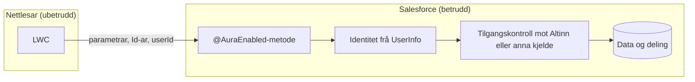

# Tilgangskontroll i dagens eksterne side: funn til vurdering

**Status:** Funn frå statisk lesing av koden 2026-11-13. Dei er ikkje verifiserte
i org. Teamet vurderer og prioriterer funna. Dokumentet skildrar tema og tiltak på
overordna nivå. Detaljar blir handterte internt i teamet.

Sjå [dagens-brukerstotte-og-soknad.md](dagens-brukerstotte-og-soknad.md) for
korleis løysinga heng saman, og [review-og-forslag.md](review-og-forslag.md)
for målreisa.

## Bakgrunn

Kontrollarane på den eksterne sida er `@AuraEnabled` og er tilgjengelege for
innlogga eksterne brukarar via `AAREG_CommunityPermission`. Nokre av dei køyrer
`without sharing`. Det er ofte nødvendig for deling, men gjer at kvar metode må
kontrollere identitet og tilgang sjølv.

Figuren viser kvar kontrollen bør liggje. Alt som kjem frå nettlesaren er
ubetrudd. Serveren må avgjere identitet og tilgang før data blir lesne eller
skrivne.



## Funn

| Tema                             | Kort skildring                                                                                         | Område                                  |
| -------------------------------- | ------------------------------------------------------------------------------------------------------ | --------------------------------------- |
| Identitet frå klienten           | Fleire metodar tek `userId` som parameter og kontrollerer ikkje alltid at det er innlogga brukar.      | heimeside, brukerstøtte, søknad         |
| Lagra kontekst brukt som tilgang | `LastUsedOrganization__c` blir sett frå klienten og lese som om han var kontrollert.                   | heimeside, meldingar, søknader, avtalar |
| Kontroll berre i UI              | Altinn-kontrollen for søknad skjer i LWC og ikkje ved innsending på serveren.                          | søknad                                  |
| Systemmodus utan avgrensing      | Nokre `without sharing`-metodar avgrensar ikkje kva postar eller objekttypar dei endrar eller slettar. | søknad                                  |
| Deling som kan kallast direkte   | Delingsmetoden for avtalar er tilgjengeleg frå klienten og byggjer på lagra kontekst.                  | heimeside, avtalar                      |
| Lesing på tvers av brukarar      | Nokre oppslag i systemmodus kan returnere data om andre brukarar eller kontoar.                        | heimeside, søknad                       |

## Handtering

- Teamet tek funna internt og prioriterer dei.
- Repoet er offentleg. Detaljar om funna skal difor ikkje stå i offentlege
  issues, PR-ar eller commit-meldingar. Ved behov kan teamet bruke ein privat
  GitHub Security Advisory.
- Rettingane treng ikkje vente på rolleprosjektet. Dei kan gjerast uavhengig av
  det.

## Tiltak som teamet kan vurdere

Tiltaka kan gjerast uavhengig av rolleprosjektet, eller samordnast med det.

1. Hent identitet frå `UserInfo.getUserId()` på serveren i staden for
   `userId` frå klienten.
2. Kontroller tilgangen på serveren i kvar metode som les eller skriv data, ikkje
   berre på heimesida.
3. Avgrens metodar i systemmodus til eigne postar, rett objekttype og rett
   status.
4. Gjer interne hjelpemetodar, til dømes deling, utilgjengelege frå klienten.
5. Bruk `with sharing` og `AccessLevel.USER_MODE` der deling ikkje krev
   systemmodus.
6. Skriv Apex-testar med `System.runAs` som minimumsbrukar. Testane skal kalle
   metodane direkte med parametrar som ikkje høyrer til brukaren.

**Døme på mønster** (illustrasjon):

```apex
// Før: identitet frå klienten
@AuraEnabled
public static void doSomething(String userId) { /* ... */ }

// Etter: identitet frå serveren og eksplisitt tilgangskontroll
@AuraEnabled
public static void doSomething(String roleKey, String contextKey) {
    AAREG_RoleAccessService.require(roleKey, contextKey, 'SUPPORT');
    Id userId = UserInfo.getUserId();
    // ...
}
```

## Samanheng med rollemodellen

Den foreslåtte `AAREG_RoleAccessService` i
[dagens-brukerstotte-og-soknad.md](dagens-brukerstotte-og-soknad.md) løyser dei
fleste av desse tema for nye sider. Gamle metodar som blir verande i bruk under
overgangen, treng likevel sine eigne kontrollar til dei blir fjerna.
