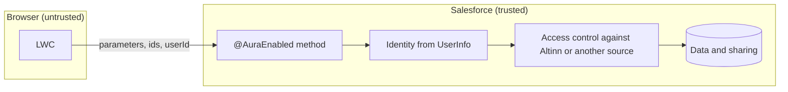

# Access control on the current external site: findings for review

**Status:** Findings from static code review as of 2026-11-13. They have not been verified in the org. The team is reviewing and prioritizing the findings. This document describes the themes and actions at a high level. Details are handled internally by the team.

See [dagens-brukerstotte-og-soknad.md](dagens-brukerstotte-og-soknad.md) for how the solution fits together, and [review-og-forslag.md](review-og-forslag.md) for the target direction.

## Background

The controllers on the external site are `@AuraEnabled` and are available to logged-in external users through `AAREG_CommunityPermission`. Some of them run `without sharing`. This is often necessary for sharing, but it means each method must validate identity and access itself.

The figure shows where the control should sit. Anything coming from the browser is untrusted. The server must determine identity and access before data is read or written.



## Findings

| Theme                          | Short description                                                                                    | Area                                          |
| ------------------------------ | ---------------------------------------------------------------------------------------------------- | --------------------------------------------- |
| Identity from the client       | Several methods take `userId` as a parameter and do not always verify that it is the logged-in user. | home page, support, application               |
| Stored context used as access  | `LastUsedOrganization__c` is set from the client and read as if it were validated.                   | home page, messages, applications, agreements |
| Control only in the UI         | The Altinn control for applications is in the LWC and not performed when submitting on the server.   | application                                   |
| System mode without boundaries | Some `without sharing` methods do not constrain which records or object types they modify or delete. | application                                   |
| Sharing callable directly      | The agreement sharing method is available from the client and is based on stored context.            | home page, agreements                         |
| Reads across users             | Some system-mode lookups can return data for other users or accounts.                                | home page, application                        |

## Handling

- The team will review the findings internally and prioritize them.
- The repository is public. Details of the findings should therefore not appear in public issues, PRs, or commit messages. If needed, the team can use a private GitHub Security Advisory.
- The fixes do not need to wait for the role project. They can be done independently.

## Actions the team may consider

These actions can be done independently of the role project or coordinated with it.

1. Retrieve identity from `UserInfo.getUserId()` on the server instead of using `userId` from the client.
2. Validate access on the server in every method that reads or writes data, not only on the home page.
3. Constrain system-mode methods to the correct records, object types, and statuses.
4. Make internal helper methods, such as sharing, unavailable from the client.
5. Use `with sharing` and `AccessLevel.USER_MODE` where sharing does not require system mode.
6. Write Apex tests with `System.runAs` as the minimum-access user. The tests should call the methods directly with parameters that do not belong to the user.

**Example pattern** (illustration):

```apex
// Before: identity from the client
@AuraEnabled
public static void doSomething(String userId) { /* ... */ }

// After: identity from the server and explicit access control
@AuraEnabled
public static void doSomething(String roleKey, String contextKey) {
    AAREG_RoleAccessService.require(roleKey, contextKey, 'SUPPORT');
    Id userId = UserInfo.getUserId();
    // ...
}
```

## Relationship to the role model

The proposed `AAREG_RoleAccessService` in [dagens-brukerstotte-og-soknad.md](dagens-brukerstotte-og-soknad.md) resolves most of these issues for new pages. Older methods that remain in use during the transition still need their own controls until they are removed.
