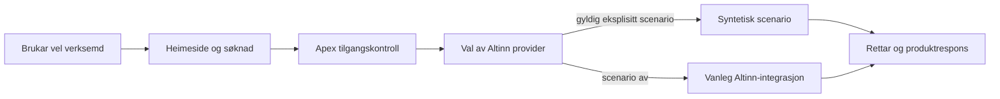

# Altinn: tilgang og syntetiske testscenario

Altinn inngår i kontrollen av kva verksemder ein brukar kan representere og
kva tilgang brukaren har. Dokumenta her forklarer den lokale integrasjonsgrensa
og testscenarioa; dei er ikkje bevis på at eit live Altinn-kall har lykkast.

## Les dette først

| Eg vil                                            | Start her                                                                                                                     |
| ------------------------------------------------- | ----------------------------------------------------------------------------------------------------------------------------- |
| Forstå rå rettar, produktrespons og synlege panel | [Tilgangskjede og scenario](tilgangskjede-og-scenario.md)                                                                     |
| Teste utan ekte Altinn                            | [Testguide](test-guide.md) og [syntetisk testdatastrategi](../../testing/aaregisteret-testdata-strategi.md)                   |
| Sjå forventa brukarvegar og negative testar       | [Scenario-testplan](../../testing/aaregisteret-scenario-testplan.md)                                                          |
| Sjå tidlegare gjennomgangar og testresultat       | [Arkivert scenariogjennomgang](../../archive/altinn/altinn-scenario-gjennomgang-2026-10.md) og [testlogg](altinn-test-log.md) |
| Sjå tidlegare plan og designavklaringar           | [Gjennomføringsplan](implementation-plan.md) og [avklaringar](grill.md)                                                       |

## Korleis grensene heng saman

Kjelda vel berre scenario-provider ved ei gyldig, eksplisitt
brukartildeling. Ugyldig aktivert scenario blir avvist; når scenario er av,
kan standardvalet bruke den vanlege integrasjonen. Test derfor aldri eit
org-oppslag som «utan nettverk» berre fordi scenariokode finst.

UI-panel er ikkje i seg sjølve autorisasjon til postar eller filer.
Rå `Permit`/`Deny`, produktflagg og effektiv Salesforce-tilgang er ulike
kontrollar. [Tilgangskjeda](tilgangskjede-og-scenario.md) viser dette med eit
syntetisk eksempel.

## Status og historikk

Scenario-provider og testdata finst i kjelda, men eventuell aktivering,
tilordning, tilgang og faktisk nettlesaråtferd må verifiserast for den
aktuelle versjonen og det aktuelle orgen. Tidlegare testresultat og eldre
miljøoppsett er flytta til [arkivet](../../archive/README.md#altinn-og-drift).
