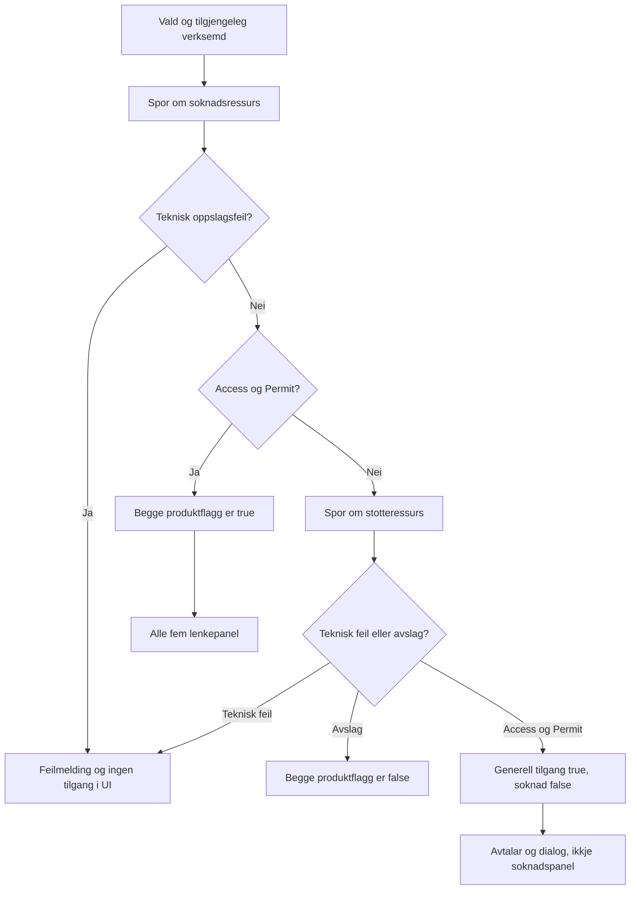

# Altinn: ressursavgjerd, produktrespons og synleg brukarflate

**Analysert:** 2026-11-14 frå lokal kjelde. **Lokal test:** 14/14 Jest PASS.
**Org-/live-evidens:** inga ny Altinn-verifikasjon i denne gjennomgangen.
Dette supplerer [testguiden](test-guide.md) og scenarioa ALT-01/ALT-02 i
[kjeldekartet](../../architecture/arbeidsforhold-kjeldekart-og-teststrategi.md)
utan å endre eksisterande tilgangsreglar eller guide.

## 1. Tre lag med ulike tydingar

| Lag               | Verdi / ansvar                                                                                                             | Kjelde                                                                                                              |
| ----------------- | -------------------------------------------------------------------------------------------------------------------------- | ------------------------------------------------------------------------------------------------------------------- |
| Rå ressursavgjerd | Søknadsressurs og støtteressurs kan ha kvar si `Permit`/`Deny`-avgjerd for same verksemd                                   | [Syntetisk S04](../../../force-app/integration/altinn/staticresources/AAREG_AltinnScenarios.resource#L239)          |
| Produktrespons    | `hasApplicationAccess` gir søknadsfunksjon; `hasAccess` er generell produkttilgang, ikkje eit separat rått støttevedtak    | [HomeController.checkAndShareIfAuthorized](../../../force-app/externalAccess/classes/AAREG_HomeController.cls#L174) |
| Synleg navigasjon | Heile lenkepanelområdet krev `hasAccess`; berre «Ny søknad» og «Mine søknader» har tilleggsvilkåret `hasApplicationAccess` | [Home-template](../../../force-app/externalAccess/lwc/aareg_home/aareg_home.html#L77)                               |

Controlleren spør først om søknadsressursen. `Access/Permit` set begge flagga
til true og hoppar over oppslag på støtteressursen. Berre utan søknadsrett
spør han om støtte; støtte-Permit set generell tilgang, men ikkje søknadsrett.
I UI ligg «Mine avtaler», «Brukerstøtte vedrørende Aa-registeret» og
«Mine meldinger» under generell tilgang.



Diagrammet summerer den undersøkte normal-/feilbana. Ei lenkje i UI er
ikkje bevis på at målkomponenten eller ein servermetode gir record-tilgang.

## 2. S04 gjennom heile kjeda

| Syntetisk verksemd | Rå søknadsavgjerd | Rå støtteavgjerd i katalogen | Produktrespons frå undersøkt kode                                               | Synleg navigasjon frå undersøkt template         |
| ------------------ | ----------------- | ---------------------------- | ------------------------------------------------------------------------------- | ------------------------------------------------ |
| A                  | Permit            | Deny                         | `hasAccess=true`, `hasApplicationAccess=true`; støtteressursen blir ikkje spurd | Søknader, avtalar og støtte/meldingar            |
| B                  | Deny              | Permit                       | `hasAccess=true`, `hasApplicationAccess=false`                                  | Avtalar og støtte/meldingar; ikkje søknadspanela |
| C                  | Permit            | Deny                         | Same aggregering som A                                                          | Same panel som A                                 |

Testguiden si S04-rad «brukerstøttetilgang ja, alle» kan difor lesast som
**synleg produktnavigasjon**, ikkje som rå Permit på støtteressursen for
alle tre verksemder. Det er ikkje grunnlag for å kalle guide/katalog feil
berre fordi dei beskriv ulike lag.

Påstanden i det overordna ALT-02-scenarioet om at ressursrettane er
uavhengige, må skiljast frå dagens implikasjon i produktet. Om søknadsrett
skal gi generell støtte-/avtaletilgang er framleis ei policyavgjerd for
produkt-/tilgangseigar. Ingen tilgangsregel er endra eller endeleg godkjend
av denne analysen.

## 3. Testseam og faktisk dekning

Køyrd lokalt 2026-11-14:

```text
rtk proxy npm run test:unit -- -- --runInBand force-app/externalAccess/lwc/aareg_home/__tests__/aareg_home.test.js
```

**PASS: éin suite, 14 testar.** Apex-importar og wire-adapterar er mocka i
[Jest-fila](../../../force-app/externalAccess/lwc/aareg_home/__tests__/aareg_home.test.js).
Køyringa kontakta ikkje Salesforce eller Altinn.

| Påstand                                                                                   | Eksisterande evidens                                                                                                                                            | Avgrensing                                                                                                                      |
| ----------------------------------------------------------------------------------------- | --------------------------------------------------------------------------------------------------------------------------------------------------------------- | ------------------------------------------------------------------------------------------------------------------------------- |
| Støtte-only-respons viser støtte og skjuler «Ny søknad» etter eksplisitt organisasjonsval | Testen `requires an explicit selection when the saved organization disappears, then grants support for B` kontrollerer desse to panela og siste Apex-parametrar | Mockar produktrespons, ikkje rå Altinn eller Apex-aggregering. Han kontrollerer ikkje eksplisitt alle fem panel                 |
| Vald verksemd blir sjekka på nytt etter refresh; tilgang blir fjerna når valet forsvinn   | Refresh-, tomtilstands- og organisasjonsbytetestane bestod                                                                                                      | Ingen kontroll av effektive Salesforce-shares eller filer                                                                       |
| Oppslagsfeil skal ikkje framstå som eit vanleg rettsavslag                                | Feil-/gjenopprettingstestane bestod; UI skil `organizationError`/`accessCheckFailed` frå manglande tilgang                                                      | Ingen live-feilinjeksjon                                                                                                        |
| Apex har søknads-Permit-, Deny- og støttefallback-assertions                              | [HomeControllerTest](../../../force-app/externalAccess/classes/AAREG_HomeControllerTest.cls) er lesen                                                           | Ikkje køyrd i denne runden. Støttefallback-testen nyttar eit testflagg for å tvinge greina, ikkje eit normalt S04-støtte-Permit |

Ein bestått Jest-test av produktrespons er ikkje bevis på uavhengig
ressurshandheving, Apex-policy eller effektiv tilgang i org.

## 4. Stegvis vidare verifikasjon

Alle stega nedanfor er **NOT RUN** med mindre dei uttrykkjeleg er dekte av
Jest-resultatet ovanfor. Bruk syntetiske, isolerte verksemder A/B/C og ein
andre brukar/verksemd for negativ tilgangskontroll; ikkje kopier
historiske brukaridentitetar frå testar eller testloggar.

### ALT-02-A — rå avgjerd mot produktrespons

1. I ein isolert Apex-test, bruk S04-data for A, B og C. Observer ressursnamn,
   verksemd og rekkjefølgje på provider-kall utan å logge personidentitet.
2. Kall produktinngangen som den innlogga syntetiske aktøren, ikkje som
   ein administrator som representerer ein annan brukar.
3. Kontroller flagga i tabellen ovanfor. For A/C skal dagens kjeldebane
   ikkje slå opp støtte etter søknads-Permit; for B skal begge ressursar
   bli undersøkte i rett rekkjefølgje.
4. I separate fixture-variantar: begge Deny, teknisk feil og tom/ugyldig
   respons. Registrer avslag og feil kvar for seg. Ikkje godta feil som
   Permit eller grønt «ingen organisasjonar».
5. Knyt resultatet til noverande policy, ikkje til eit uavklart krav om
   uavhengige UI-rettar. Eventuell policyendring krev eigen avklart testfasit.

### ALT-01/ALT-02-B — konkret UI og negativ navigasjon

1. Injiser dei tre produktresponsane A/B/C i ein lokal komponenttest.
2. Kontroller alle fem lenkepanel eksplisitt: søknadspanela berre ved
   `hasApplicationAccess`; avtale-/støtte-/meldingspanel ved `hasAccess`.
3. Byt mellom A, B, tomt val og oppslagsfeil. Kontroller at gamle panel og
   rettar blir fjerna medan nytt oppslag ventar, og at rett verksemd blir
   send til Apex.
4. Test målroute og målcontroller separat. Skjulte lenkjer er ikkje
   autorisasjon; direkte navigasjon og tilgang til ei anna verksemd sine
   recordar/filer krev eigne negative testar.

## 5. Viktige sideeffektar og attståande grenser

- `checkAndShareIfAuthorized` er **ikkje ei rein lesing**: ved generell
  tilgang kallar han `shareAgreementsWithUser`, som kan opprette shares.
  Organisasjonsbyte skriv også sist brukte verksemd på brukaren. Ikkje
  klassifiser ei UI-/Apex-køyring av desse handlingane som read-only metadata.
- Sharing-metoden les sist lagra verksemd; LWC ventar på
  `updateLastUsedOrganization` før tilgangssjekken ved byte. Test
  organisasjonsparameter og lagra verksemd separat, utan å konkludere om
  effektiv record-isolasjon frå navigasjonsflagga.
- [CommunityUtils](../../../force-app/externalAccess/classes/AAREG_CommunityUtils.cls#L23)
  avviser annan brukar enn den innlogga og går gjennom
  [servicefactory](../../../force-app/integration/altinn/classes/AAREG_AltinnServiceFactory.cls#L21).
  Standardkonstruksjon når scenario ikkje er aktivt kan velje vanleg
  integrasjon. Ikkje køyr dette som org-smoke utan kontrollert provider og
  godkjend isolering.
- [Søknadskomponenten](../../../force-app/externalApplication/lwc/aareg_application/aareg_application.js#L182)
  gjer eigen rå søknadsressurssjekk. `async checkAccessToApplication`
  returnerer ikkje Promise-kjeda frå Apex-kallet; eit `await` i init er
  difor ikkje bevis for at rettssvaret er ferdig. Dette er eit separat
  kjeldebasert timing-/testpunkt, ikkje demonstrert tilgangsomgåing.

Oppfølging: [scenario](https://github.com/navikt/crm-arbeidsforhold/issues/1180),
[testplan](https://github.com/navikt/crm-arbeidsforhold/issues/1181) og
[heilskapleg gjennomgang](https://github.com/navikt/crm-arbeidsforhold/issues/1179).
Ingen org-data, produktkode eller eksisterande dokumenttekst er endra.
