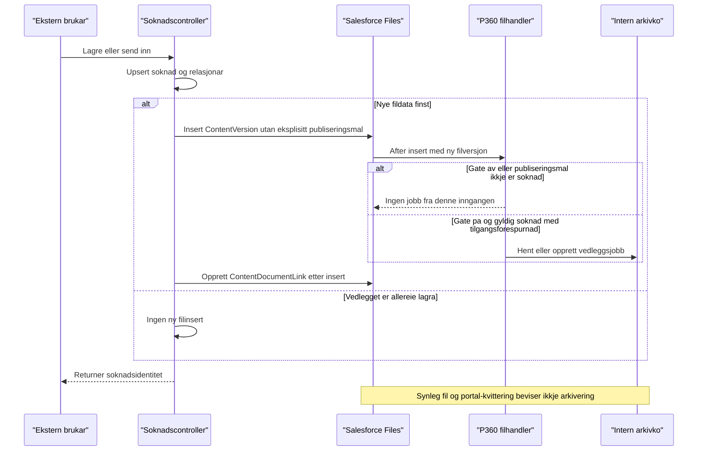

# P360: frå brukarhandling til etterprøvbart arkivresultat

**Kjeldegjennomgang:** 2026-11-14. **Runtime-status:** målinspeksjon og éin
godkjend metadataquery utførte; ingen ny funksjonstest.
Dette dokumentet supplerer [P360-01–P360-05](scenario-testdekning.md) med
inngangsgrenser, sideeffektar og diskriminerande testvariantar. Brukaravklart
produktåtferd er registrert nedanfor; tidlegare logg er ikkje endra.

## 1. Fire ulike ting som ikkje må blandast saman

1. Søknad/vedlegg er lagra og synleg i Salesforce.
2. Ei bestemt hending opprettar ein intern arkivjobb.
3. Jobben er claima og behandla av scheduler/worker.
4. P360 har faktisk oppretta rett sak, dokument og fil, og referansane er
   lagra tilbake i Salesforce.

Kvittering i portalen beviser ikkje steg 2. Lokal `Succeeded` med stub
beviser ikkje steg 4. Eit manglande scheduler-oppsett forklarer ikkje i seg
sjølv kvifor ein jobb aldri vart oppretta.

### Brukaravklart produktåtferd — 2026-11-14

Brukaren stadfesta i denne gjennomgangen:

- Ved innsending skal søknaden og alle tilhøyrande vedlegg arkiverast,
  inkludert vedlegg som vart lagra på utkastet.
- Ved ny innsending etter krav om meir informasjon skal eit **komplett nytt
  dokumentsett** arkiverast, ikkje berre nye eller endra vedlegg.

Dette er fasit for ønskt åtferd, ikkje dokumentasjon på implementasjon,
bestått test, godkjenning av live-kall eller endeleg P360-kontraktsakseptanse.
Kva filversjonar som inngår, innsendingsidentitet, ekstern representasjon av
eit nytt sett og gate-av/backfill må framleis spesifiserast. Testplanen skal
ikkje vente på avgjerdsfullføring som einaste arkiveringsinngang.

## 2. Inngangs- og kontraktsmatrise

| Hending                                        | Undersøkt kjeldebane                                                                                                                       | Faktisk grense i kjelda                                                                                                                                                                                                                            | Testkjelde / attståande bevis                                                                                                                                                                                                            |
| ---------------------------------------------- | ------------------------------------------------------------------------------------------------------------------------------------------ | -------------------------------------------------------------------------------------------------------------------------------------------------------------------------------------------------------------------------------------------------- | ---------------------------------------------------------------------------------------------------------------------------------------------------------------------------------------------------------------------------------------- |
| Lagre utkast eller send inn med nye fildata    | [ApplicationController](../../../force-app/externalApplication/classes/AAREG_ApplicationController.cls#L87)                                | Filkopling er ikkje automatisk P360-jobb: controlleren set inn `ContentVersion` utan eksplisitt `FirstPublishLocationId`, og lagar deretter `ContentDocumentLink` til søknad og tilgangsførespurnad. Handleren krev publiseringsfeltet ved insert. | P02-A/B nedanfor må skilje denne bana frå direktepublisering. Ingen ny runtime-test.                                                                                                                                                     |
| Send inn eit utkast med allereie lagra vedlegg | [insertDocumentWithLink](../../../force-app/externalApplication/classes/AAREG_ApplicationController.cls#L201)                              | Utan nye fildata blir ingen ny `ContentVersion` sett inn av metoden. Innsendinga kallar ikkje jobbservicen i undersøkt controller.                                                                                                                 | [P02-loggen](test-log.md#p02-ny-lesekontroll-av-innstillingar--2026-11-12) er brukarrapportert; effektiv gate under innsending er ikkje bevist.                                                                                          |
| Publiser ny filversjon direkte på søknad       | [ContentVersion-handler](../../../force-app/integration/p360/classes/P360_ContentVersionArchiveHandler.cls#L15)                            | Gate på, `FirstPublishLocationId` av typen `Application__c` og synleg søknad med `Access_Request__c` krevst for `ApplicationAttachment`. Handleren sjekkar ikkje søknadsstatus.                                                                    | [shouldCreateAttachmentJobForApplicationContentVersion](../../../force-app/tests/classes/integration/p360/P360_ContentVersionArchiveHandlerTest.cls#L16) kontrollerer relasjonar, eventtype og `Pending`, ikkje normal portalopplasting. |
| Frigi avgjerd ved oppdatering                  | [ArchiveGuardHandler](../../../force-app/integration/p360/classes/P360_ArchiveGuardHandler.cls#L37)                                        | Gate på og overgang frå ikkje-true til `Ready_For_P360_Archive__c=true`, med tilgangsførespurnad, opprettar `DecisionDocument`. Release-permission blir kontrollert før lagring når gate er på.                                                    | [Release-test](../../../force-app/tests/classes/integration/p360/release/P360_ApplicationDecisionArchiveGuardTest.cls#L166) dekkjer oppdateringsbana. Insert med true og replay etter gate-av må undersøkjast separat.                   |
| Opprett søknadsdokumentjobb eksplisitt         | [ArchiveJobService](../../../force-app/integration/p360/classes/job/P360_ArchiveJobService.cls#L24)                                        | `ApplicationDocument`-API finst. Ingen automatisk produksjonskallstad vart funnen ved symbolsøk i `force-app/`; treff var definisjon og testar. Smoke-skriptet kallar servicen direkte.                                                            | [Service-testar](../../../force-app/tests/classes/integration/p360/job/P360_ArchiveJobServiceTest.cls) beviser ikkje kopling til innsending. Dynamiske/eksterne kall er ikkje utelukka av søket.                                         |
| Kopier søknadsfil til avtale                   | [createContentVersionForAgreement](../../../force-app/internalApplicationAgreement/classes/AAREG_createContentVersionForAgreement.cls#L20) | Set `FirstPublishLocationId` til avtale, ikkje søknad. P360 sin undersøkte ContentVersion-handler hoppar over denne objekttypen. `AgreementDocument`-service finst, men ingen automatisk produksjonskallstad vart funnen i same symbolsøk.         | Ei fil på avtalen er ikkje arkivjobb. Avtalehending og filutval må kravavklarast før endeleg testfasit.                                                                                                                                  |

Jobbservicen har ikkje eigen processing-gate. Gate-av på trigger/scheduler/
worker er difor ikkje eit generelt løfte om at eit eksplisitt servicekall
aldri kan opprette ein jobb.

### Sekvensen ved controllerstyrt filopplasting

Dette viser undersøkt kode, ikkje ei ny org-observasjon. `after insert`
køyrer før controlleren lagar dei etterfølgjande filkoplingane.

<!-- mermaid-checked: every participant uses `participant Id as "Label"`, no \n in aliases/messages/notes, every alt/opt/loop closed by end, no `:` inside any alias -->



## 3. Prosessering, resultat og sideeffektar

- [Scheduler](../../../force-app/integration/p360/classes/job/P360_ArchiveJobScheduler.cls)
  sjekkar gate, claimar inntil ti jobbar og køar éin worker. Kall på
  `execute(null)` er ei faktisk køyring, ikkje oppretting av ein framtidig
  schedule.
- [Claim-service](../../../force-app/integration/p360/classes/job/P360_ArchiveJobClaimService.cls)
  vel `Pending` eller tidsmodne `Failed`, aukar forsøkstal og gir ti minutt
  lease. Queryen har ikkje `FOR UPDATE` eller automatisk reclaim av utgått
  `In Progress`. Konkurranseutfall er ikkje demonstrert her.
- [Worker](../../../force-app/integration/p360/classes/job/P360_ArchiveJobWorker.cls#L94)
  sender berre idempotensnøkkelen som `externalId` i den undersøkte
  request-bygginga. Han hentar ikkje søknadsinnhald eller filbytes her og
  lagrar ikkje returnerte saks-/dokument-/filreferansar på domenerecordane.
  Dette er eit separat gap frå manglande inngang.
- [Factory](../../../force-app/integration/p360/classes/adapter/P360_AdapterFactory.cls#L48)
  vel stub frå org-default `Use_Mock_Transport__c`, elles reell adapter.
  [Stub](../../../force-app/integration/p360/classes/adapter/P360_StubArchiveAdapter.cls)
  returnerer kontrollert suksess utan callout.
  [Reell adapter](../../../force-app/integration/p360/classes/adapter/P360_ArchiveAdapter.cls)
  og [RPC-klient](../../../force-app/integration/p360/classes/client/P360_RpcClient.cls)
  stoppar med eksplisitte ikkje-implementert-unntak.
- Retrybar feil får `Failed` før maksimalgrensa på fem forsøk, elles
  `Manual Review`. Dei automatiske ventingane ved forsøk 1–4 er 1, 5, 15 og
  60 minutt; den femte verdien i lista, 360, blir ikkje vald ved normal
  forsøksauke fram til maksimalgrensa. Nøyaktig runtime-timing er ikkje testa.

### Testisolering omfattar meir enn P360

| Handling                                     | Potensiell sideeffekt i kjelde                                                                                                                                                                                      | Krav før manuell/scratch-køyring                                                                     |
| -------------------------------------------- | ------------------------------------------------------------------------------------------------------------------------------------------------------------------------------------------------------------------- | ---------------------------------------------------------------------------------------------------- |
| Innsending til `New`                         | [Stadfestingsflow](../../../force-app/main/default/flows/AAREG_createContactSendConfirmation.flow-meta.xml#L367) kan opprette `EmailQueue__c` med `Queued`, Contact, Thread og Message når startvilkåra er oppfylte | Avklar mottakar, køforbrukarar og godkjend sperre; tom kø før testen garanterer ikkje tom kø etterpå |
| Ny innsending etter krav om meir informasjon | [Varslingsflow](../../../force-app/main/default/flows/AAREG_applicationNotificationToCasehandler.flow-meta.xml#L3) har både Custom Notification og direkte `emailSimple`-grein ved manglande saksbehandlar          | Kontroll av berre `EmailQueue__c` eller e-postscheduler er utilstrekkeleg                            |
| Opprett/endr avtale                          | [Flow-katalogen](../../architecture/aareg-flow-katalog.md) viser asynkron distribusjonsintegrasjon og oppfølging                                                                                                    | Ikkje bruk ordinær avtaleoppretting som isolert arkivtest før den faktiske kjeda er vurdert          |
| Køyr mock-smoke                              | [Apex-skriptet](../../../scripts/apex/p360MockArchiveFlow.apex) skriv org-default mock-setting, opprettar data og startar scheduler; claim kan ta andre køklare jobbar                                              | Isolert testvindauge og oversikt over eksisterande jobbar; aldri køyr som lesande preflight          |

P360-mock er ikkje sperre for Altinn, distribusjon, e-post eller SMS.
[Shell-runneren](../../../scripts/p360-mock-smoke.sh) gjer fem raske
statusoppslag utan venting og let mock-settinga stå på. `cleanup` fjernar
berre lokale mellombelse resultatfiler, ikkje org-data eller tilgangar.
Han identifiserer worker via klasse/tid, ikkje eksakt jobbkopling; resultatet
kan difor ikkje åleine bevise kva worker som behandla testjobben.
Runneren er ikkje køyrd i denne gjennomgangen.

## 4. Indirekte pakkeavhengnader i P360-kjeda

Dette supplerer [direkte kallsite-matrise](../../architecture/aaregisteret-pakkekallsite-matrise.md).
Lokale referansekjelder er lesne, ikkje endra. Dei er ikkje bevis på innhaldet
i installerte pakkeversjonar.

| Frå produktet                                                                                                | Pakkeledd i lokal referansekjelde                                                                                                                                      | Konsekvens / tolkningsgrense                                                                                                                                                                                    |
| ------------------------------------------------------------------------------------------------------------ | ---------------------------------------------------------------------------------------------------------------------------------------------------------------------- | --------------------------------------------------------------------------------------------------------------------------------------------------------------------------------------------------------------- |
| [ProcessingGate](../../../force-app/integration/p360/classes/P360_ArchiveProcessingGate.cls#L23)             | [FeatureToggleBase](../../../feature-toggle/main/default/classes/FeatureToggleBase.cls#L46) konstruerer `CustomMetadataDAO` og `CustomPermissionHelper`                | `custom-permission-helper` er ei påvist indirekte kjeldeavhengnad via `feature-toggle`, ikkje eit funne direkte produktkall                                                                                     |
| Same konstruktør                                                                                             | [CustomPermissionHelper.setCustomPermissionMaps](../../../custom-permission-helper/main/default/classes/CustomPermissionHelper.cls#L34) les CustomPermission-katalogen | Gate brukar ikkje `isFeatureEnabled` eller per-brukar permission-resultat; han krev enabled flagg og tomt required-permission-felt. Innlasting av permission-katalog må ikkje kallast effektiv tilgangskontroll |
| [Avgjerdstrigger](../../../force-app/integration/p360/triggers/P360_ApplicationDecisionArchiveGuard.trigger) | [MyTriggers](../../../crm-platform-base/main/default/classes/MyTriggers.cls#L42) les aktive `MyTriggerSetting__mdt` og dispatchar handler                              | Triggerfil åleine beviser ikkje at korrekt handler-/eventkonfigurasjon er aktiv i org. Runtime-lineage står att                                                                                                 |

## 5. Diskriminerande testplan

**Status for alle variantane nedanfor: NOT RUN.** Org-utføring er blokkert
til mål/handling og trygg gjennomføringsmekanisme er avklarte. Ingen kommando
her er ei godkjenning til køyring.

### Felles førebuing og evidenskontrakt

1. Bruk berre verifisert eksisterande `crm-arbeidsforhold` scratch-org.
   Stadfest eksakt mål og handling før kvar org-kommando. Ingen produksjon,
   Dev Hub, ny org, live-integrasjon eller auth-endring.
2. Bruk innsendingsfasiten ovanfor. Avklar konkret filversjonsutval,
   innsendingsidentitet og replay med produkt-/P360-eigar før ein låser
   tekniske assertions. Skil dagens kjeldeutfall frå ønskt akseptansekriterium.
3. Bruk [P360_TestDataFactory](../../../force-app/tests/classes/integration/p360/test/P360_TestDataFactory.cls)
   og [AAREG_TestDataFactory](../../../force-app/utility/classes/AAREG_TestDataFactory.cls)
   i isolerte Apex-testar. Separate grafar per variant: syntetisk Account,
   Access Request, Application, kontakt/grunnlag og éi lita syntetisk fil.
   Ikkje kopier historiske P02-recordar eller reelle kontaktdata.
4. Køyr handling som minimumstilgangsbrukar med berre dei eksplisitte
   rettane scenarioet krev. Oppsett, ekstern aktør, release-aktør og
   prosesseringsaktør må ikkje blandast saman. Eksisterande prosesseringstestar
   er ikkje bevis for at portalbrukaren har tilgang.
5. Registrer start/slutt, gate, mock-val, aktørrolle, fixture-nøkkel,
   jobbtype/status/tal, filkoplingstal og sanert feil. Org-ID-ar,
   record-ID-ar, dokumentinnhald og kontaktverdiar skal ikkje i offentleg
   evidens. Kontroller både søknads- og tilgangsførespurnadskopling.
6. For rein jobboppretting: ikkje dispatch scheduler. For separat godkjend
   mock-worker-smoke: knyt observasjon til eksakt testjobb/worker, poll kvart
   femte sekund i høgst 120 sekund. `Queued`/`Processing` ved fristen er
   TIMEOUT, ikkje suksess; ikkje start ny worker eller resubmit automatisk.
   Dette er ein føreslått testfrist, ikkje ein implementert runner-eigenskap.

| Variant / mål                              | Nummererte handlingar                                                                                                                                                                                                                  | Venta observasjon frå dagens kjelde                                                                                                               | Akseptanse / evidensgap                                                                                                                                                                                             |
| ------------------------------------------ | -------------------------------------------------------------------------------------------------------------------------------------------------------------------------------------------------------------------------------------- | ------------------------------------------------------------------------------------------------------------------------------------------------- | ------------------------------------------------------------------------------------------------------------------------------------------------------------------------------------------------------------------- |
| **P02-A: utkast før innsending**           | 1. Set opp ny syntetisk søknadsgraf. 2. Lagre med ny fil gjennom controllerbana. 3. Registrer versjon og begge lenkene. 4. Send inn same utkast utan nye fildata. 5. Tel jobbar og filversjonar før/etter.                             | Ingen ny filinsert ved steg 4; inga eksplisitt innsendingstilknyting til `ApplicationDocument` i undersøkt controller.                            | Brukarfasit krev arkiveringsgrunnlag for søknaden og utkastvedlegget ved innsending. Manglande automatisk inngang er eit kjeldebasert implementasjonsgap; runtime-årsak til historisk P02 er framleis ikkje bevist. |
| **P02-B: ny fil ved innsending**           | 1. Ny uavhengig graf utan fil. 2. Send inn med nye syntetiske fildata. 3. Observer publiseringsfelt ved insert, etterfølgjande lenker og jobbtal.                                                                                      | Controller set ikkje publiseringsfeltet eksplisitt. Etterfølgjande lenke er ikkje same triggerhending som direktepublisering.                     | Brukarfasit krev at settet omfattar både søknad og ny fil. Fang faktisk feltverdi/triggerutfall; ei synleg fil eller kvittering er ikkje nok.                                                                       |
| **P02-C: direktepublisering som kontroll** | 1. Ny graf med tilgangsførespurnad. 2. Gate på i isolert test-fixture. 3. Insert fil med `FirstPublishLocationId=application.Id`. 4. Les jobben utan å dispatcha. 5. Gjenta i nye testar med gate av og manglande tilgangsførespurnad. | Normalvariant: éin `Pending ApplicationAttachment` med rette relasjonar. Gate av eller manglande tilgangsførespurnad: ingen jobb frå handleren.   | Eksisterande test dekkjer positiv og gate-av; han må ikkje brukast som proxy for P02-A/B.                                                                                                                           |
| **P360-03-D1: release medan gate er av**   | 1. Ny avgjerd/graf. 2. Gate av, set ready=true. 3. Gate på i ny kontrollert transaksjon. 4. Oppdater eit tillate teknisk felt utan å endre ready. 5. Les jobbtal.                                                                      | Steg 2 kan lagrast utan release-guard når gate er av. Steg 4 gir ikkje ny false-til-true-overgang; after-update-koden har inga slik replay-grein. | Må avgjerast om dette er tilsikta eller krev eksplisitt recovery. Ikkje reset ready for å tvinge ny hending.                                                                                                        |
| **P360-03-D2: insert med ready=true**      | 1. Ny graf. 2. Gate på, autorisert release-aktør. 3. Insert avgjerd med ready=true. 4. Les jobbtal. 5. I ny test, insert utan release-permission og kontroller avslag.                                                                 | Before-insert validerer permission; jobboppretting ligg berre i after-update. Insert er ikkje den testa release-overgangen.                       | Produkt-/integrasjonseigar må fastsetje støtta inngang. Eksisterande test av update dekkjer ikkje denne varianten.                                                                                                  |

Variantane D1/D2 er kjeldeavleidde testmål, ikkje demonstrerte org-feil.
Gate-av er også eit kompatibilitetsval: ordinær avgjerds-DML skal fungere
utan aktiv P360-behandling. Ei eventuell endring må ikkje fjerne dette
utilsikta.

### P02-D — komplett nytt sett ved ny innsending

**Status: NOT RUN.** Dette er eit nytt testmål frå brukaravklaringa, ikkje
ein eksisterande test. Bruk same aktør-, isolerings- og evidenskontrakt som
ovanfor.

1. Opprett ein ny syntetisk graf med søknad og to ulike vedlegg. Fullfør
   første innsendingshending i eit kontrollert testseam utan live-kall.
2. Registrer første sett: éi søknadsrepresentasjon og dei to vedlegga,
   innsendingsidentitet, jobbreferansar og mocka arkivresultat.
3. I eit godkjent, isolert scenario for meir informasjon: endre
   søknadsinnhald, bevar begge vedlegga og legg til eit tredje.
4. Send inn på nytt. Verifiser eit nytt, separat sett med oppdatert
   søknadsrepresentasjon og alle tre vedlegga, ikkje berre det tredje.
5. Simuler retry av den andre innsendingshendinga utan å lage ei tredje
   forretningshending. Verifiser at dette ikkje opprettar eit tredje sett,
   og at det første settet ikkje blir overskrive eller dobbeltsendt.
6. Injiser delvis filfeil. Observer kva delar av det andre settet som er
   fullførte og kva som må gjenopptakast; ikkje godta samla arkivsuksess før
   alle delane er stadfesta. Recovery-fasiten krev ekstern kontraktsavgjerd.

**Konkrete kjeldegap:** [dagens idempotensnøklar](../../../force-app/integration/p360/classes/job/P360_IdempotencyKey.cls)
byggjer søknadsdokumentnøkkel frå berre søknads-ID og vedleggsnøkkel frå
søknads-ID + filversjons-ID. Same søknad og uendra filversjon får difor same
nøklar ved ny innsending. [Jobbservicen](../../../force-app/integration/p360/classes/job/P360_ArchiveJobService.cls)
gjenbrukar då eksisterande jobb; ny korrelasjonsverdi skil ikkje hendingane.
Dette modellerer ikkje åleine kravet om eit komplett nytt sett.

Vidare design må skilje **retry av same innsending** frå **ny innsending**,
utan å velje tilfeldig ny nøkkel for kvart forsøk. Lagring av
innsendingsidentitet, dokument-/filversjonar, samtidige innsendingar,
eksisterande jobbar og ekstern deduplisering krev ei samla avgjerd i
eksisterande idempotens-/mappingarbeid. Ingen nøkkelformat, migrering eller
ny feltmodell er vedteken eller implementert her.

### Opprydding og stopp

- Isolerte Apex-testdata blir rulla tilbake av testframeworket; dette er
  ikkje ei oppryddingsgaranti for køyring av anonymous Apex/smoke-skript.
- Før manuell smoke: ta godkjend, sanert baseline av flagg/mock, mellombelse
  assignments og scenarioeigde records. Dokumenter tilbakeføring før DML.
- Etterpå: stopp vidare dispatch, kontroller aktive testworkerar, tilbakefør
  godkjende innstillings-/tilgangsendringar og fjern berre identifiserte
  scenarioeigde data etter avtalt plan. Ved ukjend transaksjon eller ekstern
  levering: stopp og registrer BLOCKED; ikkje slett bevis eller retry blindt.
- Kontroller etter tilbakeføring at processing-flagget er av utanfor avtalt
  testvindauge. Ikkje slå av/på delte innstillingar for å «rydde» utan
  mål-/handlingsgodkjenning.

## 6. Prioriterte avgjerder og eksisterande arbeid

| Tiltak                                                    | Kvifor først                                                                                                               | Autoritativ oppfølging                                                                                                                                                                                                             |
| --------------------------------------------------------- | -------------------------------------------------------------------------------------------------------------------------- | ---------------------------------------------------------------------------------------------------------------------------------------------------------------------------------------------------------------------------------- |
| Operasjonaliser avklart innsending og komplett nytt sett  | Filversjonsutval, innsendingsidentitet og ekstern representasjon står att; dagens nøkkelmodell skil ikkje nye innsendingar | [Mapping/hendingsscope](https://github.com/navikt/crm-arbeidsforhold/issues/1016), [filstrategi](https://github.com/navikt/crm-arbeidsforhold/issues/1018), [idempotens](https://github.com/navikt/crm-arbeidsforhold/issues/1015) |
| Avklar release/replay etter gate-av og insert             | Frigitt flagg er ikkje i seg sjølv ei garantert køhending                                                                  | [Recovery](https://github.com/navikt/crm-arbeidsforhold/issues/1015)                                                                                                                                                               |
| Kople godkjend hending til full request og responslagring | Ny jobb aleine gir framleis ingen ekstern sak/dokument/fil                                                                 | [Roadmap](https://github.com/navikt/crm-arbeidsforhold/issues/1095), [transportkontrakt](https://github.com/navikt/crm-arbeidsforhold/issues/1017)                                                                                 |
| Planlegg avgrensa org-test med kanalvern og eigd cleanup  | Mock-smoke endrar data/config og kan behandle andre jobbar                                                                 | [Testplan](https://github.com/navikt/crm-arbeidsforhold/issues/1181), [runbook-eigar](https://github.com/navikt/crm-arbeidsforhold/issues/997)                                                                                     |

Ingen kode-/metadatafiks, org-endring, Apex-test, live-kall eller lukking av
Issues er utført som del av dette dokumentet.

## 7. Godkjend målinspeksjon — 2026-11-14

Brukaren stadfesta at `crm-arbeidsforhold` framleis peikar til den eksisterande
scratch-orgen, og godkjende éin lesande inspeksjon:

```text
sf org display --target-org crm-arbeidsforhold --json
```

Kommandoen vart køyrd gjennom ein mellombels VS Code-hosttask. Ein lokal
wrapper stadfesta Salesforce CLI `2.158.7` før org-kommandoen og filtrerte
output før vising. Ingen tokens, brukarnamn, org-ID eller org-URL vart viste
eller skrivne til dokumentasjonen.

| Felt / resultat        | Observert verdi                         | Tolkingsgrense                                                                                  |
| ---------------------- | --------------------------------------- | ----------------------------------------------------------------------------------------------- |
| Eksplisitt mål         | `crm-arbeidsforhold`                    | Brukarstadfesting og lokal målinspeksjon, ikkje aliasnamnet åleine                              |
| `expirationDate`       | `2026-11-19`                            | Framtidig scratch-utløp i display-resultatet; ikkje åtferdsbevis                                |
| `connectedStatus`      | `null`                                  | Fersk tilkoplingsstatus er ikkje stadfesta                                                      |
| Dev Hub-metadata finst | `true`                                  | Berre ein boolsk sjekk av display-resultatet; ingen Dev Hub vart kontakta av ein eigen kommando |
| Utføring               | Hosttask fullførte utan rapportert feil | Denne målinspeksjonen hadde ingen metadataquery; ei separat godkjend query er dokumentert under |

Første launch-forsøk feila i shell-quoting før JavaScript/Salesforce kunne
køyre. Det vart erstatta med ei skriptfil utan å utvide den godkjende
org-handlinga. Både hjelpeskriptet og den mellombelse task-fila vart fjerna
etterpå. Ingen Apex-test, endring i org eller eksternt integrasjonskall vart
starta av målinspeksjonen.

## 8. Aktive P360-triggerinnstillingar — 2026-11-14

Etter eiga mål-/handlingsstadfesting vart denne reine metadataqueryen køyrd
via ein ny mellombels VS Code-hosttask mot same eksisterande scratch-org:

```text
sf data query --target-org crm-arbeidsforhold --query "SELECT DeveloperName, Active__c, Class__c, Event__c, sObjectAPIName__c FROM MyTriggerSetting__mdt WHERE Class__c = 'P360_ArchiveGuardHandler'" --json
```

Resultatet hadde `totalSize=3` og `done=true`. Berre dei valde metadatafelta
vart viste; record-ID-ar og tekniske record-URL-ar vart filtrerte vekk.

| DeveloperName          | Active | Event           | Class                      | Object                    |
| ---------------------- | ------ | --------------- | -------------------------- | ------------------------- |
| `P360_ArchiveGuard_I`  | `true` | `BEFORE_INSERT` | `P360_ArchiveGuardHandler` | `Application_Decision__c` |
| `P360_ArchiveGuard_U`  | `true` | `BEFORE_UPDATE` | `P360_ArchiveGuardHandler` | `Application_Decision__c` |
| `P360_ArchiveGuard_AU` | `true` | `AFTER_UPDATE`  | `P360_ArchiveGuardHandler` | `Application_Decision__c` |

Dei undersøkte felta samsvarar med lokal metadata for
[before insert](../../../force-app/integration/p360/customMetadata/MyTriggerSetting.P360_ArchiveGuard_I.md-meta.xml),
[before update](../../../force-app/integration/p360/customMetadata/MyTriggerSetting.P360_ArchiveGuard_U.md-meta.xml)
og [after update](../../../force-app/integration/p360/customMetadata/MyTriggerSetting.P360_ArchiveGuard_AU.md-meta.xml).

**Stadfesta:** dei tre registreringane er aktive på oppslagstidspunktet.
**Ikkje stadfesta:** full metadata-body, namespace/rekkjefølgje/bypass i org,
deploya Apex-body, effektiv tilgang, gate-verdi under ei handling eller
faktisk trigger-/workerutfall. Queryen køyrde ikkje handleren og oppretta
ikkje jobbar. Dette er ikkje ein ende-til-ende-test eller forklaring på P02.
Den mellombelse task-fila og hjelpeskriptet vart fjerna etter fullført query.
