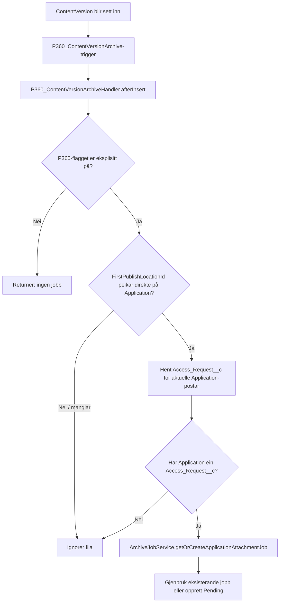
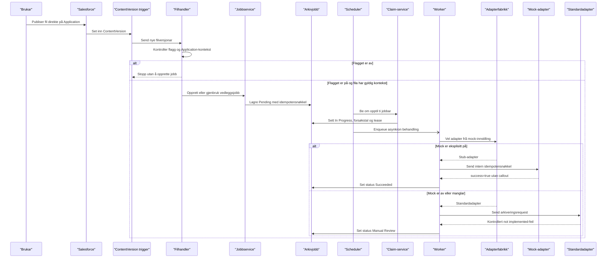
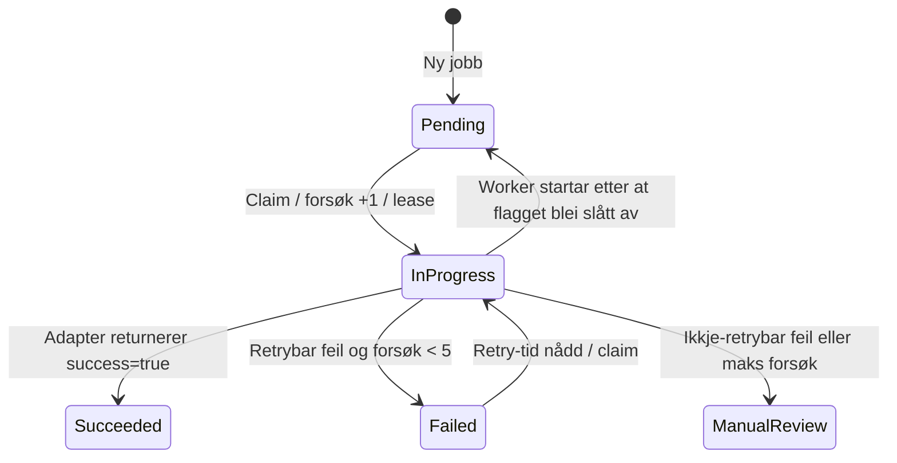
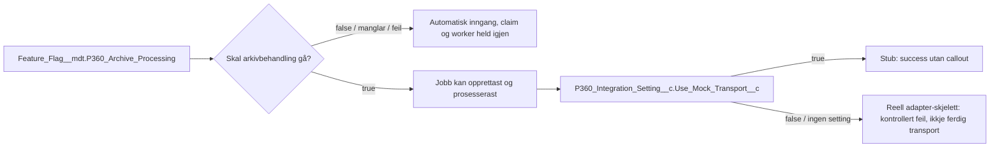

# P360 kode- og testguide: frå Salesforce-hending til arkiveringsjobb

Dette dokumentet forklarer den implementerte P360-jobbflyten i Salesforce-kjelda: kva som utløyser ein jobb, korleis han blir lagra og prosessert, kva metadata som styrer åtferda, og kva testane faktisk beviser.

Dokumentet forklarer dagens kode, ikkje ei ferdig live-integrasjon. SIF-endepunkt, autentisering, komplett dokumentmapping og faktisk filopplasting er ikkje implementert eller godkjent. Org- og testresultat er førte separat i [P360 testlogg](test-log.md); dei kan ikkje utleiast frå at kjeldekode eller metadata finst i repoet.

## Kortversjonen

- Salesforce kan opprette ein intern `P360_Archive_Job__c` for ei fil som blir **publisert direkte på** ein `Application__c`.
- Eit fail-closed feature flag må vere på for dei automatiske inngangane, claim og worker. Direkte kall til `P360_ArchiveJobService` blir ikkje stoppa av flagget.
- Ein scheduler claimar jobbar og køyrer ein asynkron Queueable worker.
- Worker vel ein adapter. Med eksplisitt mock-innstilling svarer stubben suksess utan callout.
- Mock `Succeeded` viser at den interne kø-/worker-flyten fungerer. Det viser **ikkje** at eit dokument er sendt eller lagra i P360.
- Den reelle adapteren stoppar førebels med ei kontrollert «not implemented»-feil. Det finst heller ikkje ein aktiv org-schedule.

## Kva fungerer, og kva fungerer ikkje enno?

| Fungerer i dagens kode                                                                      | Fungerer ikkje eller er ikkje verifisert                                                                        |
| ------------------------------------------------------------------------------------------- | --------------------------------------------------------------------------------------------------------------- |
| Opprette intern arkivjobb for støtta, automatiske inngangar når prosesseringsflagget er på. | Sende dokument eller filinnhald til P360/SIF.                                                                   |
| Hindre duplikate interne jobbar ved å bruke same idempotensnøkkel for same hending.         | Stadfeste ekstern P360-idempotens eller at P360 berre lagrar eitt dokument.                                     |
| Claime jobbar, køyre worker og lagre `Succeeded`, `Failed` eller `Manual Review`.           | Automatisk ta opp att `In Progress`-jobbar etter at lease går ut.                                               |
| Bruke ein kontrollert stub som svarer suksess utan nettverkskall.                           | Bruke endeleg endpoint, autentisering, RPC-kontrakt, felt-/filmapping eller reelle P360-feilkodar.              |
| Teste viktige statusovergangar med Apex-testar.                                             | Bevise at den faktiske eksterne UI-opplastinga treff ContentVersion-triggeren, eller at stor fil-bulk er trygg. |

### Teststatus og klargjering

- Kode og testdekning nedanfor er lese frå arbeidskopien. Apex-testane er ikkje køyrde i denne dokumentasjonsrunden.
- Siste registrerte automatiske resultat og mock-smoke står i [P360 testlogg](test-log.md). Desse er historisk evidens, ikkje ein ny køyring eller ein stadfesting av noverande org-status.
- Den siste loggførte smoke-runden stadfesta prosesseringsflagget som `false`, men las ikkje tilbake `Use_Mock_Transport__c` etter at scriptet sette det til `true`. Synthetic testdata og to arkivjobbar, samt to mellombelse permission set-tilordningar, stod att utan opprydding.
- Ingen manuelle Salesforce UI-scenario er registrerte som utførte. Ingen live P360-kall er verifiserte.
- Før ny køyring må gjeldande miljø, brytarar, tilgangar og attståande testdata kontrollerast og loggførast. Arbeid og opprydding i verifisert eksisterande `crm-arbeidsforhold` scratch-org krev ikkje ny brukargodkjenning etter `AGENTS.md`; andre ikkje-produksjonsorg krev fersk mål-/handlingsgodkjenning.

### Omgrep i enkelt språk

| Omgrep                | Kort forklart                                                                                                  |
| --------------------- | -------------------------------------------------------------------------------------------------------------- |
| `Application__c`      | Søknaden som fila eller vedtaket høyrer til.                                                                   |
| `Access_Request__c`   | Tilgangssaka som gir arkiveringsjobben nødvendig kontekst.                                                     |
| `ContentVersion`      | Ei bestemt versjon av ei fil i Salesforce.                                                                     |
| `P360_Archive_Job__c` | Salesforce si interne kø-/statusrad. Ho er ikkje eit P360-dokument.                                            |
| Idempotensnøkkel      | Stabil nøkkel som seier «dette er same arkiveringshending» og hindrar interne duplikatjobbar.                  |
| Stub-adapter          | Kontrollert test-/utviklingsadapter. Han svarer som om arkivering lukkast, utan å sende noko ut av Salesforce. |

## Plassering og ansvar

P360-kjelda ligg i hovudpakkja under `force-app/integration/p360/`. Testane ligg under `force-app/tests/classes/integration/p360/`.

| Lag / fil                                                                                                                  | Ansvar                                                                                                      |
| -------------------------------------------------------------------------------------------------------------------------- | ----------------------------------------------------------------------------------------------------------- |
| [P360_ContentVersionArchive.trigger](../../../force-app/integration/p360/triggers/P360_ContentVersionArchive.trigger)      | Tynn `after insert`-inngang for `ContentVersion`; sender `Trigger.new` til handleren.                       |
| [P360_ContentVersionArchiveHandler.cls](../../../force-app/integration/p360/classes/P360_ContentVersionArchiveHandler.cls) | Filtrerer filhendingar, finn Application-kontekst og ber service-laget om ein jobb.                         |
| [P360_ArchiveProcessingGate.cls](../../../force-app/integration/p360/classes/P360_ArchiveProcessingGate.cls)               | Fail-closed prosesseringsport brukt av automatiske inngangar, claim og worker.                              |
| [P360_ArchiveJobService.cls](../../../force-app/integration/p360/classes/job/P360_ArchiveJobService.cls)                   | Validerer kjelde-ID-ar og opprettar eller gjenbrukar arkivjobbar.                                           |
| [P360_IdempotencyKey.cls](../../../force-app/integration/p360/classes/job/P360_IdempotencyKey.cls)                         | Byggjer stabile nøklar for kvar arkivhendingstype.                                                          |
| [P360_ArchiveJobScheduler.cls](../../../force-app/integration/p360/classes/job/P360_ArchiveJobScheduler.cls)               | Claimar ein avgrensa jobb-batch og enqueue-ar worker. Kan kallast eksplisitt eller av Salesforce Scheduler. |
| [P360_ArchiveJobClaimService.cls](../../../force-app/integration/p360/classes/job/P360_ArchiveJobClaimService.cls)         | Vel jobbar som kan køyrast, set lease og aukar forsøksteljaren.                                             |
| [P360_ArchiveJobWorker.cls](../../../force-app/integration/p360/classes/job/P360_ArchiveJobWorker.cls)                     | Kallar adapter, klassifiserer resultat og oppdaterer status.                                                |
| [P360_AdapterFactory.cls](../../../force-app/integration/p360/classes/adapter/P360_AdapterFactory.cls)                     | Vel standard adapter frå org-default mock-setting.                                                          |
| [P360_StubArchiveAdapter.cls](../../../force-app/integration/p360/classes/adapter/P360_StubArchiveAdapter.cls)             | Returnerer kontrollert suksess utan callout eller dokumentopplasting.                                       |
| [P360_ArchiveAdapter.cls](../../../force-app/integration/p360/classes/adapter/P360_ArchiveAdapter.cls)                     | Kontraktskjelett for reell arkivering; stoppar kontrollert fordi transporten ikkje er implementert.         |

Dei viktigaste arkitekturvala er i [ADR-0004: P360 composition root og kontraktsgrense](../../adr/0004-p360-composition-root-og-kontraktsgrense.md). ADR-en har status **Foreslått**; teksten nedanfor skildrar implementert kode, ikkje ei endeleg godkjenning frå teamet.

### Kvifor er adapteren bak ein factory?

| Val                                                                                                    | Effekt                                                                                                                          |
| ------------------------------------------------------------------------------------------------------ | ------------------------------------------------------------------------------------------------------------------------------- |
| Dagens løysing: worker brukar `P360_AdapterFactory` og det smale `P360_IArchiveAdapter`-grensesnittet. | Samlar standard wiring på éin stad og gjer det mogleg å bruke ein eksplisitt stub i test/modus utan live-kall.                  |
| Alternativ: worker konstruerer `P360_ArchiveAdapter` direkte.                                          | Færre klassar, men koplar kø-/statuslogikk til konkret transport og gjer mock-val mindre tydeleg. Dette er forkasta i ADR-0004. |
| Alternativ: global service locator.                                                                    | Skjuler avhengigheiter og runtime-oppslag; også forkasta i ADR-0004.                                                            |

Tradeoffen er at adaptervalet blir avhengig av ein org-default Custom Setting. Derfor må `Use_Mock_Transport__c` kontrollerast kvar for seg frå feature flagget før ein test; mock er ikkje automatisk fallback ved feil.

## 1. Kva skjer når ei fil blir publisert?

Triggeren reagerer berre på `ContentVersion(after insert)`:

```apex
trigger P360_ContentVersionArchive on ContentVersion(after insert) {
    P360_ContentVersionArchiveHandler.afterInsert(Trigger.new);
}
```

Han inneheld ikkje filtrering, SOQL, jobboppretting eller transportlogikk. Det held Salesforce-triggeren liten, medan handleren kan testast som eit eige ansvar.

### Handleren avgrensar kjelda

Først stoppar handleren dersom `P360_ArchiveProcessingGate.isEnabled()` er `false`. Deretter tek han berre med `ContentVersion` der:

1. `FirstPublishLocationId` har ein verdi;
2. ID-en høyrer til `Application__c`;
3. Application-posten har `Access_Request__c`.

Handleren samlar aktuelle Application-ID-ar og gjer éi SOQL-spørring for å hente `Access_Request__c`. Det unngår eit Application-oppslag per fil. Ei fil utan nødvendig tilgangsforespurnad blir hoppa over; det blir ikkje oppretta ein ufullstendig arkivjobb.

Feature-flagget er ikkje eit globalt vern inni jobbservice. Direkte kall til `P360_ArchiveJobService.getOrCreate...` kan opprette ein jobb sjølv når flagget er av. Dei automatiske kjeldene og prosesseringsledda sjekkar gate; kallarar som brukar service-metoden direkte må sjølve ha rett avgrensing. Smoke-scriptet er ein slik direkte service-kallar for `ApplicationDocument`.

**Viktig UI-grense:** `FirstPublishLocationId` viser kvar `ContentVersion` først blei publisert. Handleren lyttar ikkje etter seinare `ContentDocumentLink`-innsetjingar. Dersom ei UI-reise først opprettar fila og deretter koplar henne til søknaden, går ho ikkje nødvendigvis gjennom denne inngangen. Den faktiske eksterne opplastingsreisa må testast separat.

### Kallkjede for vedlegget



<!-- mermaid-checked: every participant uses `participant Id as "Label"`, no \n in aliases/messages/notes, every alt/opt/loop closed by end, no `:` inside any alias -->



Triggeren og handleren køyrer i Salesforce-transaksjonen som set inn fila. Dei gjer ikkje P360-callout. Service-laget skriv arkivjobbposten i same transaksjon; ein feil som blir kasta vidare kan derfor stoppe den opphavlege DML-transaksjonen.

## 2. Korleis blir éin jobb oppretta per hending?

For ein ApplicationAttachment byggjer [P360_IdempotencyKey](../../../force-app/integration/p360/classes/job/P360_IdempotencyKey.cls) denne deterministiske nøkkelen:

```text
APPLICATION_ATTACHMENT:<ApplicationId>:<ContentVersionId>
```

Same Application og same `ContentVersion` betyr same arkivhending. Ein ny versjon av fila får ein ny `ContentVersionId` og dermed ein annan nøkkel.

[Idempotency_Key__c](../../../force-app/integration/p360/objects/P360_Archive_Job__c/fields/Idempotency_Key__c.field-meta.xml) er eit obligatorisk, unikt External ID-felt. Service-metoden:

1. krev Application-, ContentVersion- og Access Request-ID, pluss ein ikkje-blank correlation ID;
2. søkjer etter eksisterande jobb med idempotensnøkkelen;
3. returnerer eksisterande jobb uendra om han finst;
4. elles set inn ein `Pending`-jobb med forsøksteller 0 og køtidspunkt;
5. ved `DUPLICATE_VALUE` hentar han jobben som vann ein eventuell samtidig oppretting; andre DML-feil blir kasta vidare.

Dette vernar mot duplikat ved gjentekne kall og mot to samtidige innsetjingar med same nøkkel. Det er ikkje det same som ein endeleg P360-sidekontrakt for ekstern duplikathandtering; sjå [P360 teknisk oversikt](teknisk-oversikt.md#kontraktgrensa-mot-sif).

### Bulk-grense å vere merksam på

Application-oppslaget i handleren er bulkifisert. Jobbopprettinga er ikkje fullt bulkifisert: handleren kallar service-metoden ein gong per fil, og kvart service-kall gjer eit nøkkeloppslag og kan gjere DML. Ei stor `ContentVersion`-batch kan derfor bruke SOQL-/DML-kvotar per fil. Handler-testen set inn éi fil; han beviser ikkje at store batchar er trygge.

Dette er eit konkret test-/designpunkt før vi seier at inngangen toler vilkårleg bulkvolum. Det blir ikkje løyst av at service-metoden er idempotent.

## 3. Kva skjer med ein `Pending`-jobb?

`P360_ArchiveJobScheduler.execute` sjekkar flagget, kallar `claimNextBatch(10)` og enqueue-ar éin Queueable worker dersom han fekk jobb-ID-ar. Klassen implementerer `Schedulable`, men det finst ikkje ein aktiv org-schedule berre fordi klassen finst. Smoke-scriptet kallar `execute(null)` direkte.

Claim-service vel dei eldste jobbane som er:

- `Pending`; eller
- `Failed` med `Next_Attempt_Date__c` som har passert.

Han set dei til `In Progress`, fyller `Started_Date__c`, set `Lease_Expires_Date__c` ti minutt fram og aukar `Attempt_Count__c`. Først deretter blir worker enqueue-a.

### Statusdiagram



`In Progress` blir ikkje automatisk claim-a på nytt når lease går ut. Leasefeltet dokumenterer tidsgrensa, men dagens claim-spørring vel ikkje utgåtte `In Progress`-jobbar. Automatisk reclaim og driftsprosedyre manglar.

## 4. Worker, adapter og meininga av `Succeeded`

Worker sjekkar flagget på nytt fordi det kan ha blitt slått av etter claim. I så fall set han jobben tilbake til `Pending`, trekkjer tilbake forsøket og ryddar start-/lease-/retrytidspunkt.

Når flagget framleis er på, hentar worker jobbane og lagar førebels berre ein request med:

```apex
request.externalId = job.Idempotency_Key__c;
```

Factoryen vel adapter basert på `P360_Integration_Setting__c.Use_Mock_Transport__c`:

```text
true  -> P360_StubArchiveAdapter
false eller manglande org-default -> P360_ArchiveAdapter + P360_RpcClient
```

Stubben returnerer `success=true` utan HTTP-callout. Workeren set `Succeeded` når adapteren returnerer `success=true`. I mock-modus betyr dette:

> Intern jobb, dispatch og adaptergrense fullførte med den simulerte suksessresponsen.

Det betyr **ikkje** at filinnhald blei sendt, at P360 oppretta eit dokument, eller at P360-ID-ar blei lagra. Den noverande requesten ber berre idempotensnøkkelen.

`P360_ArchiveAdapter.archive` validerer request og nøkkel, men kastar deretter ei kontrollert «not implemented»-feil før RPC-kall. Ekte SIF-endepunkt, autentisering, RPC-envelope og filkontrakt står att.

### Dei to brytarane er ulike



- Feature flag styrer **om** P360-prosessering er aktiv.
- Mock Custom Setting styrer **kva adapter** workeren vel dersom prosessering går.
- Mock `true` slår ikkje på feature flag.
- Feature flag `true` garanterer ikkje mock. Begge verdiar må kontrollerast kvar for seg før ein test.

## 5. Kvar ligg innstillingane i metadata?

### Kople Salesforce UI til metadata og kode

| I Salesforce                                                                    | Kva du ser                                                                                         | Kva koden les                                                                                                                                                                                                                                                                                              |
| ------------------------------------------------------------------------------- | -------------------------------------------------------------------------------------------------- | ---------------------------------------------------------------------------------------------------------------------------------------------------------------------------------------------------------------------------------------------------------------------------------------------------------- |
| Lista / fana `P360 Archive Jobs`, dersom ho er tilgjengeleg for brukaren        | Ei `P360_Archive_Job__c`-rad per intern arkiveringshending, med status, forsøk og kjeldekoplingar. | Scheduler, claim-service og worker les/oppdaterer jobbposten. Sjå [jobbobjektet](../../../force-app/integration/p360/objects/P360_Archive_Job__c/P360_Archive_Job__c.object-meta.xml).                                                                                                                     |
| Setup → Custom Metadata Types → feature flag-recorden `P360_Archive_Processing` | Om intern P360-prosessering er aktivert. Ikkje endre under ein gjennomgang utan godkjenning.       | [P360_ArchiveProcessingGate](../../../force-app/integration/p360/classes/P360_ArchiveProcessingGate.cls) les `Is_Enabled__c` og `Required_Custom_Permission__c`.                                                                                                                                           |
| Setup → Custom Settings → `P360 Integration Setting` → Manage                   | Org-default `Use Mock Transport`.                                                                  | [P360_AdapterFactory](../../../force-app/integration/p360/classes/adapter/P360_AdapterFactory.cls) vel stub berre når org-defaulten er `true`.                                                                                                                                                             |
| Permission Set Assignments for test-/integrasjonsbrukaren                       | Kva felt og objekt brukaren kan lese eller endre.                                                  | [P360_Archive_Job_Processing](../../../force-app/integration/p360/permissionsets/P360_Archive_Job_Processing.permissionset-meta.xml) og [AAREG_Arbeidsforhold_Saksbehandling](../../../force-app/main/default/permissionsets/AAREG_Arbeidsforhold_Saksbehandling.permissionset-meta.xml) gir ulike rettar. |

`P360_Archive_Job__c` finst som objektmetadata i kjelda, med singular label `P360 Archive Job` og plural label `P360 Archive Jobs`. Det fanst inga eiga `CustomTab`-metadatafil før viewer-endringa. Kjelda har no ei slik fane og eit eige `P360_Archive_Job_Viewer`-permission-set med `Visible` tab, read-only objektrett og avgrensa feltlesing. Dette må deployast til eit org og viewer-set-et må tildelast før brukaren ser fana der. Fanetilgang, navigasjonsoppsett, permission-set og tilgang til sjølve postane er separate forhold. `Archive_Event_Type__c`, `Attempt_Count__c` og `Status__c` er påkravde felt, og Salesforce avviste eigne feltløyveoppføringar for dei under deploy; synlegheita må derfor stadfestast etter ein vellukka deploy.

Standardlista `Recently Viewed` er ikkje ei liste over alle jobbpostar. Dersom ho er tom, sjekk om det finst ei `All`-visning i listeveljaren; ikkje lag ny listevising som del av preflight. Dersom inga eigna vising finst etter deploy og tilgangstildeling, noter jobbar som **ikkje synlege i UI**. At objektet finst, garanterer ikkje at innlogga brukar har post- eller feltlesetilgang.

`P360_Archive_Job_Processing` er for den tekniske prosesseringsidentiteten og gir Read/Create/Edit; det er ikkje standardvalet for menneskeleg statuskontroll. `P360_Archive_Job_Viewer` er meint for godkjende menneskelege operatørar og gir eksplisitt feltlesing av relevante tidsstempel og feilkode. `Archive_Event_Type__c`, `Attempt_Count__c` og `Status__c` er påkravde og har ikkje eksplisitte feltløyveoppføringar fordi Salesforce avviste dei under deploy; UI-synlegheita er ikkje verifisert. Viewer gir ikkje tilgang til feilmeldingstekst, correlation-/idempotensnøklar eller domenelenkjer. Salesforce-permission-set er additive: ein brukar som framleis har Processing-set-et, har framleis dei rettane sjølv om Viewer-set-et òg er tildelt. Faktisk produksjonsidentitet og tildeling er ikkje fastsett av kjelda.

| Formål               | Metadata                                                                                                                                                                                                                                                                                           | Verknad                                                                                                                                                                                                         |
| -------------------- | -------------------------------------------------------------------------------------------------------------------------------------------------------------------------------------------------------------------------------------------------------------------------------------------------- | --------------------------------------------------------------------------------------------------------------------------------------------------------------------------------------------------------------- |
| Prosesseringsport    | [Feature_Flag.P360_Archive_Processing](../../../force-app/integration/p360/customMetadata/Feature_Flag.P360_Archive_Processing.md-meta.xml)                                                                                                                                                        | `Is_Enabled__c=false` som standard. Gate returnerer `false` om flagget manglar, er null/av, eller `Required_Custom_Permission__c` ikkje er blankt.                                                              |
| Adapterval           | [P360_Integration_Setting__c](../../../force-app/integration/p360/objects/P360_Integration_Setting__c/P360_Integration_Setting__c.object-meta.xml) og [Use_Mock_Transport__c](../../../force-app/integration/p360/objects/P360_Integration_Setting__c/fields/Use_Mock_Transport__c.field-meta.xml) | Hierarchy Custom Setting. Org-default `true` vel stub. Feltstandard er `false`; manglande setting er ikkje mock.                                                                                                |
| Jobbpost             | [P360_Archive_Job__c](../../../force-app/integration/p360/objects/P360_Archive_Job__c/P360_Archive_Job__c.object-meta.xml)                                                                                                                                                                         | Vedvarande status, kjeldekopling, idempotens, forsøk, retry, lease og feilinformasjon.                                                                                                                          |
| Jobbstatus           | [Status__c](../../../force-app/integration/p360/objects/P360_Archive_Job__c/fields/Status__c.field-meta.xml)                                                                                                                                                                                       | Restriktiv picklist: `Pending`, `In Progress`, `Succeeded`, `Failed`, `Manual Review`.                                                                                                                          |
| Jobbtilgang          | [P360_Archive_Job_Processing](../../../force-app/integration/p360/permissionsets/P360_Archive_Job_Processing.permissionset-meta.xml) og [P360_Archive_Job_Viewer](../../../force-app/integration/p360/permissionsets/P360_Archive_Job_Viewer.permissionset-meta.xml)                               | Processing-set-et er for teknisk jobbprosessering og gir Read/Create/Edit; Viewer-set-et gir avgrensa, read-only statusinnsyn og synleg P360 Archive Job-fane. Viewer skal ikkje leggjast i integrasjonsgruppa. |
| Application-kontekst | [Application__c.Access_Request__c](../../../force-app/main/default/objects/Application__c/fields/Access_Request__c.field-meta.xml)                                                                                                                                                                 | Lookup som handleren krev før han kan opprette `ApplicationAttachment`-jobb.                                                                                                                                    |
| Application FLS      | [AAREG_Arbeidsforhold_Saksbehandling](../../../force-app/main/default/permissionsets/AAREG_Arbeidsforhold_Saksbehandling.permissionset-meta.xml)                                                                                                                                                   | Gir les/skriv-FLS til `Application__c.Access_Request__c`; dette er separat frå P360-jobbpermission-set-et.                                                                                                      |

Klasser med `with sharing` gjer postdeling eksplisitt. `with sharing` handhevar ikkje CRUD/FLS åleine. FLS er separat metadata; test- og smoke-brukaren må kunne sjå felta som preflight og scripts les. Sjå også [FLS-preflighten i testguiden](user-testing-guide.md#metadata-preflight).

## 6. Feil og retry

Worker krev at adapteren returnerer eit response-objekt med `success=true`. Manglande eller negativ suksess blir ei `P360_ContractException`, som er ein `P360_IntegrationException`.

- `P360_IntegrationException.isRetryable` er `false` som standard.
- Retrybar feil før `MAX_ATTEMPTS=5` blir `Failed` med neste retrytid.
- Med noverande kontroll blir feil etter femte forsøk `Manual Review`.
- Ikkje-retrybar feil går direkte til `Manual Review`.
- Feilmelding blir avgrensa til lengda på Salesforce-feltet.
- Feillogging er best-effort og brukar avgrensa teknisk kontekst; payload og exception-tekst blir ikkje sende til fellesloggen.

Koden definerer backoff-lista `[1, 5, 15, 60, 360]` minutt. Med noverande `attempts < MAX_ATTEMPTS`-vilkår blir retry planlagd for dei første fire feila; femte feil går til manuell oppfølging. 360-minuttsverdien blir derfor ikkje brukt med noverande maksgrense.

## 7. Automatisk kopling per hending

| Hending                 | Automatisk inngang i dagens kode                                                     | Status / grense                                                                         |
| ----------------------- | ------------------------------------------------------------------------------------ | --------------------------------------------------------------------------------------- |
| `ApplicationAttachment` | Ny `ContentVersion` publisert direkte på Application, med Access Request og gate på. | Kjem ikkje nødvendigvis frå UI som koplar dokumentet med `ContentDocumentLink` etterpå. |
| `DecisionDocument`      | Autentisert overgang av `Ready_For_P360_Archive__c` gjennom P360-guarden.            | Jobboppretting finst; live mapping og SIF-respons står att.                             |
| `ApplicationDocument`   | Smoke-scriptet kallar jobbservice eksplisitt.                                        | Ingen godkjend automatisk forretningsutløysar i dagens kode.                            |
| `AgreementDocument`     | Service-metode finst.                                                                | Automatisk trigger/forretningshending og MVP-scope er ikkje avgjort.                    |

For datarelasjonane mellom `Access_Request__c`, Application, Decision, Agreement og arkivjobb, sjå [P360 datamodell og asynkron arkiveringsjobb](../../architecture/p360-data-model-og-arkiveringsjob.md).

## 8. Korleis testar vi dette?

### Tre ulike typar validering

| Type                                | Kvar ho køyrer                                               | Kva ho kan vise                                                                      | Kva ho ikkje kan vise                                                                           |
| ----------------------------------- | ------------------------------------------------------------ | ------------------------------------------------------------------------------------ | ----------------------------------------------------------------------------------------------- |
| Apex unit-test                      | Salesforce-org med den aktuelle koden og metadataen deploya. | Kontrollert åtferd i handler, service, claim, scheduler, worker, adapter og mapping. | At eit reelt P360-kall fungerer, eller at den faktiske UI-reisa opprettar rett Salesforce-data. |
| LWC/Jest og lokale sjekkar          | Lokalt, utan Salesforce-org.                                 | LWC-grensesnitt, lokale scripts og formatering.                                      | Apex-runtime, org-FLS, Custom Metadata-verdiar eller Queueable-køyring i org.                   |
| Mock-smoke `npm run test:p360:mock` | Salesforce-org via Salesforce CLI.                           | Samla intern mock-flyt, frå syntetiske data via scheduler til jobbstatus.            | Live transport; dessutan endrar scriptet org-innstillingar og opprettar data.                   |

Apex-testar er «unit tests» i testdesign, men dei køyrer i Salesforce-runtime og krev org-tilgang. Dei er ikkje lokale Jest-testar. Arbeid i verifisert eksisterande `crm-arbeidsforhold` scratch-org krev ikkje ny brukargodkjenning. Andre ikkje-produksjonsorg krev fersk mål-/handlingsgodkjenning før kvar kommando etter `AGENTS.md`; produksjon er forbode. Kommandoane og føresetnadene ligg i [stegvis testguide](user-testing-guide.md); dei er instruksjonar, ikkje testresultat.

Smoke-runneren er ikkje ein rein testkommando: han set mock-transport til `true`, opprettar Application-/fil-/jobbdata og dispatchar scheduler. Han ryddar ikkje opp att. I tillegg pollar han worker-status berre fem gonger utan venting; runneren kan melde feil sjølv om worker fullfører rett etterpå. Kontroller mål, føresetnader, endringar og oppryddingsplan før bruk. Verifisert eksisterande `crm-arbeidsforhold` scratch-org krev ikkje ny brukargodkjenning etter `AGENTS.md`; andre ikkje-produksjonsorg krev fersk mål-/handlingsgodkjenning.

### Apex-testar sortert etter kva dei undersøker

| Testområde                   | Representativ test                                                                                                                                                                                                                                                                                    | Kva testen viser                                                                             | Viktig avgrensing                                                                                                                                                                                                                                                                                                     |
| ---------------------------- | ----------------------------------------------------------------------------------------------------------------------------------------------------------------------------------------------------------------------------------------------------------------------------------------------------- | -------------------------------------------------------------------------------------------- | --------------------------------------------------------------------------------------------------------------------------------------------------------------------------------------------------------------------------------------------------------------------------------------------------------------------- |
| Automatisk filinngang        | [P360_ContentVersionArchiveHandlerTest](../../../force-app/tests/classes/integration/p360/P360_ContentVersionArchiveHandlerTest.cls)                                                                                                                                                                  | Direkte publisert fil kan gi `Pending`-jobb; manglande/av flagg stoppar inngangen.           | Positiv test er éi fil; seinare `ContentDocumentLink`-kopling og stor bulk er ikkje bevist.                                                                                                                                                                                                                           |
| Vedtaksfrigiving             | [P360_ApplicationDecisionArchiveGuardTest](../../../force-app/tests/classes/integration/p360/release/P360_ApplicationDecisionArchiveGuardTest.cls)                                                                                                                                                    | Rett og feil frigivingskontekst, tilgang og jobboppretting for vedtaksdokument.              | Beviser ikkje ferdig dokumentmapping eller live arkivering.                                                                                                                                                                                                                                                           |
| Jobboppretting og idempotens | [P360_ArchiveJobServiceTest](../../../force-app/tests/classes/integration/p360/job/P360_ArchiveJobServiceTest.cls) og [P360_IdempotencyKeyTest](../../../force-app/tests/classes/integration/p360/job/P360_IdempotencyKeyTest.cls)                                                                    | Stabil nøkkel og gjenbruk av eksisterande jobb ved sekvensielt gjentekne kall.               | Samtidig race og P360-side-duplikat er ikkje verifisert.                                                                                                                                                                                                                                                              |
| Jobbmetadata                 | [P360_ArchiveJobMetadataTest](../../../force-app/tests/classes/integration/p360/job/P360_ArchiveJobMetadataTest.cls)                                                                                                                                                                                  | Forventa status- og metadataavgrensingar finst i kjelda.                                     | Kjelda viser ikkje at same metadata er installert i eit bestemt org.                                                                                                                                                                                                                                                  |
| Claim og dispatch            | [P360_ArchiveJobClaimServiceTest](../../../force-app/tests/classes/integration/p360/job/P360_ArchiveJobClaimServiceTest.cls) og [P360_ArchiveJobSchedulerTest](../../../force-app/tests/classes/integration/p360/job/P360_ArchiveJobSchedulerTest.cls)                                                | Kvalifiserte jobbar blir claima, og scheduler sender worker vidare.                          | Utgått `In Progress`-lease blir ikkje automatisk reclaim-a; org-schedule er ikkje konfigurert.                                                                                                                                                                                                                        |
| Worker og status             | [P360_ArchiveJobWorkerTest](../../../force-app/tests/classes/integration/p360/job/P360_ArchiveJobWorkerTest.cls)                                                                                                                                                                                      | Stub-suksess, retry, manuell oppfølging, logging og tilbakeføring når flagget blir slått av. | Testane kallar `execute` direkte og behandlar éi jobb om gongen. Backoff-testen sjekkar berre at neste forsøk er i framtida, ikkje nøyaktig eitt minutt; gate-av-testen sjekkar ikkje at `Next_Attempt_Date__c` blir nullstilt. Standardadapterfeilen er ein kontrollert «not implemented»-feil, ikkje nettverksfeil. |
| Adapterval og stub           | [P360_AdapterFactoryTest](../../../force-app/tests/classes/integration/p360/adapter/P360_AdapterFactoryTest.cls) og [P360_StubArchiveAdapterTest](../../../force-app/tests/classes/integration/p360/adapter/P360_StubArchiveAdapterTest.cls)                                                          | Eksplisitt mock-innstilling vel stub; stub gir kontrollert suksess utan callout.             | Stub-suksess er ikkje bevis på P360-mottak.                                                                                                                                                                                                                                                                           |
| Adapter og transportgrense   | [P360_ArchiveAdapterTest](../../../force-app/tests/classes/integration/p360/adapter/P360_ArchiveAdapterTest.cls) og [P360_RpcClientTest](../../../force-app/tests/classes/integration/p360/client/P360_RpcClientTest.cls)                                                                             | Ugyldig request blir avvist, og standardkoden stoppar ved den uferdige transportgrensa.      | Endpoint, auth, RPC-envelope og wire-format er ikkje testa mot SIF.                                                                                                                                                                                                                                                   |
| Mapping og orkestrering      | [mapper-testane](../../../force-app/tests/classes/integration/p360/mapper) og [AAREG_ArchiveApplicationOrchestratorTest](../../../force-app/tests/classes/integration/p360/orchestration/AAREG_ArchiveApplicationOrchestratorTest.cls)                                                                | Interne data kan transformerast og førast gjennom kontrollert use case.                      | Endeleg godkjend mapping og komplett filoverføring manglar.                                                                                                                                                                                                                                                           |
| Kontrakt, feil og kodeverk   | [DTO-testane](../../../force-app/tests/classes/integration/p360/contract), [exception-testane](../../../force-app/tests/classes/integration/p360/exception) og [P360_CodeTableMetadataServiceTest](../../../force-app/tests/classes/integration/p360/codetable/P360_CodeTableMetadataServiceTest.cls) | Interne DTO-former, retry-klassifisering og kodeverksfeil.                                   | Beviser ikkje at SIF godtek kontrakten eller kodeverdiane.                                                                                                                                                                                                                                                            |

Den historiske testrapporten og smoke-resultatet står i [P360 testlogg](test-log.md). Ho manglar eksakte CLI-kommandoar for dei gamle køyringane; ikkje presenter dei som nyleg reproduserte resultat.

### Dette beviser ikkje unit-testane

- At ein brukar kan finne eller bruke `P360 Archive Jobs` i Salesforce UI.
- At ekstern UI-opplasting lagar `ContentVersion` med `FirstPublishLocationId` direkte på Application.
- At installertee metadata, permission set og FLS i org samsvarer med arbeidskopien.
- At Apex-scheduler går av automatisk; klassen finst, men ingen aktiv org-schedule er verifisert.
- At `Succeeded` betyr at eit dokument finst i P360.
- At bulkvolum, samtidige idempotenskall, utgått lease eller loggerfeil blir handterte ende-til-ende.

## 9. Gjennomgangen vi skal gjere saman

Dette er rekkjefølgja; ho er ikkje ein ordre om å endre org. Brukaren utfører UI-handlingane og stadfestar resultatet. Assistenten gir eitt steg om gongen og fører berre stadfesta resultat i [testloggen](test-log.md).

| Steg                       | Kva vi gjer                                                                                                                                                                       | Forventa utfall / stoppregel                                                                                                                        |
| -------------------------- | --------------------------------------------------------------------------------------------------------------------------------------------------------------------------------- | --------------------------------------------------------------------------------------------------------------------------------------------------- |
| P0 — Status                | Les testloggen og stadfest kva miljø som er godkjent for økta.                                                                                                                    | Ingen test køyrer før eksakt ikkje-produksjonsmål er stadfesta.                                                                                     |
| P1 — Read-only preflight   | Brukaren finn `P360 Archive Jobs` og les status for feature flag, mock-innstilling, permission set og attståande testdata.                                                        | Registrer faktisk verdi. Ikkje endre brytarar eller tilgangar dersom noko er uventa; stopp og avklar.                                               |
| P2 — Forstå testdekning    | Vel ein Apex-test frå matrisen; gå frå scenario til test, produksjonskode og metadata.                                                                                            | Skil mellom test som er køyrd, test som berre finst i kjelda, og åtferd som ikkje er implementert.                                                  |
| P3 — Fokuserte Apex-testar | Køyr avtalte testklassar mot verifisert eksisterande `crm-arbeidsforhold` scratch-org utan ny brukargodkjenning; andre ikkje-produksjonsorg krev fersk mål-/handlingsgodkjenning. | Loggfør eksakt kommando, mål, antal bestått/feila og run-evidens. Apex-testar krev org.                                                             |
| P4 — Mock-smoke            | Berre dersom status og cleanup-plan er avklara, køyr den org-mutande smoke-runneren.                                                                                              | Suksess viser intern mock-flyt, ikkje P360-arkivering. Ta høgd for polling-avvik og etterkontroller faktisk worker-status.                          |
| P5 — Salesforce UI         | Med syntetiske data testar brukaren den faktiske opplastingsreisa og kontrollerer om jobb blir oppretta og prosessert.                                                            | Dersom fila berre blir kopla med `ContentDocumentLink`, kan dagens trigger oversjå henne. Registrer dette som avvik, ikkje som godkjend arkivering. |
| P6 — Avslutning            | Stadfest resultat, kjende restar og godkjend opprydding.                                                                                                                          | Ingen settingar eller data blir sletta/endret utan konkret godkjenning. Oppdater testloggen før neste scenario.                                     |

For detaljerte føresetnader, CLI-eksempel og feilsøking, bruk [stegvis testguide](user-testing-guide.md). Ho og [operativ scenario-plan](../../operations/p360-og-crm-arbeidsforhold-testgjennomgang.md) er støttedokument; denne fila er den tekniske hovudforklaringa.

## 10. Kva som står att før løysinga er ferdig

1. Verifisere kva den faktiske eksterne opplastingsvegen gjer med `ContentVersion` og `ContentDocumentLink`.
2. Avklare og implementere godkjend fil-/dokumentmapping, storleiksgrenser, transport, autentisering og SIF-respons.
3. Avklare automatisk utløysar for `ApplicationDocument` og om `AgreementDocument` er med i MVP.
4. Avklare scheduler-frekvens, overlapp, driftsansvar og trygg pause/gjenopptaking.
5. Avklare retry-, ekstern idempotens- og recovery-kontrakt; særleg utgått `In Progress`-lease.
6. Teste bulk-volum for handler → service, eller samle jobbopprettinga i ein bulk-kontrakt.
7. Gjennomføre den menneskestyrte UI-/metadata-/kodegjennomgangen med evidens i [testloggen](test-log.md).

Dette er ikkje ei produksjonsaktiveringsavgjerd. Sjå [P360 completion roadmap](../../../.github/specs/p360-completion-roadmap.md), [teknisk oversikt](teknisk-oversikt.md) og [operativ testgjennomgang](../../operations/p360-og-crm-arbeidsforhold-testgjennomgang.md) for status, godkjenningsgrenser og plan.
