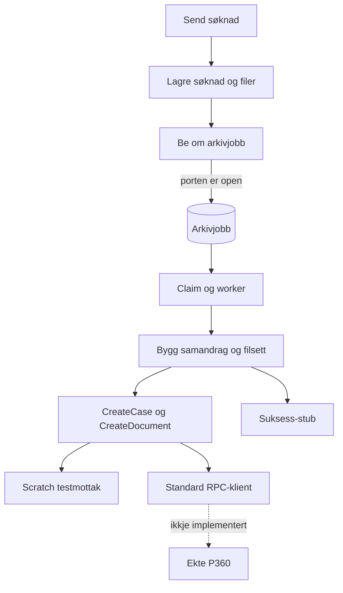

# P360: frå innsending til arkivjobb

Denne gjennomgangen beskriv kjelda på **`P360Test`**, ikkje det som
nødvendigvis finst i `main` eller er installert i eit org. På `main` finst
jobb- og adaptergrunnlaget, men ikkje heile søknadsflyten som er omtalt her.
Den [tidlegare gjennomgangen](../../archive/p360/kodegjennomgang-tidlegare.md)
er bevart for historikk.

## Ein søknad på P360Test

1. [Søknadscontrolleren](https://github.com/navikt/crm-arbeidsforhold/blob/807fdcf12f3f281beb780173d0db427cf7fa0142/force-app/externalApplication/classes/AAREG_ApplicationController.cls)
   lagrar søknad, relasjonar og eventuell ny fil før han ber
   [jobbservicen](https://github.com/navikt/crm-arbeidsforhold/blob/807fdcf12f3f281beb780173d0db427cf7fa0142/force-app/integration/p360/classes/job/P360_ArchiveJobService.cls)
   om ei `ApplicationDocument`-hending.
2. Porten `P360_Archive_Processing` må vere open. Kjeldemetadata set flagget
   til `false`; det seier ikkje kva verdi som er aktiv i ei org.
   Jobbopprettingsfeil blir forsøkt logga utan at innsendinga blir stoppa.
3. Ein open jobb (`Pending`, `In Progress` eller `Failed`) blir gjenbrukt.
   Etter ein `Succeeded`- eller `Manual Review`-jobb kan ei seinare innsending
   få ein ny jobb og ein ny innsendingsnøkkel. Dette er ikkje eit frose
   innsendingssett og dekkjer ikkje alle variantar av ny innsending.
4. [Claim-servicen](https://github.com/navikt/crm-arbeidsforhold/blob/807fdcf12f3f281beb780173d0db427cf7fa0142/force-app/integration/p360/classes/job/P360_ArchiveJobClaimService.cls)
   vel `Pending` og tidsmodne `Failed`-jobbar. Workeren lagar ei førespurnad
   for søknadsdokumentet med
   [byggjaren](https://github.com/navikt/crm-arbeidsforhold/blob/807fdcf12f3f281beb780173d0db427cf7fa0142/force-app/integration/p360/classes/mapper/AAREG_ApplicationArchiveRequestBuilder.cls).
5. Byggjaren lagar eit **tekstsamandrag**, ikkje ein dokumentert komplett
   søknad, og tek siste versjon av alle filer som er knytte til søknaden når
   workeren les. Brukaren sitt lagra filutval og eit uforanderleg
   innsendingssett er ikkje implementert.
6. [Adapteren](https://github.com/navikt/crm-arbeidsforhold/blob/807fdcf12f3f281beb780173d0db427cf7fa0142/force-app/integration/p360/classes/adapter/P360_ArchiveAdapter.cls)
   kan be om `CreateCase` og `CreateDocument` via ein vald RPC-klient.
   Standardklienten kastar framleis «not implemented».

## Andre inngangar

Ein direkte publisert `ContentVersion` kan opprette ein vedleggsjobb;
frigiving av eit vedtak kan opprette ein vedtaksjobb. Dette er ikkje det same
som at all portalopplasting opprettar slik jobb: portalen opprettar fil og
lenkje i separate steg. Workeren byggjer førebels berre komplett førespurnad
for `ApplicationDocument`; dei andre hendingstypane har ikkje tilsvarande
dokumentinnhald i den reelle adapterbana.

Konkret kjelde og avgrensing per inngang finst i
[inngangskartet](kartlegging-av-dagens-flytar.md).

## Kva betyr suksess?

| Resultat                            | Dette kan ein slutte                                        | Dette kan ein ikkje slutte                    |
| ----------------------------------- | ----------------------------------------------------------- | --------------------------------------------- |
| `Succeeded` med suksess-stub        | Adapteren svarte positivt i denne testbana                  | At P360 fekk saka, dokumentet eller filene    |
| Kvittering i scratch-testmottaket   | Den avgrensa simulerte mottakaren lagra kontrollert innhald | At ein ekte P360-server godtek kontrakten     |
| Stadfesta ekstern mottakskvittering | Berre det mottaket og innhaldet faktisk dokumenterer        | Andre utesta scenario eller produksjonsåtferd |

Historiske køyringar ligg i [testloggen](test-log.md). Sjå
[teknisk oversikt](teknisk-oversikt.md) for retry, tryggleiksgrenser og opne
kontraktar, og [verifikasjonsplanen](inngangar-og-verifikasjonsplan.md) for
steg, forventa resultat og evidens.
