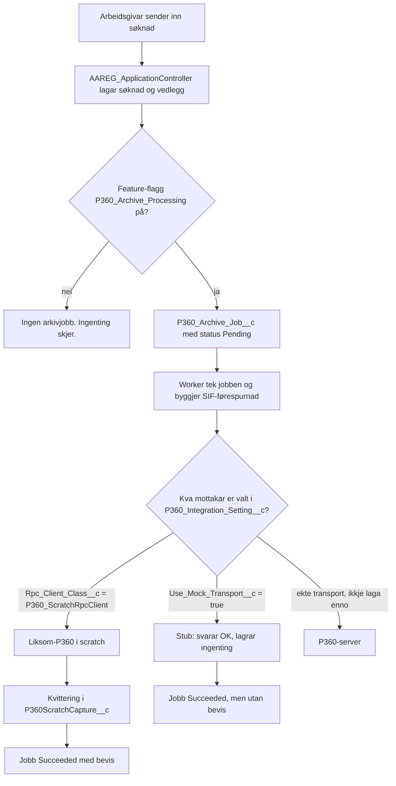
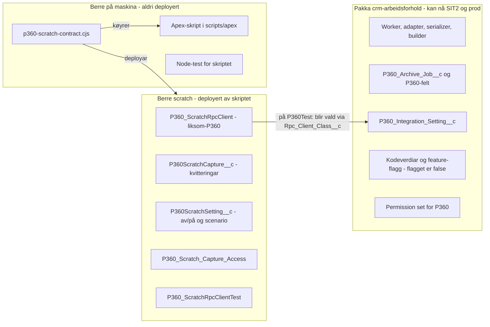
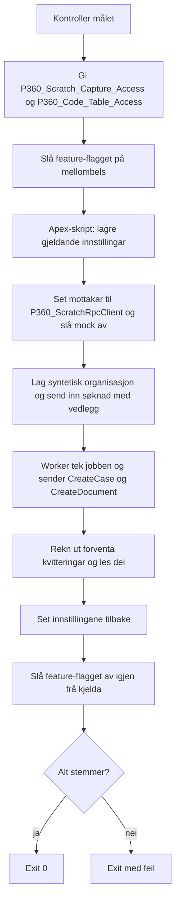

# P360 i scratch-org: brukarguide frå botnen av

Denne guiden forklarer korleis vi testar P360-arkivering utan P360-server, korleis du får tilgang til å sjå dataa, kva som er ein del av pakka og kva som berre finst i scratch, og kvifor ting er laga slik dei er.

På `main` finst scratch-mottakaren og admin-testlaben utanfor pakka.
`verify`, `test`, `regression`, `smoke` og `inspect` testar mottakaren
direkte med syntetiske data; dei sender ikkje inn ein søknad eller aktiverer
P360-transport. Admin-testlaben har eigne kommandoar i punkt 7.5.

Ende-til-ende-testen `e2e` og produktflyten som nyttar han, finst berre på
`P360Test`. Diagram og forklaringar om innsending og val av RPC-klient
nedanfor beskriv denne greina. Historisk scratch-evidens frå `P360Test` er
ikkje bevis for at same flyt finst på `main` eller er installert i orga.

Guiden skil mellom tre typar påstandar:

- **Kjelde:** står i koden eller metadataen i repoet.
- **Verifisert i scratch:** køyrt og kontrollert i `crm-arbeidsforhold` scratch-org, med dato.
- **Ope:** ikkje avgjort eller ikkje laga enno.

Meir teknisk bakgrunn finn du i [scratch-kontrakttest-og-interne-val.md](scratch-kontrakttest-og-interne-val.md). Den guiden du les no, er inngangen.

## 1. Kort fortalt

1. På `P360Test` ber innsending om ein **arkivjobb** dersom prosesseringsporten er open. Jobboppretting kan feile utan at innsendinga blir stoppa.
2. Ein **worker** (eit Apex-program som køyrer i bakgrunnen) tek jobben, byggjer ein førespurnad i P360-formatet (SIF) og sender han vidare.
3. I eit ekte miljø skal førespurnaden gå til P360-serveren. Den delen er ikkje laga enno.
4. I scratch kan vi sende syntetiske førespurnader til ein **liksom-P360** som heiter `P360_ScratchRpcClient`. Han sjekkar at førespurnaden ser rett ut og lagrar han som ein post i objektet `P360ScratchCapture__c`. Vi kallar posten ei **kvittering**.
5. Ei kontrollert kvittering viser kva testmottaket fekk i den konkrete
   køyringa. Ho viser ikkje at ein ekte P360-server har motteke noko, eller at
   alle scenario og alle søknadsfelt er dekte.
6. Mottakartestane blir styrte av `scripts/p360-scratch-contract.cjs`: `npm run p360:scratch -- <modus>` på macOS, Linux og Windows. `e2e` krev `P360Test`.

## 2. Ord du treng

| Ord                     | Enkel forklaring                                                                                                                          |
| ----------------------- | ----------------------------------------------------------------------------------------------------------------------------------------- |
| Scratch-org             | Ei mellombels Salesforce-org for utvikling. Målet her er `crm-arbeidsforhold`; bruk berre syntetiske testdata.                            |
| Pakke                   | `crm-arbeidsforhold` er ei «unlocked package» med kjelde under `force-app/`. Pakkekonfigurasjon og ignore-reglar avgjer kva som blir med. |
| Deploy                  | Å sende metadata (kode, felt, oppsett) frå maskina di til ei org.                                                                         |
| Permission set          | Ein «tilgangspakke» du kan gi til ein brukar. Han seier kva objekt, felt, faner og klassar brukaren får bruke.                            |
| FLS (feltnivåtryggleik) | Tilgang til eitt felt. Effektiv handheving avheng av brukartilgang og korleis koden les eller skriv feltet.                               |
| Sharing                 | Kva _postar_ (rader) du får sjå. Det er noko anna enn felttilgang.                                                                        |
| Custom setting          | Ein innstillingstabell i orga. Vi bruker han for å slå mock av og på og velje mottakar.                                                   |
| Custom metadata (CMDT)  | Konfigurasjon som blir deployert som metadata. Vi bruker han til P360-kodeverdiar og feature-flagg.                                       |
| Feature-flagg           | Ein av/på-brytar. `P360_Archive_Processing` må vere på for at arkivjobbar skal bli laga.                                                  |
| Mock / stub             | Ein falsk mottakar som alltid svarar «OK». Han lagrar ingenting.                                                                          |
| RPC-klient              | Den delen av koden som faktisk sender førespurnaden. Vi kan byte han ut via konfigurasjon.                                                |
| SIF                     | Formatet P360 bruker. Det er beskrive i SIF-API-dokumentet frå P360-teamet.                                                               |
| Kvittering              | Ein `P360ScratchCapture__c`-post som viser kva liksom-P360 tok imot.                                                                      |

## 3. Det store bildet på `P360Test`



Testen bruker produktkoden som er installert i det aktuelle scratch-orget,
men byter ut siste mottakarledd. Ei grøn køyring beviser berre dei konkrete
stega og det innhaldet som faktisk er kontrollerte i den køyringa.
På `main` testar `verify` mottakaren direkte og lagar ikkje ein arkivjobb.

## 4. Kvifor vi valde slik

### 4.1 Kvifor ikkje berre bruke mocken som fanst frå før?

Mocken (`Use_Mock_Transport__c = true`) svarar alltid «OK» og lagrar ingenting. Då blir jobben grøn sjølv om førespurnaden er tom eller feil.

Dette skjedde faktisk på `P360Test`: det første ende-til-ende-forsøket gav jobbstatus `Succeeded`, men null kvitteringar. Mocken hadde «vunne» over den konfigurerte mottakaren. Difor:

- slår skriptet mocken av medan testen køyrer og på igjen etterpå
- krev skriptet at kvitteringane finst, ikkje berre at jobben er grøn.

### 4.2 Kvifor byte ut nettopp RPC-klienten?

På `P360Test` er RPC-klienten det siste steget før nettverket. Ende-til-ende-testen kan dermed følgje
innsending, jobb, worker og oppbygging av SIF-førespurnaden. Kontroller
evidensen for kva dokumentinnhald og vedlegg det enkelte scenarioet faktisk
dekkjer.

På `P360Test` blir mottakaren vald med tekstfeltet `Rpc_Client_Class__c`.
Adapterfabrikken på `main` brukar ikkje dette feltet til å velje
scratch-mottakaren; der blir mottakaren testa direkte.

### 4.3 Kvifor er ting konfigurerbare?

Vi tek vala sjølv no, utan svar frå P360-teamet. Vala må vere lette å endre seinare. `Rpc_Client_Class__c` og `External_System__c` i tabellen finst berre på `P360Test`.

| Kva                                              | Kvar det blir endra                                   | Døme                                                 |
| ------------------------------------------------ | ----------------------------------------------------- | ---------------------------------------------------- |
| Kodeverdiar (sakstype, arkivkode, kategori o.l.) | CMDT `P360_Code_Table_Value__mdt`                     | Endre ein kode når P360-teamet stadfestar rett verdi |
| Kva system vi seier vi er                        | `External_System__c` på `P360_Integration_Setting__c` | `Scratch P360` i scratch                             |
| Kva mottakar som blir brukt                      | `Rpc_Client_Class__c` på same innstilling             | `P360_ScratchRpcClient`                              |
| Mock av eller på                                 | `Use_Mock_Transport__c`                               | `true` i scratch som standard                        |
| Arkivering i det heile                           | Feature-flagget `P360_Archive_Processing`             | `false` i kjelda                                     |

### 4.4 Kvifor ligg liksom-P360 utanfor pakka?

Liksom-P360 er eit testverktøy. Han skal aldri hamne i SIT2 eller produksjon. Difor ligg han under `scripts/scratch/p360/`, som ikkje er ein pakkemappe.

Han har i tillegg tre sperrer:

1. Han nektar å køyre om orga ikkje har eit `.scratch.my.salesforce.com`-domene og `IsSandbox = true`.
2. Han gjer ingenting før nokon har slått han på med `P360ScratchSetting__c.Enabled__c`.
3. Han gjer aldri nettverkskall (`callouts = 0` blir sjekka).

### 4.5 Kvifor les workeren på `P360Test` søknaden med `without sharing`?

Workeren køyrer som ein teknisk brukar. Den brukaren eig ikkje søknaden, og sharing gjer at han ikkje ser han.

Vi prøvde først `WITH SYSTEM_MODE`. Det hoppar over felttilgang, men ikkje sharing når klassen er `with sharing`. Resultatet var «Application archive source is unavailable».

Løysinga er ein liten privat lesar, `ArchiveSourceReader`, inne i `AAREG_ApplicationArchiveRequestBuilder`. Han:

- les berre den eine søknaden jobben peikar på, og vedlegga til han
- kan ikkje kallast frå andre klassar.

Alternativet var å gi den tekniske brukaren «View All» på søknader, tilgangsførespurnader og filer. Det gir mykje breiare tilgang til persondata.

> Dette er tilgangskode (raud sone). Ho må gjennomgåast av eit menneske og ha ein tryggleiksgjennomgang før commit eller PR.

### 4.6 Kvifor eit skript, og kvifor i Node.js?

Du kunne i prinsippet skrive alle kommandoane sjølv. Skriptet finst fordi det gjer fem ting som er lette å gløyme eller gjere feil:

1. **Sjekkar målet.** Det krev ein uavhengig verifisert org-ID i `AAREG_SCRATCH_ORG_ID`, kontrollerer lokal scratch-identitet og domene, og sjekkar at orga svarar med same ID og `IsSandbox = true`. Eit alias åleine er ikkje bevis.
2. **Set saman det som berre skal til scratch.** Liksom-P360 og testklassen hans ligg på to ulike stader og skal ikkje med i pakka. Skriptet kopierer dei til ei mellombels mappe og deployar berre dei.
3. **Gjer ting Apex ikkje kan.** Deploy av metadata og tildeling av permission set blir gjort med Salesforce CLI. Berre `e2e` på `P360Test` slår feature-flagget på mellombels.
4. **Ryddar opp sjølv om noko feilar.** Mellombelse filer blir sletta til slutt. I `e2e` på `P360Test` blir feature-flagget sett tilbake til `false` frå kjelda i ein `finally`-blokk.
5. **Avgjer bestått eller ikkje.** Skriptet les JSON-svaret frå `sf` og avsluttar med feil om noko ikkje stemmer, til dømes om det manglar kvitteringar. Du slepp å tolke lange loggar sjølv.

**Kvifor Node.js og ikkje bash?** Den første versjonen var eit bash-skript (`.sh`). Det fungerer ikkje på Windows utan ekstra verktøy, og det trong `jq` og `shasum` i tillegg. Vi vurderte tre løysingar:

| Løysing                                                | Fordel                                                                                                         | Ulempe                                                        |
| ------------------------------------------------------ | -------------------------------------------------------------------------------------------------------------- | ------------------------------------------------------------- |
| Bash + PowerShell, som `bin/create-scratch-org`        | Kjent mønster i repoet                                                                                         | To skript som må haldast like. Lett at dei glir frå kvarandre |
| Berre bash, Windows-brukarar bruker WSL eller Git Bash | Ingen ny kode                                                                                                  | Krev ekstra installasjon og `sf`-innlogging inne i WSL        |
| **Eitt Node.js-skript (valt)**                         | Same kode på alle plattformer. Node trengst allereie for `npm`, Prettier og Jest, og `sf` køyrer sjølv på Node | Litt lengre kode enn bash                                     |

Skriptet har ingen avhengnader utover Node og `sf`. Hashing, JSON-lesing og mellombelse mapper bruker Node sine innebygde modular.

På Windows er `sf` installert som `sf.cmd`. Node kan berre starte slike filer gjennom `cmd.exe`, så skriptet set kvart argument i hermeteikn. Då blir SOQL og filnamn med mellomrom, som layout-fila, ikkje delte opp.

Skriptet har eigne testar i `scripts/tests/p360-scratch-contract.test.cjs`. Dei bruker ein falsk `sf` og sjekkar:

- at skriptet stoppar mot feil org utan å røre ho
- at `main` avviser `e2e` utan å kontakte ei org
- at mottakartesten feilar ved manglande eller avviste kvitteringar og ved callouts
- at argumenta blir rett siterte på Windows.

Testane blir køyrde med `npm run test:node`.

## 5. Kva er i pakka, og kva er berre i scratch?

Regelen er enkel: **det som ligg under `force-app/`, er i pakka. Det som ligg under `scripts/scratch/`, er ikkje i pakka.** Også testane for scratch-verktøya ligg under `scripts/scratch/`. Grunnen er at CI finn og køyrer alle `@IsTest`-klassar under `force-app/`; ein test der som ikkje blir deploya, ville få CI-valideringa til å feile.



### 5.1 Fullstendig liste

Produktdelane i tabellen viser kjelda på `P360Test`. Innsendingskroken,
request-builderen og felta `Rpc_Client_Class__c` og `External_System__c` er
ikkje del av denne utskiljinga til `main`.

| Del                                                                                              | Stad i repoet                                                                                | Med i pakka?     | Korleis han kjem til scratch                                   |
| ------------------------------------------------------------------------------------------------ | -------------------------------------------------------------------------------------------- | ---------------- | -------------------------------------------------------------- |
| Worker, adapter, serializer, mapperar, builder                                                   | `force-app/integration/p360/classes/`                                                        | Ja               | Vanleg deploy av `force-app`                                   |
| Innsendingskroken                                                                                | `force-app/externalApplication/classes/AAREG_ApplicationController.cls`                      | Ja               | Vanleg deploy                                                  |
| Arkivjobb-objektet og P360-felta på søknad, tilgangsførespurnad, avtale og vedtak                | `force-app/integration/p360/objects/`                                                        | Ja               | Vanleg deploy                                                  |
| `P360_Integration_Setting__c` med `Rpc_Client_Class__c` og `External_System__c`                  | `force-app/integration/p360/objects/P360_Integration_Setting__c/`                            | Ja               | Vanleg deploy. Sjølve _verdiane_ er data og må setjast per org |
| Kodeverdiar (CMDT)                                                                               | `force-app/integration/p360/customMetadata/P360_Code_Table_Value.*`                          | Ja               | Vanleg deploy                                                  |
| Feature-flagg (`false`)                                                                          | `force-app/integration/p360/customMetadata/Feature_Flag.P360_Archive_Processing.md-meta.xml` | Ja               | Vanleg deploy. `e2e` på `P360Test` slår det mellombels på      |
| P360-permission set og -gruppe                                                                   | `force-app/integration/p360/permissionsets/` og `permissionsetgroups/`                       | Ja               | Vanleg deploy. _Tildeling_ er data per org                     |
| Testar for produktkoden, inkludert `P360_CapturingRpcClient`                                     | `force-app/tests/classes/integration/p360/`                                                  | Ja, som testkode | Vanleg deploy                                                  |
| Liksom-P360 (`P360_ScratchRpcClient`)                                                            | `scripts/scratch/p360/classes/`                                                              | Nei              | `npm run p360:scratch -- verify`                               |
| Kvitterings- og innstillingsobjekta, fane, layout, Lightning-side, `P360_Scratch_Capture_Access` | `scripts/scratch/p360/`                                                                      | Nei              | `verify`                                                       |
| Testen for liksom-P360                                                                           | `scripts/scratch/p360/tests/`                                                                | Nei              | `verify`                                                       |
| Apex-skript for smoke; `e2e` berre på `P360Test`                                                 | `scripts/apex/`                                                                              | Nei              | Blir køyrde som anonym Apex, ikkje lagra i orga                |
| Skriptet og testen hans                                                                          | `scripts/`                                                                                   | Nei              | Køyrer berre lokalt                                            |

### 5.2 Kvifor ligg testen for liksom-P360 under `scripts/scratch/`?

Repoet har ein regel om at Apex-testar skal ligge under `force-app/tests/classes/`. Men testen viser til `P360_ScratchRpcClient`, som ikkje finst i pakka. Om han kom med i pakka, ville pakkebygginga feile.

Ei tidlegare løysing la testen under `force-app/tests/` og stengde han ute med `.forceignore`. Det gjekk ikkje: CI-valideringa finn alle `@IsTest`-klassar under `force-app/` med `grep` og ber orga køyre dei, også dei som aldri blir deploya. Testen ligg derfor ved sida av klassen han testar, i `scripts/scratch/p360/tests/`. Skriptet hentar han derifrå.

> Ope: ein vanleg `sf project deploy start --source-dir force-app` tek ikkje med liksom-P360. Det er meininga. Køyr alltid `verify` etter at scratch-orga er ny eller oppretta på nytt.

## 6. Tilgang: korleis du ser dataa

### 6.1 Kva du har no

Verifisert i scratch 2026-11-15: CLI-brukaren i `crm-arbeidsforhold` har profilen System Administrator og desse P360-permission seta:

- `P360_Archive_Job_Processing`
- `P360_Archive_Job_Viewer`
- `P360_Code_Table_Access`
- `P360_Scratch_Capture_Access`

### 6.2 Kva du treng for kva

| Eg vil sjå …                       | Objekt eller stad                                                                                  | Du treng                                               |
| ---------------------------------- | -------------------------------------------------------------------------------------------------- | ------------------------------------------------------ |
| Kvitteringane frå liksom-P360      | Fana **P360 Scratch Captures**                                                                     | `P360_Scratch_Capture_Access` (berre scratch)          |
| Arkivjobbar, status og feilmelding | Fana **P360 Archive Jobs**                                                                         | `P360_Archive_Job_Viewer` (lesetilgang)                |
| Kodeverdiane                       | Setup → Custom Metadata Types → P360 Code Table Value → Manage Records                             | Administrator                                          |
| Feature-flagget                    | Setup → Custom Metadata Types → Feature Flag → Manage Records                                      | Administrator                                          |
| Kva mottakar som er valt           | Setup → Custom Settings → P360 Integration Setting → Manage                                        | Administrator                                          |
| Om liksom-P360 er på, og scenario  | Setup → Custom Settings → P360 Scratch Setting → Manage                                            | Administrator                                          |
| Søknaden og vedlegga               | Søknaden (`Application__c`)                                                                        | Administrator, eller permission set for saksbehandling |
| Saks- og dokumentnummer frå P360   | `P360_Case_Number__c` og `P360_Case_Id__c` på tilgangsførespurnaden, `P360_Document_*` på søknaden | Felttilgang. **Ingen har det i dag**, sjå 6.4          |

### 6.3 Steg for steg: gi deg sjølv permission set

**Med terminalen i VS Code:**

1. Opne terminalen i VS Code (`` Ctrl+` ``).
2. Skaff den uavhengig verifiserte org-ID-en og følg punkt 7.1–7.2. Før
   deploy kontrollerer skriptet den lokalt registrerte scratch-identiteten,
   domenet og orga sitt svar. Alias åleine er ikkje bevis.

    Ikkje bruk `sf org display` som ein rein lokal kontroll: Salesforce CLI
    kan spørje den tilknytte Dev Hub-en for ei scratch-org.

3. Når kontrollen har stadfesta målet, gi deg sjølv tilgangen:

    ```bash
    sf org assign permset --target-org crm-arbeidsforhold --name P360_Archive_Job_Viewer
    sf org assign permset --target-org crm-arbeidsforhold --name P360_Scratch_Capture_Access
    ```

    Får du «Duplicate PermissionSetAssignment», har du det allereie. Det er greitt.

    `P360_Scratch_Capture_Access` finst berre etter at `verify` er køyrd (sjå kapittel 7).

**I nettlesaren:**

1. `sf org open --target-org crm-arbeidsforhold`
2. Setup → Users → klikk namnet ditt.
3. Rull ned til **Permission Set Assignments** → **Edit Assignments**.
4. Flytt `P360 Archive Job Viewer` og `P360 Scratch Capture Access` til høgre → **Save**.

### 6.4 Felta for saks- og dokumentnummer

Verifisert i scratch 2026-11-15: det finst ingen felttilgang (`FieldPermissions`) for `Access_Request__c.P360_Case_Number__c`, `Access_Request__c.P360_Case_Id__c` eller `Application__c.P360_Document_Number__c`. Det gjeld òg System Administrator.

Kjelde: Felta blir heller ikkje fylte ut i dag, fordi tilbakeskriving av saks- og dokumentnummer ikkje er laga. Om du gir deg sjølv tilgang no, ser du difor berre tomme felt.

Vil du likevel sjå felta i scratch, kan du gjere det manuelt (standard Salesforce-steg, ikkje verifisert av oss):

1. Setup → Object Manager → **Access Request** → Fields & Relationships → **P360 Case Number**.
2. **Set Field-Level Security** → kryss av **Visible** for System Administrator → **Save**.
3. Gjer det same for P360 Case Id og felta du treng på **Application**.

Dette er ei manuell endring i scratch og blir ikkje lagra i repoet. Ho forsvinn når orga blir oppretta på nytt.

> Ope: kva permission set i pakka som skal gi lesetilgang til desse felta, må avgjerast saman med tilbakeskrivinga. Det er tilgang til persondata-nære saksreferansar og krev gjennomgang. Vi har med vilje ikkje lagt dette inn i pakka enno.

## 7. Steg for steg: køyr testen

### 7.1 Før du byrjar (ein gong)

1. Du har Salesforce CLI 2.158.7 og Node.js 20 eller nyare. Sjekk med `sf --version` og `node --version`. Køyr `npm install` éin gong i repoet. Alt fungerer i terminalen i VS Code på både macOS og Windows (PowerShell).
2. Kontroller den eksisterande `crm-arbeidsforhold` scratch-orga mot ein uavhengig verifisert org-ID, som i 6.3. Set ID-en i miljøet før du køyrer skripta:

    ```bash
    export AAREG_SCRATCH_ORG_ID="<uavhengig-verifisert-scratch-org-ID>"
    ```

    I PowerShell bruker du:

    ```powershell
    $env:AAREG_SCRATCH_ORG_ID = "<uavhengig-verifisert-scratch-org-ID>"
    ```

    Alias åleine er ikkje nok. Ikkje bruk produksjon, ein Dev Hub eller ei anna org.
    Målkontrollen bruker `sf org list auth`, som les lokalt lagra
    autorisasjonar for fleire orgar og kan utløyse Keychain-førespurnader.
    Stopp dersom slik lokal lesing ikkje er tillaten.

3. Produktkoden er deployert til den verifiserte scratch-orga:

    ```bash
    sf project deploy start --source-dir force-app --target-org crm-arbeidsforhold --test-level NoTestRun
    ```

    Dette sender berre det som er i pakka. Liksom-P360 kjem i neste steg.

### 7.2 Køyr `verify`

```bash
npm run p360:scratch -- verify
```

Dette skjer, i rekkjefølgje:

1. Målet blir kontrollert (scratch, domene, `IsSandbox`).
2. Liksom-P360 blir deployert, først som prøve (dry run), så på ekte.
3. `P360_ScratchRpcClientTest` blir køyrd, og skriptet krev at testen består.
4. Du får `P360_Scratch_Capture_Access`.
5. Første gong blir `P360ScratchSetting__c` laga med `Enabled = true`, `Scenario = Success` og `MaxFileBytes = 1024`.
6. Eit lite smoke-skript sender éi syntetisk sak og eitt syntetisk dokument rett til liksom-P360.
7. Skriptet les kvitteringane og kontrollerer at begge filene kom fram uendra.

Forventa slutt: ei JSON-oppsummering med `persistentReceipts: 2`, og exit-kode 0. Ein jobb i pakka blir _ikkje_ laga i dette steget.

### 7.3 Køyr `e2e` på `P360Test`

Denne modusen finst ikkje på `main`. Han krev ei arbeidskopi av `P360Test`
og den tilhøyrande produktkoden deployert i den verifiserte scratch-orga.

```bash
npm run p360:scratch -- e2e
```

Dette er den ekte prøva frå innsending til «P360»:



Forventa resultat i JSON-utskrifta:

| Felt             | Forventa                 | Kva det betyr                                  |
| ---------------- | ------------------------ | ---------------------------------------------- |
| `simulationOnly` | `true`                   | Ingen ekte P360 var involvert                  |
| `claimedJobs`    | `1`                      | Nøyaktig éin jobb blei teken                   |
| `jobStatus`      | `Succeeded`              | Workeren fullførte                             |
| `receipts`       | 2 stk., begge `Accepted` | CreateCase og CreateDocument kom fram          |
| `filesVerified`  | `2`                      | Søknadsdokumentet og vedlegget kom fram uendra |
| `callouts`       | `0`                      | Ingen nettverkskall                            |

Siste linje skal vere `Archive-processing flag restored from source (Is_Enabled__c=false).`

Historisk verifisert i scratch på `P360Test`: `e2e` bestod med søknad `a0jPw00000rIk4HIAS`, kvitteringane `SCRATCH-000036` (CreateCase) og `SCRATCH-000037` (CreateDocument), `filesVerified = 2` og `callouts = 0`. Etterpå var mock på igjen, mottakarfelta tomme og flagget `false`. Same resultat med Node-skriptet: søknad `a0jPw00000rIlTNIA0`, kvitteringane `SCRATCH-000044` og `SCRATCH-000045`, `filesVerified = 2`, `callouts = 0`, og innstillingane og flagget sette tilbake. Dette er ikkje verifikasjon av utskiljinga på `main`.

### 7.4 Dei andre modusane

| Modus               | Kva han gjer                                                 | Skriv data?                                                                    |
| ------------------- | ------------------------------------------------------------ | ------------------------------------------------------------------------------ |
| `verify`            | Deploy, test, tilgang, smoke og kontroll                     | Ja: liksom-P360 og to syntetiske kvitteringar                                  |
| `test`              | Køyrer berre testen til liksom-P360                          | Nei, Apex-testar rullar tilbake                                                |
| `regression`        | Køyrer testen til liksom-P360 og tre relevante produkttestar | Nei                                                                            |
| `smoke`             | Tilgang, smoke og kontroll, utan deploy                      | Ja: dei to syntetiske kvitteringane første gong, elles berre fleire `Attempts` |
| `inspect`           | Les kvitteringane frå smoke og kontrollerer dei              | Nei                                                                            |
| `e2e` på `P360Test` | Heile vegen frå innsending, sjå 7.3                          | Ja: syntetisk organisasjon, søknad, jobb og kvitteringar                       |

Liksom-P360 gjenkjenner same førespurnad med ein nøkkel (SHA-256 av operasjon, system og identitet). Difor lagar ny køyring av `smoke` ikkje nye kvitteringar. I staden aukar `Attempts`.

Kjem same identitet tilbake med _anna_ innhald, avviser liksom-P360 førespurnaden. Det er med vilje: P360 skal ikkje få to ulike dokument med same identitet.

### 7.5 Admin-testlab

**Ikkje køyr `seed` enno.** Ein eksisterande Flow kan fjerne koplinga
mellom søknaden og den syntetiske kontoen. Ein Apex-regresjonstest er lagd
til, men må køyrast og feilen rettast før testlaben kan brukast trygt.

Etter kontrollen i 7.1 kan du køyre admin-verktøya frå `main`:

```bash
npm run admin:scratch -- verify
npm run admin:scratch -- testlab
```

`verify` prøver og deployerer eksisterande admin-metadata, tildeler
`AAREG_Admin_Viewer` og køyrer dei fire admin-testklassane på `main`.
`testlab` prøver og deployerer scratch-metadata for testlaben og køyrer
Apex-testane hans, utan å opprette varige scenario-data.
Når feilen er retta og testane er verifiserte, vil `seed` deployere
testlaben utanfor pakka, køyre testane hans og lage merkte, syntetiske
data. Scenarioa er `soknad-ny`, `p360-arkivert`, `p360-feila`,
`p360-manuell` og `p360-utgatt-lease`. Etter dagens claim-regel skal desse
jobbane ikkje veljast av workeren.

`inspect` les testlab-data dersom testlaben alt er deployert.
Automatisk `reset` er halden att på `P360Test`:
sletting av ein merkt søknad kan òg slette tilhøyrande vedtak eller endre
andre relasjonar. Identifiser eksakte testdata og alle avhengnader før
eventuell manuell opprydding i scratch. Bruk aldri persondata eller live
P360/Altinn i testlaben.

## 8. Sjå resultatet sjølv

### 8.1 I nettlesaren

1. `sf org open --target-org crm-arbeidsforhold`
2. App Launcher (rutenettet øvst til venstre) → søk etter **P360 Scratch Captures**.
3. Vel ei listevising i nedtrekksmenyen øvst til venstre:

    | Listevising          | Viser                                                    |
    | -------------------- | -------------------------------------------------------- |
    | All Scratch Captures | Alle kvitteringar                                        |
    | Created Cases        | Berre `CaseService/CreateCase`                           |
    | Created Documents    | Berre `DocumentService/CreateDocument`                   |
    | Not Accepted         | Kvitteringar der `Simulated Outcome` ikkje er `Accepted` |

    Alle listevisingane er synlege for alle interne brukarar i scratch. Dei ligg i `scripts/scratch/p360/objects/P360ScratchCapture__c.object` og blir deployerte av `verify`.

4. Opne nyaste post. `Operation` viser CreateCase eller CreateDocument, og `Simulated Outcome` skal vere `Accepted`.
5. Fana **Details** har seks seksjonar:

    | Seksjon                  | Felt                                                                                                                 | Kva du ser                                                                                                                                 |
    | ------------------------ | -------------------------------------------------------------------------------------------------------------------- | ------------------------------------------------------------------------------------------------------------------------------------------ |
    | Summary                  | Operation, Title, Source Record, Simulated Outcome, Simulated P360 Number, Parent Case, Parent Case Number, Attempts | Kva som blei sendt, lenkje med tittel til søknaden eller tilgangsførespurnaden, nummeret liksom-P360 svarte med, og lenkje til saka        |
    | Everything sent to P360  | Everything Sent to P360                                                                                              | **Kvart einaste felt** som blei sendt, éi linje kvar: arkivkode, tilgangskode, tilgangsgruppe, status, kategori, dato, filnamn og storleik |
    | Files                    | File Count, File Details                                                                                             | Kvar fil med format og storleik. Tekstfiler er dekoda, så du kan lese innhaldet                                                            |
    | Identity                 | External System, External Id, Source Record Id, Request Key, Payload SHA256                                          | Identiteten P360 skal kjenne att saka eller dokumentet på                                                                                  |
    | Raw request and response | Synthetic Request Body, Simulated Response Body                                                                      | Rå SIF-JSON, med filene som Base64                                                                                                         |
    | System Information       | Created By, Owner, Last Modified By                                                                                  | Standardfelt                                                                                                                               |

    Øvst på Lightning-sida på datamaskin står ei forklaring som er tilpassa om du ser på ei sakskvittering eller ei dokumentkvittering.

    **Slik heng det saman:**

    ```text
    Sakskvittering → dokumentkvittering → filer
    ```

    - **Sakskvitteringa** viser førespurnaden om å opprette ei liksom-sak og det simulerte svaret.
    - **Dokumentkvitteringa** viser førespurnaden om å legge eit dokument i saka. Ho er ei kvittering, ikkje sjølve fila. Éi dokumentkvittering kan ha fleire filer.
    - **Files** inneheld dei opnbare filene som høyrer til kvitteringa, til dømes søknadsdokumentet og vedlegga.

    **Frå sak til fil:**

    1. Opne ei sakskvittering frå listevisinga **Created Cases**.
    2. Vel **Related** → **Document receipts in this case** og opne ei dokumentkvittering.
    3. Vel **Related** → **Files**. Klikk på ei fil for å opne eller laste ho ned.

    **Files (0)** på sakskvitteringa viser at du ikkje ser nokon filer festa direkte til saka. Dokumentkvitteringane kan likevel ha filer.

    **Frå dokument til sak:** Opne dokumentkvitteringa, vel **Details**, og klikk på **Parent Case**. Dersom feltet er tomt, er kvitteringa ikkje knytt til ei lagra sakskvittering; samanlikn då med **Parent Case Number** og kontroller om saka finst.

    På denne Lightning-sida blir dokumentlista berre vist på ei sakskvittering. Ho blir ikkje vist på dokumentkvitteringar, som ikkje er saker.

    På `main` blir ikkje eldre kvitteringar fylte ut automatisk. Utfylling av historiske kvitteringar er halden att på `P360Test` for tryggleiksvurdering.

    > **Ser du ikkje dei nye seksjonane?** Lightning lagrar layouten i nettlesaren. Etter ein deploy kan sida difor vise den gamle layouten sjølv om du lastar ho på nytt. Logg ut og inn att (eller køyr `sf org open --target-org crm-arbeidsforhold` i eit nytt privat vindauge). Då hentar Lightning layouten på nytt.

6. Etter `e2e` på `P360Test`: App Launcher → **P360 Archive Jobs** for å sjå jobben, status og eventuell feilmelding.
7. Etter `e2e` på `P360Test` finn du søknaden via kontoen som heiter **Syntetisk P360 scratch-organisasjon** og eit tal. `verify` på `main` lagar ikkje ein slik søknad.

### 8.2 I terminalen

```bash
sf data query --target-org crm-arbeidsforhold --query "SELECT Name, Operation__c, Outcome__c, Attempts__c FROM P360ScratchCapture__c ORDER BY Name DESC LIMIT 5"

sf data query --target-org crm-arbeidsforhold --query "SELECT Name, Status__c, Archive_Event_Type__c, Attempt_Count__c, Last_Error_Message__c FROM P360_Archive_Job__c ORDER BY CreatedDate DESC LIMIT 5"

sf data query --target-org crm-arbeidsforhold --query "SELECT Use_Mock_Transport__c FROM P360_Integration_Setting__c"

sf data query --target-org crm-arbeidsforhold --query "SELECT Enabled__c, Scenario__c, MaxFileBytes__c FROM P360ScratchSetting__c"
```

Kommandoane står på éi linje kvar, så dei fungerer både i bash/zsh og i PowerShell. Kontroller målet først, slik som i 6.3, punkt 2.

## 9. Når noko går gale

| Melding                                                              | Kva det betyr                                                                                  | Gjer dette                                                                                                                                                             |
| -------------------------------------------------------------------- | ---------------------------------------------------------------------------------------------- | ---------------------------------------------------------------------------------------------------------------------------------------------------------------------- |
| `STOP: The explicit target is not a locally identified scratch org.` | Alias, uavhengig org-ID eller lokal scratch-identitet stemmer ikkje                            | Kontroller den verifiserte identiteten og `AAREG_SCRATCH_ORG_ID`. Ikkje bruk ei anna org                                                                               |
| `Enable the Success scenario …`                                      | Liksom-P360 er av eller i eit anna scenario                                                    | Kontroller målet og set `Enabled = true` og `Scenario = Success` i P360 Scratch Setting; `verify` overskriv ikkje eksisterande innstillingar                           |
| `Other pending archive jobs exist …`                                 | Det ligg uferdige jobbar. Testen ville ha teke dei òg                                          | Sjå P360 Archive Jobs. Slett eller avslutt dei syntetiske jobbane i scratch                                                                                            |
| `The P360 archive-processing flag must be enabled in scratch.`       | Flagget blei ikkje slått på i `P360Test`-flyten                                                | Køyr `e2e` via skriptet på `P360Test`, ikkje Apex-skriptet åleine                                                                                                      |
| `FAIL: … could not be assigned …`                                    | Permission set-et finst ikkje i orga                                                           | Køyr `verify` (for scratch-settet) eller deploy `force-app`                                                                                                            |
| `WARNING: restore the archive-processing flag manually …`            | Skriptet klarte ikkje å slå flagget av igjen                                                   | Køyr `sf project deploy start --source-dir force-app/integration/p360/customMetadata/Feature_Flag.P360_Archive_Processing.md-meta.xml --target-org crm-arbeidsforhold` |
| Du trykte Ctrl+C under `e2e`                                         | Skriptet stoppar, men set flagget tilbake før det avsluttar                                    | Vent til `Archive-processing flag restored …` eller `WARNING …` blir skrive. Følg i så fall raden over                                                                 |
| Jobb `Succeeded`, men ingen kvitteringar                             | Mocken kan ha vore på og «vunne»                                                               | På `P360Test`, bruk `e2e` som slår mocken av. Stol aldri på jobbstatus åleine                                                                                          |
| `Application archive source is unavailable`                          | Workeren på `P360Test` fann ikkje søknaden                                                     | Sjå 4.5. Sjekk at rett versjon av `force-app` er deployert i scratch                                                                                                   |
| Jobb `Manual Review`                                                 | Feilen kan ikkje rettast ved å prøve om att, t.d. fil utan filending, avvising eller tapt svar | Les `Last_Error_Code__c` og `Last_Error_Message__c` på jobben                                                                                                          |
| Jobb `Failed` med `Next_Attempt_Date__c`                             | Mellombels feil. Jobben kan prøvast om att når forsøket forfell                                | Kontroller om ein scheduler faktisk er sett opp i den aktuelle scratch-orga                                                                                            |

## 10. Scenario du kan prøve

Liksom-P360 har fire scenario i `P360ScratchSetting__c.Scenario__c`:

| Scenario           | Kva liksom-P360 gjer                            | Forventa jobbstatus etter kjelda                                                 |
| ------------------ | ----------------------------------------------- | -------------------------------------------------------------------------------- |
| `Success`          | Godtek og svarar med saks- eller dokumentnummer | `Succeeded`                                                                      |
| `RetryableFailure` | Feilar før han godtek                           | `Failed` med ny forsøkstid, `Manual Review` etter siste forsøk                   |
| `PermanentFailure` | Avviser (`Rejected`, `Successful = false`)      | `Manual Review`                                                                  |
| `UnknownOutcome`   | Godtek, men «mistar» svaret                     | `Manual Review`. Ny create med same identitet blir nekta til nokon har slått opp |

Liksom-P360 i alle fire scenario er dekt av `P360_ScratchRpcClientTest` i kjelda. Historiske testresultat frå `P360Test` verifiserer ikkje den utskilde versjonen på `main`. Jobbstatusen i høgre kolonne kjem frå `classifyFailure` i `P360_ArchiveJobWorker` og er ikkje køyrd ende-til-ende i scratch for andre scenario enn `Success`.

`smoke` og `e2e` krev `Success`. Set scenariet tilbake til `Success` etter manuelle forsøk.

> Ope: Workeren slår ikkje opp med GetCases eller GetDocuments etter `UnknownOutcome` enno. Liksom-P360 støttar oppslaga, men produktkoden bruker dei ikkje.

## 11. Opprydding

- Syntetiske postar, søknader, jobbar og kvitteringar kan bli liggjande i
  scratch. Identifiser dei eksakte testdataa og kontroller avhengnader før
  eventuell sletting; testdata skal ikkje innehalde persondata.
- Ikkje slett `P360ScratchSetting__c` om du ikkje vil at `verify` skal lage han på nytt med standardverdiar.
- Skriptet slettar sine eigne mellombelse filer sjølv.
- Når scratch-orga blir oppretta på nytt, forsvinn alt dette. Køyr då 7.1 og 7.2 på nytt.

## 12. Kva som er ferdig, og kva som manglar

| Område                                                       | Status                                                              |
| ------------------------------------------------------------ | ------------------------------------------------------------------- |
| Innsending ber om arkivjobb                                  | `P360Test`-kjelde; avgrensa historisk scratch-test                  |
| Worker byggjer tekstsamandrag og lenkja filer                | `P360Test`-kjelde; avgrensa historisk scratch-test                  |
| Liksom-P360 som tek imot og lagrar kvitteringar              | Kjelde; avgrensa historisk scratch-test                             |
| Konfigurerbare kodeverdiar og mottakar                       | Kjelde                                                              |
| Tilbakeskriving av saks- og dokumentnummer                   | Saksnummer blir lagra; dokumentnummer står att                      |
| Oppslag etter tapt svar                                      | Ope, ikkje laga i produktkoden                                      |
| Eigen identitet og heilt nytt dokumentsett ved ny innsending | Delvis jobbnøkkel; frose sett og komplett flyt står att             |
| Lagra vedleggsutval i utkastet                               | Ope, ikkje laga. I dag blir alle vedlegg sende                      |
| Innsending som community-brukar                              | Eit avgrensa historisk scratch-probe; breiare verifikasjon står att |
| Ekte HTTP-transport mot P360                                 | Ope, ikkje laga                                                     |
| Felttilgang til saks- og dokumentnummer                      | Ope, sjå 6.4                                                        |

Sjå [#1015](https://github.com/navikt/crm-arbeidsforhold/issues/1015) og [#1018](https://github.com/navikt/crm-arbeidsforhold/issues/1018) for issue-status.

## 13. Les vidare

- [scratch-kontrakttest-og-interne-val.md](scratch-kontrakttest-og-interne-val.md): kva SIF-dokumentet seier, interne val og registrert evidens.
- [sif-api-kontrakter.md](sif-api-kontrakter.md): SIF-kontraktane.
- [kodegjennomgang.md](kodegjennomgang.md): gjennomgang av koden frå trigger til worker.
- [user-testing-guide.md](user-testing-guide.md): den eldre mock-testen.
