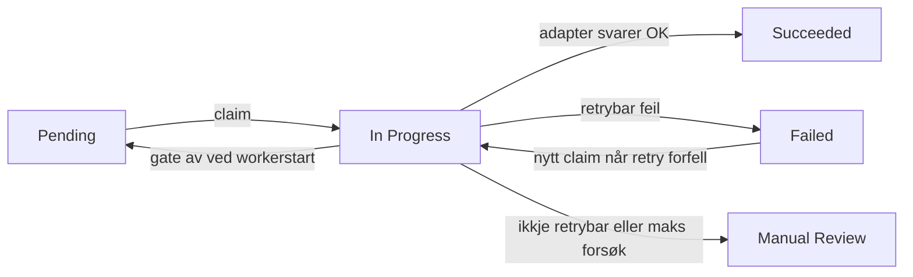

# P360 teknisk oversikt

**Grunnlag:** lokal kjelde på `P360Test`. Funksjonalitet som berre finst på
denne greina er ikkje dokumentasjon på leveranse til `main`, eit org eller
produksjon. [Tidlegare oversikt](../../archive/p360/teknisk-oversikt-2026-11-05.md)
er arkivert.

| Område          | Kjelde på `P360Test`                                                 | Grense                                                                                 |
| --------------- | -------------------------------------------------------------------- | -------------------------------------------------------------------------------------- |
| Innsending      | Controlleren ber om `ApplicationDocument`-jobb etter lagring         | Porten må vere open; feil ved kølegging stoppar ikkje innsendinga                      |
| Dokument        | Worker byggjer tekstsamandrag og siste versjon av lenkja filer       | Ikkje eit komplett, frose søknads- og brukarvalt filsett                               |
| Ny innsending   | Open jobb blir gjenbrukt; etter terminal jobb kan ny nøkkel lagast   | Nytt sett per innsending og trygg handtering av samtidige innsendingar er ikkje bevist |
| Adapter         | `CreateCase` ved behov og `CreateDocument` gjennom `P360_IRpcClient` | Faktisk ekstern kontrakt og HTTP-transport er ikkje stadfesta                          |
| Test            | Stub og scratch-only testmottak er separate val                      | Stub-suksess eller scratch-kvittering er ikkje live-arkivering                         |
| Andre hendingar | Jobbtypar og nokre inngangar finst                                   | Worker manglar dokumentbygging for vedlegg, vedtak og avtale                           |

På `main` finst grunnlag for jobb/claim/worker og adaptergrense, men
søknadscontrolleren har ikkje denne innsendingskoplinga, og adapteren er eit
skjelett. Kontroller alltid aktuell commit og installert versjon før du
bruker denne samanlikninga i ei seinare leveranse.

## Jobbstatus og retry

Claim set ti minutts lease. Ein utgått `In Progress`-lease blir ikkje
automatisk henta opp att av dagens claim-query, og manuell frigiving er ikkje
ein implementert standardhandling. Retry-planen i workeren har maks fem
forsøk; ikkje anta sikker ekstern retry etter eit ukjent utfall.

## Kontraktgrensa mot SIF

Lokale DTO-ar, serialisering, førebels kodeverk og eit simulert testmottak
er ikkje ein godkjend miljøkontrakt. SIF-endepunkt, autentisering, obligatorisk
mapping, kodeverdiar, fil- og storfilstrategi, feilkodar, duplikathandtering
og recovery må avklarast og testast med P360-eigar før live bruk.
Sjå [SIF-operasjonane](sif-rpc-operasjonar.md) og
[vedleggsutval og innsendingsidentitet](vedleggsutval-og-innsendingsidentitet-design.md).

## Logging og neste kopling

Kølegging og workerforsøk har eigne feilbaner og korrelasjonsfelt.
Køleggingsfeil skal ikkje tolkast som arkivsuksess, sjølv om søknaden blir
sendt. Kontroller både jobbar og relevant logg, utan å kopiere persondata
eller payloads til Issues. Full sporbarheit, ukjende eksterne utfall og
forsvarleg oppfølging krev vidare verifikasjon.

Innsyn i søknad og filer for workeren nyttar ein avgrensa
`without sharing`-/systemmodus-lesar. Dette er tilgangskritisk kode som krev
menneskeleg gjennomgang; ei lokal simulering beviser ikkje effektiv
org-autorisasjon.

## Vidare lesing

- [Kodegjennomgang](kodegjennomgang.md)
- [Inngangar og verifikasjonsplan](inngangar-og-verifikasjonsplan.md)
- [Scratch-kontrakttest](scratch-kontrakttest-og-interne-val.md)
- [P360 datamodell og målreglar](../../architecture/p360-data-model-og-arkiveringsjob.md)
