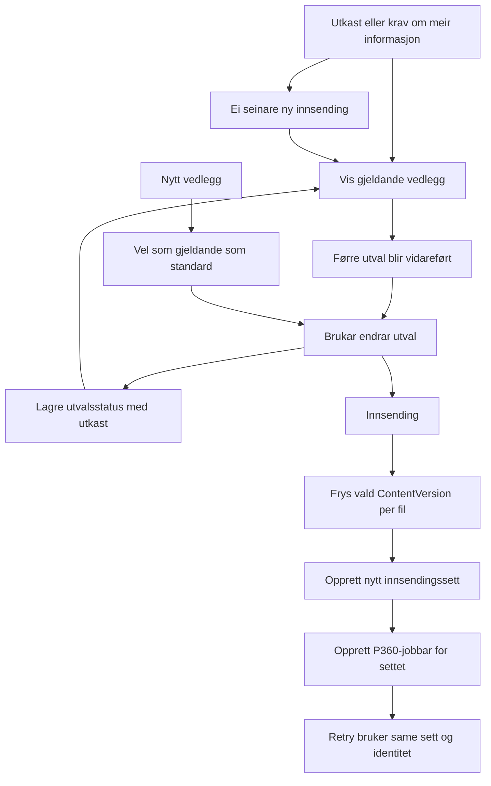

# P360 vedleggsutval og innsendingsidentitet

**Beslutningsstatus:** Produktregelen for vidareføring av vedlegg er avklart.
Modell, Salesforce-kontrakt og ekstern P360-representasjon er framleis forslag
og må godkjennast før implementering. Dokumentet viser kjeldeanalyse, ikkje
org-verifisert åtferd.

Kjeldelenkjene i analysen viser til den undersøkte `P360Test`-versjonen.
Ho er ikkje nødvendigvis lik `main`.

## Avklart produktåtferd

Ved ny innsending etter krav om meir informasjon skal eit komplett nytt
dokumentsett arkiverast. Brukaren stadfesta denne standarden for vedleggsutvalet:

- Vedlegg som var markerte som gjeldande, blir førte vidare.
- Nye vedlegg blir markerte som gjeldande som standard.
- Brukaren kan endre utvalet før innsending.
- Endringar i filutvalet skal lagrast saman med utkastet og gjenopprettast ved
  navigasjon eller oppfrisking.
- For eldre søknader utan lagra utval blir alle eksisterande vedlegg
  førehandsvalde; brukaren kan fjerne utdaterte filer.

«Siste ContentVersion per valt ContentDocument ved innsending» er eit godt
arbeidsutgangspunkt, men er ikkje stadfesta som endeleg P360-kontrakt.

## Kjeldeåtferd i repoet

- [Søknadsskjemaet](https://github.com/navikt/crm-arbeidsforhold/blob/807fdcf12f3f281beb780173d0db427cf7fa0142/force-app/externalApplication/lwc/aareg_application/aareg_application.js)
  les éi ny fil inn i `fileData` og sender berre denne fila til
  `saveAsDraft` eller `processApplication`.
- [Skjemamarkupen](https://github.com/navikt/crm-arbeidsforhold/blob/807fdcf12f3f281beb780173d0db427cf7fa0142/force-app/externalApplication/lwc/aareg_application/aareg_application.html)
  viser tidlegare vedlegg gjennom `c-record-files-with-sharing` med
  `is-get-all="true"` og `is-delete-option="false"`. Forelderen får ikkje eit
  filutval frå denne komponenten. Ingen lokal komponentimplementasjon vart
  funnen i repoet.
- [AAREG_ApplicationController](https://github.com/navikt/crm-arbeidsforhold/blob/807fdcf12f3f281beb780173d0db427cf7fa0142/force-app/externalApplication/classes/AAREG_ApplicationController.cls)
  opprettar `ContentVersion` utan eksplisitt `FirstPublishLocationId`, og
  opprettar `ContentDocumentLink` etterpå. Innsending utan nye fildata
  opprettar ikkje ein ny filversjon i denne controlleren.
- [P360_ContentVersionArchiveHandler](https://github.com/navikt/crm-arbeidsforhold/blob/807fdcf12f3f281beb780173d0db427cf7fa0142/force-app/integration/p360/classes/P360_ContentVersionArchiveHandler.cls)
  opprettar vedleggsjobb berre når ein ny `ContentVersion` blir sett inn med
  `FirstPublishLocationId` direkte på `Application__c` og prosesseringsporten er
  open. Dette er ikkje same inngang som portalopplastinga.
- [P360_ArchiveJobService](https://github.com/navikt/crm-arbeidsforhold/blob/807fdcf12f3f281beb780173d0db427cf7fa0142/force-app/integration/p360/classes/job/P360_ArchiveJobService.cls)
  og [P360_IdempotencyKey](https://github.com/navikt/crm-arbeidsforhold/blob/807fdcf12f3f281beb780173d0db427cf7fa0142/force-app/integration/p360/classes/job/P360_IdempotencyKey.cls)
  gjenbruker ein open søknadsjobb, men kan lage ein ny innsendingsnøkkel etter
  at førre jobb har fått terminal status. Vedleggsnøkkelen er per søknad og
  ContentVersion. Koden lagrar ikkje eit frose filsett for kvar innsending.

Desse funna er statisk kjeldeanalyse. Dei dokumenterer ikkje effektiv
org-konfigurasjon, P360-transport eller ekstern arkiveringsåtferd.

## Føreslått kontrakt

1. **Stabil policy i Custom Metadata.** Metadata kan styre stabile reglar, til
   dømes tillatne/obligatoriske dokumentkategoriar og standardval per
   søknadstype. Metadata skal ikkje lagre kva konkrete filer ein brukar har
   valt; det er runtime-data.
2. **Utval før innsending.** Søknadsflata viser tidlegare vedlegg og førre
   innsendte utval. Dette utvalet blir ført vidare, nye vedlegg blir valde som
   gjeldande, og brukaren kan endre det før innsending. For eldre søknader utan
   lagra utval er alle eksisterande vedlegg valde som standard. Endringane blir
   lagra saman med utkastet og gjenoppretta ved navigasjon eller oppfrisking.
3. **Frose innsendingssett.** Ved ei akseptert innsending blir eit nytt,
   uforanderleg innsendingssett oppretta. Det inneheld søknadsidentiteten og
   nøyaktig éin vald `ContentVersion` per valt `ContentDocument`. Endringar i
   søknaden eller nye filversjonar etter innsending endrar ikkje det gamle
   settet.
4. **Skil innsending frå retry.** Ei ny innsending får ny stabil identitet,
   sjølv om filane har same versjonar som før. Retry av same innsending bruker
   same identitet, frosne sett og idempotensnøklar. Ein tilfeldig ny nøkkel per
   forsøk er ikkje tilstrekkeleg.
5. **Arkiver berre frå snapshot.** P360-mapping og jobboppretting skal lese det
   frosne settet, ikkje den seinare, muterbare søknads- eller fillista.
   Salesforce-transaksjonen skal opprette snapshot og interne jobbar; ekstern
   transport skal skje asynkront.

### Caller-kontrakt som må realiserast

- Innsendingsgrensa må få den valde fillista frå brukarflata og validere at
  kvar fil framleis høyrer til søknaden og er tillaten av gjeldande policy.
- Serveren må slå opp og fryse aktuell `ContentVersion` for kvar vald fil på
  innsendingstidspunktet. Manglande, utilgjengelege eller ugyldige val skal gi
  ein synleg feil; dei skal ikkje droppast stille.
- Innsendingen må opprette eitt identitetsberande snapshot og arkivjobbar som
  peikar på det. Delvis feil må ikkje presenterast som samla arkivsuksess.
- Uinnsendte endringar i filutvalet må overleve lagring av utkast, navigasjon og
  oppfrisking. Konkret Salesforce-recordmodell, CRUD/FLS, sharing og migrering
  av eksisterande vedlegg er ikkje avgjort.
- Kvar unik innsending må kunne skiljast frå retry også etter timeout eller
  tapt svar. Nøyaktig request-token-/resume-mekanisme må avklarast og testast.
- Gjeldande kode oppdaterer søknaden på staden. Om sjølve søknadsinnhaldet skal
  frysast som data, P360-dokumentmetadata eller ei anna representasjon, krev
  godkjend mapping og ligg utanfor denne avgjerda.
- [AAREG_ApplicationController](https://github.com/navikt/crm-arbeidsforhold/blob/807fdcf12f3f281beb780173d0db427cf7fa0142/force-app/externalApplication/classes/AAREG_ApplicationController.cls)
  er `without sharing`. Ein ny innsending må derfor validere søknadstilgang,
  at kvar ContentDocument er lenka til rett søknad, og at brukaren kan endre
  utvalet; validering av berre innsendte Salesforce-ID-ar er ikkje nok.

## Kandidat for Salesforce-datamodell

Dette er eit arkitekturforslag, ikkje godkjende API-namn eller metadata.
`force-app` er eitt `crm-arbeidsforhold`-package. Søknadsutval og
innsendingsidentitet høyrer til søknadsdomenet; `P360_Archive_Job__c` og
integrasjonsspesifikke felt held fram under `integration/p360`.

| Ansvar                             | Føreslått rekordrolle                                                                        | Livsløp                                                             |
| ---------------------------------- | -------------------------------------------------------------------------------------------- | ------------------------------------------------------------------- |
| Gjeldande filutval                 | Søknadsforankra filtilknyting med ei gjeldande-markering per ContentDocument                 | Endrast saman med utkast; eldre filer startar som valde             |
| Innsendingsidentitet               | Éin innsendingsrekord per akseptert submit, med unik request-nøkkel                          | Opprettast ein gong; same nøkkel finn att same innsending ved retry |
| Frose filsett og P360-prosessering | Eksisterande P360-jobbar utvida med innsendingstilknyting og eksakt ContentVersion-identitet | Kjeldefil/innsending er uendra; status, lease og retry kan endrast  |

Dette held tre ulike ting skilde: redigerbart brukarval, uforanderleg
innsendingsgrunnlag og muterbar teknisk jobblivssyklus. Jobbservicen kan då
gruppere alle dokumenthendingane under innsendinga, medan idempotensnøklane
bruker innsendinga i staden for berre søknads-ID-en. Den eksisterande
`ApplicationDocument`-mappinga må framleis avklare korleis søknadsinnhaldet
blir representert og frosen.

Ei enklare løysing som berre legg eit nytt tidsstempel eller ein ny
korrelasjons-ID i dagens jobbnøkkel er forkasta: ho grupperer ikkje eit komplett
sett og tryggar ikkje retry etter tapt svar. Filtilknytinga må identifisere
ContentDocument per søknad; eksakte Salesforce-felttypar og CRUD/FLS/sharing
må verifiserast før metadata blir oppretta.

## Eksisterande test-sømmer

- [AAREG_ApplicationControllerTest](https://github.com/navikt/crm-arbeidsforhold/blob/807fdcf12f3f281beb780173d0db427cf7fa0142/force-app/externalApplication/classes/AAREG_ApplicationControllerTest.cls)
  testar den offentlege Apex-grensa; `shouldLinkUploadedFileToApplicationAndAccessRequest`
  kontrollerer dagens lenking av ei ny fil til søknad og tilgangsførespurnad.
  Han testar ikkje vedleggsutval eller gjenoppretting av utkastval.
- [P360_ContentVersionArchiveHandlerTest](https://github.com/navikt/crm-arbeidsforhold/blob/807fdcf12f3f281beb780173d0db427cf7fa0142/force-app/tests/classes/integration/p360/P360_ContentVersionArchiveHandlerTest.cls)
  testar direktepublisering til søknad. Han testar ikkje portalens
  controllerstyrte opplasting.
- [P360_ArchiveJobServiceTest](https://github.com/navikt/crm-arbeidsforhold/blob/807fdcf12f3f281beb780173d0db427cf7fa0142/force-app/tests/classes/integration/p360/job/P360_ArchiveJobServiceTest.cls)
  testar jobboppretting og gjenbruk. Testar av jobbnøkkel er ikkje i seg sjølve
  bevis på at eit komplett, uforanderleg filsett er arkivert for kvar
  innsending eller at timeout/retry er trygg mot P360.
- Ingen lokal Jest-testmappe vart funnen for `aareg_application`; ny
  filutvalsflate treng ein fokusert LWC-test og ei Apex-test gjennom den
  brukarvendte innsendinga.

## Designval

| Alternativ                                                          | Fordelar / trade-off                                                                                                                                                                       |
| ------------------------------------------------------------------- | ------------------------------------------------------------------------------------------------------------------------------------------------------------------------------------------ |
| Brukarstyrt utval, med vidareføring og nye filer valde som standard | Synleggjer kva som inngår, handterer gamle og nye vedlegg, og reduserer risikoen for å arkivere utdaterte filer. Krev lagring av utvalsstatus og eit snapshot per innsending. **Tilrådd.** |
| Automatisk arkivering av alle filer etter Custom Metadata-reglar    | Mindre brukarinteraksjon og enklare portalflate, men metadata kan ikkje uttrykkje den konkrete, endrande fillista for éi søknad. Risiko for at irrelevante eller utdaterte filer blir med. |

Custom Metadata bør difor avgrensast til stabile reglar og standardval.
Faktisk filval høyrer til søknadsdata og det frosne innsendingssettet.

## Testkrav for ei seinare TDD-slice

1. Opne ei eldre søknad utan lagra utval, med fleire vedlegg; kontroller at alle
   eksisterande vedlegg blir førehandsvalde og kan veljast bort.
2. Opne ei søknad med tidlegare innsendt utval og eit nytt vedlegg; kontroller at
   førre utval blir førehandsvalt og det nye vedlegget blir valt som standard.
3. Endre utvalet, lagre utkastet, naviger bort eller oppfrisk sida, og kontroller
   at det endra utvalet blir gjenoppretta.
4. Send inn; kontroller at kvar vald fil får gjeldande `ContentVersion` fryst,
   og at fråvalde filer ikkje er med.
5. Opprett ein ny versjon av ei vald fil etter innsending; kontroller at det
   første settet framleis peikar på den opphavlege versjonen.
6. Send inn etter krav om meir informasjon; kontroller at førre utval blir
   vidareført, nye vedlegg er valde som standard, og brukarendringar blir tekne
   med i eit komplett nytt sett.
7. Retry same innsending etter eit simulert timeout/ukjent svar; kontroller at
   same snapshot og jobbar blir gjenbrukte, utan eit tredje sett.
8. Køyr ein ny innsending med same filer; kontroller at ho får ny identitet og
   ikkje blir forveksla med retry.
9. Test ugyldig eller fråkopla fil, manglande `ContentVersion`, tomt utval når
   policy krev vedlegg, delvis jobbfeil og manglande tilgang.
10. Test servergrensa under ein minimumstilgangsbrukar når åtferda ikkje krev
    privilegert tilgang. LWC-testen skal kontrollere at endringar i utval og
    innsending blir sende gjennom same offentlege brukargrense.

Ingen av desse testane er køyrde for dette designnotatet.

## Opne avgjerder

- Nøyaktig Salesforce-modell for gjeldande utval og immutable snapshot, og
  eigarskap mellom søknadsdomenet og P360-jobbmetadata.
- Korleis vedvarande filutval blir lagra og kontrollert med CRUD/FLS, sharing og
  eksisterande vedlegg.
- Korleis same innsending blir funnen att ved retry etter timeout eller
  sideoppfrisking.
- Kategoriar, filtypar, obligatoriske dokument og metadatareglar per
  søknadstype.
- P360/SIF-kontrakt for eit nytt komplett sett, dokumentversjonar,
  duplikatidentitet og lagring av resultatreferansar.
- Kva søknadsdata P360 skal motta saman med vedlegga.
- Endeleg dataminimerings-, tilgangs- og retention-vurdering.

Sjå òg [inngangar og verifikasjonsplan](inngangar-og-verifikasjonsplan.md) og
[P360 datamodell og arkiveringsjobb](../../architecture/p360-data-model-og-arkiveringsjob.md).
