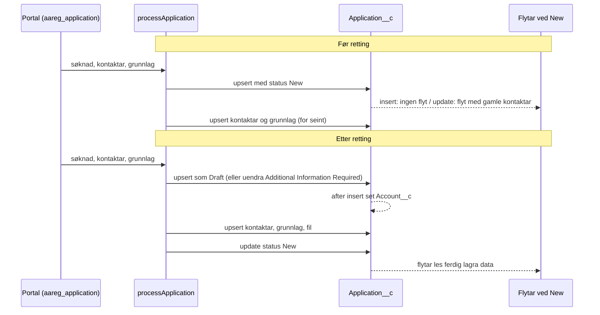

# Feilrapport: kontakt og e-post blir ikkje kopla til søknaden

| Felt         | Verdi                                                                                      |
| ------------ | ------------------------------------------------------------------------------------------ |
| Dato         | 2026-11-17                                                                                 |
| Grein        | `fix/kontaktkopling-ved-innsending` (frå `main`)                                           |
| Område       | Ekstern søknad (`AAREG_ApplicationController.processApplication`) og innsendingsflytane    |
| Status       | Retta og verifisert i scratch-org `crm-arbeidsforhold`. Ikkje verifisert i SIT eller PROD. |
| Verifisering | [Testguide for SIT og PROD](../testing/kontaktkopling-verifisering-sit-prod.md)            |

## Samandrag

Når ein søkjar sende inn ein **ny søknad direkte**, utan å lagre utkast
først, blei søkjaren ikkje kopla til søknaden som kontakt (`Contact__c` var
tom). Same innsending fekk heller ikkje stadfestings-e-post i kø, generert
søknadstekst (`AA_register_application_text__c`) eller svarfrist
(`ApplicationDeadlineForReply__c`).

Når ein søkjar sende inn **frå eit lagra utkast** og hadde endra e-posten til
ein varslingskontakt, fekk den genererte søknadsteksten den **gamle**
e-postadressa.

Begge feila hadde same rotårsak: Apex sette innsendingsstatus på søknaden
**før** kontaktar og grunnlag var lagra. Rettinga lagrar alle data først og
endrar status til slutt i ein eigen DML.

## Symptom

| Innsending             | Observert før retting                                                                                         |
| ---------------------- | ------------------------------------------------------------------------------------------------------------- |
| Ny søknad, direkte     | `Contact__c` tom, `IsEmailConfirmationSent__c = false`, ingen `EmailQueue__c`, tom søknadstekst og svarfrist. |
| Frå utkast             | `Contact__c` og stadfesting OK, men søknadsteksten viste varslingskontaktane slik dei var i utkastet.         |
| Etter meir informasjon | Ingen endring i åtferd. Kontakt og stadfesting blir ikkje oppretta på nytt.                                   |

`Email__c` på søknaden og `RelatedContact__c` blei lagra rett i alle tilfelle.
Det var koplinga og avleidde felt som feila, ikkje sjølve lagringa.

## Rotårsak

To record-triggered after-save-flytar køyrer berre når `Casehandler_Status__c`
**blir endra til** `New` ved ei **oppdatering**:

| Flyt                                                                                                                                    | Trigger                                 | Gjer                                                                                            |
| --------------------------------------------------------------------------------------------------------------------------------------- | --------------------------------------- | ----------------------------------------------------------------------------------------------- |
| [AAREG_createContactSendConfirmation](../../force-app/main/default/flows/AAREG_createContactSendConfirmation.flow-meta.xml)             | Update, `New`, kontakt tom, ikkje sendt | Finn/opprettar `Contact` på `Account__c` + `Email__c`, set `Contact__c`, legg stadfesting i kø. |
| [AAREG_populateApplicationFieldAfterSubmit](../../force-app/main/default/flows/AAREG_populateApplicationFieldAfterSubmit.flow-meta.xml) | Update, `New`                           | Les `RelatedContact__c` og grunnlag, byggjer søknadstekst og svarfrist.                         |

I tillegg set [AAREGApplicationAfterInsertPopulateApplicationFields](../../force-app/main/default/flows/AAREGApplicationAfterInsertPopulateApplicationFields.flow-meta.xml)
`Account__c` frå `AccountId__c` **etter** innsetting. Portalen sender berre
`AccountId__c`.

Den gamle `processApplication` gjorde dette i éin operasjon:

1. Set `Status__c` og `Casehandler_Status__c` til `New`.
2. `upsert` søknaden.
3. `upsert` varslingskontaktar og grunnlag.

**Direkte innsending:** Søknaden blei **oppretta** med `New`. Ei innsetting
er ikkje ei oppdatering, så ingen av dei to flytane starta. Den seinare
oppdateringa av `Account__c` endra ikkje status og starta dei heller ikkje.

**Frå utkast:** Statusen gjekk frå `Draft` til `New` i steg 2, så flytane
køyrde, men **før** steg 3. Teksten blei bygd frå kontaktane som låg lagra i
utkastet.

## Kva er endra

| Fil                                                                                                                    | Endring                                                                                                                                                                                                                                                                                   |
| ---------------------------------------------------------------------------------------------------------------------- | ----------------------------------------------------------------------------------------------------------------------------------------------------------------------------------------------------------------------------------------------------------------------------------------- |
| [AAREG_ApplicationController.cls](../../force-app/externalApplication/classes/AAREG_ApplicationController.cls)         | `processApplication` lagrar først søknaden utan innsendingsfelt (`Draft`, eller uendra `Additional Information Required`), deretter kontaktar, grunnlag og fil, og gjer statusovergangen i ein eigen `update`. Statusfelta må vere skrivbare; mellombels status går gjennom FLS-filteret. |
| [AAREG_ApplicationControllerTest.cls](../../force-app/externalApplication/classes/AAREG_ApplicationControllerTest.cls) | Fem nye testar og hjelparar.                                                                                                                                                                                                                                                              |

Ingen Flow, objekt, felt, tilgang eller LWC er endra.

### Kvifor denne løysinga

| Alternativ                                           | Vurdering                                                                                                                          |
| ---------------------------------------------------- | ---------------------------------------------------------------------------------------------------------------------------------- |
| **Valt:** Lagre data først, endre status sist i Apex | Gjer direkte innsending lik vegen _lagre utkast → send inn_, som alt fungerte. Rettar begge feila på éin stad. Ingen flytendring.  |
| Endre flytane til _Create and Update_                | Kontaktflyten ville køyrt før `Account__c` er sett etter innsetting, og teksten ville framleis blitt bygd før kontaktane er lagra. |
| Flytte kontakt- og tekstlogikk til Apex              | Større endring av raud-sone-logikk. Kan vurderast seinare.                                                                         |

**Tradeoff:** Innsending gjer no éin ekstra DML på `Application__c`. Ein ny
søknad finst kort som `Draft` i same transaksjon. Feilar noko, blir heile
transaksjonen rulla tilbake som før. Statusoppdateringa går gjennom same
feltfilter (`sanitizeApplicationForDml`) og brukarmodus som før.

## Endra åtferd etter retting

Dette skjer no for **direkte innsendingar**, slik det alt skjedde for
innsending frå utkast:

- Søkjaren blir kopla som `Contact__c`. Finst ingen kontakt med same
  organisasjon og e-post, blir ein ny `Contact` oppretta.
- Stadfestings-e-post (`aaRegApplicationConfirmation`) blir lagd i
  `EmailQueue__c`.
- Det blir oppretta `Thread__c` og `Message__c` frå Nav.
- `AA_register_application_text__c` og `ApplicationDeadlineForReply__c` blir
  sette.

**Ikkje endra:** Ved ny innsending etter krav om meir informasjon blir
kontakt og stadfesting ikkje oppretta på nytt, og teksten blir ikkje bygd på
nytt (som før).

## Kjente avgrensingar og opne punkt

1. **Eksisterande søknader blir ikkje retta automatisk.** Søknader sende
   direkte før utrullinga manglar framleis `Contact__c`, tekst og svarfrist.
   Ei eventuell opprydding må avgjerast separat, med runbook og godkjenning.
2. `IsEmailConfirmationSent__c` blir sett **før** e-posten blir lagd i kø. Flagget
   beviser ikkje at e-posten er levert.
3. Søknadsteksten brukar `$Record__Prior.DataProcessorName__c`. Med rettinga er
   dette den lagra verdien frå same innsending, så teksten blir rett, men
   malen bør på sikt bruke `$Record`.

## Testdekning

Alle testar køyrer som ein minimum-access-brukar med `AAREG_CommunityPermission`
og syntetiske `example.invalid`-adresser.

| Test                                                   | Dekkjer                                                                                   | Før retting | Etter |
| ------------------------------------------------------ | ----------------------------------------------------------------------------------------- | ----------- | ----- |
| `shouldLinkApplicantContactWhenSubmittingDirectly`     | Direkte: kontakt, konto, stadfesting i kø, svarfrist, søkjar- og varslings-e-post i tekst | Feila       | Grøn  |
| `shouldReuseExistingContactWhenSubmittingDirectly`     | Direkte: gjenbruk av kontakt med same organisasjon og e-post, ingen duplikat              | Feila       | Grøn  |
| `shouldUseChangedNotificationEmailWhenSubmittingDraft` | Utkast: endra varslings-e-post i tekst, gammal e-post ikkje i tekst                       | Feila       | Grøn  |
| `shouldUseChangedApplicantEmailWhenSubmittingDraft`    | Utkast: endra søkjar-e-post gir kontakt med ny e-post og éi stadfesting                   | Grøn        | Grøn  |
| `shouldNotQueueConfirmationAgainWhenResubmitting`      | Ny innsending: `In Progress`, same kontakt, ingen ekstra stadfesting                      | Grøn*       | Grøn  |
| `shouldRejectSubmissionWithoutStatusFieldAccess`       | Avviser innsending før DML når søkjaren manglar skrivetilgang til statusfelta             | Ny          | Grøn  |

\* Fixture-feil i første køyring (manglande saksbehandlar for varsel), retta i
testen før produksjonsendringa.

Eksisterande testar for tilgangsførespurnad, fil og feltfilter er uendra og
grøne.

To eldre statustestar køyrde som admin utan feltrettar. I CI passerte dei
berre fordi `Status__c` har standardverdien `New`, så feltfilteret fjerna
statusen. Dei køyrer no som portalsøkjar med `AAREG_CommunityPermission`:

- `shouldProcessNewApplication` ventar framleis `New`.
- `shouldResetAdditionalInformationApplicationToNew` heiter no
  `shouldMoveAdditionalInformationApplicationToInProgress` og ventar
  `In Progress`, slik ein ekte søkjar også fekk før rettinga.

Etter at metoden byrja å krevje skriverett til statusfelta, køyrer òg
`shouldLinkUploadedFileToApplicationAndAccessRequest`,
`shouldProcessApplicationThroughForcedSanitizeBranch` og
`shouldReuseAccessRequestForExistingApplication` som portalsøkjar. Som admin
utan feltrett blir dei no avviste, slik dei skal.

## Teststeg for gjennomgang i scratch-org

Bruk ein portalbrukar med tilgang til ein syntetisk organisasjon og e-post
du sjølv kontrollerer. Kontroller felt på søknaden i Salesforce etter kvart
steg.

| #   | Scenario                       | Steg                                                                                                            | Forventa                                                                                                   |
| --- | ------------------------------ | --------------------------------------------------------------------------------------------------------------- | ---------------------------------------------------------------------------------------------------------- |
| S1  | Ny søknad, direkte             | 1. Opne ny søknad. 2. Fyll ut søkjar-e-post A og éin varslingskontakt med e-post B. 3. Send inn utan å lagre.   | Status `New`. `Kontakt` fylt med e-post A. Stadfesting i kø. Søknadstekst inneheld A og B. Svarfrist fylt. |
| S2  | Gjenbruk av kontakt            | Gjenta S1 for same organisasjon og same e-post A.                                                               | Same `Contact` som i S1, ingen ny kontakt.                                                                 |
| S3  | Utkast, endra varslings-e-post | 1. Ny søknad med varslingskontakt e-post B. 2. Lagre utkast. 3. Opne utkastet, endre til e-post C. 4. Send inn. | Søknadsteksten inneheld C, ikkje B. `Kontakt` fylt.                                                        |
| S4  | Utkast, endra søkjar-e-post    | 1. Utkast med søkjar-e-post A. 2. Endre til D. 3. Send inn.                                                     | `Kontakt` har e-post D. Éi stadfesting i kø.                                                               |
| S5  | Meir informasjon               | 1. Saksbehandlar set søknad frå S1 til _Additional Information Required_. 2. Søkjar sender inn på nytt.         | Begge statusar `In Progress`. Same `Kontakt`. Ingen ny stadfesting.                                        |

## Validering utført

Rettinga blei først utvikla og testa på grunnlag av `P360Test` og deretter
flytt til `main` utan P360-endringane.

| Kontroll                                                                                    | Resultat                                        |
| ------------------------------------------------------------------------------------------- | ----------------------------------------------- |
| Nye testar mot uendra produksjonskode i scratch-org (`P360Test`)                            | 3 feila som venta (raudt)                       |
| `AAREG_ApplicationControllerTest` etter retting (`P360Test`)                                | 28 av 28 grøne                                  |
| Full deploy av `force-app` med `RunLocalTests` til `crm-arbeidsforhold` (`P360Test`)        | 804 av 804 komponentar, 533 av 533 testar grøne |
| PR-validering (`[PR] Validate`) på greina frå `main`, eigen scratch-org med `RunLocalTests` | Sjå CI-status på PR-en                          |
| `prettier --check` på endra filer                                                           | Grøn                                            |

## Rollback

Deploy førre versjon av `AAREG_ApplicationController.cls` (og testklassen). Ingen
datamodell eller flyt er endra, så tilbakerulling krev ingen dataopprydding.
Kontaktar, stadfestingar og trådar oppretta medan rettinga var aktiv, blir
verande.
