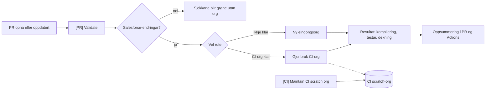
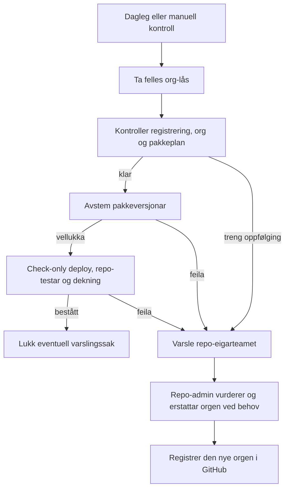

# Validering med gjenbrukbar scratch-org

`[PR] Validate` brukar den registrerte CI-scratch-orgen når han er frisk og
samsvarar med pakkeplanen. Elles fell PR-valideringa tilbake til ein ny
eingongsorg. PR-valideringa blir ikkje blokkert av at gjenbruksorgen manglar
eller treng utskifting.

`[CI] Maintain CI scratch org` køyrer dagleg og kan startast manuelt frå
`main`. Han held same concurrency-lås som PR-valideringa, kontrollerer orgen,
oppgraderer planlagde pakkar når det kan gjerast trygt, og røyketestar
deployerbar metadata, repoets Apex-testklassar og dekning med ein check-only
deploy etter kvar vellukka reconcile, også når ingen pakkeversjon blei endra.
Han opprettar, byter eller slettar aldri scratch-orgar. Når org eller pakkeplan
krev manuell oppfølging, opprettar eller oppdaterer han éi GitHub-issue og
nemner repo-eigarteamet. Issue blir lukka når kontrollen er grøn igjen.

## Oversikt





PR-valideringa vel fallback dersom orgen ikkje oppfyller rutekrava.
Kompilerings- og testfeil i sjølve valideringa gir ikkje automatisk fallback.

## Når må orgen bytast?

Vedlikehaldet varslar når registreringa manglar eller er ufullstendig, orgen
ikkje kan autentiserast eller identiteten ikkje stemmer, orgen går ut innan
sju dagar, scratch-definisjonen eller `sourceApiVersion` er endra, pakkar
ikkje kan oppgraderast trygt, eller røyketesten feilar. Issue-en lenkjer hit.

Så lenge GitHub-miljøet ikkje peikar på ein frisk org, brukar PR-valideringa
fallback-ruta med ein ny eingongsorg. Ho held fram å krevje same Apex-testar
og minst 85 % samla dekning.

## Kven kan opprette og registrere ein ny org?

Berre ein aktiv medlem av GitHub-teamet `@navikt/crm-arbeidsforhold-admin`
som òg har admin-permission på repoet. Lokal kommando kontrollerer begge
vilkåra før han kontaktar Salesforce. GitHub kontrollerer tilgang på nytt når
secrets og variablar blir skrivne. Teamet `@navikt/crm-arbeidsforhold` har
push-tilgang, men kan ikkje køyre erstatningsflyten utan admin-permission.

## Føresetnader

- Rein `main`-checkout av repoet. Kommandoen hentar `origin/main` før han
  kontrollerer at checkouten er oppdatert, og avviser lokale endringar i
  prosjektdefinisjon, pakkeplan, `.forceignore`, pakkeplan-hjelparar eller
  deployerbar kjelde.
- Node.js 22, Salesforce CLI 2.158.7 og GitHub CLI (`gh`).
- Salesforce CLI er innlogga mot den autoriserte Dev Hub-en. Bruk den
  eksplisitte eksisterande aliasen til Dev Hub; ikkje bruk standardalias utan
  å kontrollere at han er rett.
- `gh` er innlogga mot GitHub med `read:org`-tilgang og admin-permission på
  `navikt/crm-arbeidsforhold`. Kontroller med `gh auth status`. Dersom
  `read:org` manglar, oppdater GitHub CLI-innlogginga etter teamet sine
  tilgangsreglar. Innlogginga må òg kunne opprette og slette Git-referansar
  i repoet; branch-reglar kan avvise dette.
- `CRM_PACKAGE_KEY` er tilgjengeleg i terminalmiljøet frå teamet si godkjende
  secret-lagring. Ikkje legg nøkkelen i repoet, kommandolinjeargument,
  terminalhistorikk eller issue.
- Miljøet `ci-scratch-org` finst og er brukt av PR-valideringa. Det inneheld
  `CRM_PACKAGE_KEY` og `CRM_PROD_SFDX_URL` for CI, i tillegg til dei fire
  `CI_SCRATCH_ORG_*`-verdiane når ein org er registrert.

`CRM_PROD_SFDX_URL` gir CI tilgang til Dev Hub-en som blir brukt i den daglege
pakkeplanen. Vedlikehaldsworkflowen brukar han for å slå opp versjonane i
pakkeplanen, men opprettar eller slettar ikkje orgar der. Den lokale
erstatningskommandoen brukar Dev Hub-aliasen du oppgir for å slå opp same
plan og opprette den nye scratch-orgen.

## Erstatt CI scratch-org

Set først pakkenøkkelen i same terminal som du køyrer kommandoen i. Hent
verdien frå teamet si godkjende secret-lagring, og lim han inn når du blir
spurd. Inndata blir ikkje viste og havnar ikkje i terminalhistorikken.
Kommandoen fungerer i både zsh og bash:

```sh
printf 'CRM_PACKAGE_KEY: '; read -rs CRM_PACKAGE_KEY; echo; export CRM_PACKAGE_KEY
```

Utan dette steget stoppar kommandoen med
`CRM_PACKAGE_KEY must be available in the local environment.` Verdien i
GitHub-miljøet `ci-scratch-org` kan ikkje lesast tilbake, så han må hentast frå
secret-lagringa. Fjern verdien frå terminalen når du er ferdig:
`unset CRM_PACKAGE_KEY`.

Køyr frå repo-rota etter at `main` er oppdatert. Byt ut plasshaldaren med den
eksisterande Dev Hub-aliasen som du kontrollerte lokalt:

```sh
npm run ci-org:replace -- --target-dev-hub <existing-dev-hub-alias>
```

Aliasar med mellomrom må stå i hermeteikn, til dømes
`--target-dev-hub "NAV DevHub"`.

Kommandoen:

1. hentar `origin/main`, kontrollerer `main` og kjeldeendringar, og verifiserer
   aktivt eigarteammedlemskap og repo-admin-tilgang;
2. ber deg stadfeste den eksplisitte Dev Hub-aliasen før Salesforce blir
   kontakta;
3. løyser same pakkeplan som dagleg CI, inkludert tilgjengelege
   `LATEST`-versjonar;
4. opprettar ein scratch-org som varer i 30 dagar, med eit unikt namn som blir
   vist før opprettinga, og installerer alle planlagde pakkeversjonar;
5. kopierer deployerbar `force-app` og `.forceignore` til eit mellombels
   område utan å endre checkouten, slik at Salesforce held fram med å ignorere
   testfiler og anna kjelde som ikkje skal deployerast. Han køyrer check-only
   deploy med repoet sine Apex-testklassar og handhevar 85 % samla dekning.
   Metadata blir ikkje lagra i scratch-orgen;
6. etter bestått røyketest tek han ein felles GitHub-lås, og oppdaterer variablane
   `CI_SCRATCH_ORG_ID`, `CI_SCRATCH_ORG_EXPIRATION` og
   `CI_SCRATCH_ORG_CONFIG_SHA256`, og set `CI_SCRATCH_ORG_AUTH_URL` som secret
   i GitHub-miljøet med di eiga `gh`-innlogging. Låsen hindrar at to
   operatørar skriv registreringa samtidig og blir fjerna etter oppdatering
   eller tilbakerulling.

Auth-URL-en blir sendt direkte til `gh secret set` via standard input. Han
blir ikkje vist i terminalen eller lagra i repoet. Variablane blir skrivne
før secreten; ved feil prøver kommandoen å rulle variablane tilbake. Dersom
låsen ikkje kan takast, eller Environment-verdiane ikkje kan lesast før første
skriving, blir kandidaten sletta. Dersom sletting feilar, viser feilmeldinga
Salesforce-aliasen som må ryddast opp manuelt. Etter at første Environment-
skriving er forsøkt, blir kandidaten teken vare på ved feil fordi GitHub kan
ha akseptert ei endring sjølv om `gh` rapporterer feil. Kontroller
Environment-verdiane og PR-valideringsruta før orgen eventuelt blir sletta
manuelt. Den tidlegare registrerte orgen blir ikkje sletta av kommandoen; han
går ut etter Salesforce sin utløpsdato. Det hindrar at ei mislukka registrering
fjernar den siste orgen PR-valideringa kan bruke.

### Opprydding etter uavklart orgoppretting

Dersom Salesforce-kommandoen feilar under opprettinga, søkjer skriptet etter
det unike namnet i `ScratchOrgInfo` i den valde Dev Hub-en. Finst nøyaktig éi
verifisert førespurnad, prøver skriptet å slette henne. Salesforce opplyser at
sletting av førespurnaden også slettar ein aktiv scratch-org.

Kontroller alltid namnet og Dev Hub-en frå feilmeldinga før du prøver på nytt.
Ei forseinka oppretting kan bli synleg etter kontrollen, og sletting kan
feile eller ha eit uavklart resultat. Søk etter namnet i **Scratch Org Infos**
i Dev Hub-en, stadfest at førespurnaden tilhøyrer det feila forsøket, og rydd
eventuelt opp der. Ved avbrot blir namnet vist i terminalen før opprettinga.

### Opprydding etter avbroten registrering

Låsen er Git-referansen `refs/heads/ci-scratch-org-registration-lock`. Han
peikar på ein eigen mellombels commit utan secrets eller filendringar. Om
kommandoen blir avbroten, GitHub svarar med ein uavklart feil, eller sletting
av låsen feilar, kan han bli ståande. Nye registreringar stoppar då trygt.

1. Avklar med dei andre repo-administratorane at **ingen** registrering eller
   tilbakerulling er aktiv. Ikkje fjern låsen medan ein operatør arbeider.
2. Kontroller registreringa i GitHub-miljøet `ci-scratch-org` og meldinga frå
   kommandoen. Ved uavklart Environment-oppdatering, undersøk den bevarte
   scratch-orgen før du eventuelt slettar han eller registrerer på nytt.
   Dersom låsopprettinga feila uklart før Environment-skriving, blir
   kandidaten sletta; feilmeldinga viser aliasen dersom oppryddinga feila.
3. Ein repo-admin kan kontrollere låsen med:

    ```sh
    gh api repos/navikt/crm-arbeidsforhold/git/ref/heads/ci-scratch-org-registration-lock --jq '.object.sha'
    ```

4. Først når det er stadfesta at ingen operasjon er aktiv, kan repo-adminen
   fjerne den gamle låsen:

    ```sh
    gh api --method DELETE repos/navikt/crm-arbeidsforhold/git/refs/heads/ci-scratch-org-registration-lock
    ```

Er låsen borte, eller hindrar branch-reglar eller tokenet skriving av
referansar, må ein repo-admin avklare tilgang og tilstand før nytt forsøk.

Det krevst ingen kryptert artifact, privat handoff-nøkkel eller GitHub App.
GitHub App kan vurderast seinare, men er ikkje ein del av denne løysninga.

## Dagleg drift og varsling

1. Den planlagde køyringa kontrollerer registrert org og pakkeplan.
2. Dersom planlagde pakkar kan oppgraderast trygt, oppdaterer han dei i same
   org. Etter kvar vellukka reconcile køyrer han check-only deploy av
   deployerbar metadata, repo-testane og 85 % samla dekning. Dette stadfestar
   at orgen er frisk før ei open varslingssak blir lukka, også når pakkane
   allereie var oppdaterte.
3. Dersom orgen må bytast eller oppgraderinga/røyketesten ikkje lukkast,
   opprettar eller oppdaterer workflowen issue-en
   `[CI] Reusable scratch org needs attention`. Ho nemner
   `@navikt/crm-arbeidsforhold-admin` og lenkjer til denne guiden. Actions-
   oppsummeringa viser òg den konkrete årsaka frå kontrollen.
4. Når orgen er frisk og pakkeplanen stemmer igjen, lukkar workflowen issue-en.

Workflowen kan manuelt startast frå **Actions → [CI] Maintain CI scratch org**
på `main`. Ho har berre `issues: write` for varselet; ho får ikkje rett til å
endre GitHub secrets eller variablar. Ho autentiserer mot Dev Hub for
pakkeplan-oppslaget, men opprettar eller slettar ikkje orgar.

## Valider ein PR på ny scratch-org

Set labelen `ci:fresh-org` på PR-en for å validere han på ein ny scratch-org i
staden for CI-orgen. Når labelen blir sett, startar `[PR] Validate` på nytt.
Så lenge labelen står på PR-en, går òg nye push til ny scratch-org. Fjern
labelen for å gå tilbake til gjenbruk.

Bruk labelen når du vil kontrollere at valideringa fungerer utan den
registrerte orgen, eller når du mistenkjer at tilstand i CI-orgen påverkar
resultatet. Køyringa tek like lang tid som før gjenbruk vart innført.

- Det er å setje labelen som startar valideringa. **Re-run** av ei eldre
  køyring ser labelane slik dei var då den køyringa starta.
- Andre labelar startar ikkje Salesforce-validering og endrar ikkje
  resultatet av påkravde sjekkar.
- Labelen gir same tryggleikskontrollar som vanleg PR-validering: berre
  PR-ar frå dette repoet mot `main`, og skript frå base-commiten.

Manuell start av **[CI] Reusable scratch org validation** med `force_fresh`
er berre tillaten frå `main` og validerer `main`, ikkje ein PR.

## Lokal validering

Dei lokale testane køyrer utan Salesforce-org:

```sh
npm run test:node
npm run prettier:check
```

Dei verifiserer ikkje tilgang til GitHub Environment, Dev Hub, pakkeinstallering
eller faktisk org-deploy. Første ende-til-ende-verifisering skjer ved at ein
repo-admin køyrer erstatningskommandoen og kontrollerer at neste PR-validering
brukar gjenbruksorgen.

Steg 8–10 frå den avslutta piloten er tekne vare på i
[pilotarkivet](../archive/operations/reusable-scratch-org-pilot-steg-8-10.md).
