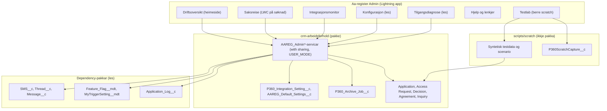
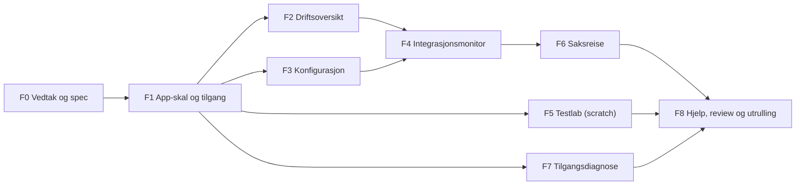

# Aa-register Admin: plan

Status: vedteke 2026-11-15, under arbeid. Spec: [.github/specs/aareg-admin-app.md](../../.github/specs/aareg-admin-app.md).

## 1. Kva er problemet?

I dag må ein som vil teste eller feilsøkje Aa-registeret hoppe mellom mange stader:

- tre ulike appar (`Aa-registeret – Brukerstøtte`, `AAREG_application`, `Arbeidsforhold Admin`);
- objektfaner for søknad, tilgang, vedtak, avtale og henvending;
- `Application_Log__c` for loggar, `P360_Archive_Job__c` for arkivjobbar og `P360ScratchCapture__c` for simulerte P360-kvitteringar;
- Setup for feature flags, trigger-innstillingar, permission sets og Flow-ar;
- `docs/` for å forstå kva som skal skje.

Ingen stad svarar på dei tre spørsmåla ein faktisk har:

1. **Kva skjer med Aa-registeret akkurat no?** Kva står fast, kva feila og kva ventar?
2. **Kva skjedde med denne søknaden?** Kva steg gjekk han gjennom, i kva rekkjefølgje, og kva sende vi ut?
3. **Korleis testar eg dette trygt?** Kva testdata, scenario og kvitteringar finst, og korleis nullstiller eg?

## 2. Mål

Éin intern Lightning-app, **Aa-register Admin**, som samlar:

| Område                 | Svarar på                                                | Kvar              |
| ---------------------- | -------------------------------------------------------- | ----------------- |
| Driftsoversikt         | Kva står fast, feilar eller ventar no?                   | Pakke og scratch  |
| Saksreise              | Kva hende med denne søknaden, frå innsending til arkiv   | Pakke og scratch  |
| Integrasjonsmonitor    | P360, distribusjonstilgang, Altinn, SMS og e-post        | Pakke og scratch  |
| Konfigurasjon          | Er P360 på? Mock eller ekte transport? Kva trigger går?  | Pakke og scratch  |
| Tilgangsdiagnose       | Kvifor ser eller ser ikkje brukar X dette?               | Pakke og scratch  |
| Testlab                | Lag testdata, køyr scenario, sjå kvitteringar, nullstill | **Berre scratch** |
| Hjelp og dokumentasjon | Kva betyr dette, og kvar står det meir?                  | Pakke og scratch  |

## 3. Prinsipp

1. **Bygg vidare på det som finst.** Den pakkeeigde appen `Arbeidsforhold_Admin` er nesten tom: berre heimeside, e-postmalar, dashboard og rapportar. Han blir utvida. API-namnet blir ikkje endra. Om etiketten skal endrast til «Aa-register Admin», er eit eige vedtak.
2. **Les, ikkje skriv, i pakka.** Den pakkeeigde delen viser og forklarer. Han endrar ikkje domenedata, startar ikkje integrasjonar og omgår ikkje tilgangskontroll.
3. **Testverktøy blir berre i scratch.** Alt som lagar testdata, simulerer P360 eller nullstiller data ligg under `scripts/scratch/` og blir aldri pakka.
4. **Standard Salesforce før eigen kode.** Bruk listevisingar, rapportar, dashboard, dynamiske relaterte lister og `flexipage:richText` først. Lag LWC berre der standarden ikkje kan svare på spørsmålet, til dømes saksreisa.
5. **Ingen nye eksterne kall.** Appen les Salesforce-data. Han kontaktar ikkje P360, Altinn, distribusjonstenesta, KRR eller andre tenester.
6. **Forklar i GUI-et.** Kvar side skal seie kva ein ser på, kva som er normalt og kva ein bør gjere vidare.

## 4. Arkitektur

### 4.1 Kva som er pakke og kva som er scratch

| Del                                                        | Plassering                                          | Kan gå til SIT2/prod |
| ---------------------------------------------------------- | --------------------------------------------------- | -------------------- |
| App, faner, heimeside, listevisingar, rapportar, dashboard | `force-app/main/default/` (eksisterande app)        | Ja, etter vedtak     |
| Lese-servicar og LWC for oversikt, saksreise og diagnose   | `force-app/internalAdmin/` (ny mappe)               | Ja, etter vedtak     |
| Permission set `AAREG_Admin_Viewer`                        | `force-app/internalAdmin/permissionsets/`           | Ja, etter vedtak     |
| Testlab, scenario, nullstilling, P360-kvitteringar         | `scripts/scratch/admin/` og `scripts/scratch/p360/` | **Nei**              |
| Permission set `AAREG_Scratch_Test_Operator`               | `scripts/scratch/admin/`                            | **Nei**              |

Mappa `force-app/internalAdmin/` følgjer eigarskapsmodellen i [repositorystruktur.md](../architecture/repositorystruktur.md). Plasseringa skal stadfestast i spec-gjennomgangen.

## 5. Modular

### 5.1 App-skal og navigasjon

- Utvid `Arbeidsforhold_Admin` med faner for søknad, tilgangsførespurnad, vedtak, avtale, henvending, P360-arkivjobb og applikasjonslogg.
- Scratch-utrullinga legg til faner for `P360ScratchCapture__c` og testlaben.
- Verktøylinja får snarvegar til hjelp og, i scratch, til testlaben.

### 5.2 Driftsoversikt

Heimesida viser fliser med tal og lenkjer til filtrerte lister:

- søknader per status, og søknader som har stått i same status lenger enn ein konfigurerbar terskel;
- vedtak som ventar på P360-frigjeving;
- P360-jobbar per status: venta, i arbeid, feila, til manuell handsaming og leasen utgått;
- feil i `Application_Log__c` siste 24 timar, gruppert på `Source_Class__c`;
- opne henvendingar utan eigar.

Tersklar ligg i Custom Metadata, ikkje i kode.

### 5.3 Saksreise

Ein LWC på søknadssida og i appen syner ei tidslinje for éin søknad:

- oppretting, innsending og statusendringar;
- vedtak, avtale og distribusjonstilgang;
- vedlegg og vedtaksfiler;
- P360-jobbar med status, forsøk, correlation ID og siste feil;
- loggar der `Referrence_ID__c` peikar på søknaden, vedtaket eller avtalen;
- e-post, SMS og dialogtrådar.

Kvart steg viser kjelde, tidspunkt og lenkje til posten. Steg som manglar data blir merkte som «ikkje registrert», ikkje gøymde.

**Blokkar:** Historikksporing er slått på for objekta, men ingen felt er markerte med `trackHistory`. Statusendringar kan derfor ikkje visast før eit vedtak avgjer kva felt som skal sporast. Sjå [opne vedtak](#7-opne-vedtak).

### 5.4 Integrasjonsmonitor

| Integrasjon          | Kjelde i Salesforce                                          | Visning                                                |
| -------------------- | ------------------------------------------------------------ | ------------------------------------------------------ |
| P360                 | `P360_Archive_Job__c`, `Application_Log__c`                  | Kø, feil, retry, manuell frigjeving, correlation ID    |
| P360 i scratch       | `P360ScratchCapture__c`                                      | Kvitteringar, førespurnad, svar, filer (berre scratch) |
| Distribusjonstilgang | `Application_Log__c` frå `AAREG_distributionAccess*`, avtale | Siste kall og feil per avtale                          |
| Altinn               | `Application_Log__c`, scenario-repository                    | Siste kall og feil                                     |
| SMS og e-post        | `SMS__c`, `EmailMessage`, e-postvarslingsmetadata            | Sende, feila og ventande varsel                        |

Monitoren viser berre metadata og redigerte felt. Payloadar blir ikkje viste utan at tilgangsvedtaket tillèt det.

### 5.5 Konfigurasjon

Ei leseside som samlar:

- feature flag `P360_Archive_Processing` og om han er på;
- `P360_Integration_Setting__c`, inkludert om mock-transport er vald;
- `MyTriggerSetting__mdt`-oppføringar for Aa-registeret-objekta;
- `AAREG_Default_Settings__c` og varslingsmetadata;
- kva Named Credentials som finst, utan endepunkt-hemmelegheiter eller tokenar.

Sida forklarer kva kvar innstilling gjer og lenkjer til Setup for endring. Ho endrar ingenting sjølv.

### 5.6 Tilgangsdiagnose

Vel ein brukar og sjå:

- profil, permission sets og grupper med Aa-registeret- eller P360-relevans;
- custom permissions, til dømes `P360_Archive_Release`;
- om brukaren kan lese og endre hovudobjekta.

Svaret er ei forklaring, ikkje ei tildeling. Tildeling skjer framleis i Setup. Diagnose av andre brukarar er raud sone og krev eige tilgangsvedtak.

### 5.7 Testlab (berre scratch)

- Lag syntetiske testscenario frå [testdata-strategien](../testing/aaregisteret-testdata-strategi.md) med eitt klikk eller éin kommando.
- Køyr steg i [scenario-testplanen](../testing/aaregisteret-scenario-testplan.md) og lagre evidens.
- Sjå P360-kvitteringar frå `P360ScratchCapture__c`.
- Nullstill syntetiske testdata utan å røre anna data.
- Bruk same Node-køyrar som `npm run p360:scratch`, slik at det fungerer på macOS, Linux og Windows.

Testlaben skal kontrollere at målet er ein scratch-org (`Organization.IsSandbox=true` og scratch-domene) før han endrar noko.

#### Slik brukar du testlaben

Køyr kommandoane i ein terminal i VS Code, eller vel **Terminal → Run Task** og ei av oppgåvene som byrjar med «Admin test lab». Kommandoane er like på macOS, Linux og Windows.

| Steg | Kommando                                   | Kva skjer                                                                                     |
| ---- | ------------------------------------------ | --------------------------------------------------------------------------------------------- |
| 1    | `npm run admin:scratch -- seed p360-feila` | Lagar eitt scenario. Byt ut `p360-feila` med eit anna namn frå tabellen under.                |
| 2    | `npm run admin:scratch -- inspect`         | Viser alle testlab-søknader med søknadsnummer, status og P360-jobbstatus.                     |
| 3    | Opne appen **Arbeidsforhold Admin**        | Sjå scenarioet på heimesida, i Integrasjonsmonitoren og i Saksreisa (søk på søknadsnummeret). |
| 4    | `npm run admin:scratch -- reset`           | Slettar berre testlab-postar. Anna data blir ikkje rørt.                                      |

| Scenario            | Kva du får                                                         | Kvar du ser det                                                |
| ------------------- | ------------------------------------------------------------------ | -------------------------------------------------------------- |
| `soknad-ny`         | Ny søknad som ikkje er sendt inn og ikkje har P360-jobb            | Heimesida («Søknader per status»), Saksreisa                   |
| `p360-arkivert`     | Innsend søknad med vellukka P360-jobb                              | Monitoren (`Succeeded`), Saksreisa utan «Arkivert» som manglar |
| `p360-feila`        | Innsend søknad der P360-jobben har feila og ikkje blir prøvd igjen | Monitoren (`Failed`, feilkode `TESTLAB_SYNTHETIC_FAILURE`)     |
| `p360-manuell`      | Innsend søknad der P360-jobben ventar på manuell vurdering         | Monitoren (`Manual Review`)                                    |
| `p360-utgatt-lease` | Innsend søknad der P360-jobben står fast med utgått lease          | Heimesida («P360-jobbar med utgått lease»), Monitoren          |

Kvifor dette er trygt:

- **Berre scratch.** Køyraren kontrollerer alias, scratch-domene og `IsSandbox=true` før han gjer noko. Apex-klassen kontrollerer det same éin gong til.
- **Ikkje i pakka.** `AAREG_AdminTestLab` ligg i `scripts/scratch/admin/`, og testen ligg i `force-app/tests/classes/internalAdmin/scratch/`, som `.forceignore` held utanfor pakka. Køyraren deployar dei som upakka metadata.
- **Ingen kall ut.** P360-jobbane blir berre laga med statusar som arkivarbeidaren aldri hentar (`Succeeded`, `Manual Review`, `In Progress`, og `Failed` utan neste forsøk). Ein Apex-test sjekkar dette. Køyraren stoppar om ein operasjon rapporterer eitt eller fleire kall.
- **Merkte postar.** Kontoane heiter `AAREG TESTLAB <scenario> <tidsstempel>`, og jobbane har nøkkel `AAREG-TESTLAB-…`. `reset` slettar berre det som er merkt.
- **Brukartilgang.** All lesing og skriving skjer i brukarmodus. Ein brukar utan tilgang til objekta får feil, ikkje data.

### 5.8 Hjelp

Kvar side har ein kort tekst øvst om kva ho viser og kva som er normalt. Verktøylinja nedst i appen har knappen **Help**, som opnar komponenten `aaregAdminHelp`. Han har lenkjer til denne guiden, [heile løysinga](../architecture/hele-loysinga.md), [Flow-katalogen](../architecture/aareg-flow-katalog.md), [P360 scratch-guiden](../integrations/p360/scratch-brukarguide.md) og [testplanen](../testing/aaregisteret-scenario-testplan.md), og han viser testlab-kommandoane. Lenkjene peikar til `main` på GitHub og verkar først når dokumenta er merga.

## 6. Fasar

| Fase | Innhald                                          | Avhengnad           | Ferdig når                                                    |
| ---- | ------------------------------------------------ | ------------------- | ------------------------------------------------------------- |
| F0   | Spec, vedtak om namn, tilgang og historikk       | –                   | Opne vedtak i kapittel 7 er avgjorde                          |
| F1   | App, faner, `AAREG_Admin_Viewer`, heimeside      | F0                  | App synleg i scratch for brukar med permission set            |
| F2   | Driftsoversikt med fliser og listevisingar       | F1                  | Fliser viser rette tal mot syntetiske data                    |
| F3   | Konfigurasjonsside                               | F1                  | Viser flag, mock-transport og triggerinnstillingar korrekt    |
| F4   | Integrasjonsmonitor                              | F2, F3              | P360-jobbar og loggar kan følgjast frå feil til årsak         |
| F5   | Testlab i scratch                                | F1                  | Scenario kan lagast, køyrast og nullstillast på alle tre OS   |
| F6   | Saksreise                                        | F4, historikkvedtak | Tidslinja viser éin søknad frå innsending til arkiv           |
| F7   | Tilgangsdiagnose                                 | F1, tilgangsvedtak  | Diagnosen stemmer med faktiske tilgangar for tre testbrukarar |
| F8   | Hjelp, security-review, dokumentasjon, utrulling | F5, F6, F7          | Review er gjennomført; SIT2 er verifisert etter godkjenning   |

## 7. Vedtak (F0, 2026-11-15)

Produkteigar bad agenten avgjere spørsmåla han kunne svare på sjølv. Alle vala er dei mest forsiktige som framleis gir det appen skal levere. Kvart val kan utvidast seinare med ei menneskeleg avgjerd.

| Spørsmål                            | Vedtak                                                                                                                                                      | Kvifor                                                            |
| ----------------------------------- | ----------------------------------------------------------------------------------------------------------------------------------------------------------- | ----------------------------------------------------------------- |
| Ny etikett «Aa-register Admin»?     | Nei, `Arbeidsforhold Admin` blir ståande                                                                                                                    | Eksisterande tekst; ikkje nødvendig for målet                     |
| `AAREG_Admin_Viewer` og `View All`? | Berre lesing, ingen `View All` eller `Modify All`                                                                                                           | Sharing gjeld framleis; private objekt blir ikkje opna            |
| Kva felt blir sporte?               | Søknad: `Status__c`, `Casehandler_Status__c`, `CasehandlerOwner__c`, `ApplicationDeadlineForReply__c`. Vedtak: `Process_status__c`. Henvending: `Status__c` | Status, eigar og frist, utan persondata; langt under grensa på 20 |
| Payloadar frå loggen?               | Aldri. Loggmeldinga blir vist avkorta med FLS                                                                                                               | Payloadar kan innehalde persondata                                |
| Diagnose av andre brukarar?         | Nei, berre eigen brukar                                                                                                                                     | Krev lesing av andre sine tilgangar                               |
| Produksjon?                         | Scratch og SIT2. Produksjon berre etter Team Platforce-godkjenning og menneskeleg utføring                                                                  | Org-reglane                                                       |

**Testlaben startar ingen eksterne kall.** Avtalar blir oppretta med status `Under review`, fordi `Active` ved oppretting startar callout til distribusjonstilgang. Søknader blir berre sette inn, aldri oppdaterte, fordi endring av saksbehandlarstatus sender e-post. Henvendingar brukar aldri typane «Sikkerhetsbrudd» eller «Feil i løsningen», fordi dei sender SMS.

## 8. Teststrategi

| Lag           | Kva                                                                | Kommando eller stad                           |
| ------------- | ------------------------------------------------------------------ | --------------------------------------------- |
| Apex          | Lese-servicar: aggregering, sharing, USER_MODE, minimumstilgang    | `force-app/tests/classes/internalAdmin/`      |
| LWC Jest      | Fliser, tidslinje, tomme og feilande tilstandar                    | `npm test -- --runInBand`                     |
| Node          | Testlab-køyrar, scratch-målkontroll, nullstilling                  | `npm run test:node`                           |
| GUI i scratch | Stegvise kontrollar med skjermbilete som evidens                   | Scenario-testplanen                           |
| Tilgang       | Minimumsbrukar ser ingenting; viewer ser berre det vedtaket tillèt | `System.runAs` i Apex og manuell GUI-kontroll |

Ingen test skal kontakte eksterne tenester. Testlaben brukar den simulerte P360-mottakaren.

## 9. GitHub-issues

Epic: [#1186](https://github.com/navikt/crm-arbeidsforhold/issues/1186).

| Fase | Issue                                                                                                |
| ---- | ---------------------------------------------------------------------------------------------------- |
| F0   | [#1187](https://github.com/navikt/crm-arbeidsforhold/issues/1187) Avgjer opne val                    |
| F1   | [#1188](https://github.com/navikt/crm-arbeidsforhold/issues/1188) App-skal, faner og permission sets |
| F2   | [#1189](https://github.com/navikt/crm-arbeidsforhold/issues/1189) Driftsoversikt                     |
| F3   | [#1190](https://github.com/navikt/crm-arbeidsforhold/issues/1190) Konfigurasjonsside                 |
| F4   | [#1191](https://github.com/navikt/crm-arbeidsforhold/issues/1191) Integrasjonsmonitor                |
| F5   | [#1192](https://github.com/navikt/crm-arbeidsforhold/issues/1192) Testlab i scratch                  |
| F6   | [#1193](https://github.com/navikt/crm-arbeidsforhold/issues/1193) Saksreise                          |
| F7   | [#1194](https://github.com/navikt/crm-arbeidsforhold/issues/1194) Tilgangsdiagnose                   |
| F8   | [#1195](https://github.com/navikt/crm-arbeidsforhold/issues/1195) Hjelp, review og utrulling         |

## 10. Status (15.11.2026)

Alt under er verifisert i scratch-orgen `crm-arbeidsforhold`. Koden ligg berre i den lokale arbeidskopien og er ikkje committa. Issuane står opne til endringa er merga via PR.

| Fase | Status               | Evidens                                                                                                 |
| ---- | -------------------- | ------------------------------------------------------------------------------------------------------- |
| F1   | Verifisert i scratch | Appen med 15 faner, `AAREG_Admin_Viewer` tildelt                                                        |
| F2   | Verifisert i GUI     | Fliser og «Vis postar» stemmer med testlab-data                                                         |
| F3   | Verifisert i GUI     | Konfigurasjonssida viser flagg, mock-transport og triggerar                                             |
| F4   | Verifisert i GUI     | Monitoren viser `Failed`, `Manual Review` og utgått lease frå testlaben                                 |
| F5   | Verifisert i scratch | Fem scenario laga, inspisert og nullstilte. 0 kall ut. 5 av 5 Apex-testar og 10 av 10 Node-testar grøne |
| F6   | Verifisert i GUI     | Saksreisa for S-000721: datofelt utan klokkeslett, P360-jobb tel som arkivert                           |
| F7   | Verifisert i GUI     | Profil, permission set og forklaring per objekt                                                         |
| F8   | Delvis               | Help-panelet er verifisert i GUI. Security-review utan funn. PR og SIT2 står att                        |

Apex for admin-appen: 23 av 23 grøne. LWC Jest: 16 av 16 grøne.
