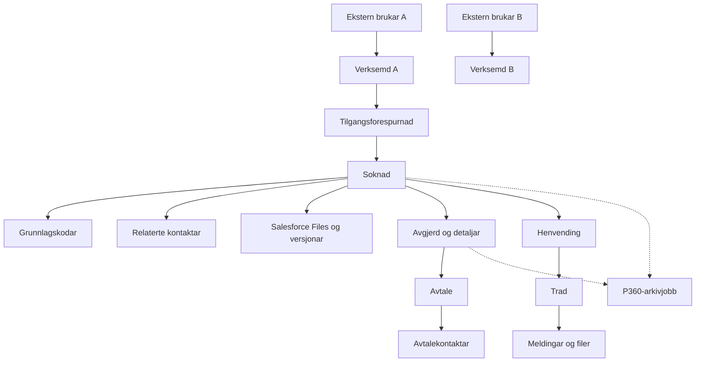

# Aa-registeret: syntetisk testdatastrategi

**Status:** arbeidsgrunnlag for [scenario-testplanen](aaregisteret-scenario-testplan.md).
**Kjeldegjennomgang:** 2026-11-14. Ingen org-data eller eksterne tenester er
brukte i dette dokumentet.

## 1. Testnivå og kva dei beviser

| Nivå               | Mekanisme                                                         | Kan bevise                                                                                                   | Kan ikkje åleine bevise                                                           |
| ------------------ | ----------------------------------------------------------------- | ------------------------------------------------------------------------------------------------------------ | --------------------------------------------------------------------------------- |
| UI/unit            | LWC Jest med mocka Apex/wires                                     | Komponenttilstand, handterar, synlege panel, feilmeldingar og parameter som blir sende                       | Apex-policy, Salesforce sharing/FLS, aktiv Flow eller ekstern respons             |
| Apex unit          | `System.Test`, testdatafabrikk, `System.runAs`, `HttpCalloutMock` | Logikk i Apex, CRUD-/sharing-søm der testen faktisk set opp relevant brukar, serialisering og mocka feilsvar | Live Altinn/distribusjon/P360, org-spesifikk aktivering eller manuell portalreise |
| Metadata/source    | Lokal inspeksjon, Prettier og lenkekontroll                       | At kjelde/metadata er til stades og korrekt forma                                                            | Deploya versjon eller runtime-åtferd                                              |
| Salesforce Flow/UI | Avgrensa, godkjend test i `crm-arbeidsforhold`                    | Konkret org-/UI-resultat for oppgitt rolle, versjon og tidspunkt                                             | Produksjonsåtferd eller ekstern leveranse utan motpartsevidens                    |
| Ekstern kontrakt   | Kontrollert test mot godkjend ikkje-produksjonsendepunkt          | Faktisk transport/kontrakt mot dette testmiljøet                                                             | Produksjon eller utesta scenario                                                  |

Dette prosjektet er Salesforce-/Experience Cloud-kode, ikkje ein sjølvstendig
webserver ein kan starte lokalt. Det er derfor ikkje grunnlag for å late
som npm/Jest er browser-E2E eller å kalle ei mocka Apex-køyring ein
Salesforce-integrasjonstest.

### Teststrategi for prosjektet

- **App-type:** Salesforce-hosted Experience Cloud/Lightning UI med LWC,
  Apex, Flow og eksterne tenester. Det finst ikkje ein lokal webserver med
  komplett Salesforce-runtime.
- **Kritiske reiser:** Altinn-val og søknadsrett; lagre/send inn søknad med
  vedlegg; intern behandling og avgjerd; avtale/distribusjon; støttehenvending
  med tråd og filer.
- **Primær valideringsstakk:** lokale LWC Jest-testar for UI; Apex-testar i
  godkjend `crm-arbeidsforhold` scratch-org for serverlogikk; isolert
  Flow-/Experience Cloud-test for ende-til-ende brukarhandling; callout mocks
  for Altinn/distribusjon/P360. Ekte ekstern kontrakttest er ein separat,
  godkjend test.
- **Infra-akse:** databasen og Salesforce-runtime er plattformforvalta; Docker
  er ikkje ein erstatning for denne testgrensa. Når org-basert Apex/Flow-test
  ikkje kan køyrast, er lokal source/Jest berre delvis evidens, ikkje ein
  godkjend fallback som kan merkast PASS.
- **Browser-akse:** Playwright er ikkje konfigurert i repoet eller installert
  lokalt. UI-åtferd kan testast komponentvis med Jest; faktisk Experience
  Cloud-rendering krev godkjend browser-/scratch-org-test. Jest er ikkje ein
  browser-E2E-fallback.
- **Miljø:** repoets CI nyttar Node.js 22 for testjobbar. Salesforce-testar
  krev eksplisitt godkjent ikkje-produksjonsmål før kvar org-handling.
  Ingen lokal DB/container trengst for LWC Jest.
- **Akseptanse:** kvar reise må ha positivt resultat, minst éin relevant
  avvisings-/feilvariant, read-back av muterte data og sanert evidens. For
  ekstern integrasjon må request, mock-resultat og lagra lokal tilstand
  skiljast frå ekte mottak/arkivering.
- **Testgrunnmur:** bruk dei eksisterande feature-testklassene og
  `AAREG_TestDataFactory`, `AAREG_AltinnTestDataFactory` og
  `P360_TestDataFactory`; dei er ikkje ei felles transaction/base class.
  Salesforce-plattforma leverer runtime, så ein lokal startup-test er ikkje
  relevant. Nye testskjelett skal leggjast ved feature-eigd testområde.
- **Kommando:** CI køyrer `npm run test:unit`; fokuserte lokale Jest-testar kan
  avgrensast med
  `npm run test:unit -- --runInBand <sti-til-testfil>`. Apex-kommandolinjekøyring
  krev eige godkjent mål og blir ikkje erstatta av npm-testen.
- **Kjent dekningsgap:** ingen konfigurert browser-E2E, ingen lokal Apex/Flow
  runtime og ingen bevis på effektiv org-sharing eller ekstern aksept frå
  Jest-/mock-testar.

## 2. Isolert fixture-graf

Bygg éin graf per scenario. Bruk nye, relasjonelt konsistente records;
ikkje leia eller sletta data frå andre scenario.

Stipla P360-koplingar er testområde, ikkje garanti for at kvar inngang finst.
Sjå [P360-verifikasjonsplanen](../integrations/p360/inngangar-og-verifikasjonsplan.md).

## 3. Fixture-komponentar og variantar

| Fixture                    | Minste syntetiske oppsett                                                                                   | Variant for isolasjon/feil                                                                                          |
| -------------------------- | ----------------------------------------------------------------------------------------------------------- | ------------------------------------------------------------------------------------------------------------------- |
| Verksemd                   | Account med gyldig syntetisk testidentifikator, organisasjonsform og berre nødvendige kategori-/adressefelt | To verksemder med ulik eigar og ulike retts-/record-koplingar                                                       |
| Ekstern aktør              | Community-kontekst med éi eksplisitt verksemdkopling og minimum nødvendige tilgangar                        | Aktør for verksemd B; feil/ugyldig aktør berre i test                                                               |
| Intern aktør               | Minste tilgangsbrukar for lesing; separat saksbehandlar for handlingar som krev det                         | Manglande eigarskap/permission, annan intern rolle                                                                  |
| Tilgangsforespurnad/søknad | `Access_Request__c` og tilknytt `Application__c` med record type, status og nødvendige relasjonar           | Utkast, New, In Progress, Additional Information Required, ferdigbehandla                                           |
| Søknadsunderdata           | Grunnlagskodar og `RelatedContact__c`-records med samanhengande foreldre                                    | Tom liste, sletta rad, ugyldig relasjon eller kontakt delt mellom søknad og avtale                                  |
| Dokument                   | Lita syntetisk `ContentVersion`; kontroller `ContentDocumentLink` til rett forelder                         | Ingen fil, fleire versjonar, manglande lenkje, feil forelder eller same dokument kopla til fleire tillatne rekordar |
| Avgjerd                    | `Application_Decision__c` og berre dei detaljlinjene scenarioet treng                                       | Innvilging/avslag, manglande dato/grunn, manglande release-tilgang                                                  |
| Avtale                     | `Agreement__c` knytt til same søknad/verksemd og tilgangsomfang                                             | Active, Under review, Deactivated; kontakt med og utan søknadskopling                                               |
| Dialog                     | `Inquiry__c`, `Thread__c`, `Message__c` og Salesforce Files                                                 | Utkast/final, fleire meldingar, ekstern/intern avsendar, verksemd B                                                 |
| Altinn                     | Lokal scenario-provider eller `HttpCalloutMock` med eksplisitt scenario/ressurs/utfall                      | Permit, Deny, tomt svar, feil/exception; aldri fall tilbake til live-teneste i test                                 |
| Distribusjon               | `HttpCalloutMock` med konkret HTTP-status og registrert request                                             | PUT, DELETE, 4xx/5xx, timeout/exception, tom/ugyldig payload                                                        |
| P360                       | Jobbservice med syntetisk identitet og injisert stub/failure-adapter                                        | Pending, due Failed, Manual Review, konkurranse eller replay som separate variantar                                 |
| Varsling                   | Mocka Flow/Apex-testdata, `EmailQueue__c`/SMS bare i isolert testseam                                       | Kø før/etter, fault path, manglande mottakar; ingen reell sending                                                   |

### Identifikatorar og trygg bruk av eksisterande fabrikkar

- Bruk berre syntetiske testidentifikatorar som er godkjende for testmiljøet.
  I lokale Apex-/Jest-testar bruk fixture-verdiane frå den avgrensa testen;
  ikkje kopier dei til offentleg dokumentasjon eller til manuell org-test.
- Den eksisterande [AAREG_TestDataFactory](../../force-app/utility/classes/AAREG_TestDataFactory.cls)
  har faste eksempelverdiar og byggjer kontoar for fleire organisasjonsformer.
  Ikkje anta at alle eldre eksempelverdiar er globalt reserverte syntetiske
  verdiar. Kontroller eigarskap/personvern før bruk utanfor den isolerte
  Salesforce-testtransaksjonen; ikkje ta verdiane inn i nye fixtures her.
- Bruk [AAREG_AltinnTestDataFactory](../../force-app/tests/classes/integration/altinn/AAREG_AltinnTestDataFactory.cls)
  for det avgrensa katalogscenarioet S01–S08. Den eksplisitte provider-policyen
  skal hindre at scenariofeil stille vel vanleg Altinn-integrasjon.
- Bruk [P360_TestDataFactory](../../force-app/tests/classes/integration/p360/test/P360_TestDataFactory.cls)
  for testflagg, release-/processing-brukarar og isolerte P360-jobbar. Ei
  test-fixture-endring av metadata er ikkje ei endring i org-konfigurasjon.
- Fabrikkfunksjonar kan setje opp privilegert data. Køyr sjølve handlinga som
  aktøren scenarioet testar; bruk `System.runAs(minimumAccessUser)` når
  åtferda ikkje krev høgare rettar. Setup-admin og aktør skal ikkje blandast.

## 4. Aktør- og tilgangsmatrise

| Aktør                  | Positiv kontroll                                                              | Negativ kontroll                                                           |
| ---------------------- | ----------------------------------------------------------------------------- | -------------------------------------------------------------------------- |
| Ekstern representant A | Berre A-data og dei funksjonane policy tillèt                                 | Direkte søk/lenkje til B-record, B-fil eller B-tråd gir ikkje data         |
| Ekstern representant B | Berre B-data                                                                  | Skal ikkje arve A sin valde organisasjon, delingar eller ulest-teljing     |
| Saksbehandlar          | Behandle den tildelte søknaden og utføre godkjende status-/avgjerdshandlingar | Feil status, manglande eigarskap eller permission blir synleg avvist       |
| Avtaleansvarleg        | Endre kontaktar/avtale innan eksplisitt tillate handling                      | Manglande update-tilgang endrar ikkje avtale eller distribusjon            |
| P360 release-aktør     | Set einvegssignal etter release-policy                                        | Uautorisert release og redigering etter release blir avvist når gate er på |
| Bakgrunnsjobb          | Behandle berre dei isolerte, klare jobbane                                    | Gate av, feil/mock eller manglande payload gir ikkje falsk ekstern suksess |

Permission set-definisjon eller assignment-teljing er ikkje bevis på effektiv
tilgang. Verifiser record-eigarskap, deling, CRUD/FLS og aktuell brukar i
passande testnivå.

## 5. Determinisme, oppsett og opprydding

1. Apex-testar skal lage data i same `@IsTest`-transaksjon, bruke
   Salesforce-testisolering og aldri vere avhengige av org-records.
2. Jest-testar skal nullstille DOM og mocks mellom testar. Apex, wire og
   integrasjonsresultat skal vere stubba/virtuelle.
3. Callout-testar skal installere `System.Test.setMock` før kallet og
   kontrollere request, status og respons. Ikkje la ein manglande mock
   opne ei live-teneste.
4. Bruk deterministiske namn/koplingar i ein enkelt test og unik nøkkel ved
   parallelle/itererte scenariokøyringar. Ingen global statisk testfixture.
5. Test cleanup: Apex-frameworket rullar tilbake testdata. Jest-testen slettar
   DOM og nullstiller mocks. Mock-endepunkt skal ikkje ha eksterne sideeffektar.
6. Scratch UI-/Flow-test krev eit eksplisitt avgrensa mål/handling før kvar
   org-kommando og eige testvindauge. Bruk berre `crm-arbeidsforhold`;
   ingen produksjon, Dev Hub, andre orgar, reelle persondata eller
   ukontrollert DML.
7. Før ei eventuell godkjend manuell skriptkøyring: dokumenter syntetisk
   fixture-identifikator, ansvarleg testaktør, venta e-post/SMS/fordelings-
   og P360-effektar, eigd cleanup og rollback. Ikkje slett ukjende/delte
   records eller endre ei delt feature-setting som «opprydding».

## 6. Ekstern effekt og testval

| Integrasjon/sideeffekt | Trygg lokal mekanisme                                                                   | Ikkje tillate som implisitt test                            |
| ---------------------- | --------------------------------------------------------------------------------------- | ----------------------------------------------------------- |
| Altinn                 | Scenario-provider i isolert test eller `HttpCalloutMock`; test at feil ikkje gir Permit | Live callout fordi scenario manglar eller feilar            |
| Distribusjonstilgang   | `HttpCalloutMock`; assert PUT/DELETE-payload og feilrespons                             | Kalle det eksterne API-et frå standard Jest/Apex-validering |
| E-post/SMS             | Test queue/state og fault path; ikkje send melding                                      | Tru at processing-flagget for P360 sperrar varslingskanalar |
| P360                   | Injected adapter/stub for lokal jobbstatus; eksplisitt skil stub frå ekstern aksept     | Kalle stub `Succeeded` ekstern arkivering                   |
| Planlagd Flow/sletting | Isolert Apex-test med berre eigde fixture-records og ikkje-kvalifiserte kontrollrecords | Køyr schedule/cleanup over ukjende eller delte org-data     |

Mock-suksess dokumenterer berre mock-kontrakten. Ved kontrakttest utanfor
lokal test krevst eige godkjent ikkje-produksjonsmål, kontroll av
payload/personvern og ekstern eigar. Ingen slik test er planlagd som del
av denne dokumentasjonsleveransen.

## 7. Evidenskrav for kvar køyring

Registrer minst:

- stabil scenario-ID, scenario-versjon og testtype;
- dato/tid, eksakt kommando eller manuell steg-ID, exit code og pass/fail-tal;
- aktørrolle, fixture-isolasjonsnøkkel utan person-/org-identifikator;
- resultat per observerbart krav, relevante status-/relasjonstal og
  callout-mock-utfall;
- sideeffektar som faktisk vart observerte, cleanup og tilbakeføringsstatus;
- `PASS`, `FAIL`, `BLOCKED` eller `NOT RUN`, med kort grunngiving.

Ikkje logg token, credentials, org-ID/URL, personidentifikator, kontaktdata,
filbytes eller reelle saks-/søknadsdata. Skjermbilete frå UI må vere
sanerte; bruk testidentifikator i lukka arbeidsnotat berre når godkjent.
